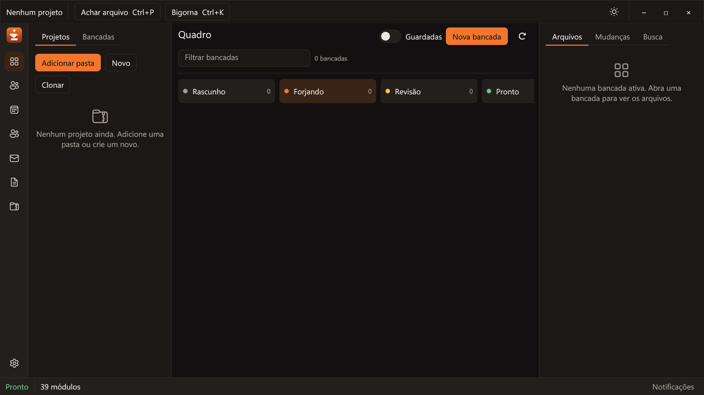
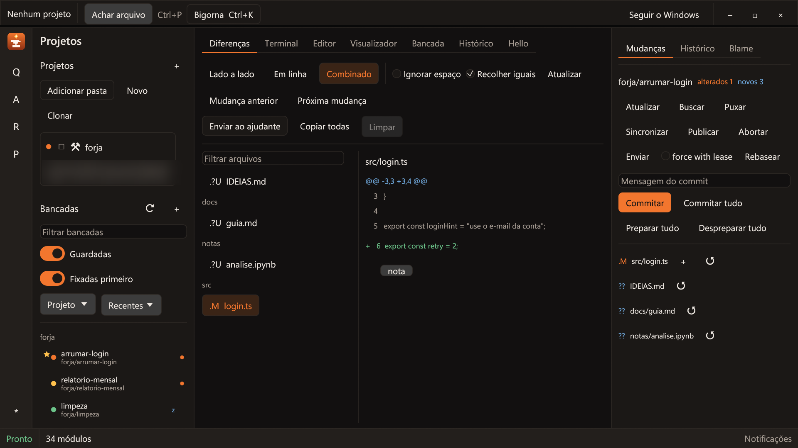
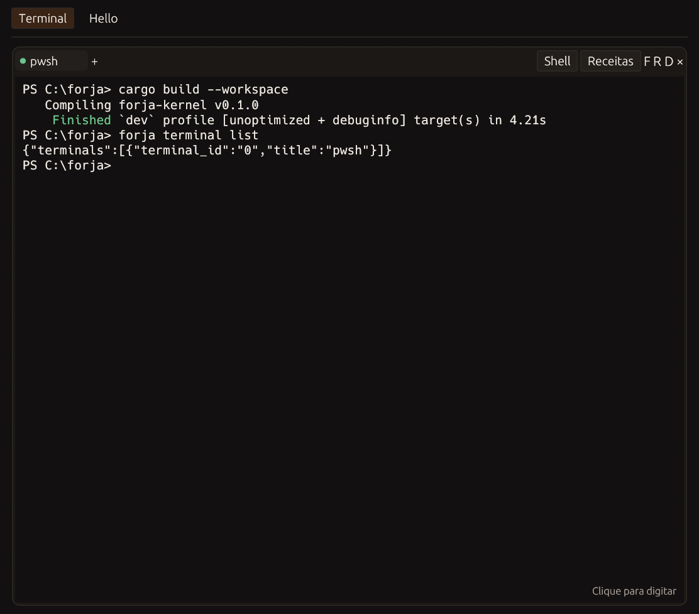
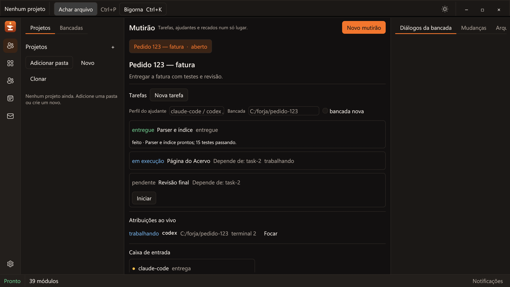
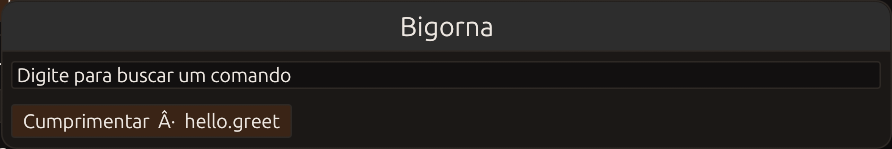

# Forja

**A oficina do desenvolvedor que trabalha com agentes de código.**

A Forja reúne num único aplicativo para Windows as linhas de trabalho com agentes de IA: bancadas isoladas sobre Git worktrees, terminais ConPTY, ajudantes em linha de comando, revisão de diffs com notas por linha, rotinas agendadas e o Mutirão, que coordena vários ajudantes. Os próprios agentes podem operar a Forja pelo CLI `forja` e pelo servidor MCP `forja-mcp`.

---

## Recursos Principais

- **Bancadas isoladas:** cada bancada é um checkout próprio, com branch, terminais e ajudantes. Quadro com as etapas Rascunho, Forjando, Revisão e Pronto.
- **Ajudantes:** perfis para Claude Code, Codex, OpenCode, Aider, Antigravity, Copilot e outros 10 (em `content/helpers/`). Modos de permissão `ask`, `accept-edits`, `automatic` e `full`.
- **Mutirão:** tarefas com dependências, caixa de recados, entregas com evidências, aprovação de plano e teto de custo em USD.
- **Revisão:** diffs com notas por linha que voltam ao ajudante, e pull/merge requests com checks.
- **Pedidos:** GitHub, GitLab, Jira, Linear e pedidos locais; o botão **Forjar** cria uma bancada a partir do pedido.
- **Rotinas, Acervo, Uso e Skills:** ações agendadas, busca em sessões antigas, consumo de tokens e skills de agentes.
- **Automação segura:** CLI `forja`, servidor MCP com aprovação por chamada, e aprovação de qualquer conteúdo que executa código pelo hash exato.
- **Tudo é arquivo:** comandos, receitas, temas, modelos, perfis e skills são arquivos de texto. Extensões Lua rodam em sandbox.
- **Local primeiro:** funciona offline; as integrações usam suas contas e o cofre do Windows.

O guia completo, com todas as páginas, abas, ajustes e atalhos, está em [docs/guia.md](docs/guia.md).

---

## Telas da Forja

### Quadro de Bancadas
Bancadas por etapa, com a branch, o ajudante e os pedidos ligados a cada uma.



### Editor e Diferenças
Revise o diff lado a lado ou unificado e envie notas por linha ao ajudante.



### Terminal ConPTY
Terminais com emulação VT, painéis divididos, busca, temas e receitas.



### Mutirão
Tarefas, dependências, ajudantes em execução e caixa de recados num só lugar.



### Bigorna (Paleta de Comandos)
Qualquer comando, bancada, ajuste ou arquivo pela busca da Bigorna (`Ctrl+K`).



---

## Requisitos

- **Windows 10 ou 11** (64 bits).
- **Git** no `PATH`.
- **WebView2 Runtime**, usado pela aba Navegador. Geralmente já vem instalado no Windows 11.
- **Opcionais:** os CLIs dos ajudantes (`claude`, `codex` etc.), o cliente `ssh` para destinos SSH, WSL para destinos WSL, e uma chave da OpenAI só para transcrição de voz. Tokens de GitHub, GitLab, Jira e Linear são informados em Ajustes. `gh` e `glab` não são necessários.
- **Para compilar:** toolchain Rust estável.

---

## Como Compilar e Rodar

### Executar a Forja
```sh
cargo run -p forja-app
```

### Operar pelo CLI `forja`
Com a Forja aberta, o CLI se comunica com ela por um named pipe:
```sh
cargo run -p forja-cli -- metodos    # catálogo de métodos RPC (depois de instalado: forja metodos)
cargo run -p forja-cli -- bench list # bancadas
cargo run -p forja-cli -- terminal open --cwd .
```
Se a Forja não estiver aberta, o CLI avisa e indica `forja abrir`.

### Servidor MCP `forja-mcp`
`forja-mcp` é um servidor MCP por stdio que repassa as chamadas à Forja aberta. `forja mcp setup` mostra os trechos de configuração para Claude Code, Codex e OpenCode; a Forja não grava nesses arquivos. Leituras ficam disponíveis por padrão, escritas precisam estar em `mcp.server.expose` e pedem aprovação por chamada, e ações destrutivas nunca são expostas.

### Testes e Verificação
```sh
cargo build
cargo test --workspace
cargo clippy --workspace --all-targets -- -D warnings
cargo xtask provenance
```

---

## Estrutura do Repositório

```
forja/
├── crates/
│   ├── kernel/          # Núcleo: contrato de módulos, slots, comandos, configurações, i18n, tarefas
│   ├── protocol/        # Tipos e schema do RPC, CLI e MCP
│   ├── ui-kit/          # Design system "Brasa" e componentes egui
│   ├── shell/           # O aplicativo (forja-app)
│   ├── cli/             # CLI forja, gerado a partir do catálogo de métodos
│   ├── mcp/             # forja-mcp, ponte MCP por stdio
│   ├── hook/            # forja-hook, que repassa eventos de status dos agentes
│   ├── contracts/       # Tipos compartilhados entre módulos
│   ├── counter-kit/     # Clientes e cofre dos balcões de pedidos
│   └── modules/<nome>/  # Um módulo por funcionalidade (bancadas, terminal, muster, git...)
├── content/             # Conteúdo autoral embutido
│   ├── commands/        # Comandos da Bigorna e do chat (*.md)
│   ├── helpers/         # Perfis TOML de detecção e início de agentes
│   ├── recipes/         # Receitas de build, teste, lint e formatação para Go, Node, Python e Rust
│   ├── skills/          # Skills no formato aberto SKILL.md
│   ├── templates/       # Modelos (forja.toml, AGENTS.md, PR, recados, entregas)
│   └── themes/          # Temas de interface e terminal
├── extensions/          # Extensões Lua de exemplo
├── design/              # Produto, marca, UI, contratos e relatórios
├── docs/                # Guias de uso e documentação técnica
└── xtask/               # Ferramentas de desenvolvimento (new-module, provenance, package)
```

---

## Documentação

- [Guia da Forja (Português)](docs/guia.md)
- [User Guide (English)](docs/guide.md)
- [Como criar módulos Rust](docs/modules.md)
- [Extensões e conteúdo](docs/extensions.md)
- [Livro do produto e vocabulário](design/product.md)
- [Diretrizes de autoria](AGENTS.md)
- [Manual da identidade visual](design/brand.md)

---

## Licença

Distribuído sob a licença [Apache-2.0](LICENSE).
