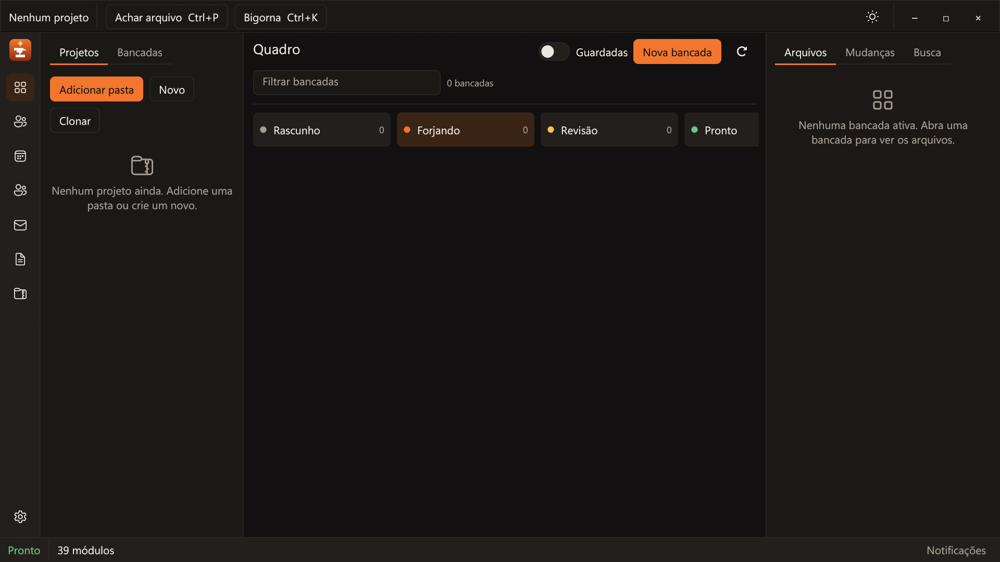
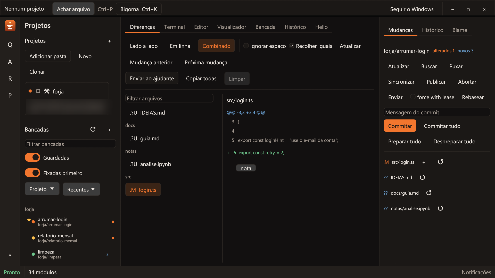
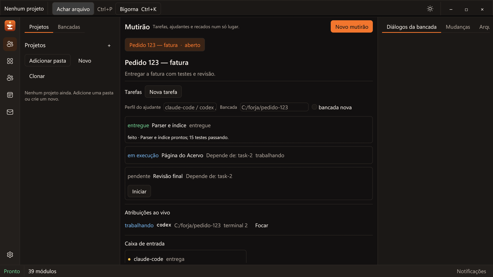
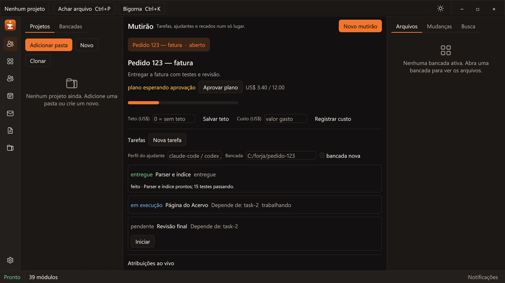
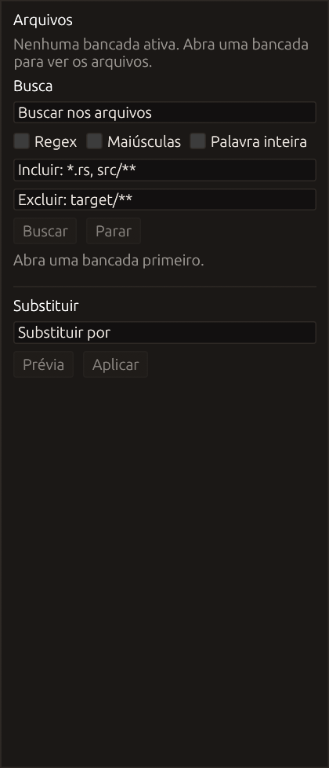
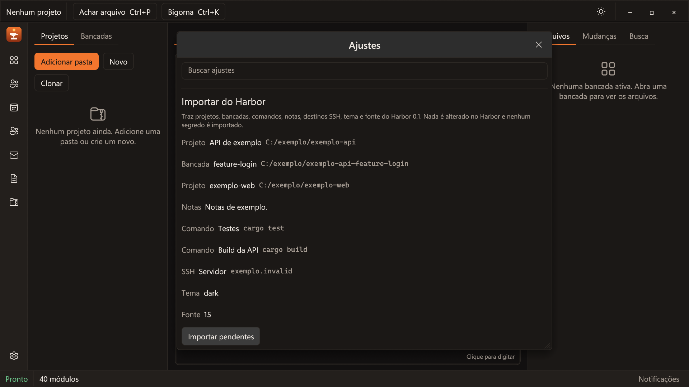
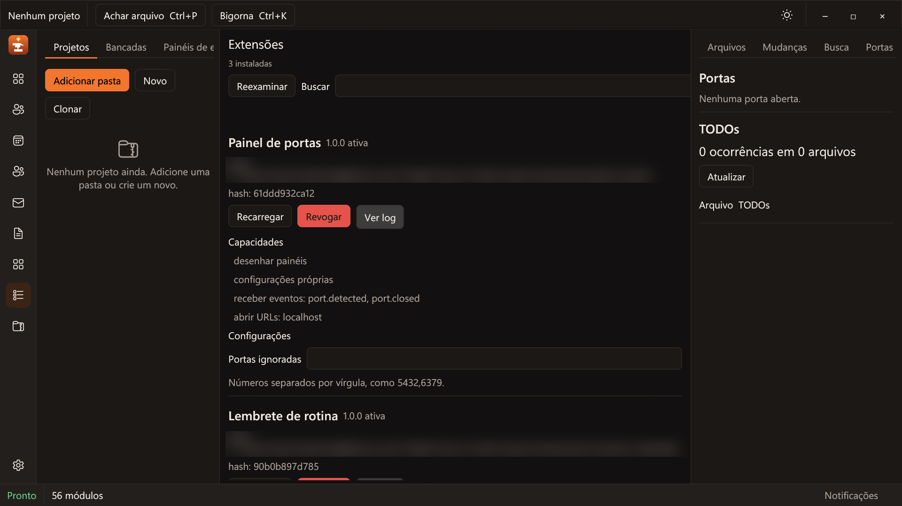

# Guia da Forja

Bem-vindo à **Forja**, a oficina do desenvolvedor que trabalha com agentes de código. Este guia descreve o que o aplicativo faz hoje: páginas do trilho, abas da bancada, painel direito, Ajustes, o CLI `forja`, o servidor MCP, extensões e os dados que ficam no seu computador.

---

## 1. Primeiros Passos

### 1.1 Conceitos
- **Projeto:** uma pasta que a Forja conhece (repositório Git ou pasta comum).
- **Bancada:** uma linha de trabalho isolada, com um checkout próprio (Git worktree), uma branch, terminais e ajudantes. A **bancada principal** é o checkout original do projeto.
- **Ajudante:** um agente de código em linha de comando (Claude Code, Codex, OpenCode, Aider, Antigravity, Copilot e outros) rodando numa bancada.
- **Pedido:** uma issue, pull request ou ticket de um balcão (GitHub, GitLab, Jira, Linear) ou um pedido local.
- **Etapa:** a fase de uma bancada no Quadro: Rascunho, Forjando, Revisão e Pronto.
- **Mutirão:** um coordenador divide um objetivo em tarefas e despacha ajudantes para bancadas próprias.
- **Bigorna:** a paleta de comandos (`Ctrl+K`), onde se busca e executa qualquer ação.

### 1.2 Requisitos
- **Obrigatórios:** Windows 10 ou 11 (64 bits) e **Git** no `PATH`.
- **WebView2 Runtime:** usado pela aba **Navegador**. Costuma já vir no Windows 11; no Windows 10, instale-o se faltar.
- **Opcionais:**
  - CLIs dos ajudantes (`claude`, `codex`, `opencode` etc.). A Forja detecta os executáveis instalados.
  - Cliente OpenSSH (`ssh`) para destinos SSH, e WSL para destinos WSL.
  - Token de GitHub, GitLab, Jira ou Linear, informado em **Ajustes > Pedidos e balcões**. Os tokens ficam no cofre do Windows. `gh` e `glab` **não são necessários**.
  - Chave da OpenAI, só se você quiser transcrição de voz.

### 1.3 Primeira execução
Abra a Forja e siga o cartão de primeiro uso, que aparece sozinho até ser concluído. Ele pode importar dados do Harbor (seção 11.6). Para rodar a partir do código:
```sh
cargo run -p forja-app
```

---

## 2. A Janela

- **Barra superior:** projeto e bancada atuais, **Achar arquivo** (`Ctrl+P`), **Bigorna** (`Ctrl+K`) e controles de tema e janela.
- **Trilho (esquerda):** as páginas da Forja (seção 3).
- **Barra lateral:** abas **Projetos** e **Bancadas**, com agrupar, ordenar, filtrar e fixar.
- **Área central:** as abas da bancada (seção 4), ou a página escolhida no trilho.
- **Painel direito:** **Arquivos**, **Mudanças**, **Busca** e **Portas** (seção 5).
- **Barra de status:** estado da Forja, avisos de ajudantes e **Notificações**.



---

## 3. Páginas do Trilho

| Página | Para que serve |
|---|---|
| **Quadro** | Bancadas em colunas por etapa. Mostra a branch, o ajudante e os pedidos ligados a cada uma. Botão **Nova bancada** e filtro de guardadas. |
| **Pedidos** | Pedidos dos balcões, com filtros **Meus**, **Para revisar**, **Abertos**, **Recentes** e **Todos**. Botão **Forjar** cria a bancada (seção 6). |
| **Ajudantes** | Perfis de ajudante, detecção de instalação e início de sessões. |
| **Rotinas** | Ações agendadas por cron, com histórico de execuções (seção 7). |
| **Mutirão** | Coordenação multiajudante, com plano, orçamento e caixa de recados (seção 8). |
| **Acervo** | Busca em texto completo nas sessões antigas de todos os ajudantes, com retomada e exclusão. |
| **Skills** | Skills da Forja e dos ajudantes (pastas com `SKILL.md`). Instalar, copiar e remover pedem confirmação. |
| **Uso** | Tokens por dia, por modelo, por projeto e sessões recentes, lidos das transcrições locais de Claude, Codex e OpenCode. |
| **Extensões** | Estado, capacidades, aprovação, revogação, configurações e log de cada extensão Lua (seção 10). |

A página **Ajustes** fica no canto inferior do trilho.

---

## 4. Projetos e Bancadas

### 4.1 Criar e organizar
- **Adicionar pasta** registra uma pasta existente. **Clonar** traz um repositório. **Novo** cria um projeto.
- **Nova bancada** (`Ctrl+Shift+N`) cria um worktree com branch própria, a partir do projeto.
- **Guardar bancada** (`bench.store`) roda o script de desmonte, encerra os terminais e pergunta se a branch local deve ficar ou sair.

### 4.2 Etapas
1. **Rascunho:** definição da linha de trabalho.
2. **Forjando:** desenvolvimento ativo, por você ou pelos ajudantes.
3. **Revisão:** diffs, notas, testes e linters.
4. **Pronto:** verificado e pronto para merge ou pull request.

Projetos podem acrescentar etapas próprias. Arrastar um cartão no Quadro muda a etapa; voltar exige confirmação.

### 4.3 O `forja.toml`
Na raiz do projeto, o `forja.toml` define o ciclo de vida das bancadas:
```toml
schema_version = 1

# Roda na pasta da nova bancada (precisa de aprovação)
setup = "cargo check"

# Roda antes de guardar a bancada
teardown = ""

# Abas abertas ao criar a bancada
tabs = ["terminal", "helper"]
```
Setup e teardown só rodam depois da sua aprovação. A Forja guarda a aprovação pelo hash SHA-256 do conteúdo: se o script mudar, ele pede aprovação de novo.

---

## 5. Abas da Bancada

| Aba | O que faz |
|---|---|
| **Terminal** | Terminais ConPTY com emulação VT, divisão em painéis, busca, links, temas próprios e receitas. |
| **Ajudante** | Sessão do agente, em modo TUI (no terminal) ou **Ajudante (chat)**, que lê a transcrição ao vivo e envia mensagens pelo modo headless do perfil. Comandos do agente vão como `/nome`. |
| **Editor** | Editor de arquivos da bancada, com busca e substituição, renomear símbolo, formatação e comparação com o disco. |
| **Diferenças** | Diffs da bancada, lado a lado ou unificados, com realce de sintaxe e estatísticas por arquivo. |
| **Visualizador** | Visualização somente leitura de arquivos (por exemplo, tabelas). |
| **Revisão** | Pull request ou merge request da branch: gerar título e descrição, abrir, ver checks e threads, responder, resolver e fazer merge. |
| **Navegador** | Navegador embutido (WebView2) com abas, histórico, busca, zoom e diagramas Mermaid offline. |

### 5.1 Fluxo de revisão
1. Na aba **Diferenças**, clique numa linha e escreva uma nota (ex.: *"Trate o token expirado antes do refresh"*).
2. Clique em **Enviar notas ao ajudante**.
3. O ajudante recebe as notas como dados estruturados, faz a correção e roda os testes.
4. Na aba **Revisão**, abra o pull request e acompanhe os checks. Se um check falhar, use **Consertar com ajudante**.



---

## 6. Ajudantes e Pedidos

### 6.1 Perfis e permissões
- A Forja traz 16 perfis embutidos (`content/helpers/`). Perfis próprios vão em `~/.forja/helpers/<id>.toml`.
- Ao iniciar um ajudante você escolhe a permissão:
  - `ask`: pede confirmação antes de editar ou rodar comandos.
  - `accept-edits`: edita arquivos do projeto sem perguntar; comandos de terminal ainda pedem confirmação.
  - `automatic`: roda comandos padrão do projeto. Exige que a pasta esteja confiável.
  - `full`: sem restrições. Use só em ambientes isolados.
- O padrão fica em **Ajustes > Ajudantes > Permissões padrão**.
- Atalhos: `Ctrl+Shift+A` inicia o ajudante padrão, `Ctrl+Shift+H` foca o ajudante da bancada.
- Estados: **Trabalhando**, **Precisa de você** (espera resposta ou aprovação) e **Ocioso / Terminou**.

### 6.2 Contas
Em **Ajustes > Contas** você pode ter mais de uma conta por ajudante, cada uma com a própria pasta de configuração. A conta ativa é injetada no ambiente do ajudante ao iniciar. Remover uma conta só apaga a pasta dela, depois de confirmação.

### 6.3 Do pedido à entrega
1. Abra **Pedidos** no trilho e escolha um pedido.
2. Clique em **Forjar**.
3. A Forja cria uma bancada com branch a partir do título (ex.: `pedido-102-autenticacao-jwt`).
4. O setup do `forja.toml` roda, se aprovado.
5. As abas configuradas abrem e o ajudante começa com o título, a descrição e o contexto do pedido no prompt.

Balcões são conectados em **Ajustes > Pedidos e balcões**. O token só é enviado ao host configurado; outro host é recusado antes de qualquer requisição.

---

## 7. Rotinas

Uma **rotina** é uma ação agendada, com cron ou horário fixo, que roda um prompt de ajudante ou um comando numa bancada fixa ou efêmera.

Exemplos:
- Auditoria noturna de dependências (`cargo audit`, `npm audit`).
- Varredura periódica de código morto ou de linters.
- Checagem matinal de sincronização com a branch remota.

Cada rotina guarda o histórico de execuções. Notificações de sucesso e de falha podem ser ligadas ou desligadas separadamente nos Ajustes.

---

## 8. Mutirão



O **Mutirão** coordena vários ajudantes para um objetivo.

1. **Novo mutirão:** título e objetivo.
2. **Nova tarefa:** título, especificação e dependências. A tarefa B só inicia quando a A for entregue.
3. **Plano:** com `muster.plan.require_approval` ligado (padrão), o mutirão não inicia tarefas até você clicar em **Aprovar plano**. `muster.plan.max_tasks` limita o número de tarefas.
4. **Iniciar:** escolha o perfil do ajudante e a bancada, já pronta. O ajudante recebe um preâmbulo com as regras do mutirão.
5. **Recados:** o ajudante pergunta ao coordenador com um recado do tipo `pergunta`. Recados vão para a caixa de entrada. Se o ajudante estiver ocupado, o recado do coordenador fica na fila.
6. **Entrega:** o ajudante entrega com `feito`, `falhou` ou `bloqueado`, um resumo e evidências (testes e arquivos). Com `muster.handoff.require_evidence` ligado, a evidência é obrigatória.
7. **Alerta:** se um ajudante para sem entregar, a Forja cria um alerta e marca a tarefa como bloqueada.

**Orçamento:** cada mutirão tem um teto em USD (`budget_usd`, ou `muster.budget.max_usd`). O custo é registrado com `muster.spend`, e `muster.start` recusa novas tarefas quando o teto é atingido. A página mostra o consumo em barra.



---

## 9. Acervo, Uso e Skills

- **Acervo:** indexa as sessões de todos os ajudantes. Busque comandos antigos, trechos sugeridos e decisões. Retome uma sessão ou crie uma bifurcação (*fork*) dela.
- **Uso:** tokens por dia, modelo, projeto e sessão, calculados a partir das transcrições locais dos ajudantes.
- **Skills:** pastas com `SKILL.md`, da Forja e dos ajudantes. Instalar ou copiar uma skill em outra raiz pede consentimento, e uma skill substituída vai para a lixeira.

---

## 10. Painel Direito

- **Arquivos:** árvore da bancada, com criar, renomear, duplicar, mover para a lixeira, copiar caminho e abrir terminal na pasta. Tem desfazer e refazer.
- **Mudanças:** arquivos alterados, com histórico do grafo de commits, blame, stage, commit, push, pull e sincronização.
- **Busca:** busca nos arquivos da bancada (`Ctrl+Shift+F`), com substituição, prévia e confirmação.
- **Portas:** portas TCP em escuta, o processo dono, a bancada provável e a opção de encerrar o processo, com confirmação.



---

## 11. Ajustes

Os Ajustes são gerados a partir do catálogo de configurações, agrupado por tema: Aparência, Bancadas, Terminal, Editor, Ajudantes, Mutirão, Rotinas, Pedidos e balcões, Integrações, Remoto (SSH/WSL), Extensões, Privacidade e Avançado. Seções próprias incluem Contas, Aprovações de confiança, Servidor MCP, Voz, Importar do Harbor e uma seção por balcão (GitHub, GitLab, Jira, Linear).

### 11.1 Privacidade
Histórico (com retenção), limpeza automática da área de transferência após um prazo, redação de segredos nos logs, cofre de segredos com bloqueio por inatividade e uso calculado só localmente. As configurações de privacidade ficam na máquina.

### 11.2 Rede
Modo do proxy (`network.proxy.mode`), URL, exceções de hosts, autenticação do proxy, verificação TLS, tempo limite HTTP e **modo offline** (`network.mode.offline`), que bloqueia requisições de rede.

### 11.3 Confiança
Qualquer conteúdo que executa código vindo do projeto ou de uma extensão (scripts do `forja.toml`, receitas, comandos, extensões e perfis de ajudante) é aprovado pelo hash exato do arquivo. O diálogo oferece **Aprovar uma vez** (só nesta sessão), **Aprovar este conteúdo** (guardado) ou **Recusar**. Qualquer mudança no arquivo muda o hash e pede aprovação de novo. Em **Ajustes > Aprovações de confiança** você vê todas as decisões e pode revogá-las.

### 11.4 MCP
O servidor MCP (`forja-mcp`) expõe a Forja aos agentes (seção 12.2). Em **Ajustes > Servidor MCP**:
- Leituras ficam disponíveis por padrão. Escritas só entram na lista `mcp.server.expose`. Ações destrutivas nunca são expostas.
- Cada escrita exposta pede aprovação, no diálogo **Aprovar chamada MCP**: **Permitir uma vez**, **Permitir até a Forja fechar** ou **Recusar**. Sem resposta dentro de `mcp.server.timeout_s`, a chamada é negada.
- `mcp.server.auto_approve` dispensa a pergunta só para escritas de baixo risco.

### 11.5 Remoto
Destinos SSH e WSL: um host salvo, importado do `~/.ssh/config` ou criado na tela. Senhas e passphrases ficam com o `ssh` e com o agente, não com a Forja. Também há teste de conexão e encaminhamento de portas locais.

### 11.6 Importação do Harbor
O Harbor é o nosso aplicativo anterior. O importador lê `session.json` e `settings.json` de `%APPDATA%\Harbor`, sem alterar nada lá, e importa o que você escolher:

- projetos e bancadas (worktrees que já existem);
- quick commands, como receitas em `~/.forja/recipes/imported.toml`;
- notas, em `~/.forja/imported-notes.md` (nunca sobrescreve um arquivo existente);
- destinos SSH, tema claro/escuro e tamanho da fonte do terminal.

Tokens e segredos do Harbor **não** são lidos. Você reconecta os balcões na Forja. Importar de novo não duplica nada. Pode ser feito no cartão de primeiro uso ou em **Ajustes > Importar do Harbor**.



---

## 12. CLI `forja` e Servidor MCP

### 12.1 CLI `forja`
O CLI conversa com o aplicativo aberto por um named pipe. Ele é gerado a partir do catálogo de métodos, então todo método RPC vira um comando.

```sh
forja metodos                  # catálogo resumido (--json para o completo)
forja bench list               # bancadas
forja bench create --project_id <id> --name "feature-auth"
forja terminal open --cwd .    # abre um terminal
forja terminal read --terminal_id 1 --lines 20
forja helper list
forja helper launch --profile_id claude-code --bench_path <pasta> --prompt "Corrija o lint" --permission ask
forja muster run --title "Entrega" --objective "Fechar a v1"
forja muster status
forja archive search --query "migração"
forja mcp setup                # snippets de configuração de MCP
forja abrir                    # abre a Forja
```

Formas equivalentes: `forja bench.list` e `forja bench list` chamam o mesmo método. `--json` devolve o resultado em JSON. Se a Forja não estiver aberta, o CLI avisa e pede `forja abrir`.

### 12.2 Servidor MCP (`forja-mcp`)
`forja-mcp` é um servidor MCP por stdio: o cliente (Claude Code, Codex, OpenCode) o inicia e ele repassa cada chamada à Forja pelo named pipe. As ferramentas têm nomes como `forja.bench.list` e `forja.git.status`.

- `forja mcp setup` mostra os trechos de configuração para Claude Code (JSON `mcpServers`), Codex (TOML `mcp_servers`) e OpenCode (JSON `mcp`).
- A Forja **não escreve** nesses arquivos. Você copia o trecho.
- As regras de exposição e de aprovação por chamada estão na seção 11.4.

---

## 13. Extensões e Conteúdo ("Tudo é Arquivo")

### 13.1 Conteúdo em arquivos
Comandos, receitas, temas, modelos, perfis de ajudante, skills e atalhos são arquivos de texto. Não precisa compilar nada.

| Pasta | O que define | Formato |
|---|---|---|
| `commands/*.md` | Comandos da Bigorna e do `/comando` do chat | frontmatter TOML entre `+++` + Markdown |
| `recipes/*.toml` | Receitas de terminal | `[[recipe]]` |
| `helpers/*.toml` | Perfis de ajudante | TOML de perfil |
| `skills/<nome>/SKILL.md` | Skills | frontmatter YAML + Markdown |
| `themes/*.toml` | Temas de interface e terminal | paleta e 16 cores ANSI |
| `templates/*.md` | Modelos de arquivo (PR, recado, entrega) | frontmatter + Markdown |
| `keymaps/*.toml` | Pacotes de atalhos | `[[binding]]` |
| `extensions/<id>/` | Extensões Lua | `extension.toml` + `init.lua` |

Há três camadas: o embutido em `content/` é a base; `~/.forja/` substitui o embutido; `<projeto>/.forja/` substitui o do usuário. `~/.forja/keymap.toml` tem a palavra final nos atalhos. Comandos e receitas de projeto que executam algo também precisam de aprovação (seção 11.3).

### 13.2 Extensões Lua
Uma extensão é uma pasta com `extension.toml` e `init.lua`, em `~/.forja/extensions/<id>/` ou `<projeto>/.forja/extensions/<id>/`.

- **Sandbox:** sem `os`, `io`, `require`, `debug` e afins. Memória e tempo de CPU são limitados.
- **Capacidades declaradas:** comandos, painéis, configurações, eventos, `terminal.send`, `git.read`, `fs.read`, `fs.write`, `http` e `ui.open_url`. Sem a capacidade, a função responde `capability_denied`.
- **Aprovação:** pelo hash da pasta inteira. Qualquer byte novo muda o estado para *alterada*, e a extensão para até você aprovar de novo.
- **Página Extensões:** estado (*pendente*, *ativa*, *alterada*, *inválida*, *suspensa*, *conflito*), capacidades, erros e log em `%APPDATA%\Forja\logs\extensions\<id>.log`.
- **Desenvolvimento:** com `extension.dev.watch` ligado, uma extensão em `~/.forja/extensions/` recarrega sozinha quando as capacidades não mudam.



Veja `docs/extensions.md` para o formato completo, a API Lua e as receitas.

---

## 14. Atalhos do Teclado

| Tecla | Ação |
|---|---|
| `Ctrl+K` | Bigorna (paleta de comandos) |
| `Ctrl+Shift+P` | Bigorna já filtrando comandos |
| `Ctrl+P` | Achar arquivo |
| `Ctrl+Shift+F` | Buscar nos arquivos |
| `Ctrl+Shift+N` | Nova bancada |
| `Alt+1` … `Alt+0` | Ir para a bancada 1 a 10 |
| `Alt+PageDown` / `Alt+PageUp` | Próxima / bancada anterior |
| `Ctrl+Tab` / `Ctrl+Shift+Tab` | Próxima / aba anterior |
| `Ctrl+1` … `Ctrl+0` | Ir para a aba 1 a 10 |
| `Ctrl+W` / `Ctrl+Shift+W` | Fechar aba (no terminal, use `Ctrl+Shift+W`) |
| `Ctrl+Shift+T` | Reabrir aba fechada |
| `` Ctrl+` `` | Mostrar ou ocultar o terminal |
| `Ctrl+B` / `Ctrl+Shift+B` | Mostrar ou ocultar a barra lateral / o painel direito |
| `Ctrl+Shift+A` | Iniciar o ajudante padrão |
| `Ctrl+Shift+H` | Focar o ajudante da bancada |
| `Ctrl+Shift+M` | Abrir o Mutirão |
| `Ctrl+Shift+D` | Abrir Diferenças |
| `Ctrl+Alt+V` | Ditado por voz |
| `Ctrl+,` | Ajustes |
| `Ctrl+Shift+,` | Mapa de atalhos |
| `Ctrl+Shift+/` | Lista de todos os atalhos |

Os atalhos seguem o padrão do Windows e podem ser trocados em `~/.forja/keymap.toml`.

---

## 15. Onde Ficam os Dados

- **Estado e preferências:** `%APPDATA%\Forja\`: `settings.toml`, o estado de cada módulo, as aprovações, os logs, o histórico do navegador, os perfis do WebView2 e as contas dos ajudantes. Para trocar a pasta, use `FORJA_DATA_DIR`.
- **Conteúdo do usuário:** `%USERPROFILE%\.forja\`: receitas, comandos, temas, skills, extensões e perfis globais. Para trocar a pasta, use `FORJA_CONTENT_DIR`.
- **Conteúdo do projeto:** `<projeto>\.forja\` e `<projeto>\forja.toml`, feitos para ir junto com o código no Git.
- **Bancadas:** worktrees do Git. A Forja não escreve fora das pastas dela sem seu consentimento registrado.
- **Harbor:** `%APPDATA%\Harbor` é só lido.
