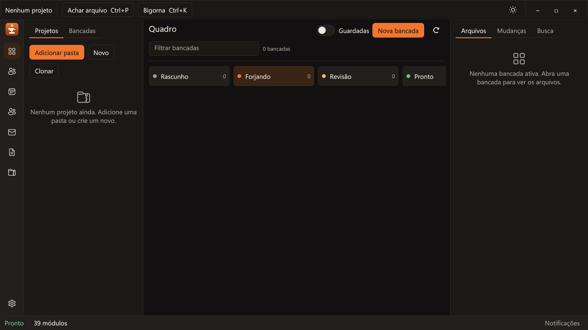
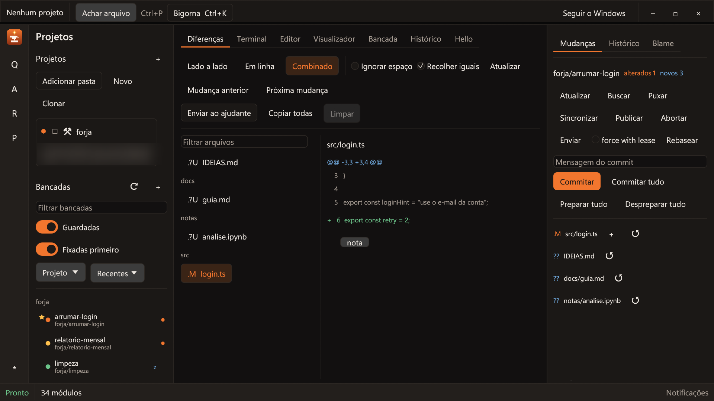
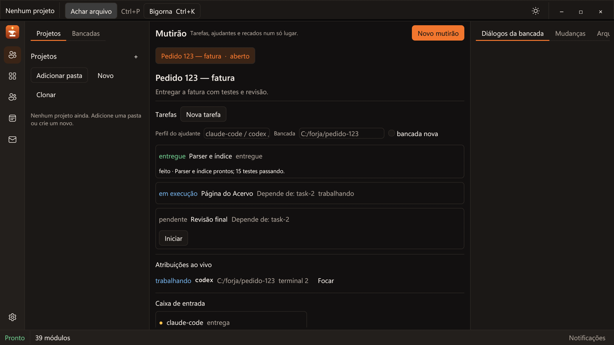
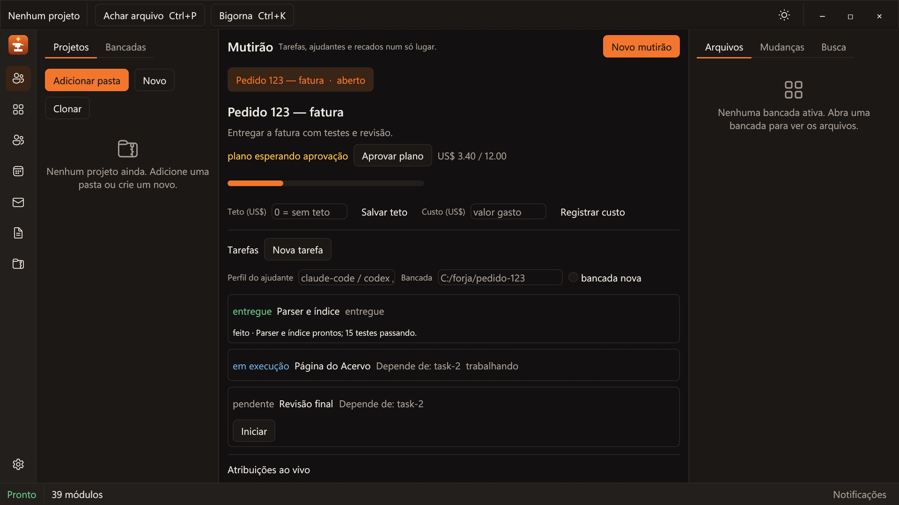
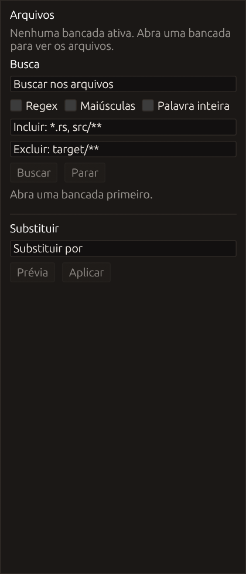
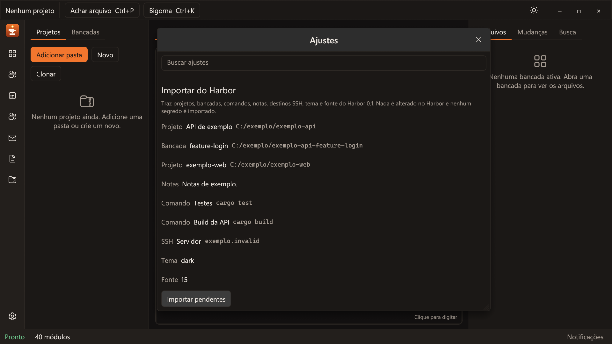
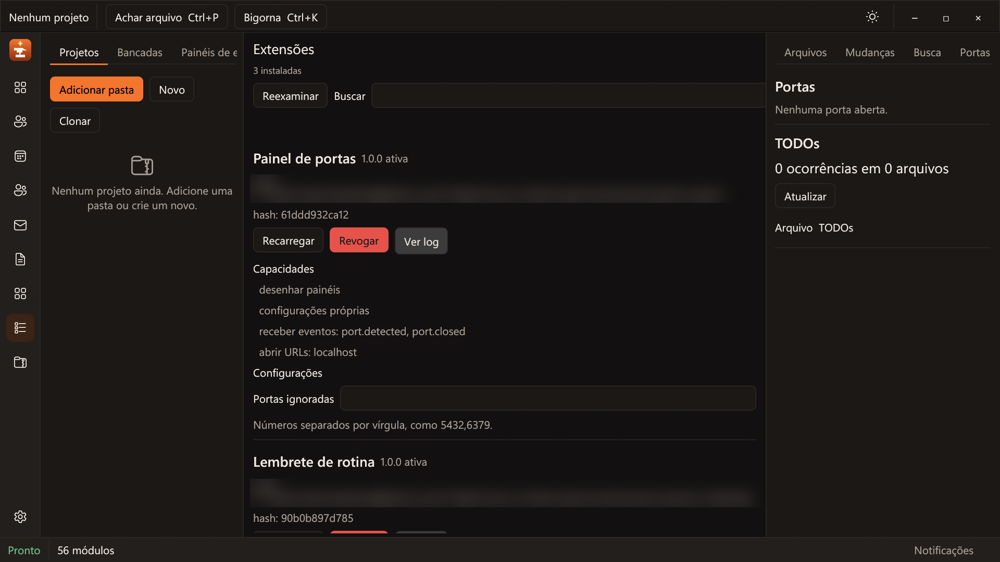

# Forja User Guide

Welcome to **Forja**, the workshop for developers who work with coding agents. This guide describes what the app does today: rail pages, bench tabs, the right panel, Settings, the `forja` CLI, the MCP server, extensions, and the data kept on your computer.

> The interface is available in pt-BR and en. Screenshots show the pt-BR interface.

---

## 1. Getting Started

### 1.1 Concepts
- **Project:** a folder Forja knows about (a Git repository or a plain folder).
- **Bench (Bancada):** an isolated line of work with its own checkout (a Git worktree), branch, terminals, and helpers. The **main bench** is the project's original checkout.
- **Helper (Ajudante):** a command-line coding agent (Claude Code, Codex, OpenCode, Aider, Antigravity, Copilot, and others) running in a bench.
- **Request (Pedido):** an issue, pull request, or ticket from a counter (GitHub, GitLab, Jira, Linear) or a local request.
- **Stage (Etapa):** a bench's phase on the Board: Draft (Rascunho), Forging (Forjando), Review (Revisão), and Ready (Pronto).
- **Muster (Mutirão):** a coordinator splits a goal into tasks and dispatches helpers, each in its own bench.
- **Anvil (Bigorna):** the command palette (`Ctrl+K`), where you search for and run any action.

### 1.2 Requirements
- **Required:** Windows 10 or 11 (64-bit) and **Git** on the `PATH`.
- **WebView2 Runtime:** used by the **Browser** tab. It usually ships with Windows 11; on Windows 10, install it if it is missing.
- **Optional:**
  - Helper CLIs (`claude`, `codex`, `opencode`, and so on). Forja detects the executables that are installed.
  - An OpenSSH client (`ssh`) for SSH targets, and WSL for WSL targets.
  - A GitHub, GitLab, Jira, or Linear token, entered in **Settings > Requests and counters**. Tokens are kept in the Windows credential store. You do **not** need `gh` or `glab`.
  - An OpenAI key, only if you want voice transcription.

### 1.3 First run
Open Forja and follow the first-run card, which opens by itself until you finish it. It can import data from Harbor (section 11.6). To run from source:
```sh
cargo run -p forja-app
```

---

## 2. The Window

- **Top bar:** the current project and bench, **Find file** (`Ctrl+P`), **Anvil** (`Ctrl+K`), and theme and window controls.
- **Rail (left):** Forja's pages (section 3).
- **Sidebar:** the **Projects** and **Benches** tabs, with grouping, sorting, filtering, and pinning.
- **Center:** the bench tabs (section 4), or the page you picked on the rail.
- **Right panel:** **Files**, **Changes**, **Search**, and **Ports** (section 10).
- **Status bar:** Forja's state, helper notices, and **Notifications**.



---

## 3. Rail Pages

| Page | What it is for |
|---|---|
| **Board (Quadro)** | Benches in columns by stage. Shows the branch, the helper, and the requests linked to each bench. **New bench** button and a stored-benches filter. |
| **Requests (Pedidos)** | Requests from the counters, with the filters **Mine**, **To review**, **Open**, **Recent**, and **All**. The **Forjar** button creates a bench (section 6). |
| **Helpers (Ajudantes)** | Helper profiles, install detection, and starting sessions. |
| **Routines (Rotinas)** | Scheduled actions (cron), with run history (section 7). |
| **Muster (Mutirão)** | Multi-helper coordination with a plan, a budget, and a note inbox (section 8). |
| **Archive (Acervo)** | Full-text search across the past sessions of every helper, with resume and delete. |
| **Skills** | Skills from Forja and from helpers (folders with `SKILL.md`). Install, copy, and remove ask for confirmation. |
| **Usage (Uso)** | Tokens by day, model, and project, plus recent sessions, read from the local transcripts of Claude, Codex, and OpenCode. |
| **Extensions (Extensões)** | State, capabilities, approval, revocation, settings, and the log of each Lua extension (section 13). |

The **Settings** page sits at the bottom of the rail.

---

## 4. Projects and Benches

### 4.1 Create and organize
- **Add folder** registers an existing folder. **Clone** brings in a repository. **New** creates a project.
- **New bench** (`Ctrl+Shift+N`) creates a worktree with its own branch from the project.
- **Store bench** (`bench.store`) runs the teardown script, closes the terminals, and asks whether to keep or remove the local branch.

### 4.2 Stages
1. **Draft (Rascunho):** scoping the line of work.
2. **Forging (Forjando):** active development by you or by helpers.
3. **Review (Revisão):** diffs, notes, tests, and linters.
4. **Ready (Pronto):** verified and ready to merge or open as a pull request.

A project can add its own stages. Dragging a card on the Board changes its stage; moving backward asks for confirmation.

### 4.3 The `forja.toml` file
At the root of a project, `forja.toml` defines the bench lifecycle:
```toml
schema_version = 1

# Runs in the new bench folder (needs approval)
setup = "cargo check"

# Runs before the bench is stored
teardown = ""

# Tabs opened when the bench is created
tabs = ["terminal", "helper"]
```
Setup and teardown run only after you approve them. Forja records the approval by the SHA-256 hash of the content, so a changed script asks for approval again.

---

## 5. Bench Tabs

| Tab | What it does |
|---|---|
| **Terminal** | ConPTY terminals with VT emulation, split panes, search, links, custom themes, and recipes. |
| **Helper** | The agent session, in TUI mode (inside the terminal) or **Helper (chat)**, which reads the transcript live and sends messages through the profile's headless mode. Agent commands are sent as `/name`. |
| **Editor** | The bench's file editor, with find and replace, rename symbol, formatting, and compare with disk. |
| **Diff (Diferenças)** | The bench's diffs, side by side or unified, with syntax highlighting and per-file stats. |
| **Viewers (Visualizador)** | Read-only views of files (for example, tables). |
| **Review (Revisão)** | The branch's pull or merge request: generate a title and description, open it, see checks and threads, reply, resolve, and merge. |
| **Browser (Navegador)** | The embedded browser (WebView2), with tabs, history, find, zoom, and offline Mermaid diagrams. |

### 5.1 Review loop
1. In the **Diff** tab, click a line and write a note (for example, *"Handle an expired token before the refresh"*).
2. Click **Send notes to helper**.
3. The helper receives the notes as structured data, makes the fix, and runs the tests.
4. In the **Review** tab, open the pull request and follow the checks. If a check fails, use **Fix with helper**.



---

## 6. Helpers and Requests

### 6.1 Profiles and permissions
- Forja ships 16 built-in helper profiles (`content/helpers/`). Your own profiles go in `~/.forja/helpers/<id>.toml`.
- When you start a helper, choose its permission:
  - `ask`: asks before it edits or runs commands.
  - `accept-edits`: edits project files without asking; terminal commands still ask.
  - `automatic`: runs the project's standard commands. Requires a trusted folder.
  - `full`: no restrictions. Use only in isolated environments.
- The default lives in **Settings > Helpers > Default permissions**.
- Shortcuts: `Ctrl+Shift+A` starts the default helper, and `Ctrl+Shift+H` focuses the bench's helper.
- States: **Working**, **Needs you** (waiting for an answer or approval), and **Idle / Done**.

### 6.2 Accounts
In **Settings > Accounts** you can have more than one account per helper, each with its own configuration folder. The active account is injected into the helper's environment when it starts. Removing an account deletes only its folder, after confirmation.

### 6.3 From request to delivery
1. Open **Requests** on the rail and pick a request.
2. Click **Forjar**.
3. Forja creates a bench whose branch comes from the title (for example, `pedido-102-autenticacao-jwt`).
4. The `forja.toml` setup runs, if approved.
5. The configured tabs open, and the helper starts with the request's title, description, and context in its prompt.

Counters are connected in **Settings > Requests and counters**. A token is sent only to the configured host; any other host is refused before a request is made.

---

## 7. Routines

A **routine** is a scheduled action (cron or a fixed time) that runs a helper prompt or a command in a fixed or temporary bench.

Examples:
- A nightly dependency audit (`cargo audit`, `npm audit`).
- A periodic dead-code or linter sweep.
- A morning check of sync with the remote branch.

Each routine keeps a run history. Success and failure notifications can be turned on or off separately in Settings.

---

## 8. Muster



A **Muster** coordinates several helpers toward one goal.

1. **New muster:** a title and an objective.
2. **New task:** a title, a specification, and dependencies. Task B starts only after task A is delivered.
3. **Plan:** with `muster.plan.require_approval` on (the default), the muster starts no tasks until you click **Approve plan**. `muster.plan.max_tasks` limits the number of tasks.
4. **Start:** pick the helper profile and an existing, ready bench. The helper receives a preamble with the muster's rules.
5. **Notes:** a helper asks the coordinator with a note of kind `question`. Notes go to the coordinator's inbox. If a helper is busy, a note from the coordinator waits in a queue.
6. **Handoff:** a helper delivers with `done`, `failed`, or `blocked`, a summary, and evidence (tests and files). With `muster.handoff.require_evidence` on, evidence is required.
7. **Alert:** if a helper stops without delivering, Forja raises an alert and marks the task as blocked.

**Budget:** each muster has a cap in USD (`budget_usd`, or `muster.budget.max_usd`). Cost is recorded with `muster.spend`, and `muster.start` refuses to start new tasks once the cap is reached. The page shows consumption as a bar.



---

## 9. Archive, Usage, and Skills

- **Archive (Acervo):** indexes the sessions of every helper. Search for old commands, suggested snippets, and decisions. Resume a session or fork it.
- **Usage (Uso):** tokens by day, model, project, and session, computed from the helpers' local transcripts.
- **Skills:** folders with `SKILL.md`, from Forja and from helpers. Installing or copying a skill into a root Forja does not own asks for consent, and a replaced skill goes to the Recycle Bin.

---

## 10. Right Panel

- **Files:** the bench's tree, with create, rename, duplicate, move to the Recycle Bin, copy path, and open a terminal in the folder. Undo and redo are supported.
- **Changes:** changed files, with the commit graph history, blame, stage, commit, push, pull, and sync.
- **Search:** search across the bench's files (`Ctrl+Shift+F`), with replace, preview, and confirmation.
- **Ports:** TCP ports in use, the owning process, the likely bench, and the option to end the process, after confirmation.



---

## 11. Settings

Settings are generated from the settings catalog and grouped by topic: Appearance, Benches, Terminal, Editor, Helpers, Muster, Routines, Requests and counters, Integrations, Remote (SSH/WSL), Extensions, Privacy, and Advanced. Dedicated sections include Accounts, Trust approvals, MCP server, Voice, Import from Harbor, and one section per counter (GitHub, GitLab, Jira, Linear).

### 11.1 Privacy
History (with retention), automatic clipboard clearing after a set time, secret redaction in logs, a secrets vault with lock on idle, and usage computed only locally. Privacy settings stay on this machine.

### 11.2 Network
Proxy mode (`network.proxy.mode`), URL, host exceptions, proxy authentication, TLS verification, HTTP timeout, and **offline mode** (`network.mode.offline`), which blocks network requests.

### 11.3 Trust
Any content that runs code from the project or from an extension (`forja.toml` scripts, recipes, commands, extensions, and helper profiles) is approved by the exact file hash. The dialog offers **Approve once** (this session only), **Approve this content** (stored), or **Reject**. Any change to the file changes the hash and asks again. **Settings > Trust approvals** lists every decision and lets you revoke it.

### 11.4 MCP
The MCP server (`forja-mcp`) exposes Forja to agents (section 12.2). In **Settings > MCP server**:
- Reads are available by default. Writes are exposed only if listed in `mcp.server.expose`. Destructive actions are never exposed.
- Each exposed write asks for approval in the **Approve MCP call** dialog: **Allow once**, **Allow until Forja closes**, or **Refuse**. If there is no answer within `mcp.server.timeout_s`, the call is denied.
- `mcp.server.auto_approve` skips the prompt only for low-risk writes.

### 11.5 Remote
SSH and WSL targets: a saved host, imported from `~/.ssh/config` or created in the settings page. Passwords and passphrases stay with `ssh` and the agent, not with Forja. There is also a connection test and local port forwarding.

### 11.6 Import from Harbor
Harbor is our previous app. The importer reads `session.json` and `settings.json` from `%APPDATA%\Harbor` without changing anything there, and imports what you choose:

- projects and benches (worktrees that already exist);
- quick commands, as recipes in `~/.forja/recipes/imported.toml`;
- notes, in `~/.forja/imported-notes.md` (it never overwrites an existing file);
- SSH targets, the light/dark theme, and the terminal font size.

Harbor tokens and secrets are **not** read. Reconnect your counters in Forja. Importing again does not duplicate anything. It can run from the first-run card or from **Settings > Import from Harbor**.



---

## 12. The `forja` CLI and the MCP Server

### 12.1 The `forja` CLI
The CLI talks to the running app through a named pipe. It is generated from the method catalog, so every RPC method becomes a command.

```sh
forja metodos                  # short method catalog (--json for the full one)
forja bench list               # benches
forja bench create --project_id <id> --name "feature-auth"
forja terminal open --cwd .    # open a terminal
forja terminal read --terminal_id 1 --lines 20
forja helper list
forja helper launch --profile_id claude-code --bench_path <folder> --prompt "Fix the lint" --permission ask
forja muster run --title "Delivery" --objective "Ship v1"
forja muster status
forja archive search --query "migration"
forja mcp setup                # MCP configuration snippets
forja abrir                    # open Forja
```

Equivalent forms: `forja bench.list` and `forja bench list` call the same method. `--json` prints the result as JSON. If Forja is not running, the CLI says so and asks you to run `forja abrir`.

### 12.2 The MCP server (`forja-mcp`)
`forja-mcp` is a stdio MCP server: the client (Claude Code, Codex, OpenCode) starts it, and it forwards each call to Forja through the named pipe. Tools have names such as `forja.bench.list` and `forja.git.status`.

- `forja mcp setup` prints configuration snippets for Claude Code (JSON `mcpServers`), Codex (TOML `mcp_servers`), and OpenCode (JSON `mcp`).
- Forja **does not write** to those files. You copy the snippet.
- The exposure and per-call approval rules are in section 11.4.

---

## 13. Extensions and Content ("Everything Is a File")

### 13.1 Content as files
Commands, recipes, themes, templates, helper profiles, skills, and keymaps are plain-text files. Nothing needs to be compiled.

| Folder | What it defines | Format |
|---|---|---|
| `commands/*.md` | Anvil entries and chat `/command`s | TOML frontmatter between `+++` + Markdown |
| `recipes/*.toml` | Terminal recipes | `[[recipe]]` |
| `helpers/*.toml` | Helper profiles | helper profile TOML |
| `skills/<name>/SKILL.md` | Skills | YAML frontmatter + Markdown |
| `themes/*.toml` | UI and terminal themes | palette and 16 ANSI colors |
| `templates/*.md` | File templates (PR, note, handoff) | frontmatter + Markdown |
| `keymaps/*.toml` | Keybinding packs | `[[binding]]` |
| `extensions/<id>/` | Lua extensions | `extension.toml` + `init.lua` |

There are three layers: the built-in content in `content/` is the base; `~/.forja/` overrides the built-in content; `<project>/.forja/` overrides the user's. `~/.forja/keymap.toml` has the last word on shortcuts. Project commands and recipes that run something also need approval (section 11.3).

### 13.2 Lua extensions
An extension is a folder with `extension.toml` and `init.lua`, in `~/.forja/extensions/<id>/` or `<project>/.forja/extensions/<id>/`.

- **Sandbox:** no `os`, `io`, `require`, `debug`, and similar libraries. Memory and CPU time are limited.
- **Declared capabilities:** commands, panels, settings, events, `terminal.send`, `git.read`, `fs.read`, `fs.write`, `http`, and `ui.open_url`. Without a capability, the function returns `capability_denied`.
- **Approval:** by the hash of the whole folder. Any changed byte sets the state to *changed*, and the extension stops until you approve it again.
- **Extensions page:** state (*pending*, *active*, *changed*, *invalid*, *suspended*, *conflict*), capabilities, errors, and the log at `%APPDATA%\Forja\logs\extensions\<id>.log`.
- **Development:** with `extension.dev.watch` on, an extension in `~/.forja/extensions/` reloads by itself when its capabilities do not change.



See `docs/extensions.md` for the full format, the Lua API, and recipes.

---

## 14. Keyboard Shortcuts

| Key | Action |
|---|---|
| `Ctrl+K` | Anvil (command palette) |
| `Ctrl+Shift+P` | Anvil already filtering commands |
| `Ctrl+P` | Find file |
| `Ctrl+Shift+F` | Search in files |
| `Ctrl+Shift+N` | New bench |
| `Alt+1` … `Alt+0` | Go to bench 1 to 10 |
| `Alt+PageDown` / `Alt+PageUp` | Next / previous bench |
| `Ctrl+Tab` / `Ctrl+Shift+Tab` | Next / previous tab |
| `Ctrl+1` … `Ctrl+0` | Go to tab 1 to 10 |
| `Ctrl+W` / `Ctrl+Shift+W` | Close tab (in the terminal, use `Ctrl+Shift+W`) |
| `Ctrl+Shift+T` | Reopen closed tab |
| `` Ctrl+` `` | Show or hide the terminal |
| `Ctrl+B` / `Ctrl+Shift+B` | Show or hide the sidebar / the right panel |
| `Ctrl+Shift+A` | Start the default helper |
| `Ctrl+Shift+H` | Focus the bench's helper |
| `Ctrl+Shift+M` | Open Muster |
| `Ctrl+Shift+D` | Open Diff |
| `Ctrl+Alt+V` | Voice dictation |
| `Ctrl+,` | Settings |
| `Ctrl+Shift+,` | Keymap |
| `Ctrl+Shift+/` | List all shortcuts |

Shortcuts follow Windows conventions and can be changed in `~/.forja/keymap.toml`.

---

## 15. Where Data Lives

- **State and preferences:** `%APPDATA%\Forja\`: `settings.toml`, each module's state, approvals, logs, browser history, WebView2 profiles, and helper accounts. To move it, set `FORJA_DATA_DIR`.
- **User content:** `%USERPROFILE%\.forja\`: recipes, commands, themes, skills, extensions, and global profiles. To move it, set `FORJA_CONTENT_DIR`.
- **Project content:** `<project>\.forja\` and `<project>\forja.toml`, meant to be committed with the code.
- **Benches:** Git worktrees. Forja does not write outside its own folders without your recorded consent.
- **Harbor:** `%APPDATA%\Harbor` is read only.
