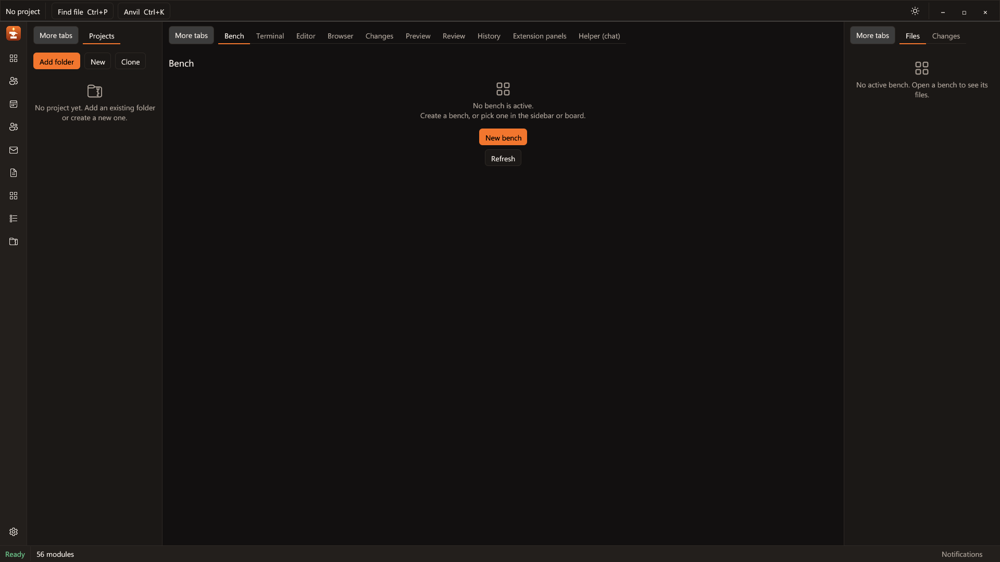

state: en.dark.bench-tab.bench.detail
capture_sha: (não informado para esta variante)
model: opencode/glm-5.3-flash-free
referência: pt-BR.dark.bench-tab.bench.detail

# Bancada — detalhe (sem bancada ativa) — variante en

Tela inicial da área de bancada, mostrada sem projeto e sem bancada ativa: à esquerda o painel de projetos vazio, no centro o aviso de bancada inativa e à direita o painel "Files" com estado vazio. Variante em inglês (locale `en`) da página de referência pt-BR; a estrutura é a mesma e o que muda são os textos da interface e as coordenadas (esta captura tem janela de 1280×800 px, contra 1024×768 na referência).

## Como chegar
Abrir o aplicativo Forja com `forja-app --locale en --theme dark --bench-tab bench.detail`; por padrão a tela inicial já cai nesta visão. Também se chega por `Ctrl+K` (Anvil) ou clicando em "Projects" no painel esquerdo e depois na aba "Bench" da área central. Comando de captura: `forja atlas capture --bench-tab bench.detail --locale en --theme dark`.

## Regiões
- **Barra superior** (0,0)–(1280,40): rótulo "No project", botões "Find file  Ctrl+P" e "Anvil  Ctrl+K", botão de alternância de tema (ícone de sol, sem nome acessível) e botões de janela (–, □, ×). Igual à referência, com textos em inglês.
- **Trilho esquerdo de ícones** (0,40)–(56,768): coluna de botões-ícone (Board, Helpers, Routines, Muster, Requests, Skills, Usage, Extensions, Archive) e, no rodapé, "Settings".
- **Painel de projetos** (56,40)–(304,768): abas "Projects" (marcada), "Benches" e "Extension panels" (cortada pela divisória); ações "Add folder", "New" e "Clone"; estado vazio com ícone de pasta e o texto "No project yet. Add an existing folder or create a new one.".
- **Área central** (320,40)–(972,768): fileira de abas (Terminal, Editor, Browser, Changes, Preview, Bench, Review, History, Extension panels), título "Bench", a mensagem central "No bench is active. Create a bench, or pick one in the sidebar or board." e os botões "New bench" (laranja) e "Refresh".
- **Painel direito (Files)** (988,40)–(1280,768): fileira de abas (visíveis: "Files", "Changes", "Search", "Ports"; "Helper (chat)" e "Extension panels" empilhadas fora de vista), ícone de grade, mensagem "No active bench. Open a bench to see its files." — mesma estrutura da referência, com os rótulos em inglês.
- **Barra de status** (0,768)–(1280,800): "Ready" em verde, "56 modules" e, à direita, "Notifications".

## Elementos
| Elemento | Tipo | Posição (px) | Estado | O que faz |
|---|---|---|---|---|
| "Find file  Ctrl+P" | Button | (99,5)–(218,37) | — | Abre a busca de arquivos pelo atalho Ctrl+P |
| "Anvil  Ctrl+K" | Button | (226,5)–(327,37) | — | Abre a paleta de comandos (Anvil) pelo atalho Ctrl+K |
| (sem nome acessível) | Unknown | (1101,5)–(1133,37) | — | Botão-ícone de sol na barra superior; alterna o tema |
| "–" | Button | (1155,5)–(1187,37) | — | Minimiza a janela |
| "□" | Button | (1195,5)–(1227,37) | — | Maximiza/restaura a janela |
| "×" | Button | (1235,5)–(1269,37) | — | Fecha a janela |
| "No project" | Label | (11,12)–(77,31) | — | Mostra que nenhum projeto está aberto |
| (sem nome acessível) | Unknown | (304,42)–(320,768) | focus | Divisória vertical entre painel de projetos e área central |
| (sem nome acessível) | Unknown | (972,42)–(988,768) | focus | Divisória vertical entre área central e painel direito |
| (sem nome acessível) | Image | (12,50)–(40,78) | — | Ícone/logo no topo do trilho esquerdo |
| "Projects" | Button | (64,50)–(136,82) | marcado=True | Aba ativa do painel esquerdo; mostra a lista de projetos |
| (sem nome acessível) | Unknown | (64,50)–(300,82) | focus | Barra/fundo da fileira de abas do painel esquerdo |
| "Benches" | Button | (136,50)–(211,82) | marcado=False | Aba para alternar para a lista de bancadas |
| "Extension panels" | Button | (211,50)–(337,82) | marcado=False | Aba de painéis de extensões; texto cortado pela divisória |
| "Terminal" | Button | (324,50)–(401,82) | marcado=False | Aba da área central que mostra o terminal |
| "Editor" | Button | (401,50)–(461,82) | marcado=False | Aba da área central que mostra o editor |
| "Browser" | Button | (461,50)–(534,82) | marcado=False | Aba da área central que mostra o navegador |
| "Changes" | Button | (534,50)–(611,82) | marcado=False | Aba da área central que mostra as mudanças |
| "Preview" | Button | (611,50)–(682,82) | marcado=False | Aba da área central que mostra a pré-visualização |
| "Bench" | Button | (682,50)–(743,82) | marcado=True | Aba ativa da área central (sublinhado laranja na imagem); mostra o detalhe da bancada |
| "Review" | Button | (743,50)–(810,82) | marcado=False | Aba da área central que mostra a revisão |
| "History" | Button | (810,50)–(878,82) | marcado=False | Aba da área central que mostra o histórico |
| "Extension panels" | Button | (878,50)–(1004,82) | marcado=False | Aba da área central; retângulo invade a divisória do painel direito e o texto aparece truncado |
| (sem nome acessível) | Unknown | (992,50)–(1268,82) | focus | Barra/fundo da fileira de abas do painel direito |
| "Files" | Button | (992,50)–(1043,82) | marcado=True | Aba ativa do painel direito; exibe o explorador de arquivos |
| "Helper (chat)" | Button | (1004,50)–(1107,82) | marcado=False | Aba empilhada sobre "Files" e "Changes"; não aparece na imagem |
| "Changes" | Button | (1043,50)–(1120,82) | marcado=False | Aba visível; mostraria as mudanças da bancada |
| "Search" | Button | (1120,50)–(1185,82) | marcado=False | Aba visível; busca no conteúdo |
| "Ports" | Button | (1185,50)–(1240,82) | marcado=False | Aba visível; lista de portas/terminais |
| "Extension panels" | Button | (1240,50)–(1366,82) | marcado=False | Aba empilhada; retângulo passa da largura da janela (1280 px) |
| (sem nome acessível) | Unknown | (64,80)–(300,82) | — | Separador sob as abas do painel esquerdo |
| (sem nome acessível) | Unknown | (992,80)–(1268,82) | — | Separador sob as abas do painel direito |
| "Board" | Button | (8,94)–(44,130) | marcado=False | Botão-ícone do trilho; abre o quadro de bancadas |
| "Add folder" | Button | (64,98)–(154,130) | — | Destaque laranja; adiciona uma pasta de projeto |
| "New" | Button | (162,98)–(213,130) | — | Cria um novo projeto |
| "Clone" | Button | (221,98)–(280,130) | — | Clona um projeto |
| "Bench" | Label | (324,98)–(372,122) | — | Título da área central |
| (ícone) | Label | (1116,114)–(1144,142) | — | Ícone de grade do estado vazio do painel Files |
| "Helpers" | Button | (8,138)–(44,174) | marcado=False | Botão-ícone do trilho; abre a lista de ajudantes |
| (ícone) | Label | (702,146)–(730,174) | — | Ícone de pasta acima da mensagem central |
| "No active bench. Open a bench to see its files." | Label | (1004,150)–(1256,188) | — | Estado vazio do painel Files |
| (ícone) | Label | (168,158)–(196,186) | — | Ícone de pasta do estado vazio do painel de projetos |
| "Routines" | Button | (8,182)–(44,218) | marcado=False | Botão-ícone do trilho; abre rotinas |
| "No bench is active.\nCreate a bench, or pick one in the sidebar or board." | Label | (557,182)–(874,220) | — | Mensagem central; visível por inteiro nesta variante (na referência pt-BR era truncada pela divisória) |
| "No project yet. Add an existing folder or create a new one." | Label | (67,194)–(297,232) | — | Estado vazio do painel de projetos |
| "New bench" | Button | (669,236)–(762,268) | — | Botão laranja; cria uma bancada |
| "Requests" | Button | (8,270)–(44,306) | marcado=False | Botão-ícone do trilho; abre pedidos |
| "Refresh" | Button | (681,276)–(751,308) | — | Recarrega o conteúdo do painel Files |
| "Skills" | Button | (8,314)–(44,350) | marcado=False | Botão-ícone do trilho; abre skills |
| "Usage" | Button | (8,358)–(44,394) | marcado=False | Botão-ícone do trilho; abre uso |
| "Extensions" | Button | (8,402)–(44,438) | marcado=False | Botão-ícone do trilho; abre extensões |
| "Archive" | Button | (8,446)–(44,482) | marcado=False | Botão-ícone do trilho; abre o acervo |
| "Settings" | Button | (8,724)–(44,760) | marcado=False | Botão-ícone do rodapé do trilho; abre os ajustes |
| "Ready" | Label | (10,775)–(48,794) | — | Status geral, exibido em verde |
| "56 modules" | Label | (70,775)–(142,794) | — | Contagem de módulos carregados |
| "Notifications" | Label | (1168,775)–(1246,794) | — | Abre as notificações |

## Aparência
Tema escuro, idêntico ao da referência: fundo quase preto com variações de cinza-escuro por painel e divisórias verticais claras. A cor de destaque é o laranja, aplicado nos botões "Add folder" e "New bench", no sublinhado das abas marcadas ("Projects", "Bench" e "Files") e no "Ready" da barra de status (em verde). Tipografia sem serifa em dois tamanhos: títulos de aba/ação em ~13–15 px e rótulos de estado vazio em ~14 px, cinza-claro de baixo contraste sobre o fundo escuro. O trilho esquerdo usa botões quadrados de 36 px só com ícones, espaçados regularmente a cada 44 px, com "Settings" isolado no rodapé. Alinhamento consistente: ações do painel de projetos em coluna, texto e botões da área central centralizados e textos de estado vazio centralizados nos painéis.

## Problemas encontrados
- A aba "Extension panels" da fileira do painel direito tem retângulo (1240,50)–(1366,82), que passa da largura da imagem (1280 px): fica parcialmente fora da janela; na imagem só se vê o início ("Ext") cortado pela borda.
- A aba "Extension panels" da área central (878,50)–(1004,82) invade a divisória do painel direito (972,42)–(988,768); o texto aparece truncado ("Extension pane").
- A aba "Extension panels" do painel de projetos (211,50)–(337,82) invade a divisória do painel (304,42)–(320,768); o texto aparece cortado ("Extension pai").
- Na fileira de abas do painel direito, "Helper (chat)" (1004,50)–(1107,82) fica empilhada com retângulos sobrepostos às abas visíveis "Files" (992,50)–(1043,82) e "Changes" (1043,50)–(1120,82) e não aparece na imagem.
- O botão de tema na barra superior (1101,5)–(1133,37) é um Unknown sem nome acessível; só é identificável pelo ícone de sol.
- Vários elementos da árvore estão sem nome acessível (divisórias, barras de abas, separadores, ícones), o que reduz a navegabilidade por leitor de tela.
- Rótulos de estado vazio ("No project yet…", "No bench is active…", "No active bench…") em cinza-claro sobre fundo escuro, com contraste baixo.
- Diferença em relação à referência pt-BR: aqui a mensagem central "No bench is active. Create a bench, or pick one in the sidebar or board." (557,182)–(874,220) não invade a divisória e não há aba com estado marcado ambíguo no painel direito (apenas "Files" está marcada); os defeitos de truncamento e sobreposição listados acima persistem.
