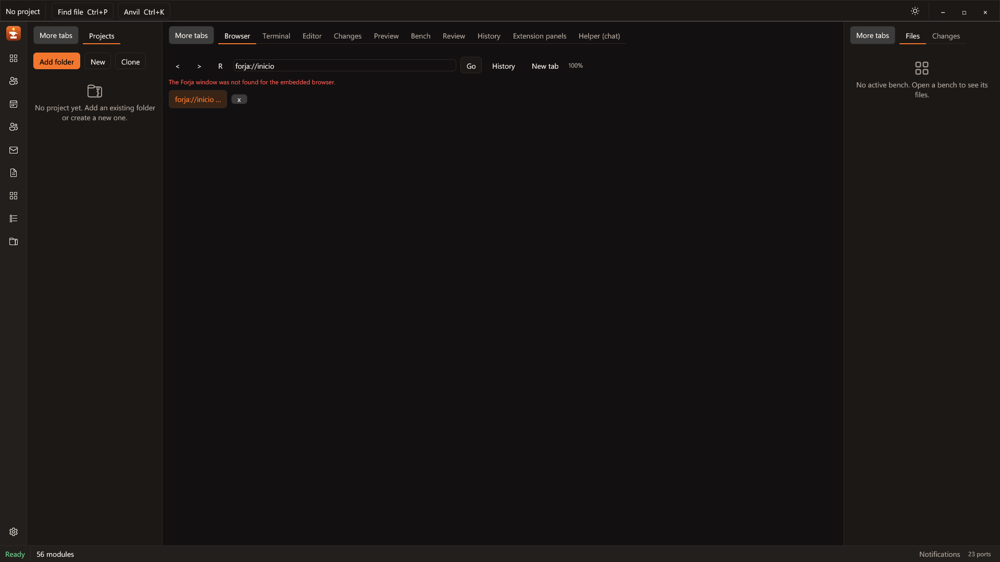

state: en.dark.bench-tab.browser.tab
capture_sha: 41f27101b594f969
model: opencode/glm-5.3-flash-free
---

# Bench tab — Browser panel (browser.tab)

Main screen of the app in a bench with the central panel on the **Browser** tab, which embeds a browser for `forja://` URLs; in this capture the browser could not start and the projects and files panels are empty. This is the **English variant** of the reference page `pt-BR.dark.bench-tab.browser.tab`: same structure and layout, with interface texts in English and only small position/width differences that depend on the size of each string (theme toggle and window buttons more to the right in this capture).

## How to get there
In the main window, click the **Browser** tab of the central panel tab strip (461,50)–(534,82). The screen was opened with `forja-app --locale en --theme dark --bench-tab browser.tab`; the Atlas capture is at `captures/en.dark.bench-tab.browser.tab.png`.

## Regions
- **Top bar** (0,0)–(1280,42): "No project" pill on the left; buttons "Find file  Ctrl+P" and "Anvil  Ctrl+K"; theme toggle icon (sun) at (1101,5)–(1133,37); window buttons "–", "□", "×" on the right.
- **Left rail** (0,42)–(48,768): logo (12,50)–(40,78) at the top and column of icon buttons: "Board", "Helpers", "Routines", "Muster", "Requests", "Skills", "Usage", "Extensions", "Archive" and, at the bottom of the rail, "Settings".
- **Left panel (Projects)** (48,42)–(304,736): tabs "Projects" (marked), "Benches" and "Extension panels"; buttons "Add folder", "New" and "Clone"; empty state with folder icon (168,158)–(196,186) and the text "No project yet. Add an existing folder or create a new one.".
- **Divider** (304,42)–(320,768): unnamed vertical strip between the left and central panels.
- **Central panel (Browser)** (320,42)–(972,736): tabs "Terminal", "Editor", "Browser" (marked), "Changes", "Preview", "Bench", "Review", "History" and "Extension panels"; navigation bar with "<", ">", "R", address field "forja://inicio", "Go", "History" and "New tab"; "100%" zoom indicator; error message "The Forja window was not found for the embedded browser."; chip "forja://inicio …" with close button "x"; hint "The page is hidden while a panel or window is on top." (declared over the status bar).
- **Divider** (972,42)–(988,768): unnamed vertical strip between the central and right panels.
- **Right panel (Files)** (988,42)–(1280,736): tabs "Files" (marked), "Helper (chat)", "Changes", "Search", "Ports" and "Extension panels"; empty state with grid icon (label "(ícone)" at (1116,114)–(1144,142)) and the text "No active bench. Open a bench to see its files.".
- **Status bar** (0,768)–(1280,800): "Ready" (in green), "56 modules", "Notifications" and "23 ports".

## Elements
| Element | Type | Position (px) | State | What it does |
|---|---|---|---|---|
| "Find file  Ctrl+P" | Button | (99,5)–(218,37) | click,focus | Opens the quick file search (Ctrl+P shortcut). |
| "Anvil  Ctrl+K" | Button | (226,5)–(327,37) | click,focus | Opens the command palette (Ctrl+K shortcut). |
| (sem nome acessível) | Unknown | (1101,5)–(1133,37) | click,focus | Sun icon: toggles the interface theme. |
| "–" | Button | (1155,5)–(1187,37) | click,focus | Minimizes the window. |
| "□" | Button | (1195,5)–(1227,37) | click,focus | Restores/maximizes the window. |
| "×" | Button | (1235,5)–(1269,37) | click,focus | Closes the window. |
| "No project" | Label | (11,12)–(77,31) | click,focus | Indicates that no project is open; probably opens the project list. |
| (sem nome acessível) | Unknown | (304,42)–(320,768) | focus | Vertical divider between the left and central panels. |
| (sem nome acessível) | Unknown | (972,42)–(988,768) | focus | Vertical divider between the central and right panels. |
| (sem nome acessível) | Image | (12,50)–(40,78) | click,focus | Forja logo at the top of the rail. |
| "Projects" | Button | (64,50)–(136,82) | click,focus | marcado=True — active tab of the left panel, shows the project list. |
| (sem nome acessível) | Unknown | (64,50)–(300,82) | focus | Background strip of the left panel tabs. |
| "Benches" | Button | (136,50)–(211,82) | click,focus | marcado=False — switches the left panel to the bench list. |
| "Extension panels" | Button | (211,50)–(337,82) | click,focus | marcado=False — switches the left panel to extension panels; crosses the divider and appears truncated ("Extension pan") in the image. |
| "Terminal" | Button | (324,50)–(401,82) | click,focus | marcado=False — central panel tab for the terminal. |
| "Editor" | Button | (401,50)–(461,82) | click,focus | marcado=False — switches the central panel to the editor. |
| "Browser" | Button | (461,50)–(534,82) | click,focus | marcado=True — current tab, shows the embedded browser. |
| "Changes" | Button | (534,50)–(611,82) | click,focus | marcado=False — diff view tab. |
| "Preview" | Button | (611,50)–(682,82) | click,focus | marcado=False — file preview tab. |
| "Bench" | Button | (682,50)–(743,82) | click,focus | marcado=False — bench details tab. |
| "Review" | Button | (743,50)–(810,82) | click,focus | marcado=False — review tab. |
| "History" | Button | (810,50)–(878,82) | click,focus | marcado=False — history tab of the central panel. |
| "Extension panels" | Button | (878,50)–(1004,82) | click,focus | marcado=False — central panel extension panels tab; crosses the right divider. |
| (sem nome acessível) | Unknown | (992,50)–(1268,82) | focus | Background strip of the right panel tabs. |
| "Files" | Button | (992,50)–(1043,82) | click,focus | marcado=True — active tab of the right panel, file list of the bench. |
| "Helper (chat)" | Button | (1004,50)–(1107,82) | click,focus | marcado=False — helper chat tab; rectangle overlaps "Files" and "Changes". |
| "Changes" | Button | (1043,50)–(1120,82) | click,focus | marcado=False — second occurrence of the name (also used in the central panel); overlaps neighbouring tabs. |
| "Search" | Button | (1120,50)–(1185,82) | click,focus | marcado=False — search tab. |
| "Ports" | Button | (1185,50)–(1240,82) | click,focus | marcado=False — bench ports tab. |
| "Extension panels" | Button | (1240,50)–(1366,82) | click,focus | marcado=False — third occurrence of the name; rectangle goes beyond the window width (1280 px) and is cut off. |
| (sem nome acessível) | Unknown | (64,80)–(300,82) | click,focus | Thin divider line under the left panel tabs. |
| (sem nome acessível) | Unknown | (992,80)–(1268,82) | click,focus | Thin divider line under the right panel tabs. |
| "Board" | Button | (8,94)–(44,130) | click,focus | marcado=False — rail icon button for the board. |
| "Add folder" | Button | (64,98)–(154,130) | click,focus | Highlighted action (orange) to import a folder as a project. |
| "New" | Button | (162,98)–(213,130) | click,focus | Creates a new project. |
| "Clone" | Button | (221,98)–(280,130) | click,focus | Opens the repository/project cloning flow. |
| "<" | Button | (324,98)–(358,130) | click,focus | Navigates to the previous browser page. |
| "100%" | Label | (324,98)–(352,146) | click | Page zoom indicator; declared rectangle overlaps the "<" button and is disproportionate (48 px tall) to the text, which in the image appears below the navigation buttons. |
| ">" | Button | (366,98)–(399,130) | click,focus | Navigates to the next browser page. |
| "R" | Button | (407,98)–(440,130) | click,focus | Reloads the current browser page (non-descriptive name). |
| "Go" | Button | (884,98)–(925,130) | click,focus | Confirms/navigates to the URL typed in the address field; rectangle crosses the right divider. |
| "History" | Button | (933,98)–(1001,130) | click,focus | Opens the embedded browser history; rectangle crosses the divider and the text appears truncated ("Histo") in the image. |
| "New tab" | Button | (1009,98)–(1084,130) | click,focus | Opens a new browser tab; rectangle beyond the central panel, not visible in the image. |
| "forja://inicio" | TextInput | (448,103)–(876,126) | click,focus | Browser address field, with the initial URL. |
| (ícone) | Label | (1116,114)–(1144,142) | click | Grid icon of the empty state of the files panel; rendered slightly to the right of the declared rectangle. |
| "Helpers" | Button | (8,138)–(44,174) | click,focus | marcado=False — rail icon button for helpers. |
| "No active bench. Open a bench to see its files." | Label | (1004,150)–(1256,188) | click | Empty state of the files panel. |
| "The Forja window was not found for the embedded browser." | Label | (324,154)–(644,170) | click | Error message: the embedded browser did not find the Forja window. |
| (ícone) | Label | (168,158)–(196,186) | click | Folder icon of the empty state of the projects panel. |
| "forja://inicio …" | Button | (324,178)–(436,213) | click,focus | Chip of the "forja://inicio" tab open in the browser (no content loaded). |
| "Routines" | Button | (8,182)–(44,218) | click,focus | marcado=False — rail icon button for routines. |
| "x" | Button | (444,186)–(475,205) | click,focus | Closes the "forja://inicio" chip/tab (lowercase "x", unlike the "×" of the window). |
| "No project yet. Add an existing folder or create a new one." | Label | (67,194)–(297,232) | click | Empty state of the projects panel. |
| "Muster" | Button | (8,226)–(44,262) | click,focus | marcado=False — rail icon button for the muster. |
| "Requests" | Button | (8,270)–(44,306) | click,focus | marcado=False — rail icon button for requests. |
| "Skills" | Button | (8,314)–(44,350) | click,focus | marcado=False — rail icon button for skills. |
| "Usage" | Button | (8,358)–(44,394) | click,focus | marcado=False — rail icon button for usage. |
| "Extensions" | Button | (8,402)–(44,438) | click,focus | marcado=False — rail icon button for extensions. |
| "Archive" | Button | (8,446)–(44,482) | click,focus | marcado=False — rail icon button for the archive. |
| "Settings" | Button | (8,724)–(44,760) | click,focus | marcado=False — rail icon button for settings, at the bottom of the rail. |
| "The page is hidden while a panel or window is on top." | Label | (324,768)–(609,784) | click | Warning of the embedded browser: the page is paused when covered; declared over the status bar strip (in the pt-BR reference it appears at y 736–752, below the navigation bar). |
| "Ready" | Label | (10,775)–(48,794) | click | General status in the bottom bar, shown in green. |
| "56 modules" | Label | (70,775)–(142,794) | click | Number of loaded modules. |
| "Notifications" | Label | (1125,775)–(1203,794) | click,focus | Notifications area/shortcut in the status bar. |
| "23 ports" | Label | (1219,776)–(1262,792) | click | Number of active ports. |

## Appearance
Dark theme with a near-black brown background (tones close to #1f1814 to #2a211c), with panels in subtle tone variation and 16 px dark dividers. The accent color is orange ("Brasa"): orange background on the "Add folder" button, orange text with underline on the marked tabs "Projects", "Browser" and "Files", orange border and text on the chip "forja://inicio …". The browser error message appears in orange-red and the "Ready" status in green. Texts are light gray on a dark background, sans-serif of ~12–14 px; tabs and bar buttons are ~32 px tall with uniform spacing, left-aligned in the tab strips and centered in the rail icon buttons. The status bar uses smaller text (~12 px), with "Ready" and "56 modules" on the left and "Notifications"/"23 ports" on the right.

## Problems found
- Tab rectangles overlap each other in the same strip: "Files" (992,50)–(1043,82) overlaps "Helper (chat)" (1004,50)–(1107,82), which overlaps "Changes" (1043,50)–(1120,82); in the central panel, "History" (810,50)–(878,82) touches "Extension panels" (878,50)–(1004,82).
- The "Extension panels" tab of the right panel declares (1240,50)–(1366,82), beyond the window width (1280 px), and is cut off.
- The left panel tab "Extension panels" (211,50)–(337,82) crosses the divider (304,42)–(320,768) and appears truncated ("Extension pan") in the image.
- "Go" (884,98)–(925,130), "History" (933,98)–(1001,130) and "New tab" (1009,98)–(1084,130) declare rectangles beyond the central panel limit (divider at 972–988): "History" is truncated in the image and "New tab" is not visible.
- The "100%" label declares (324,98)–(352,146), overlapping the "<" button (324,98)–(358,130) and with a disproportionate height (48 px) for the text.
- The hint "The page is hidden while a panel or window is on top." is declared at (324,768)–(609,784), inside the status bar strip, conflicting with the region of "Ready"/"56 modules" (y 775–794); in the pt-BR reference the same hint appears at y 736 — stale or divergent coordinates between variants.
- The "(ícone)" label of the right panel (1116,114)–(1144,142) appears rendered slightly to the right of the declared rectangle in the image.
- Window buttons named only by symbols: "–", "□" and "×", without descriptive accessible names (Minimize/Maximize/Close); the same applies to "<", ">", "R" and "x" of the browser.
- Elements without accessible name: theme toggle (1101,5)–(1133,37), the two vertical dividers, the tab strips (64,50)–(300,82) and (992,50)–(1268,82), the lines (64,80)–(300,82) and (992,80)–(1268,82), the logo (Image) and the two "(ícone)" labels.
- Repeated names without differentiation in the tree: "Extension panels" (3 occurrences), "Changes" (2), "History" (2, one being the central panel tab and the other the browser button).
- Low contrast in the empty state texts ("No project yet…", "No active bench…") and in the inactive tabs, in dark gray on a dark background.
