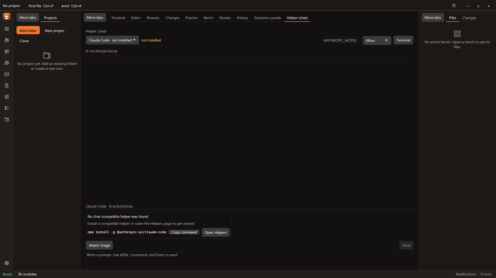

state: en.dark.bench-tab.chat.tab
capture_sha: 6010fb249399ce51
model: opencode/glm-5.3-flash-free
---

# Bancada — aba Helper (chat)

Tela da bancada com a aba "Helper (chat)" ativa: painel central de conversa com o agente de código, flanqueado pelo painel de projetos à esquerda e pelo painel de arquivos da bancada à direita. Variante en (inglês) da página de referência pt-BR, mesmo tema escuro; o que muda são os textos (todos em inglês) e a janela mais larga (1280×800 em vez de 1024×768), o que deixa visíveis abas que na referência estavam sobrepostas.

## Como chegar
Na janela principal, abra uma bancada e, no grupo de abas do cabeçalho da bancada (faixa superior direita), clique em "Helper (chat)". Como a tela foi capturada diretamente nessa aba, o comando é: `forja-app --locale en --theme dark --bench-tab chat.tab`.

## Regiões
- **Barra de título** (0,0)–(1280,37): rótulo do projeto ("No project"), botões "Find file  Ctrl+P" e "Anvil  Ctrl+K", botão-ícone de tema (sol) e os botões de janela "–", "□" e "×".
- **Trilho à esquerda** (0,37)–(52,768): logotipo da Forja (imagem laranja, 12,50–40,78) e coluna de botões-ícone: "Board", "Helpers", "Routines", "Muster", "Requests", "Skills", "Usage", "Extensions", "Archive" e, no pé, "Settings".
- **Painel lateral esquerdo** (52,37)–(304,768): grupo de abas "Projects" (marcado), "Benches" e "Extension panels"; botões "Add folder" (destacado em laranja), "New" e "Clone"; estado vazio com ícone de pasta e o texto "No project yet. Add an existing folder or create a new one.".
- **Divisor 1** (304,42)–(320,768): separador vertical arrastável entre o painel esquerdo e a área central.
- **Área central** (320,37)–(972,768): faixa de abas "Terminal", "Editor", "Browser", "Changes", "Preview", "Bench", "Review", "History" e "Extension panels"; cabeçalho do chat com "Helper (chat)", "Claude Code", status "idle" (verde) e o caminho "D:\a\forja\forja" em fonte monoespaçada; área de mensagens vazia; rodapé com "Claude Code · D:\a\forja\forja ·", botão "Attach image", botão "Send" e campo multilinha com o placeholder "Write a prompt. Use @file, /command, and Enter to send.".
- **Divisor 2** (972,42)–(988,768): separador vertical arrastável entre a área central e o painel direito.
- **Painel direito** (988,37)–(1280,768): grupo de abas "Files" (marcado), "Helper (chat)" (marcado, porém invisível por sobreposição), "Changes", "Search", "Ports" e "Extension panels" (esta além da borda da janela); cabeçalho com campo de texto sem nome mostrando "ANTHROPIC_MODEL", ComboBox "Effort", botão "Terminal" e ícone de grade; mensagem "No active bench. Open a bench to see its files.".
- **Barra de status** (0,768)–(1280,800): "Ready" e "56 modules" à esquerda, "Notifications" à direita.

## Elementos
| Elemento | Tipo | Posição (px) | Estado | O que faz |
|---|---|---|---|---|
| "No project" | Label | (11,12)–(77,31) | — | Mostra o projeto corrente; vazio porque nenhum projeto está aberto. |
| "Find file  Ctrl+P" | Button | (99,5)–(218,37) | — | Abre a busca rápida de arquivos (atalho Ctrl+P). |
| "Anvil  Ctrl+K" | Button | (226,5)–(327,37) | — | Abre a paleta de comandos (atalho Ctrl+K). |
| (sem nome acessível) | Unknown | (1101,5)–(1133,37) | — | Ícone de sol: alterna o tema da interface. |
| "–" | Button | (1155,5)–(1187,37) | — | Minimiza a janela. |
| "□" | Button | (1195,5)–(1227,37) | — | Maximiza/restaura a janela. |
| "×" | Button | (1235,5)–(1269,37) | — | Fecha a janela. |
| (sem nome acessível) | Unknown | (304,42)–(320,768) | — | Divisor vertical entre painel esquerdo e área central. |
| (sem nome acessível) | Unknown | (972,42)–(988,768) | — | Divisor vertical entre área central e painel direito. |
| (sem nome acessível) | Image | (12,50)–(40,78) | — | Logotipo da Forja no topo do trilho. |
| "Projects" | Button | (64,50)–(136,82) | marcado=True | Aba ativa do painel esquerdo; mostra a lista de projetos. |
| (sem nome acessível) | Unknown | (64,50)–(300,82) | — | Contêiner/faixa do grupo de abas do painel esquerdo. |
| "Benches" | Button | (136,50)–(211,82) | marcado=False | Aba que alterna para a lista de bancadas. |
| "Extension panels" | Button | (211,50)–(337,82) | marcado=False | Aba do grupo esquerdo; passa do divisor (x≈304) e o texto aparece truncado ("Extension pan"). |
| "Terminal" | Button | (324,50)–(401,82) | marcado=False | Aba do terminal da bancada. |
| "Editor" | Button | (401,50)–(461,82) | marcado=False | Aba do editor. |
| "Browser" | Button | (461,50)–(534,82) | marcado=False | Aba do navegador. |
| "Changes" | Button | (534,50)–(611,82) | marcado=False | Aba de alterações da bancada. |
| "Preview" | Button | (611,50)–(682,82) | marcado=False | Aba de visualização. |
| "Bench" | Button | (682,50)–(743,82) | marcado=False | Aba da visão geral da bancada. |
| "Review" | Button | (743,50)–(810,82) | marcado=False | Aba de revisão. |
| "History" | Button | (810,50)–(878,82) | marcado=False | Aba de histórico. |
| "Extension panels" | Button | (878,50)–(1004,82) | marcado=False | Última aba do grupo central; passa do divisor (x≈972) e o texto aparece truncado ("Extension pane"). |
| (sem nome acessível) | Unknown | (992,50)–(1268,82) | — | Contêiner/faixa do grupo de abas do cabeçalho da bancada. |
| "Files" | Button | (992,50)–(1043,82) | marcado=True | Aba ativa do painel direito; lista os arquivos da bancada. |
| "Helper (chat)" | Button | (1004,50)–(1107,82) | marcado=True | Aba selecionada desta tela; sobreposta a "Files"/"Changes" e não aparece na imagem. |
| "Changes" | Button | (1043,50)–(1120,82) | marcado=False | Aba de alterações do grupo direito, sobreposta a "Helper (chat)". |
| "Search" | Button | (1120,50)–(1185,82) | marcado=False | Aba de busca na bancada. |
| "Ports" | Button | (1185,50)–(1240,82) | marcado=False | Aba de portas/serviços da bancada. |
| "Extension panels" | Button | (1240,50)–(1366,82) | marcado=False | Aba além da borda direita da janela (1280); só as letras iniciais ("Ext") aparecem. |
| (sem nome acessível) | Unknown | (64,80)–(300,82) | — | Indicador/sublinhado da aba ativa do grupo esquerdo. |
| (sem nome acessível) | Unknown | (992,80)–(1268,82) | — | Indicador/sublinhado da aba ativa do grupo direito. |
| "Board" | Button | (8,94)–(44,130) | marcado=False | Botão-ícone do trilho; abre o quadro (board). |
| "Add folder" | Button | (64,98)–(154,130) | — | Ação destacada para adicionar uma pasta de projeto. |
| "New" | Button | (162,98)–(213,130) | — | Cria um novo projeto. |
| "Clone" | Button | (221,98)–(280,130) | — | Clona um repositório/projeto. |
| "Helper (chat)" | Label | (332,100)–(411,119) | — | Título do painel de chat. |
| (ícone) | Label | (1116,114)–(1144,142) | — | Ícone de grade no cabeçalho do painel direito (sem nome acessível). |
| "Terminal" | Button | (1022,127)–(1099,162) | — | Botão no cabeçalho do painel direito; abre um terminal. |
| "Effort" | ComboBox | (904,129)–(1014,164) | — | Seletor do nível de esforço do ajudante. |
| "Claude Code" | Label | (332,131)–(436,155) | — | Nome do ajudante/agente em uso no chat. |
| "idle" | Label | (444,134)–(466,153) | — | Status do ajudante, exibido em verde. |
| (sem nome acessível) | TextInput | (748,134)–(896,157) | — | Campo de texto do cabeçalho, exibindo "ANTHROPIC_MODEL". |
| "Helpers" | Button | (8,138)–(44,174) | marcado=False | Botão-ícone do trilho; abre a seção de ajudantes. |
| "No active bench. Open a bench to see its files." | Label | (1004,150)–(1256,188) | — | Estado vazio do painel de arquivos da bancada; na imagem só se lê "Open a bench to see its files.", o início da frase não aparece. |
| (ícone) | Label | (168,158)–(196,186) | — | Ícone de pasta do estado vazio do painel de projetos (sem nome acessível). |
| "D:\a\forja\forja" | Label | (332,180)–(454,195) | — | Caminho do projeto da conversa, em fonte monoespaçada. |
| "Routines" | Button | (8,182)–(44,218) | marcado=False | Botão-ícone do trilho; abre a seção de rotinas. |
| "No project yet. Add an existing folder or create a new one." | Label | (67,194)–(297,232) | — | Mensagem de estado vazio da lista de projetos. |
| "Muster" | Button | (8,226)–(44,262) | marcado=False | Botão-ícone do trilho; abre a seção Muster. |
| "Requests" | Button | (8,270)–(44,306) | marcado=False | Botão-ícone do trilho; abre a seção de pedidos. |
| "Skills" | Button | (8,314)–(44,350) | marcado=False | Botão-ícone do trilho; abre a seção de skills. |
| "Usage" | Button | (8,358)–(44,394) | marcado=False | Botão-ícone do trilho; abre a seção de uso. |
| "Extensions" | Button | (8,402)–(44,438) | marcado=False | Botão-ícone do trilho; abre a seção de extensões. |
| "Archive" | Button | (8,446)–(44,482) | marcado=False | Botão-ícone do trilho; abre a seção de acervo. |
| "Claude Code · D:\a\forja\forja ·" | Label | (332,622)–(524,641) | — | Rodapé do chat com o contexto da conversa (ajudante e caminho). |
| "Attach image" | Button | (332,655)–(437,690) | — | Anexa uma imagem à mensagem do chat. |
| "Send" | Button | (1045,655)–(1099,690) | — | Envia a mensagem do chat. |
| (sem nome acessível) | MultilineTextInput | (332,698)–(1099,758) | — | Campo multilinha para digitar o pedido ao ajudante; placeholder "Write a prompt. Use @file, /command, and Enter to send.". |
| "Settings" | Button | (8,724)–(44,760) | marcado=False | Botão-ícone do pé do trilho; abre os ajustes. |
| "Ready" | Label | (10,775)–(48,794) | — | Estado geral do app na barra de status. |
| "56 modules" | Label | (70,775)–(142,794) | — | Quantidade de módulos carregados. |
| "Notifications" | Label | (1168,775)–(1246,794) | — | Abre a área de notificações. |

## Aparência
Igual à referência pt-BR: tema escuro com fundo marrom-quase-preto nas três colunas e área central do chat ligeiramente mais escura; texto em cinza-claro, abas inativas em cinza médio. Destaques em laranja no logotipo do trilho, no botão "Add folder" (fundo laranja com texto escuro) e nos sublinhados das abas ativas "Projects" e "Files". O status "idle" aparece em verde (equivalente ao "ocioso" da referência). O caminho "D:\a\forja\forja" usa fonte monoespaçada. Botões com contorno arredondado fino e fundo levemente elevado; os do trilho são quadrados de 36 px, só com ícone. Abas de altura uniforme (~32 px) com sublinhado laranja de 2 px na ativa; barra de status de uma linha (~32 px) com texto pequeno. O que muda em relação à referência é só o idioma dos textos (todos em inglês) e a largura da janela (1280 px), que traz as abas centrais "Bench", "Review" e "History" para a área visível.

## Problemas encontrados
- O grupo de abas do cabeçalho da bancada continua estourando: "Extension panels" (1240–1366) fica além da borda direita da janela (1280) e só as letras "Ext" aparecem.
- A aba ativa "Helper (chat)" (marcado=True, 1004–1107) não aparece na tela: fica sobreposta a "Files" (992–1043) e "Changes" (1043–1120), então não se vê qual aba do grupo direito está selecionada.
- "Files" e "Helper (chat)" estão marcados ao mesmo tempo (marcado=True), um indicador ambíguo de aba ativa.
- A faixa do grupo direito (a partir de x=992) se sobrepõe à última aba do grupo central, "Extension panels" (878–1004).
- A aba "Extension panels" do grupo esquerdo (211–337) passa do divisor em x≈304 e o texto aparece truncado ("Extension pan"); a do grupo central (878–1004) passa do divisor em x≈972 e também aparece truncada ("Extension pane").
- O texto do estado vazio do painel direito ("No active bench. Open a bench to see its files.", 1004–1256) aparece na imagem apenas a partir de "Open a bench...", com o início da frase não visível.
- A linha de composição do chat avança sobre a região do painel direito: o MultilineTextInput vai até x=1099 e o botão "Send" (1045–1099) fica além do divisor 2 (972–988).
- O campo de texto sem nome acessível exibe o texto em inglês "ANTHROPIC_MODEL" (identificador de variável de ambiente, não traduzido).
- TextInput e MultilineTextInput sem nome acessível.
- Botão de tema (sol, 1101–1133) e os rótulos de ícone em (1116,114) e (168,158) sem nome acessível.
- O rótulo "Claude Code · D:\a\forja\forja ·" termina com um separador "·" solto.
