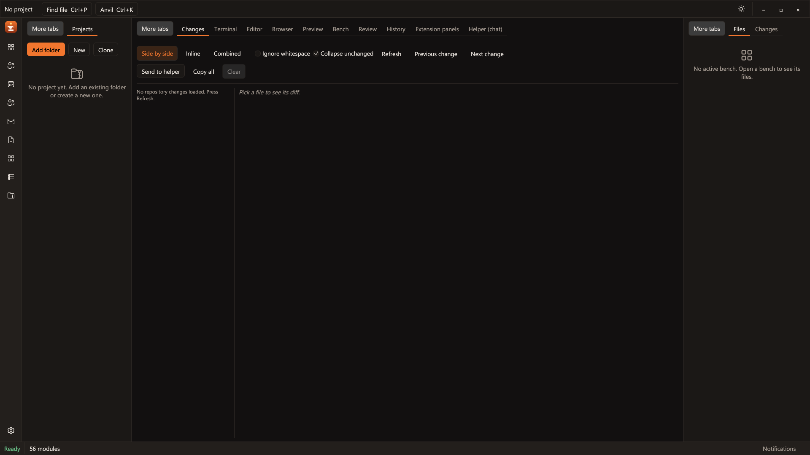

state: en.dark.bench-tab.diff.tab
capture_sha: (ver arquivo de captura)
---

# Aba "Changes" (diferenças) da bancada — estado vazio

Tela principal do app com a aba "Changes" aberta no painel central, sem projeto nem bancada ativa: as áreas mostram apenas mensagens de estado vazio. Variante em inglês (en) do tema escuro; página de referência: pt-BR.dark.bench-tab.diff.tab — a estrutura é a mesma; muda o idioma dos textos, as dimensões da janela (1280×800 contra 1053×768 na referência) e, em consequência, a largura do painel direito e a disposição dos botões do diff.

## Como chegar
Abrir o app com `forja-app --locale en --theme dark --bench-tab diff.tab`; na interface, clicar na aba "Changes" na faixa de abas do painel central (a captura usa o comando acima).

## Regiões
- **Barra superior (título/comandos)**: (0,0)–(1280,42). Rótulo do projeto ("No project"), botões "Find file  Ctrl+P" e "Anvil  Ctrl+K", alternador de tema (ícone de sol) e botões de janela (–, □, ×).
- **Trilho à esquerda**: (0,42)–(56,768). Coluna de ícones: logo da Forja no topo e botões "Board", "Helpers", "Routines", "Muster", "Requests", "Skills", "Usage", "Extensions", "Archive", com "Settings" fixado embaixo.
- **Painel lateral esquerdo (Projects)**: (56,42)–(304,768). Abas "Projects" (ativa), "Benches", "Extension panels"; botões "Add folder" (destaque laranja), "New", "Clone"; mensagem "No project yet. Add an existing folder or create a new one." com ícone de pasta.
- **Divisor 1**: (304,42)–(320,768). Separador vertical redimensionável entre o painel esquerdo e a área central.
- **Área central (Changes/diff)**: (320,42)–(972,768). Abas "Terminal", "Editor", "Browser", "Changes" (ativa), "Preview", "Bench", "Review", "History", "Extension panels"; barra de modo ("Side by side" destacado, "Inline", "Combined"), caixas "Ignore whitespace" e "Collapse unchanged", botões "Refresh" e "Previous change" (fora da área visível); segunda linha com "Next change", "Send to helper", "Copy all", "Clear" (desativado); mensagens "No repository changes loaded. Press Refresh." e "Pick a file to see its diff.".
- **Divisor 2**: (972,42)–(988,768). Separador vertical entre a área central e o painel direito.
- **Painel direito (Files)**: (988,42)–(1280,768). Abas "Files" (ativa), "Helper (chat)", "Changes", "Search", "Ports", "Extension panels" (esta além da borda); ícone de grade e mensagem "No active bench. Open a bench to see its files.".
- **Barra de status**: (0,768)–(1280,800). "Ready" à esquerda, "56 modules" ao lado e "Notifications" à direita.

## Elementos
| Elemento | Tipo | Posição (px) | Estado | O que faz |
|---|---|---|---|---|
| "No project" | Rótulo | (11,12)–(77,31) | — | Mostra o projeto atual (nenhum aberto); clicável. |
| "Find file  Ctrl+P" | Botão | (99,5)–(218,37) | — | Abre a busca rápida de arquivos (atalho Ctrl+P). |
| "Anvil  Ctrl+K" | Botão | (226,5)–(327,37) | — | Abre a paleta de comandos (atalho Ctrl+K). |
| (sem nome acessível) | Desconhecido | (1101,5)–(1133,37) | — | Ícone de sol na barra superior; alternador de tema. |
| "–" | Botão | (1155,5)–(1187,37) | — | Minimiza a janela. |
| "□" | Botão | (1195,5)–(1227,37) | — | Maximiza/restaura a janela. |
| "×" | Botão | (1235,5)–(1269,37) | — | Fecha a janela. |
| (sem nome acessível) | Desconhecido | (304,42)–(320,768) | — | Divisor vertical entre o painel esquerdo e a área central. |
| (sem nome acessível) | Desconhecido | (972,42)–(988,768) | — | Divisor vertical entre a área central e o painel direito. |
| (sem nome acessível) | Imagem | (12,50)–(40,78) | — | Ícone/logo da Forja no topo do trilho. |
| "Projects" | Botão | (64,50)–(136,82) | marcado=True | Aba ativa do painel esquerdo; mostra a lista de projetos. |
| (sem nome acessível) | Desconhecido | (64,50)–(300,82) | — | Faixa que contém as abas do painel esquerdo. |
| "Benches" | Botão | (136,50)–(211,82) | marcado=False | Aba do painel esquerdo; lista de bancadas. |
| "Extension panels" | Botão | (211,50)–(337,82) | marcado=False | Aba do painel esquerdo; texto cortado na borda do painel ("Extension pan…"). |
| "Terminal" | Botão | (324,50)–(401,82) | marcado=False | Aba do painel central; abre o terminal. |
| "Editor" | Botão | (401,50)–(461,82) | marcado=False | Aba do painel central; abre o editor. |
| "Browser" | Botão | (461,50)–(534,82) | marcado=False | Aba do painel central; abre o navegador. |
| "Changes" | Botão | (534,50)–(611,82) | marcado=True | Aba ativa do painel central; exibe o diff. |
| "Preview" | Botão | (611,50)–(682,82) | marcado=False | Aba do painel central; abre o visualizador. |
| "Bench" | Botão | (682,50)–(743,82) | marcado=False | Aba do painel central; abre a bancada. |
| "Review" | Botão | (743,50)–(810,82) | marcado=False | Aba do painel central; abre a revisão. |
| "History" | Botão | (810,50)–(878,82) | marcado=False | Aba do painel central; abre o histórico. |
| "Extension panels" | Botão | (878,50)–(1004,82) | marcado=False | Aba do painel central; passa do divisor em x≈972 e aparece cortada. |
| (sem nome acessível) | Desconhecido | (992,50)–(1268,82) | — | Faixa que contém as abas do painel direito. |
| "Files" | Botão | (992,50)–(1043,82) | marcado=True | Aba ativa do painel direito; lista de arquivos da bancada. |
| "Helper (chat)" | Botão | (1004,50)–(1107,82) | marcado=False | Aba do painel direito; chat do ajudante (sobrepõe "Files"/"Changes", não visível na imagem). |
| "Changes" | Botão | (1043,50)–(1120,82) | marcado=False | Aba do painel direito; lista de mudanças. |
| "Search" | Botão | (1120,50)–(1185,82) | marcado=False | Aba do painel direito; busca. |
| "Ports" | Botão | (1185,50)–(1240,82) | marcado=False | Aba do painel direito; portas ativas. |
| "Extension panels" | Botão | (1240,50)–(1366,82) | marcado=False | Aba do painel direito; além da largura da janela (só "Ext" aparece). |
| (sem nome acessível) | Desconhecido | (64,80)–(300,82) | — | Sublinhado da aba ativa no painel esquerdo. |
| (sem nome acessível) | Desconhecido | (992,80)–(1268,82) | — | Sublinhado da aba ativa no painel direito. |
| "Board" | Botão | (8,94)–(44,130) | marcado=False | Botão-ícone do trilho; abre o quadro. |
| "Add folder" | Botão | (64,98)–(154,130) | — | Ação primária (laranja) para adicionar uma pasta de projeto. |
| "New" | Botão | (162,98)–(213,130) | — | Cria um novo projeto. |
| "Clone" | Botão | (221,98)–(280,130) | — | Clona um repositório como projeto. |
| "Side by side" | Botão | (324,98)–(421,133) | — | Modo de exibição do diff em duas colunas (aparece destacado em laranja na imagem). |
| "Inline" | Botão | (429,98)–(487,133) | — | Modo de diff em linha única. |
| "Combined" | Botão | (495,98)–(582,133) | — | Modo de diff combinado. |
| "Ignore whitespace" | Caixa de seleção | (604,100)–(734,132) | marcado=False | Ignora diferenças de espaço em branco; desenhada como círculo. |
| "Collapse unchanged" | Caixa de seleção | (742,100)–(885,132) | marcado=True | Recolhe trechos sem mudanças; aparece marcada (caixa com ✓). |
| "Refresh" | Botão | (893,100)–(963,132) | — | Recarrega o diff. |
| "Previous change" | Botão | (971,100)–(1096,132) | — | Navega à mudança anterior; fica além do divisor central, não visível na imagem. |
| (ícone) | Rótulo | (1116,114)–(1144,142) | — | Ícone de grade do estado vazio do painel de arquivos. |
| "Helpers" | Botão | (8,138)–(44,174) | marcado=False | Botão-ícone do trilho; abre os ajudantes. |
| "Next change" | Botão | (324,143)–(425,175) | — | Navega à próxima mudança; quebrou para a segunda linha da barra do diff. |
| "No active bench. Open a bench to see its files." | Rótulo | (1004,150)–(1256,188) | — | Mensagem de estado vazio do painel de arquivos. |
| (ícone) | Rótulo | (168,158)–(196,186) | — | Ícone de pasta do estado vazio do painel de projetos. |
| "Routines" | Botão | (8,182)–(44,218) | marcado=False | Botão-ícone do trilho; abre as rotinas. |
| "Send to helper" | Botão | (324,184)–(438,216) | — | Envia o diff atual ao ajudante de código. |
| "Copy all" | Botão | (446,184)–(519,216) | — | Copia todas as diferenças para a área de transferência. |
| "Clear" | Botão | (527,184)–(582,219) | desativado | Limpa a seleção/diff atual; indisponível sem conteúdo. |
| "No project yet. Add an existing folder or create a new one." | Rótulo | (67,194)–(297,232) | — | Mensagem de estado vazio do painel de projetos, em duas linhas. |
| "Muster" | Botão | (8,226)–(44,262) | marcado=False | Botão-ícone do trilho; abre o mutirão. |
| "No repository changes loaded. Press Refresh." | Rótulo | (324,241)–(519,273) | — | Mensagem de estado vazio do diff, quebrada em duas linhas. |
| "Pick a file to see its diff." | Rótulo | (566,241)–(710,260) | — | Mensagem em itálico da metade direita do diff. |
| "Requests" | Botão | (8,270)–(44,306) | marcado=False | Botão-ícone do trilho; abre os pedidos. |
| "Skills" | Botão | (8,314)–(44,350) | marcado=False | Botão-ícone do trilho; abre as skills. |
| "Usage" | Botão | (8,358)–(44,394) | marcado=False | Botão-ícone do trilho; abre o uso. |
| "Extensions" | Botão | (8,402)–(44,438) | marcado=False | Botão-ícone do trilho; abre as extensões. |
| "Archive" | Botão | (8,446)–(44,482) | marcado=False | Botão-ícone do trilho; abre o acervo. |
| "Settings" | Botão | (8,724)–(44,760) | marcado=False | Botão-ícone do trilho fixo embaixo; abre os ajustes. |
| "Ready" | Rótulo | (10,775)–(48,794) | — | Status atual na barra de status. |
| "56 modules" | Rótulo | (70,775)–(142,794) | — | Quantidade de módulos carregados. |
| "Notifications" | Rótulo | (1168,775)–(1246,794) | — | Abre a área de notificações. |

## Aparência
Mesmo tema escuro da referência: fundo quase preto (marrom-escuro) nas barras e painéis, com a área central e o painel direito levemente mais escuros que o painel esquerdo. Cor de destaque laranja na ação primária "Add folder", na aba ativa "Changes" (texto e sublinhado) e no botão "Side by side" (fundo laranja); status "Ready" em verde. Tipografia sans-serif: rótulos pequenos na barra de status e mensagens de estado vazio em cinza claro/itálico. Com a janela mais larga (1280 px), os textos em inglês cabem sem quebrar: "Refresh" fica na primeira linha da barra do diff, e os botões "Send to helper"/"Copy all"/"Clear" ocupam uma única linha na segunda fileira; "Pick a file to see its diff." aparece inteiro. Estrutura idêntica à referência: trilho de ícones de 36 px, sublinhados de aba na base (y≈80), divisores verticais de 16 px.

## Problemas encontrados
- "Extension panels" do painel direito (1240–1366) ultrapassa a largura da janela (1280 px) e aparece cortada ("Ext…"); "Extension panels" do painel central (878–1004) passa do divisor em x≈972 e também é cortada.
- "Previous change" (971–1096) fica além do divisor central e não é visível; "Next change" (324,143) quebrou para a segunda linha da barra do diff — o par de navegação anterior/próxima fica separado e um dos dois some.
- Sobreposição de abas no painel direito: "Helper (chat)" (1004–1107) sobre "Files" (992–1043) e "Changes" (1043–1120) sobre "Helper (chat)".
- Aba "Extension panels" do painel esquerdo (211–337) é cortada pela borda do painel em x≈304, exibindo "Extension pan…".
- Botões da barra superior, divisores, faixas de abas, sublinhados, logo e ícones de estado vazio sem nome acessível (o alternador de tema em (1101,5)–(1133,37) é o caso mais relevante, pois é um comando sem rótulo).
- Controles inconsistentes: "Ignore whitespace" é desenhado como círculo (estilo botão de opção) e "Collapse unchanged" como caixa marcada, embora ambos sejam CheckBox independentes.
- Mensagens de estado vazio em cinza itálico ("Pick a file to see its diff.", "No repository changes loaded. Press Refresh.", "No project yet. Add an existing folder or create a new one.") têm contraste baixo sobre o fundo escuro; "No repository changes loaded. Press Refresh." quebra em duas linhas de forma desajeitada ("Press / Refresh."). "Clear" desativado tem contraste reduzido (esperado para estado desabilitado).
