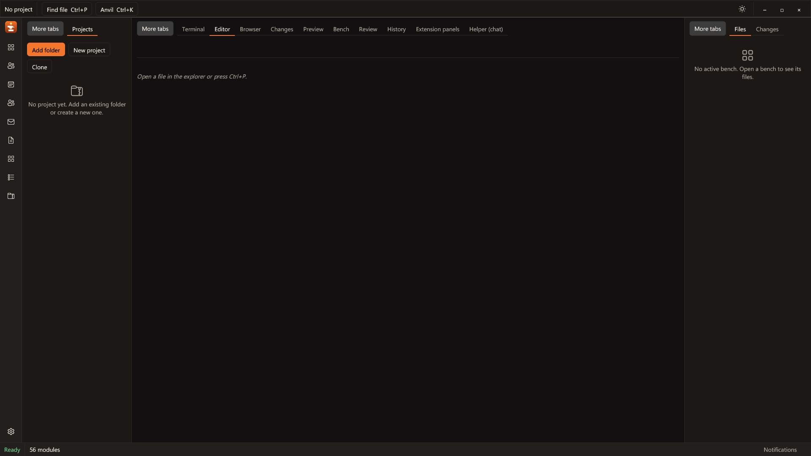

state: en.dark.bench-tab.editor.tab
capture_sha: pendente
model: opencode/glm-5.3-flash-free
---

# Tela principal — aba Editor sem projeto (bench-tab editor.tab)

Variante em inglês da página de referência (pt-BR.dark.bench-tab.editor.tab): janela principal da Forja sem projeto aberto, com o painel central na aba "Editor" e o painel direito em "Files", ambos exibindo mensagens de vazio. A estrutura é idêntica à da referência; mudam os textos (traduzidos para o inglês) e as coordenadas, pois a janela capturada é maior (1280×800 px contra 1024×768 px da referência).

## Como chegar
Abrir o app já leva a esta tela quando nenhum projeto está ativo: `forja-app --locale en --theme dark --bench-tab editor.tab`. Pela interface, é a janela inicial; a aba "Editor" do grupo central e a aba "Files" do grupo direito estão selecionadas.

## Regiões
- **Barra superior** (0,0)–(1280,42): à esquerda o rótulo "No project" e os botões "Find file  Ctrl+P" e "Anvil  Ctrl+K"; à direita um ícone de tema (sol) sem nome acessível e os botões de janela "–", "□" e "×".
- **Trilho à esquerda** (0,42)–(52,768): logotipo da Forja no topo e uma coluna de ícones-quadrados: "Board", "Helpers", "Routines", "Muster", "Requests", "Skills", "Usage", "Extensions", "Archive" e, no rodapé do trilho, "Settings".
- **Painel lateral esquerdo** (52,42)–(304,768): abas "Projects" (selecionada), "Benches" e "Extension panels"; botões "Add folder" (destacado em laranja), "New" e "Clone"; ícone de pasta e a mensagem "No project yet. Add an existing folder or create a new one."
- **Área central** (320,42)–(972,768): grupo de abas com "Terminal", "Editor" (selecionada, com sublinhado laranja), "Browser", "Changes", "Preview", "Bench", "Review", "History" e "Extension panels"; abaixo, uma régua horizontal e a mensagem em itálico "Open a file in the explorer or press Ctrl+P." sobre fundo vazio.
- **Painel direito** (988,42)–(1280,768): grupo de abas com "Files" (selecionada) e outras abas parcialmente sobrepostas; ícone de grade e a mensagem "No active bench. Open a bench to see its files."
- **Barra de status** (0,768)–(1280,800): à esquerda "Ready" (em verde) e "56 modules"; à direita "Notifications".

## Elementos
| Elemento | Tipo | Posição (px) | Estado | O que faz |
|---|---|---|---|---|
| "Find file  Ctrl+P" | Button | (99,5)–(218,37) | — | Abre a busca rápida de arquivos pelo nome (atalho Ctrl+P). Equivalente a "Achar arquivo Ctrl+P" na referência. |
| "Anvil  Ctrl+K" | Button | (226,5)–(327,37) | — | Abre a paleta de comandos (atalho Ctrl+K). Equivalente a "Bigorna Ctrl+K" na referência. |
| (sem nome acessível) | Unknown | (1101,5)–(1133,37) | — | Ícone de sol; alterna o tema da interface. |
| "–" | Button | (1155,5)–(1187,37) | — | Minimiza a janela. |
| "□" | Button | (1195,5)–(1227,37) | — | Maximiza/restaura a janela. |
| "×" | Button | (1235,5)–(1269,37) | — | Fecha a janela. |
| "No project" | Label | (11,12)–(77,31) | — | Mostra que não há projeto aberto; abre a lista de projetos. Equivalente a "Nenhum projeto". |
| (sem nome acessível) | Unknown | (304,42)–(320,768) | foco | Divisor arrastável entre o painel esquerdo e a área central. |
| (sem nome acessível) | Unknown | (972,42)–(988,768) | foco | Divisor arrastável entre a área central e o painel direito. |
| (sem nome acessível) | Image | (12,50)–(40,78) | — | Logotipo da Forja no topo do trilho. |
| "Projects" | Button | (64,50)–(136,82) | marcado=True | Aba selecionada do painel esquerdo; mostra a lista de projetos. Equivalente a "Projetos". |
| (sem nome acessível) | Unknown | (64,50)–(300,82) | foco | Faixa de fundo do grupo de abas do painel esquerdo. |
| "Benches" | Button | (136,50)–(211,82) | marcado=False | Aba que mostraria a lista de bancadas. Equivalente a "Bancadas". |
| "Extension panels" | Button | (211,50)–(337,82) | marcado=False | Aba do painel esquerdo; estende-se por baixo da área central. Equivalente a "Painéis de extensões". |
| "Terminal" | Button | (324,50)–(401,82) | marcado=False | Aba central que abriria o terminal integrado. |
| "Editor" | Button | (401,50)–(461,82) | marcado=True | Aba central selecionada; mostra o editor de arquivos. |
| "Browser" | Button | (461,50)–(534,82) | marcado=False | Aba central do navegador de código/estrutura. Equivalente a "Navegador". |
| "Changes" | Button | (534,50)–(611,82) | marcado=False | Aba central de comparação de arquivos. Equivalente a "Diferenças". |
| "Preview" | Button | (611,50)–(682,82) | marcado=False | Aba central de pré-visualização. Equivalente a "Visualizador". |
| "Bench" | Button | (682,50)–(743,82) | marcado=False | Aba central do conteúdo da bancada (sem correspondente visível na referência, onde estava coberto pela sobreposição). |
| "Review" | Button | (743,50)–(810,82) | marcado=False | Aba central de revisão de código. Equivalente a "Revisão". |
| "History" | Button | (810,50)–(878,82) | marcado=False | Aba de histórico. Equivalente a "Histórico". |
| "Extension panels" | Button | (878,50)–(1004,82) | marcado=False | Aba do grupo central; invade a faixa do grupo direito. Equivalente a "Painéis de extensões". |
| (sem nome acessível) | Unknown | (992,50)–(1268,82) | foco | Faixa de fundo do grupo de abas do painel direito. |
| "Files" | Button | (992,50)–(1043,82) | marcado=True | Aba selecionada do painel direito; mostra o explorador de arquivos. Equivalente a "Arquivos". |
| "Helper (chat)" | Button | (1004,50)–(1107,82) | marcado=False | Aba do chat do ajudante; sobreposta a "Files" e "Changes". Equivalente a "Ajudante (chat)". |
| "Changes" | Button | (1043,50)–(1120,82) | marcado=False | Aba de alterações da bancada; sobreposta a "Helper (chat)". Equivalente a "Mudanças". |
| "Search" | Button | (1120,50)–(1185,82) | marcado=False | Aba de busca. Equivalente a "Busca". |
| "Ports" | Button | (1185,50)–(1240,82) | marcado=False | Aba de portas em uso. Equivalente a "Portas". |
| "Extension panels" | Button | (1240,50)–(1366,82) | marcado=False | Aba do grupo direito; ultrapassa a borda direita da janela. Equivalente a "Painéis de extensões". |
| (sem nome acessível) | Unknown | (64,80)–(300,82) | — | Sublinhado da aba selecionada no grupo esquerdo. |
| (sem nome acessível) | Unknown | (992,80)–(1268,82) | — | Sublinhado da aba selecionada no grupo direito. |
| "Board" | Button | (8,94)–(44,130) | marcado=False | Atalho do trilho para o quadro de tarefas. Equivalente a "Quadro". |
| "Add folder" | Button | (64,98)–(154,130) | — | Abre o seletor para adicionar uma pasta como projeto. Equivalente a "Adicionar pasta". |
| "New" | Button | (162,98)–(213,130) | — | Cria um projeto novo. Equivalente a "Novo". |
| "Clone" | Button | (221,98)–(280,130) | — | Clona um repositório para criar um projeto. Equivalente a "Clonar". |
| (ícone) | Label | (1116,114)–(1144,142) | — | Ícone de grade do estado vazio do painel "Files". |
| "Helpers" | Button | (8,138)–(44,174) | marcado=False | Atalho do trilho para a lista de ajudantes. Equivalente a "Ajudantes". |
| "No active bench. Open a bench to see its files." | Label | (1004,150)–(1256,188) | — | Mensagem de vazio do explorador de arquivos. Equivalente a "Nenhuma bancada ativa. Abra uma bancada para ver os arquivos." |
| (ícone) | Label | (168,158)–(196,186) | — | Ícone de pasta do estado vazio da lista de projetos. |
| "Open a file in the explorer or press Ctrl+P." | Label | (324,160)–(583,179) | — | Mensagem de vazio da área do editor. Equivalente a "Abra um arquivo no explorador ou pressione Ctrl+P." |
| "Routines" | Button | (8,182)–(44,218) | marcado=False | Atalho do trilho para rotinas. Equivalente a "Rotinas". |
| "No project yet. Add an existing folder or create a new one." | Label | (67,194)–(297,232) | — | Mensagem de vazio da lista de projetos. Equivalente a "Nenhum projeto ainda. Adicione uma pasta ou crie um novo." |
| "Muster" | Button | (8,226)–(44,262) | marcado=False | Atalho do trilho para o mutirão de ajudantes. Equivalente a "Mutirão". |
| "Requests" | Button | (8,270)–(44,306) | marcado=False | Atalho do trilho para pedidos. Equivalente a "Pedidos". |
| "Skills" | Button | (8,314)–(44,350) | marcado=False | Atalho do trilho para skills. |
| "Usage" | Button | (8,358)–(44,394) | marcado=False | Atalho do trilho para o consumo de tokens. Equivalente a "Uso". |
| "Extensions" | Button | (8,402)–(44,438) | marcado=False | Atalho do trilho para extensões. Equivalente a "Extensões". |
| "Archive" | Button | (8,446)–(44,482) | marcado=False | Atalho do trilho para o acervo. Equivalente a "Acervo". |
| "Settings" | Button | (8,724)–(44,760) | marcado=False | Atalho do trilho para os ajustes, fixado no fim do trilho. Equivalente a "Ajustes". |
| "Ready" | Label | (10,775)–(48,794) | — | Estado geral do app na barra de status. Equivalente a "Pronto". |
| "56 modules" | Label | (70,775)–(142,794) | — | Contagem de módulos carregados. Equivalente a "56 módulos". |
| "Notifications" | Label | (1168,775)–(1246,794) | — | Abre o painel de notificações. Equivalente a "Notificações". |

## Aparência
Idêntica à da referência: tema escuro com fundo geral marrom-escuro quase preto (tons de #1a–#20), painéis levemente mais claros que a área central e cor de destaque laranja no botão primário "Add folder", no sublinhado das abas selecionadas ("Projects", "Editor", "Files") e no texto "Ready" da barra de status. Tipografia sans-serif de corpo pequeno (aprox. 12–13 px); a mensagem do editor vem em itálico e cinza. Abas selecionadas em texto claro, não selecionadas em cinza médio. Os três grupos de abas (esquerdo, central, direito) ficam alinhados na mesma faixa (y 50–82), separados por divisores verticais de 16 px. Botões de ação têm fundo levemente elevado e cantos arredondados; o trilho esquerdo usa apenas ícones quadrados de 36 px centralizados. Por a janela ser mais larga (1280 px), a área central e o painel direito mostram mais abas simultaneamente do que na captura de referência.

## Problemas encontrados
- Sobreposição de abas: no limite esquerdo, "Extension panels" do painel lateral (211,50)–(337,82) invade a faixa do grupo central e passa por baixo de "Terminal" (324,50)–(401,82).
- Sobreposição entre grupos central e direito: "Extension panels" do grupo central (878,50)–(1004,82) invade a faixa do grupo direito (992,50)–(1268,82) e passa por baixo de "Files".
- Grupo de abas direito com fileiras sobrepostas: "Files" (992,50)–(1043,82) sob "Helper (chat)" (1004,50)–(1107,82) e "Helper (chat)" sob "Changes" (1043,50)–(1120,82) na faixa 1043–1107.
- Elemento fora da janela: "Extension panels" (1240,50)–(1366,82) estende-se além da largura de 1280 px e aparece cortado na borda direita.
- Botão sem nome acessível: o ícone de tema na barra superior (1101,5)–(1133,37) é um Unknown clicável sem rótulo.
- Ícones/imagens sem alternativa textual: logotipo (12,50)–(40,78) e os ícones de estado vazio (1116,114) e (168,158) aparecem como "(sem nome acessível)".
- Divisores verticais (304,42)–(320,768) e (972,42)–(988,768) são Unknown sem nome acessível, o que dificulta identificação por leitor de tela.
- Textos de estado vazio em cinza sobre fundo escuro têm contraste baixo ("Open a file in the explorer or press Ctrl+P.").
