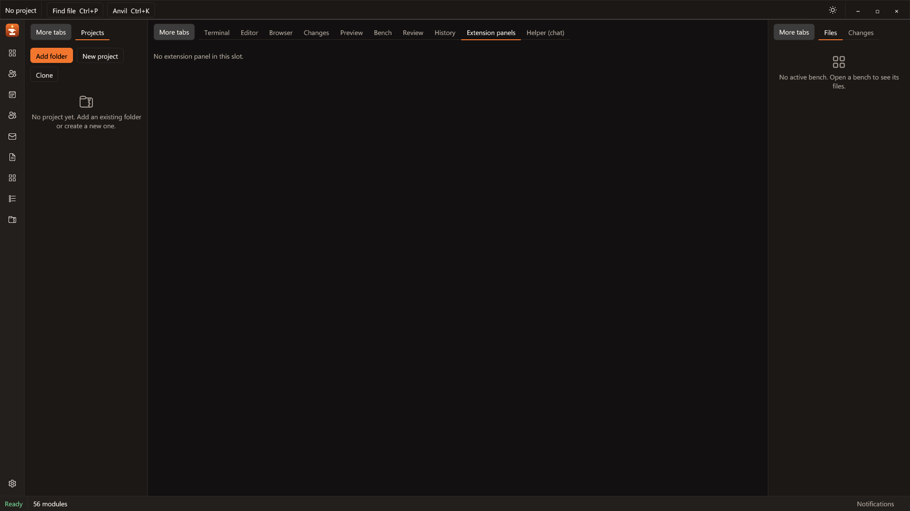

state: en.dark.bench-tab.extension.panels.bench
capture_sha: —
model: opencode/glm-5.3-flash-free
---

# Aba de bancada — Painéis de extensões (slot vazio, variante en)

Tela da aba de bancada com o painel central apontando para o slot `extension.panels.bench`, sem painel de extensão carregado, e os painéis laterais (Projetos e Arquivos) também em estado vazio. Variante em inglês (tema dark) da página de referência `pt-BR.dark.bench-tab.extension.panels.bench`; a janela desta captura tem 1280×800 px (a referência tem 1053×768), portanto as coordenadas mudam, mas a estrutura é a mesma.

## Como chegar
Abrir o app sem projeto ativo e com a aba de bancada selecionada: `forja-app --locale en --theme dark --bench-tab extension.panels.bench`. Na interface: na faixa de abas à esquerda clicar em "Extension panels" (ou manter a aba de bancada ativa) — o painel central exibe a mensagem de slot vazio. Comando de captura: captura do estado `en.dark.bench-tab.extension.panels.bench` (tema dark, idioma en), imagem `captures/en.dark.bench-tab.extension.panels.bench.png` (1280×800 px, escala 1.0).

## Regiões
- **Barra superior** (0,0)–(1280,42): rótulo do projeto ("No project"), botões "Find file  Ctrl+P" e "Anvil  Ctrl+K", alternador de tema (ícone de sol, sem nome) e botões de janela ("–", "□", "×").
- **Trilho à esquerda** (0,42)–(52,768): logotipo da Forja (imagem laranja) e botões-ícone na vertical: "Board", "Helpers", "Routines", "Muster", "Requests", "Skills", "Usage", "Extensions", "Archive" e, no rodapé, "Settings".
- **Painel lateral esquerdo** (52,42)–(304,768): abas "Projects" (ativa, com sublinhado), "Benches" e "Extension panels" (cortada); botões "Add folder" (destaque laranja), "New" e "Clone"; estado vazio com ícone de pasta e o texto "No project yet. Add an existing folder or create a new one.".
- **Divisor** (304,42)–(320,768): separador redimensionável entre o painel esquerdo e a área central (sem nome acessível).
- **Área central** (320,42)–(972,768): faixa de abas "Terminal", "Editor", "Browser", "Changes", "Preview", "Bench", "Review", "History" e "Extension panels" (ativa, cortada na borda), com a mensagem "No extension panel in this slot." — conteúdo vazio do slot `extension.panels.bench`.
- **Divisor** (972,42)–(988,768): separador redimensionável entre a área central e o painel direito (sem nome acessível).
- **Painel lateral direito** (988,42)–(1280,768): grupo de abas ("Files" ativa; "Helper (chat)", "Changes", "Search" e "Ports" sobrepostas/visíveis; "Extension panels" fora da janela), ícone de grade e a mensagem "No active bench. Open a bench to see its files.".
- **Barra de status** (0,768)–(1280,800): "Ready" (em verde), "56 modules" e, à direita, "Notifications".

## Elementos
| Elemento | Tipo | Posição (px) | Estado | O que faz |
|---|---|---|---|---|
| "No project" | Label | (11,12)–(77,31) | — | Rótulo na barra superior indicando ausência de projeto aberto |
| "Find file  Ctrl+P" | Button | (99,5)–(218,37) | click,focus | Abre a busca rápida de arquivos (atalho Ctrl+P) |
| "Anvil  Ctrl+K" | Button | (226,5)–(327,37) | click,focus | Abre a paleta de comandos (atalho Ctrl+K) |
| (sem nome acessível) | Unknown | (1101,5)–(1133,37) | click,focus | Ícone de sol: alternador de tema claro/escuro |
| "–" | Button | (1155,5)–(1187,37) | click,focus | Minimiza a janela |
| "□" | Button | (1195,5)–(1227,37) | click,focus | Maximiza/restaura a janela |
| "×" | Button | (1235,5)–(1269,37) | click,focus | Fecha a janela |
| (sem nome acessível) | Image | (12,50)–(40,78) | click,focus | Logotipo da Forja (bigorna laranja) no topo do trilho |
| "Projects" | Button | (64,50)–(136,82) | click,focus; marcado=True | Aba ativa do painel esquerdo; mostra a lista de projetos |
| (sem nome acessível) | Unknown | (64,50)–(300,82) | focus | Faixa do grupo de abas do painel esquerdo |
| "Benches" | Button | (136,50)–(211,82) | click,focus; marcado=False | Aba que alterna para a lista de bancadas |
| "Extension panels" | Button | (211,50)–(337,82) | click,focus; marcado=False | Aba do painel esquerdo; retângulo avança até x=337, cruza o divisor (x≈304–320) e o texto aparece cortado ("Extension pa") |
| "Terminal" | Button | (324,50)–(401,82) | click,focus; marcado=False | Aba do painel central que mostra o terminal |
| "Editor" | Button | (401,50)–(461,82) | click,focus; marcado=False | Aba que mostra o editor de arquivos |
| "Browser" | Button | (461,50)–(534,82) | click,focus; marcado=False | Aba que mostra o navegador |
| "Changes" | Button | (534,50)–(611,82) | click,focus; marcado=False | Aba que mostra o visor de diferenças |
| "Preview" | Button | (611,50)–(682,82) | click,focus; marcado=False | Aba que mostra o visualizador |
| "Bench" | Button | (682,50)–(743,82) | click,focus; marcado=False | Aba que mostra a visão da bancada |
| "Review" | Button | (743,50)–(810,82) | click,focus; marcado=False | Aba de revisão |
| "History" | Button | (810,50)–(878,82) | click,focus; marcado=False | Aba de histórico |
| "Extension panels" | Button | (878,50)–(1004,82) | click,focus; marcado=True | Aba ativa da área central (slot `extension.panels.bench`); retângulo cruza o divisor direito (x≈972–988) e avança sobre o painel direito |
| (sem nome acessível) | Unknown | (992,50)–(1268,82) | focus | Faixa do grupo de abas do painel direito |
| "Files" | Button | (992,50)–(1043,82) | click,focus; marcado=True | Aba ativa do painel direito; lista de arquivos da bancada |
| "Helper (chat)" | Button | (1004,50)–(1107,82) | click,focus; marcado=False | Aba do chat do ajudante; sobreposta a "Files" e "Changes" |
| "Changes" | Button | (1043,50)–(1120,82) | click,focus; marcado=False | Aba de mudanças do painel direito |
| "Search" | Button | (1120,50)–(1185,82) | click,focus; marcado=False | Aba de busca |
| "Ports" | Button | (1185,50)–(1240,82) | click,focus; marcado=False | Aba de portas |
| "Extension panels" | Button | (1240,50)–(1366,82) | click,focus; marcado=False | Segunda aba "Extension panels" no grupo do painel direito; retângulo ultrapassa a largura da janela (1280 px) e fica cortado/invisível |
| (sem nome acessível) | Unknown | (64,80)–(300,82) | click,focus | Indicador de sublinhado da aba ativa do painel esquerdo |
| (sem nome acessível) | Unknown | (992,80)–(1268,82) | click,focus | Indicador de sublinhado da aba ativa do painel direito |
| "Board" | Button | (8,94)–(44,130) | click,focus; marcado=False | Botão-ícone do trilho para o quadro |
| "Add folder" | Button | (64,98)–(154,130) | click,focus | Adiciona uma pasta de projeto (botão em destaque laranja) |
| "New" | Button | (162,98)–(213,130) | click,focus | Cria um novo projeto |
| "Clone" | Button | (221,98)–(280,130) | click,focus | Clona um projeto/bancada |
| "No extension panel in this slot." | Label | (324,98)–(513,117) | click | Mensagem de estado vazio do slot `extension.panels.bench` |
| (ícone) | Label | (1116,114)–(1144,142) | click | Ícone de grade do estado vazio do painel direito |
| "Helpers" | Button | (8,138)–(44,174) | click,focus; marcado=False | Botão-ícone do trilho para a lista de ajudantes |
| "No active bench. Open a bench to see its files." | Label | (1004,150)–(1256,188) | click | Mensagem de estado vazio do painel de arquivos |
| "Routines" | Button | (8,182)–(44,218) | click,focus; marcado=False | Botão-ícone do trilho para rotinas |
| (ícone) | Label | (168,158)–(196,186) | click | Ícone de pasta do estado vazio do painel de projetos |
| "Muster" | Button | (8,226)–(44,262) | click,focus; marcado=False | Botão-ícone do trilho para o mutirão |
| "No project yet. Add an existing folder or create a new one." | Label | (67,194)–(297,232) | click | Mensagem de estado vazio da lista de projetos |
| "Requests" | Button | (8,270)–(44,306) | click,focus; marcado=False | Botão-ícone do trilho para pedidos |
| "Skills" | Button | (8,314)–(44,350) | click,focus; marcado=False | Botão-ícone do trilho para skills |
| "Usage" | Button | (8,358)–(44,394) | click,focus; marcado=False | Botão-ícone do trilho para uso |
| "Extensions" | Button | (8,402)–(44,438) | click,focus; marcado=False | Botão-ícone do trilho para extensões |
| "Archive" | Button | (8,446)–(44,482) | click,focus; marcado=False | Botão-ícone do trilho para o acervo |
| "Settings" | Button | (8,724)–(44,760) | click,focus; marcado=False | Botão-ícone do trilho para os ajustes, fixado no rodapé |
| (sem nome acessível) | Unknown | (304,42)–(320,768) | focus | Divisor vertical entre o painel esquerdo e a área central |
| (sem nome acessível) | Unknown | (972,42)–(988,768) | focus | Divisor vertical entre a área central e o painel direito |
| "Ready" | Label | (10,775)–(48,794) | click | Status geral na barra inferior, em verde |
| "56 modules" | Label | (70,775)–(142,794) | click | Contagem de módulos carregados |
| "Notifications" | Label | (1168,775)–(1246,794) | click,focus | Atalho para notificações, à direita da barra de status |

## Aparência
Igual à referência pt-BR (mesmo tema dark "Brasa"): fundo marrom-escuro quase preto de tonalidade quente; barra superior levemente mais escura que o conteúdo. Destaque laranja no logotipo do trilho, no botão primário "Add folder" e no sublinhado das abas ativas ("Projects", "Extension panels" central e "Files"). Texto em cinza-claro sobre fundo escuro; ícones e mensagens de estado vazio em cinza médio (contraste menor). Tipografia sem serifa, corpo em torno de 14 px (abas e botões) e 13 px na barra de status. O que muda nesta variante são só os textos, todos em inglês ("No project", "Ready", "56 modules" etc.), e a geometria: a janela é mais larga (1280×800 px), então os grupos de abas cabem com folga e a sobreposição entre "Bench"/"Review"/"History" e a faixa do painel direito vista na referência não ocorre aqui — persistem apenas as sobreposições dentro do grupo do painel direito.

## Problemas encontrados
- Estouro de largura: o botão "Extension panels" do painel direito (1240,50)–(1366,82) tem retângulo além da largura da janela (1280 px) e fica cortado ou invisível.
- Sobreposição de abas no painel direito: "Helper (chat)" (1004,50)–(1107,82) sobrepõe "Files" (992,50)–(1043,82) e "Changes" (1043,50)–(1120,82), indicando dois grupos de abas desenhados na mesma faixa.
- A aba central "Extension panels" (878,50)–(1004,82) cruza o divisor direito (x≈972–988) e avança sobre a faixa de abas do painel direito (992,50)–(1268,82).
- Texto cortado por transbordo de painel: a aba "Extension panels" do painel esquerdo (211,50)–(337,82) cruza o divisor em x≈304–320 e aparece truncada ("Extension pa") na borda do painel.
- Nomes acessíveis duplicados e ambíguos: três botões "Extension panels" (painel esquerdo, área central e painel direito) e dois botões "Changes" (área central e painel direito) com o mesmo texto.
- Elementos sem nome acessível: alternador de tema (1101,5), os dois divisores verticais (304,42 e 972,42), as faixas dos grupos de abas e os indicadores de sublinhado — apenas "Unknown"/(sem nome acessível) na árvore; o logotipo (Image) e os ícones de estado vazio também não têm nome.
- Botões de janela nomeados apenas pelos símbolos "–", "□" e "×", sem rótulo descritivo (minimizar/maximizar/fechar).
