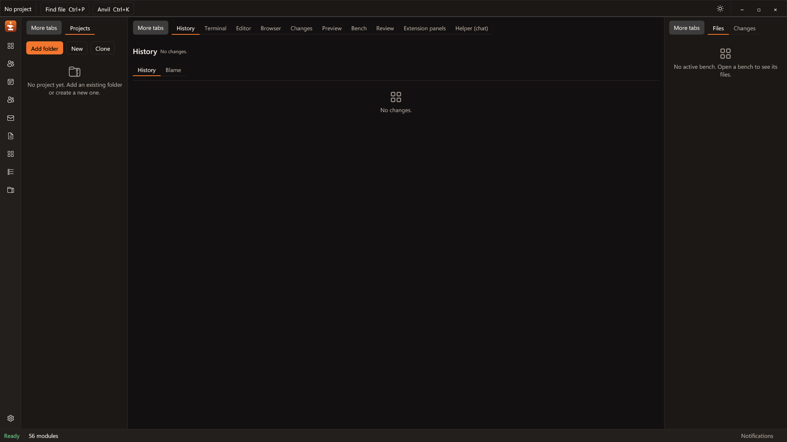

state: en.dark.bench-tab.git.history
capture_sha: 437f4a8d6bd67172
model: opencode/glm-5.3-flash-free
---

# Bench — History tab (Git)

Tela da bancada que mostra a visão de histórico Git no painel central; nesta captura não há projeto nem bancada ativa, então histórico, projetos e arquivos aparecem vazios. É a variante em inglês da página de referência `pt-BR.dark.bench-tab.git.history`: a estrutura e o layout são os mesmos, mudando os textos da interface (agora em inglês) e as coordenadas, pois a janela capturada é maior (1280×800 px contra 1024×768 px da referência).

## Como chegar
Abrir a Forja, abrir uma bancada e, na faixa de abas do painel central, escolher a visão "History" (com a sub-visão "History" ativa ao lado de "Blame"). Comando de captura: `forja-app --locale en --theme dark --bench-tab git.history`.

## Regiões
- **Barra superior** (0,0)–(1280,42): rótulo "No project" à esquerda, botões "Find file  Ctrl+P" e "Anvil  Ctrl+K"; à direita, botão sem nome (ícone de sol, alternar tema) e os botões de janela "–", "□" e "×".
- **Trilho à esquerda** (0,42)–(52,768): logotipo da Forja no topo e, abaixo, ícones de navegação "Board", "Helpers", "Routines", "Muster", "Requests", "Skills", "Usage", "Extensions", "Archive" e, na base, "Settings".
- **Faixa de abas esquerda + painel Projects** (52,42)–(304,768): abas "Projects" (ativa, com sublinhado laranja), "Benches" e "Extension panels"; abaixo, os botões "Add folder" (destaque laranja), "New" e "Clone" e o estado vazio com ícone de pasta e o texto "No project yet. Add an existing folder or create a new one.".
- **Divisor vertical** (304,42)–(320,768): separador sem nome entre o painel de projetos e o painel central.
- **Painel central** (320,42)–(972,768): faixa de abas "Terminal", "Editor", "Browser", "Changes", "Preview", "Bench", "Review" e "History" (ativa), seguida de "Extension panels" truncada pela borda do painel; abaixo, o cabeçalho "History" com a nota "No changes.", as sub-abas "History" (ativa) e "Blame", e uma grande área vazia com ícone de grade e "No changes." centralizados.
- **Divisor vertical** (972,42)–(988,768): separador sem nome entre o painel central e o painel direito.
- **Painel direito (Files)** (988,42)–(1280,768): abas "Files" (ativa), "Changes", "Search" e "Ports" (visíveis) e "Extension panels" cortada pela borda da janela; abaixo, ícone de grade (quatro quadrados) e o estado vazio "No active bench. Open a bench to see its files.".
- **Barra de status** (0,768)–(1280,800): "Ready" em verde à esquerda, "56 modules" ao lado e "Notifications" à direita.

## Elementos
| Elemento | Tipo | Posição (px) | Estado | O que faz |
|---|---|---|---|---|
| "Find file  Ctrl+P" | Button | (99,5)–(218,37) | — | Abre a busca de arquivos pelo atalho Ctrl+P. |
| "Anvil  Ctrl+K" | Button | (226,5)–(327,37) | — | Abre a paleta de comandos pelo atalho Ctrl+K. |
| (sem nome acessível) | Unknown | (1101,5)–(1133,37) | focável | Botão com ícone de sol: alterna o tema claro/escuro. |
| "–" | Button | (1155,5)–(1187,37) | — | Minimiza a janela. |
| "□" | Button | (1195,5)–(1227,37) | — | Maximiza/restaura a janela. |
| "×" | Button | (1235,5)–(1269,37) | — | Fecha a janela. |
| "No project" | Label | (11,12)–(77,31) | clicável, focável | Indica que não há projeto aberto. |
| (sem nome acessível) | Unknown | (304,42)–(320,768) | focável | Divisor vertical entre os painéis esquerdo e central. |
| (sem nome acessível) | Unknown | (972,42)–(988,768) | focável | Divisor vertical entre os painéis central e direito. |
| (sem nome acessível) | Image | (12,50)–(40,78) | clicável, focável | Logotipo da Forja no topo do trilho. |
| "Projects" | Button | (64,50)–(136,82) | marcado=True | Aba ativa do grupo esquerdo; mostra o painel de projetos. |
| (sem nome acessível) | Unknown | (64,50)–(300,82) | focável | Faixa de abas do grupo esquerdo. |
| "Benches" | Button | (136,50)–(211,82) | marcado=False | Aba para o painel de bancadas. |
| "Extension panels" | Button | (211,50)–(337,82) | marcado=False | Aba do grupo esquerdo; rótulo truncado visualmente em "Extension pa…". |
| "Terminal" | Button | (324,50)–(401,82) | marcado=False | Aba do painel central para a visão de terminal. |
| "Editor" | Button | (401,50)–(461,82) | marcado=False | Aba do painel central para a visão de editor. |
| "Browser" | Button | (461,50)–(534,82) | marcado=False | Aba do painel central para a visão de navegador. |
| "Changes" | Button | (534,50)–(611,82) | marcado=False | Aba do painel central para a visão de diferenças. |
| "Preview" | Button | (611,50)–(682,82) | marcado=False | Aba do painel central para a visão de visualização. |
| "Bench" | Button | (682,50)–(743,82) | marcado=False | Aba do painel central para a visão da bancada. |
| "Review" | Button | (743,50)–(810,82) | marcado=False | Aba do painel central para a visão de revisão. |
| "History" | Button | (810,50)–(878,82) | marcado=True | Aba ativa do painel central; mostra a visão Git. |
| "Extension panels" | Button | (878,50)–(1004,82) | marcado=False | Aba do painel central; rótulo truncado visualmente em "Extension pane…". |
| (sem nome acessível) | Unknown | (992,50)–(1268,82) | focável | Faixa de abas do grupo direito. |
| "Files" | Button | (992,50)–(1043,82) | marcado=True | Aba ativa do painel direito; mostra o explorador de arquivos da bancada. |
| "Helper (chat)" | Button | (1004,50)–(1107,82) | marcado=False | Aba do grupo direito; retângulo sobreposto aos de "Files" e "Changes" e não visível como aba na imagem. |
| "Changes" | Button | (1043,50)–(1120,82) | marcado=False | Aba do grupo direito para mudanças da bancada. |
| "Search" | Button | (1120,50)–(1185,82) | marcado=False | Aba do grupo direito de busca. |
| "Ports" | Button | (1185,50)–(1240,82) | marcado=False | Aba do grupo direito para portas/terminais. |
| "Extension panels" | Button | (1240,50)–(1366,82) | marcado=False | Aba cortada pela borda direita da janela (retângulo vai até x=1366, além dos 1280 px visíveis). |
| (sem nome acessível) | Unknown | (64,80)–(300,82) | clicável, focável | Linha de sublinhado/rodapé da faixa de abas esquerda. |
| (sem nome acessível) | Unknown | (992,80)–(1268,82) | clicável, focável | Linha de sublinhado/rodapé da faixa de abas direita. |
| "Board" | Button | (8,94)–(44,130) | marcado=False | Ícone do trilho: abre o quadro geral. |
| "Add folder" | Button | (64,98)–(154,130) | — | Adiciona uma pasta de projeto existente (botão laranja em destaque). |
| "New" | Button | (162,98)–(213,130) | — | Cria um projeto novo. |
| "Clone" | Button | (221,98)–(280,130) | — | Clona um repositório como projeto. |
| "History" | Label | (324,102)–(383,126) | clicável | Título do painel central (visão de histórico Git). |
| "No changes." | Label | (391,106)–(457,122) | clicável | Nota ao lado do título: sem mudanças no histórico. |
| (ícone) | Label | (1116,114)–(1144,142) | clicável | Ícone de grade (quatro quadrados) do estado vazio do painel direito. |
| "Helpers" | Button | (8,138)–(44,174) | marcado=False | Ícone do trilho: abre a lista de ajudantes. |
| "History" | Button | (324,142)–(392,174) | marcado=True | Sub-aba ativa da visão Git: lista de commits. |
| "Blame" | Button | (392,142)–(453,174) | marcado=False | Sub-aba da visão Git: blame por linha. |
| "No active bench. Open a bench to see its files." | Label | (1004,150)–(1256,188) | clicável | Estado vazio do painel de arquivos, em duas linhas. |
| (ícone) | Label | (168,158)–(196,186) | clicável | Ícone de pasta do estado vazio do painel de projetos. |
| "Routines" | Button | (8,182)–(44,218) | marcado=False | Ícone do trilho: abre as rotinas. |
| "No project yet. Add an existing folder or create a new one." | Label | (67,194)–(297,232) | clicável | Estado vazio do painel de projetos, em duas linhas. |
| (ícone) | Label | (702,212)–(730,240) | clicável | Ícone de grade do estado vazio da área central. |
| "Muster" | Button | (8,226)–(44,262) | marcado=False | Ícone do trilho: abre o mutirão. |
| "No changes." | Label | (678,248)–(754,267) | clicável | Texto do estado vazio da área central, abaixo do ícone de grade. |
| "Requests" | Button | (8,270)–(44,306) | marcado=False | Ícone do trilho: abre os pedidos. |
| "Skills" | Button | (8,314)–(44,350) | marcado=False | Ícone do trilho: abre as skills. |
| "Usage" | Button | (8,358)–(44,394) | marcado=False | Ícone do trilho: abre o uso. |
| "Extensions" | Button | (8,402)–(44,438) | marcado=False | Ícone do trilho: abre as extensões. |
| "Archive" | Button | (8,446)–(44,482) | marcado=False | Ícone do trilho: abre o acervo. |
| "Settings" | Button | (8,724)–(44,760) | marcado=False | Ícone do trilho: abre os ajustes, fixado na base. |
| "Ready" | Label | (10,775)–(48,794) | clicável | Status geral na barra de status, em verde. |
| "56 modules" | Label | (70,775)–(142,794) | clicável | Contagem de módulos carregados. |
| "Notifications" | Label | (1168,775)–(1246,794) | clicável, focável | Acesso às notificações, à direita da barra de status. |

## Aparência
Idêntica à referência pt-BR em tema escuro: fundo geral quase preto com leve tom quente, painéis em variação um pouco mais clara e divisores discretos. Texto principal em cinza-claro; textos secundários ("No changes.", estados vazios) em cinza médio. O acento laranja "Brasa" aparece no botão "Add folder" (fundo laranja, texto escuro) e nos sublinhados das abas ativas "Projects", "History" (central), "Files" e da sub-aba "History", além de no título "History". "Ready" na barra de status aparece em verde. Tipografia sem serifa, corpo em torno de 13–14 px e títulos em ~17–18 px seminegrito; com a janela mais larga (1280 px), o texto do estado vazio do painel direito cabe em uma frase quebrada em duas linhas sem cortes. Botões com cantos arredondados, ícones do trilho em traço fino em coluna de ~36 px e estados vazios centralizados no painel, com ícone acima do texto.

## Problemas encontrados
- Aba "Extension panels" (1240,50)–(1366,82) tem retângulo além da largura da janela (1280 px): fica parcialmente fora da área visível, aparecendo na imagem só como "Ext…".
- Retângulos de abas sobrepostos no grupo direito: "Helper (chat)" (1004–1107) sobre "Files" (992–1043) e "Changes" (1043–1120); "Helper (chat)" não aparece como aba visível na imagem, indício de elemento duplicado ou de grupo de abas sobreposto na árvore.
- Nomes ambíguos para leitores de tela: três botões chamados "Extension panels" (grupos esquerdo, central e direito), dois chamados "History" (aba central e sub-aba do painel Git) e dois chamados "Changes" (aba central e aba do grupo direito).
- Rótulos de aba truncados pelos divisores/limites de painel: "Extension pa…" (grupo esquerdo, corte em x≈300), "Extension pane…" (painel central, corte em x≈972) e "Ext…" (painel direito, corte na borda da janela em x=1280).
- Seis elementos sem nome acessível: os dois divisores verticais (304,42)–(320,768) e (972,42)–(988,768), as duas faixas de abas (64,50)–(300,82) e (992,50)–(1268,82), a Image do logotipo (12,50)–(40,78) e o botão de alternar tema (1101,5)–(1133,37), este identificável apenas pelo ícone de sol.
- Três Labels declarados como "(ícone)" sem nome acessível: os de (1116,114)–(1144,142), (168,158)–(196,186) e (702,212)–(730,240).
- O texto da interface está integralmente em inglês (locale "en"), conforme esperado nesta variante; nenhuma mistura de idiomas foi observada.
