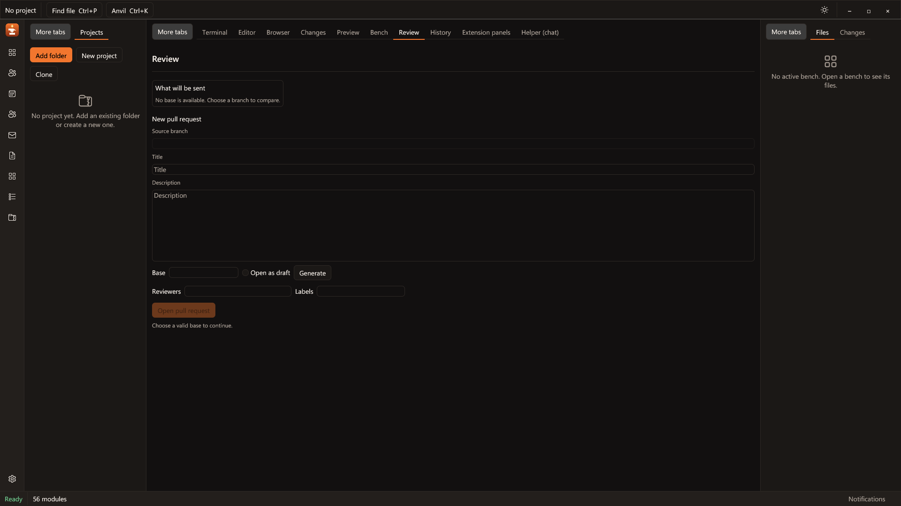

state: en.dark.bench-tab.review.tab
capture_sha: 4d5b3cce3b655686
model: opencode/glm-5.3-flash-free
---

# Review (bench tab)

Tela da aba "Review" de uma bancada da Forja, que concentra a criação de um novo pull request; capturada sem projeto aberto, por isso os painéis laterais mostram estados vazios. É a variante em inglês da página de referência `pt-BR.dark.bench-tab.review.tab`: mesma estrutura e cores; mudam os textos (em inglês) e as coordenadas, pois a janela capturada é maior (1280×800 px contra 1054×768 px da referência).

## Como chegar
Abrir o app sem projeto carregado (rótulo "No project" na barra superior), entrar na bancada e clicar na aba "Review" do conjunto de abas da bancada ("Files", "Bench", "Changes", "Review", "History"…). Comando de captura: `forja-app --locale en --theme dark --bench-tab review.tab`.

## Regiões
- **Barra superior** — (0,0)–(1280,42): rótulo "No project", botões "Find file  Ctrl+P" e "Anvil  Ctrl+K", ícone de tema (sol, sem nome acessível) e botões de janela "–", "□", "×".
- **Trilho à esquerda** — (0,42)–(56,768): logotipo da Forja (imagem) no topo, seguido dos botões-ícone "Board", "Helpers", "Routines", "Muster", "Requests", "Skills", "Usage", "Extensions", "Archive" e, na base, "Settings".
- **Painel esquerdo (Projects)** — (56,42)–(304,768): abas "Projects" (ativa), "Benches" e "Extension panels"; botões "Add folder", "New" e "Clone"; estado vazio com ícone de pasta e o texto "No project yet. Add an existing folder or create a new one.".
- **Área central (Review)** — (320,42)–(972,768): cabeçalho com abas "Terminal", "Editor", "Browser", "Changes", "Preview", "Bench", "Review" (ativa), "History" e "Extension panels"; título "Review" com o botão "Refresh review"; formulário "New pull request" com rótulo "Source branch:", campo "Title", campo multilinha "Description", campo "Base", caixa "Open as draft", botão "Generate", campos "Reviewers" e "Labels" e o botão "Open pull request".
- **Painel direito (Files)** — (988,42)–(1280,768): abas "Files" (ativa, sublinhada), "Helper (chat)", "Changes", "Search", "Ports" e "Extension panels"; estado vazio com ícone de grade e o texto "No active bench. Open a bench to see its files.".
- **Barra de status** — (0,768)–(1280,800): "Ready" em verde, "56 modules" à esquerda e "Notifications" à direita.
- Dois divisores verticais sem nome acessível separam os painéis: (304,42)–(320,768) e (972,42)–(988,768).

## Elementos
| Elemento | Tipo | Posição (px) | Estado | O que faz |
|---|---|---|---|---|
| "Find file  Ctrl+P" | Botão | (99,5)–(218,37) | — | Abre o seletor rápido de arquivos (atalho Ctrl+P) |
| "Anvil  Ctrl+K" | Botão | (226,5)–(327,37) | — | Abre a paleta de comandos da Forja (atalho Ctrl+K) |
| (sem nome acessível) | Desconhecido | (1101,5)–(1133,37) | — | Ícone de sol; alterna o tema da interface |
| "–" | Botão | (1155,5)–(1187,37) | — | Minimiza a janela |
| "□" | Botão | (1195,5)–(1227,37) | — | Maximiza/restaura a janela |
| "×" | Botão | (1235,5)–(1269,37) | — | Fecha a janela |
| "No project" | Rótulo | (11,12)–(77,31) | — | Indica que nenhum projeto está aberto |
| (sem nome acessível) | Desconhecido | (304,42)–(320,768) | — | Divisor vertical entre o painel esquerdo e a área central |
| (sem nome acessível) | Desconhecido | (972,42)–(988,768) | — | Divisor vertical entre a área central e o painel direito |
| (sem nome acessível) | Imagem | (12,50)–(40,78) | — | Logotipo da Forja (bigorna) no topo do trilho |
| "Projects" | Botão | (64,50)–(136,82) | marcado=True | Aba ativa do painel esquerdo; mostra a lista de projetos |
| (sem nome acessível) | Desconhecido | (64,50)–(300,82) | — | Faixa de fundo do conjunto de abas do painel esquerdo |
| "Benches" | Botão | (136,50)–(211,82) | marcado=False | Aba do painel esquerdo; lista as bancadas |
| "Extension panels" | Botão | (211,50)–(337,82) | marcado=False | Aba do painel esquerdo; painéis de extensões (texto truncado na imagem) |
| "Terminal" | Botão | (324,50)–(401,82) | marcado=False | Aba do cabeçalho central; abre o terminal da bancada |
| "Editor" | Botão | (401,50)–(461,82) | marcado=False | Aba do cabeçalho central; abre o editor |
| "Browser" | Botão | (461,50)–(534,82) | marcado=False | Aba do cabeçalho central; abre o navegador |
| "Changes" | Botão | (534,50)–(611,82) | marcado=False | Aba do cabeçalho central; mostra diffs |
| "Preview" | Botão | (611,50)–(682,82) | marcado=False | Aba do cabeçalho central; abre o visualizador |
| "Bench" | Botão | (682,50)–(743,82) | marcado=False | Aba do cabeçalho central; visão geral da bancada |
| "Review" | Botão | (743,50)–(810,82) | marcado=True | Aba da bancada ativa no cabeçalho central; abre a tela documentada (criação de pull request) |
| "History" | Botão | (810,50)–(878,82) | marcado=False | Aba do cabeçalho central; histórico de commits |
| "Extension panels" | Botão | (878,50)–(1004,82) | marcado=False | Aba do cabeçalho central; painéis de extensões (ultrapassa o painel central) |
| (sem nome acessível) | Desconhecido | (992,50)–(1268,82) | — | Faixa de fundo do conjunto de abas do painel direito |
| "Files" | Botão | (992,50)–(1043,82) | marcado=True | Aba ativa do painel direito; lista de arquivos (sublinhada) |
| "Helper (chat)" | Botão | (1004,50)–(1107,82) | marcado=False | Aba do painel direito; chat do ajudante (não visível na imagem, sobreposta às demais) |
| "Changes" | Botão | (1043,50)–(1120,82) | marcado=False | Aba do painel direito; mudanças não commitadas |
| "Search" | Botão | (1120,50)–(1185,82) | marcado=False | Aba do painel direito; busca no projeto |
| "Ports" | Botão | (1185,50)–(1240,82) | marcado=False | Aba do painel direito; portas em uso |
| "Extension panels" | Botão | (1240,50)–(1366,82) | marcado=False | Aba do painel direito; painéis de extensões (estende-se além da janela) |
| (sem nome acessível) | Desconhecido | (64,80)–(300,82) | — | Linha de sublinhado da aba ativa do painel esquerdo |
| (sem nome acessível) | Desconhecido | (992,80)–(1268,82) | — | Linha de sublinhado da aba ativa do painel direito |
| "Board" | Botão | (8,94)–(44,130) | marcado=False | Ícone do trilho; abre o quadro de projetos |
| "Add folder" | Botão | (64,98)–(154,130) | — | Adiciona uma pasta de projeto existente |
| "New" | Botão | (162,98)–(213,130) | — | Cria um projeto novo |
| "Clone" | Botão | (221,98)–(280,130) | — | Clona um repositório como novo projeto |
| "Review" | Rótulo | (324,98)–(381,130) | — | Título da tela central |
| "Refresh review" | Botão | (389,98)–(502,130) | — | Recarrega os dados da revisão |
| (ícone) | Rótulo | (1116,114)–(1144,142) | — | Ícone de grade acima da mensagem de estado vazio do painel direito |
| "Helpers" | Botão | (8,138)–(44,174) | marcado=False | Ícone do trilho; abre a lista de ajudantes de código |
| "No active bench. Open a bench to see its files." | Rótulo | (1004,150)–(1256,188) | — | Estado vazio do painel de arquivos |
| (ícone) | Rótulo | (168,158)–(196,186) | — | Ícone de pasta do estado vazio do painel esquerdo |
| "New pull request" | Rótulo | (324,160)–(429,179) | — | Título do formulário de criação de pull request |
| "Routines" | Botão | (8,182)–(44,218) | marcado=False | Ícone do trilho; abre as rotinas |
| "Source branch:" | Rótulo | (324,187)–(405,203) | — | Rótulo do campo de branch de origem do pull request |
| "No project yet. Add an existing folder or create a new one." | Rótulo | (67,194)–(297,232) | — | Estado vazio do painel de projetos |
| (sem nome acessível) | Campo de texto | (324,211)–(1107,234) | — | Campo de uma linha; exibe o texto "Title" e é cortado na borda do painel |
| "Muster" | Botão | (8,226)–(44,262) | marcado=False | Ícone do trilho; abre o mutirão |
| (sem nome acessível) | Campo de texto multilinha | (324,242)–(1107,395) | — | Campo "Description" do pull request; cortado na borda do painel |
| "Requests" | Botão | (8,270)–(44,306) | marcado=False | Ícone do trilho; abre os pedidos (pull requests) |
| "Skills" | Botão | (8,314)–(44,350) | marcado=False | Ícone do trilho; abre as skills |
| "Usage" | Botão | (8,358)–(44,394) | marcado=False | Ícone do trilho; abre o uso de recursos |
| "Extensions" | Botão | (8,402)–(44,438) | marcado=False | Ícone do trilho; abre as extensões |
| "Open as draft" | Caixa de seleção | (516,403)–(618,435) | marcado=False | Marca o pull request como rascunho |
| "Generate" | Botão | (626,403)–(706,435) | — | Gera o título/descrição do pull request |
| (sem nome acessível) | Campo de texto | (360,407)–(508,430) | — | Campo do valor "Base" do pull request |
| "Base" | Rótulo | (324,409)–(352,428) | — | Rótulo do campo Base |
| "Archive" | Botão | (8,446)–(44,482) | marcado=False | Ícone do trilho; abre o acervo |
| (sem nome acessível) | Campo de texto | (393,447)–(621,470) | — | Campo de revisores do pull request |
| (sem nome acessível) | Campo de texto | (675,447)–(863,470) | — | Campo de labels do pull request |
| "Reviewers" | Rótulo | (324,449)–(385,468) | — | Rótulo do campo de revisores |
| "Labels" | Rótulo | (629,449)–(667,468) | — | Rótulo do campo de labels |
| "Open pull request" | Botão | (324,483)–(459,515) | — | Cria o pull request com os dados do formulário |
| "Settings" | Botão | (8,724)–(44,760) | marcado=False | Ícone do trilho; abre os ajustes (base do trilho) |
| "Ready" | Rótulo | (10,775)–(48,794) | — | Estado geral do app na barra de status |
| "56 modules" | Rótulo | (70,775)–(142,794) | — | Quantidade de módulos carregados |
| "Notifications" | Rótulo | (1168,775)–(1246,794) | — | Acesso às notificações na barra de status |

## Aparência
Igual à referência pt-BR: tema escuro com fundo quase preto nos painéis e na barra de status, área central levemente mais escura e separada por divisores finos. Destaque em laranja (accent "Brasa") no logotipo, no sublinhado das abas ativas ("Projects", "Review", "Files") e nos botões primários "Add folder" e "Open pull request"; os demais botões têm contorno cinza sutil. Texto em cinza claro nos títulos e cinza médio nos textos secundários; "Ready" na barra de status em verde. Tipografia sans-serif em dois níveis (títulos maiores, rótulos menores). Os estados vazios dos painéis lateral ficam centralizados verticalmente, com ícone e texto; o formulário central usa rótulos à esquerda e campos de largura total, com espaçamento vertical constante. Como a janela é mais larga que na referência, o painel direito mostra mais abas visíveis ("Search" e "Ports" aparecem por completo).

## Problemas encontrados
- O formulário "New pull request" está cortado: os campos "Title" e "Description" têm retângulos até x=1107, enquanto o painel central termina em ~972 px; ambos são cortados na borda do painel.
- A aba central "Extension panels" (878,50)–(1004,82) atravessa o divisor em x=972 e se sobrepõe à faixa de abas do painel direito (992,50)–(1268,82); na imagem o texto aparece truncado ("Extension pan").
- A aba "Extension panels" do painel direito (1240,50)–(1366,82) estende-se além da largura da janela (1280 px) e fica fora da imagem; na imagem só se vê o início ("Ext").
- Sobreposição no conjunto de abas do painel direito: "Helper (chat)" (1004,50)–(1107,82) sobrepõe "Files" (992–1043), "Changes" (1043–1120) e parte de "Search"; na imagem "Helper (chat)" não é visível.
- A aba "Extension panels" do painel esquerdo (211,50)–(337,82) atravessa o divisor em x=304 e se sobrepõe à aba central "Terminal" (324,50)–(401,82); na imagem o texto aparece truncado como "Extension pa".
- O rótulo "Source branch:" é seguido diretamente do campo que exibe o texto "Title"; não há campo visível para informar a branch de origem.
- Campos de texto sem nome acessível: "Title" (324,211), "Description" (324,242), Base (360,407), Revisores (393,447) e Labels (675,447).
- Elementos interativos sem nome acessível: ícone de tema na barra superior (1101,5), divisores dos painéis (304,42) e (972,42), faixas de abas (64,50) e (992,50), além da imagem do logotipo.
- Os divisores verticais (304,42) e (972,42) e as faixas de abas só expõem a ação "focus", sem ação de arrastar/clique associada.
