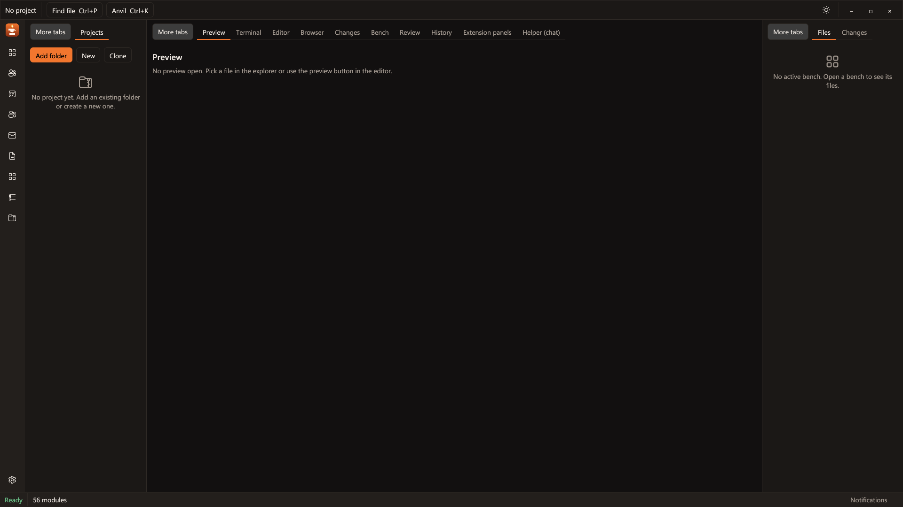

state: en.dark.bench-tab.viewers.tab
capture_sha: 9fcfb0347dfa63c1
model: opencode/glm-5.3-flash-free
---

# Preview (bench tab) — empty state

English (en) and dark variant of the "Preview" tab of the bench, which shows file previews; in this state no project is open and no preview has been requested. Reference page: `pt-BR.dark.bench-tab.viewers.tab`.

## How to get there
Open the app (`forja-app`), click the "Preview" tab in the bench tab strip. Capture command: `forja-app --locale en --theme dark --bench-tab viewers.tab`.

## Regions
- **Top bar** (0,0)–(1280,42): chip "No project", buttons "Find file  Ctrl+P" and "Anvil  Ctrl+K" on the left; unnamed icon (light theme) and the window buttons "–", "□" and "×" on the right.
- **Left rail** (0,42)–(52,768): column of icon buttons ("Board", "Helpers", "Routines", "Muster", "Requests", "Skills", "Usage", "Extensions", "Archive") and, at the foot, "Settings"; the Forja logo image sits on top of the rail.
- **Left side panel** (52,42)–(304,768): tabs "Projects", "Benches" and "Extension panels" (cut off), buttons "Add folder", "New" and "Clone" and the message "No project yet. Add an existing folder or create a new one." with a folder icon.
- **Central area** (320,42)–(972,768): bench tab strip ("Terminal" to "Extension panels"), title "Preview" and the message "No preview open. Pick a file in the explorer or use the preview button in the editor."
- **Right panel** (988,42)–(1280,768): tabs "Files", "Helper (chat)", "Changes", "Search" and "Ports"; grid icon and the message "No active bench. Open a bench to see its files."
- **Vertical dividers**: unnamed strips at (304,42)–(320,768) and (972,42)–(988,768) separate the left panel, central area, and right panel.
- **Status bar** (0,768)–(1280,800): "Ready" on the left, "56 modules" next to it and "Notifications" on the right.

## Elements
| Element | Type | Position (px) | State | What it does |
|---|---|---|---|---|
| "Find file  Ctrl+P" | Button | (99,5)–(218,37) | — | Opens the quick file search (Ctrl+P shortcut). |
| "Anvil  Ctrl+K" | Button | (226,5)–(327,37) | — | Opens the command palette (Ctrl+K shortcut). |
| (no accessible name) | Unknown | (1101,5)–(1133,37) | — | Sun/light theme icon; toggles the theme. |
| "–" | Button | (1155,5)–(1187,37) | — | Minimizes the window. |
| "□" | Button | (1195,5)–(1227,37) | — | Maximizes/restores the window. |
| "×" | Button | (1235,5)–(1269,37) | — | Closes the window. |
| "No project" | Label | (11,12)–(77,31) | — | Indicates that there is no open project. |
| (no accessible name) | Unknown | (304,42)–(320,768) | — | Vertical divider between the left panel and the central area. |
| (no accessible name) | Unknown | (972,42)–(988,768) | — | Vertical divider between the central area and the right panel. |
| (no accessible name) | Image | (12,50)–(40,78) | — | Forja logo/icon at the top of the rail. |
| (no accessible name) | Unknown | (64,50)–(300,82) | — | Container of the left panel tab strip. |
| "Projects" | Button | (64,50)–(136,82) | checked=True | Active tab of the left panel; shows the list of projects. |
| "Benches" | Button | (136,50)–(211,82) | checked=False | Switches the panel to the bench list. |
| "Extension panels" | Button | (211,50)–(337,82) | checked=False | Extension panels tab; text cut off at the panel border and invading "Terminal". |
| "Terminal" | Button | (324,50)–(401,82) | checked=False | Terminal tab of the central area. |
| "Editor" | Button | (401,50)–(461,82) | checked=False | Editor tab. |
| "Browser" | Button | (461,50)–(534,82) | checked=False | Browser tab. |
| "Changes" | Button | (534,50)–(611,82) | checked=False | Changes tab. |
| "Preview" | Button | (611,50)–(682,82) | checked=True | Active tab of the central area; shows this preview. |
| "Bench" | Button | (682,50)–(743,82) | checked=False | Bench tab. |
| "Review" | Button | (743,50)–(810,82) | checked=False | Review tab. |
| "History" | Button | (810,50)–(878,82) | checked=False | History tab. |
| "Extension panels" | Button | (878,50)–(1004,82) | checked=False | Last tab of the central strip; crosses the divider (x=972) and invades the right panel. |
| (no accessible name) | Unknown | (992,50)–(1268,82) | — | Container of the right panel tab strip. |
| "Files" | Button | (992,50)–(1043,82) | checked=True | Active tab of the right panel; file explorer. |
| "Helper (chat)" | Button | (1004,50)–(1107,82) | checked=False | Overlaps "Files" and "Changes"; helper chat tab. |
| "Changes" | Button | (1043,50)–(1120,82) | checked=False | Changes tab of the right panel. |
| "Search" | Button | (1120,50)–(1185,82) | checked=False | Search tab. |
| "Ports" | Button | (1185,50)–(1240,82) | checked=False | Ports tab. |
| "Extension panels" | Button | (1240,50)–(1366,82) | checked=False | Exceeds the window width (1280 px); only "Ext…" is visible. |
| (no accessible name) | Unknown | (64,80)–(300,82) | — | Underline of the active tab "Projects". |
| (no accessible name) | Unknown | (992,80)–(1268,82) | — | Underline of the active tab "Files". |
| "Board" | Button | (8,94)–(44,130) | checked=False | Rail icon; opens the board. |
| "Add folder" | Button | (64,98)–(154,130) | — | Orange button in highlight; opens the folder picker. |
| "New" | Button | (162,98)–(213,130) | — | Creates a new project. |
| "Clone" | Button | (221,98)–(280,130) | — | Clones a repository. |
| "Preview" | Label | (324,98)–(388,122) | — | Title of the central area. |
| (ícone) | Label | (1116,114)–(1144,142) | — | Grid icon of the empty state of the right panel. |
| "No preview open. Pick a file in the explorer or use the preview button in the editor." | Label | (324,130)–(834,149) | — | Empty state message of the central area, in a single line. |
| "Helpers" | Button | (8,138)–(44,174) | checked=False | Rail icon; opens the helpers. |
| "No active bench. Open a bench to see its files." | Label | (1004,150)–(1256,188) | — | Empty state message of the right panel, centered in two lines. |
| (ícone) | Label | (168,158)–(196,186) | — | Folder icon illustrating the empty state of the left panel. |
| "Routines" | Button | (8,182)–(44,218) | checked=False | Rail icon; opens the routines. |
| "No project yet. Add an existing folder or create a new one." | Label | (67,194)–(297,232) | — | Empty state message of the left panel, in two lines. |
| "Muster" | Button | (8,226)–(44,262) | checked=False | Rail icon; opens the muster. |
| "Requests" | Button | (8,270)–(44,306) | checked=False | Rail icon; opens the requests. |
| "Skills" | Button | (8,314)–(44,350) | checked=False | Rail icon; opens the skills. |
| "Usage" | Button | (8,358)–(44,394) | checked=False | Rail icon; opens the usage. |
| "Extensions" | Button | (8,402)–(44,438) | checked=False | Rail icon; opens the extensions. |
| "Archive" | Button | (8,446)–(44,482) | checked=False | Rail icon; opens the archive. |
| "Settings" | Button | (8,724)–(44,760) | checked=False | Rail icon at the foot; opens the settings. |
| "Ready" | Label | (10,775)–(48,794) | — | General state in the status bar, in green. |
| "56 modules" | Label | (70,775)–(142,794) | — | Number of loaded modules. |
| "Notifications" | Label | (1168,775)–(1246,794) | — | Opens the notifications area. |

## Appearance
Same structure and layout as the pt-BR reference; only the texts change (all in English). Dark theme: near-black background, with the top and status bars in an even darker tone and the panels in very dark gray; the vertical dividers appear as slightly lighter lines. The highlight color is the brand orange (Brasa): solid fill in the "Add folder" button and underline under the active tabs ("Projects", "Preview" and "Files"). The text is light gray in the messages and white in titles and tabs; sans-serif typography, small body (tab and status labels) and medium in the title "Preview". The left rail uses only 36 px icons aligned in a single column; "Add folder", "New" and "Clone" are left-aligned in the panel, and the empty state messages are centered horizontally in their panels. "Ready" in the status bar is green.

## Problems found
- Tab overlap: in the left panel, "Extension panels" (211–337) crosses the divider (x=304) and invades "Terminal" (324–401); in the central strip, "Extension panels" (878–1004) crosses the divider (x=972) and invades the right panel strip (992–1268); in the right panel, "Helper (chat)" (1004–1107) overlaps "Files" (992–1043).
- Elements outside the window (image width: 1280 px): "Extension panels" (1240–1366) of the right panel has a rectangle beyond the right border.
- Text cut off in the image: "Extension pai…" (left panel tab, cut at x≈304), "Extension pane…" (central tab, cut at x≈972) and "Ext…" (right panel tab, cut at the border x=1280).
- The empty state icons of the panels are reported as "Label" with a click action, instead of image/decoration without action.
- Button without an accessible name: the light/dark theme icon at (1101,5)–(1133,37) has no label.
