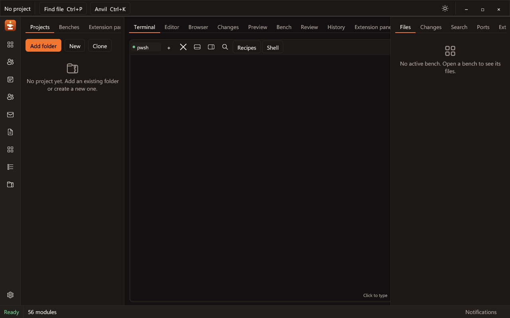

state: en.dark.home.default
capture_sha: —
model: opencode/glm-5.3-flash-free
---

# Tela inicial (home, sem projeto)

É a janela principal da Forja no estado vazio, sem projeto aberto: mostra a trilha de navegação lateral, o painel de Projetos vazio, o Terminal central e o painel Files aguardando uma bancada ativa. Variante em inglês (`en`) da página de referência `pt-BR.dark.home.default`: mantém a mesma estrutura de regiões e elementos; mudam os textos (em inglês), a largura da janela capturada (1280 px contra 1024 px na referência) e, por consequência, as posições dos botões da barra superior e das faixas de abas.

## Como chegar
É a tela padrão do app: iniciar `forja-app --locale en --theme dark`. Nenhuma interação é necessária — é o estado `en.dark.home.default`. Comando de captura: rotina do Atlas gravando `captures/en.dark.home.default.png` (pixels, escala 1.0).

## Regiões
- **Barra superior** (aprox. (0,0)–(1280,42)): rótulo "No project", botões "Find file  Ctrl+P" e "Anvil  Ctrl+K", botão de alternância de tema (ícone de sol, sem nome acessível, (1101,5)–(1133,37)) e os botões de janela "–", "□" e "×" à direita.
- **Trilho à esquerda** (aprox. (0,42)–(52,766)): logotipo (imagem laranja em forma de bigorna, (12,50)–(40,78)) e, de cima para baixo, os ícones "Board", "Helpers", "Routines", "Muster", "Requests", "Skills", "Usage", "Extensions", "Archive" e, colado ao rodapé, "Settings".
- **Painel lateral esquerdo — Projects** (aprox. (52,42)–(304,766)): abas "Projects" (ativa), "Benches" e "Extension panels" (cortada na borda do painel); botões "Add folder" (destacado em laranja), "New" e "Clone"; estado vazio com ícone de pasta (rótulo "(ícone)", (168,158)–(196,186)) e o texto "No project yet. Add an existing folder or create a new one.".
- **Divisores verticais** (aprox. (304,42)–(320,768) e (972,42)–(988,768)): faixas estreitas sem nome acessível entre o painel esquerdo, a área central e o painel direito (redimensionadores de painel).
- **Área central — Terminal** (aprox. (320,42)–(972,766)): abas "Terminal" (ativa), "Editor", "Browser", "Changes", "Preview", "Bench", "Review", "History" e "Extension panels" (cortada na borda); barra de ferramentas do terminal com a pílula de sessão "pwsh" (elemento sem nome acessível, (328,107)–(404,129), com indicador circular pequeno em (385,110)–(401,126)), "+", quatro botões de ícone sem nome acessível, "Recipes" e "Shell"; área vazia de texto do terminal (328,139)–(980,756) com a sugestão "Click to type" no canto inferior direito.
- **Painel direito — Files** (aprox. (988,42)–(1280,766)): abas "Files" (ativa), "Changes", "Search", "Ports" e as demais abas que ultrapassam a janela ("Helper (chat)", "Extension panels"); estado vazio com ícone de grade (rótulo "(ícone)", (1116,114)–(1144,142)) e o texto "No active bench. Open a bench to see its files.".
- **Barra de status** (aprox. (0,766)–(1280,800)): rótulos "Ready" e "56 modules" à esquerda e "Notifications" à direita.

## Elementos
| Elemento | Tipo | Posição (px) | Estado | O que faz |
|---|---|---|---|---|
| "Find file  Ctrl+P" | Button | (99,5)–(218,37) | normal | Abre o localizador de arquivos (atalho Ctrl+P). |
| "Anvil  Ctrl+K" | Button | (226,5)–(327,37) | normal | Abre a paleta de comandos (atalho Ctrl+K). |
| (sem nome acessível) | Unknown | (1101,5)–(1133,37) | normal | Ícone de sol: alterna o tema (claro/escuro). |
| "–" | Button | (1155,5)–(1187,37) | normal | Minimiza a janela. |
| "□" | Button | (1195,5)–(1227,37) | normal | Maximiza/restaura a janela. |
| "×" | Button | (1235,5)–(1269,37) | normal | Fecha a janela. |
| "No project" | Label | (11,12)–(77,31) | clicável | Mostra o projeto atual (nenhum). |
| (sem nome acessível) | Unknown | (304,42)–(320,768) | foco | Divisor arrastável entre painel esquerdo e área central. |
| (sem nome acessível) | Unknown | (972,42)–(988,768) | foco | Divisor arrastável entre área central e painel direito. |
| (sem nome acessível) | Image | (12,50)–(40,78) | clicável | Logotipo da Forja no topo do trilho. |
| "Projects" | Button | (64,50)–(136,82) | marcado=True | Aba ativa do painel esquerdo; lista projetos. |
| (sem nome acessível) | Unknown | (64,50)–(300,82) | foco | Contêiner da faixa de abas do painel esquerdo. |
| "Benches" | Button | (136,50)–(211,82) | marcado=False | Aba de bancadas do painel esquerdo. |
| "Extension panels" | Button | (211,50)–(337,82) | marcado=False | Aba de painéis de extensões do painel esquerdo; retângulo passa da borda do painel (x≈304). |
| "Terminal" | Button | (324,50)–(401,82) | marcado=True | Aba ativa da área central; mostra o terminal. |
| "Editor" | Button | (401,50)–(461,82) | marcado=False | Aba do editor de arquivos. |
| "Browser" | Button | (461,50)–(534,82) | marcado=False | Aba do navegador integrado. |
| "Changes" | Button | (534,50)–(611,82) | marcado=False | Aba de comparação de diffs. |
| "Preview" | Button | (611,50)–(682,82) | marcado=False | Aba do visualizador/preview de arquivos. |
| "Bench" | Button | (682,50)–(743,82) | marcado=False | Aba de informações da bancada. |
| "Review" | Button | (743,50)–(810,82) | marcado=False | Aba de revisão. |
| "History" | Button | (810,50)–(878,82) | marcado=False | Aba de histórico. |
| "Extension panels" | Button | (878,50)–(1004,82) | marcado=False | Aba de painéis de extensões da área central; retângulo passa do divisor (x≈972) e o texto aparece cortado na imagem. |
| (sem nome acessível) | Unknown | (992,50)–(1268,82) | foco | Contêiner da faixa de abas do painel direito; sobrepõe as abas "Files" e "Helper (chat)". |
| "Files" | Button | (992,50)–(1043,82) | marcado=True | Aba ativa do painel direito; lista arquivos da bancada. |
| "Helper (chat)" | Button | (1004,50)–(1107,82) | marcado=False | Aba do chat do ajudante; sobrepõe "Files" e "Changes" e não aparece visível na imagem. |
| "Changes" | Button | (1043,50)–(1120,82) | marcado=False | Aba de mudanças pendentes do painel direito. |
| "Search" | Button | (1120,50)–(1185,82) | marcado=False | Aba de busca. |
| "Ports" | Button | (1185,50)–(1240,82) | marcado=False | Aba de portas em uso. |
| "Extension panels" | Button | (1240,50)–(1366,82) | marcado=False | Aba de painéis de extensões do painel direito; retângulo além da largura da janela (1280 px). |
| (sem nome acessível) | Unknown | (64,80)–(300,82) | clicável | Faixa fina sob as abas do painel esquerdo (linha de sublinhado da aba ativa). |
| (sem nome acessível) | Unknown | (992,80)–(1268,82) | clicável | Faixa fina sob as abas do painel direito. |
| "Board" | Button | (8,94)–(44,130) | marcado=False | Ícone do quadro geral (projetos/bancadas). |
| "Add folder" | Button | (64,98)–(154,130) | normal (destaque laranja) | Adiciona uma pasta de projeto existente. |
| "New" | Button | (162,98)–(213,130) | normal | Cria um projeto novo. |
| "Clone" | Button | (221,98)–(280,130) | normal | Clona um repositório/projeto. |
| "+" | Button | (407,102)–(441,134) | normal | Abre nova aba/sessão de terminal. |
| (sem nome acessível) | Unknown | (444,102)–(476,134) | clicável | Ícone de X: encerra o terminal. |
| (sem nome acessível) | Unknown | (479,102)–(511,134) | clicável | Ícone de monitor: alterna a exibição do terminal. |
| (sem nome acessível) | Unknown | (514,102)–(546,134) | clicável | Ícone de retângulo: alterna o terminal em painel dedicado. |
| (sem nome acessível) | Unknown | (549,102)–(581,134) | clicável | Ícone de lupa: busca no terminal. |
| "Recipes" | Button | (584,102)–(655,134) | normal | Abre a lista de receitas de terminal. |
| "Shell" | Button | (658,102)–(711,134) | normal | Seletor do shell da sessão (pwsh). |
| (sem nome acessível) | Unknown | (328,107)–(404,129) | clicável | Pílula da sessão ativa "pwsh" com indicador. |
| (sem nome acessível) | Unknown | (385,110)–(401,126) | clicável | Indicador circular da pílula (ponto de status). |
| "(ícone)" | Label | (1116,114)–(1144,142) | clicável | Ícone de grade do estado vazio do painel Files. |
| "Helpers" | Button | (8,138)–(44,174) | marcado=False | Ícone do painel de ajudantes (agentes de IA). |
| (sem nome acessível) | Unknown | (328,139)–(980,756) | clicável | Área de texto do terminal (vazia); clique foca o terminal. |
| "No active bench. Open a bench to see its files." | Label | (1004,150)–(1256,188) | clicável | Estado vazio do painel Files. |
| "Routines" | Button | (8,182)–(44,218) | marcado=False | Ícone do painel de rotinas. |
| "(ícone)" | Label | (168,158)–(196,186) | clicável | Ícone de pasta do estado vazio do painel Projects. |
| "No project yet. Add an existing folder or create a new one." | Label | (67,194)–(297,232) | clicável | Estado vazio do painel Projects. |
| "Muster" | Button | (8,226)–(44,262) | marcado=False | Ícone do painel de mutirão (tarefas em lote). |
| "Requests" | Button | (8,270)–(44,306) | marcado=False | Ícone do painel de pedidos. |
| "Skills" | Button | (8,314)–(44,350) | marcado=False | Ícone do painel de skills. |
| "Usage" | Button | (8,358)–(44,394) | marcado=False | Ícone do painel de uso. |
| "Extensions" | Button | (8,402)–(44,438) | marcado=False | Ícone do painel de extensões. |
| "Archive" | Button | (8,446)–(44,482) | marcado=False | Ícone do painel de acervo. |
| "Settings" | Button | (8,724)–(44,760) | marcado=False | Ícone de ajustes, no rodapé do trilho. |
| "Ready" | Label | (10,775)–(48,794) | clicável | Estado geral do app na barra de status. |
| "56 modules" | Label | (70,775)–(142,794) | clicável | Contagem de módulos carregados. |
| "Notifications" | Label | (1168,775)–(1246,794) | clicável | Acesso a notificações na barra de status. |

## Aparência
Tema escuro: fundo quase preto (grafite, aproximadamente #1c1c1c) na janela e nos painéis, com a barra superior e a barra de status em tom levemente distinto. Acento laranja ("Brasa"): o botão "Add folder" tem fundo laranja sólido com texto escuro, a aba ativa de cada faixa ("Projects", "Terminal", "Files") recebe sublinhado e texto em laranja, o logotipo do trilho é laranja e o rótulo "Ready" da barra de status aparece em laranja. Ponto verde pequeno na pílula "pwsh" indica sessão ativa. Tipografia sans-serif compacta (~12–13 px) em cinza claro (#d0d0d0 aprox.), com rótulos de estado vazio em cinza médio, centralizados. Abas e botões têm retângulos alinhados em duas faixas de abas (y≈50–82) e uma linha de ferramentas (y≈102–134); o trilho usa ícones quadrados de 36 px, espaçados de 44 px verticalmente, com "Settings" ancorado ao rodapé. Os divisores entre painéis aparecem como linhas verticais discretas de tom mais escuro. Em relação à referência pt-BR, os textos são todos em inglês e a janela capturada é mais larga (1280 px), o que desloca os controles da barra superior para a direita e amplia a área central; a paleta, a tipografia e o alinhamento são iguais.

## Problemas encontrados
- A aba "Extension panels" do painel esquerdo (211,50)–(337,82) ultrapassa a borda do painel (x≈304) e o texto aparece cortado ("Extension pan…") na imagem.
- A aba "Extension panels" da faixa central (878,50)–(1004,82) passa do limite da área central (x≈972) e o texto aparece cortado ("Extension pane…") na imagem.
- A faixa de abas do painel direito transborda a largura da janela: "Extension panels" (1240,50)–(1366,82) tem retângulo além da largura da imagem (1280 px) e fica inacessível visualmente.
- Retângulos sobrepostos na árvore do painel direito: "Helper (chat)" (1004,50)–(1107,82) sobrepõe "Files" (992,50)–(1043,82) e "Changes" (1043,50)–(1120,82); na imagem "Helper (chat)" não é visível, indicando medições inconsistentes da faixa de abas.
- Botões sem nome acessível (acessibilidade): o alternador de tema (1101,5)–(1133,37), os quatro ícones da barra do terminal (444,102)–(581,134) e a pílula de sessão "pwsh" (328,107)–(404,129) não expõem nome.
- Os botões de ícone do terminal e o alternador de tema dependem de reconhecimento visual, sem rótulo ou tooltip acessível na árvore.
- Os rótulos de estado vazio "(ícone)" ((168,158)–(196,186) e (1116,114)–(1144,142)) estão em português na variante em inglês — texto não traduzido na árvore de acessibilidade.
- Estados com pixels idênticos a esta captura incluem modais e outras telas que deveriam alterar a imagem (en.dark.modal.bench.dialogs, en.dark.modal.counter.poller, en.dark.modal.mcp.approval, en.dark.modal.notify.toasts, en.dark.modal.onboarding.wizard, en.dark.modal.voice.overlay, en.dark.right-tab.explorer.panel e en.dark.bench-tab.terminal.tab): nessas capturas nenhum diálogo, aviso, sobreposição ou mudança de aba aparece renderizado.
- O texto "Click to type" na área do terminal (canto inferior direito, ~(910,737)–(974,750)) não corresponde a nenhum elemento da árvore de acessibilidade.
