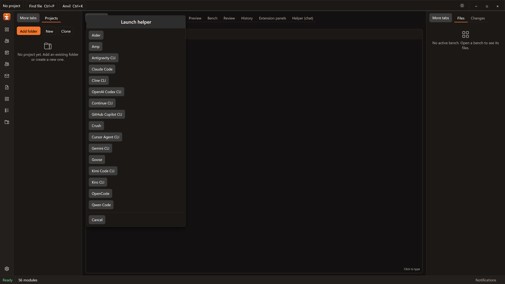

state: en.dark.modal.helper.profile_picker
capture_sha: 234c7e56b56ec0de
model: opencode/glm-5.3-flash-free
---

# Launch helper (modal helper.profile_picker)

Variante em inglês da página de referência (pt-BR.dark.modal.helper.profile_picker): mesmo layout, cores e estrutura; mudam apenas os textos da interface, que aparecem em inglês ("Launch helper", "Cancel", "Find file", "Anvil", "No project" etc. em vez de "Iniciar ajudante", "Cancelar", "Achar arquivo", "Bigorna", "Nenhum projeto"). Tema escuro igual ao da referência, sem diferenças de contraste aparentes.

## Como chegar
Na janela principal, acione a ação de iniciar ajudante (o painel de "Helpers" fica no trilho à esquerda; o modal abre sobreposto ao app). Captura: `forja-app --locale en --theme dark --modal helper.profile_picker`.

## Regiões
- **Modal "Launch helper"** — (328,0)–(706,804). Coluna central escura sobreposta ao app; barra de título com o texto "Launch helper" (0–49) e corpo (328,139)–(980,756) com a lista vertical de chips de ajudantes, terminando no botão "Cancel".
- **Barra superior do app** — (0,0)–(1280,42). À esquerda o rótulo "No project" e os botões "Find file  Ctrl+P" e "Anvil  Ctrl+K"; à direita um botão de tema sem nome acessível (1101–1133) e os botões de janela "–", "□", "×".
- **Trilho à esquerda** — (0,42)–(52,768). Coluna de ícones: "Board", "Helpers", "Routines", "Muster", "Requests", "Skills", "Usage", "Extensions", "Archive" e "Settings", todos não marcados; acima, um ícone de módulo ativo em laranja (12,50)–(40,78).
- **Painel lateral esquerdo (Projects)** — (52,42)–(~304,768). Abas "Projects" (marcada), "Benches" e "Extension panels"; ações "Add folder", "New" e "Clone"; estado vazio com ícone de pasta (168,158)–(196,186) e o rótulo "No project yet. Add an existing folder or create a new one.".
- **Área central** — (~320,42)–(~972,768). Abas "Terminal" (marcada), "Editor", "Browser", "Changes", "Preview", "Bench", "Review", "History" e "Extension panels" e um botão "+" com quatro elementos sem nome ao lado, mais "Recipes" e "Shell"; na prática quase todo coberto pelo modal.
- **Painel direito (Files)** — (~988,42)–(1280,768). Abas "Files" (marcada), "Helper (chat)", "Changes", "Search", "Ports" e "Extension panels"; estado vazio com ícone de grade (1116,114)–(1144,142) e o rótulo "No active bench. Open a bench to see its files.".
- **Barra de status** — (0,768)–(1280,800). "Ready" à esquerda, "56 modules" ao lado e "Notifications" à direita.

## Elementos
| Elemento | Tipo | Posição (px) | Estado | O que faz |
|---|---|---|---|---|
| "Launch helper" | Janela (modal) | (328,0)–(706,804) | foco | Modal de escolha do ajudante; recebe o foco ao abrir |
| (sem nome acessível) | Desconhecido | (361,1)–(673,49) | clique, foco | Barra de título do modal, sobre a qual se lê "Launch helper" |
| "Find file  Ctrl+P" | Botão | (99,5)–(218,37) | clique, foco | Abre a busca rápida de arquivos (atalho Ctrl+P) |
| "Anvil  Ctrl+K" | Botão | (226,5)–(327,37) | clique, foco | Abre a paleta de comandos (Ctrl+K); encosta na borda esquerda do modal |
| (sem nome acessível) | Desconhecido | (1101,5)–(1133,37) | clique, foco | Botão de alternância de tema (ícone de sol) |
| "–" | Botão | (1155,5)–(1187,37) | clique, foco | Minimiza a janela |
| "□" | Botão | (1195,5)–(1227,37) | clique, foco | Maximiza/restaura a janela |
| "×" | Botão | (1235,5)–(1269,37) | clique, foco | Fecha a janela |
| "No project" | Rótulo | (11,12)–(77,31) | clique, foco | Indica ausência de projeto selecionado |
| (sem nome acessível) | Desconhecido | (304,42)–(320,768) | foco | Divisor vertical entre painel esquerdo e área central |
| (sem nome acessível) | Desconhecido | (972,42)–(988,768) | foco | Divisor vertical entre área central e painel direito |
| (sem nome acessível) | Imagem | (12,50)–(40,78) | clique, foco | Ícone do módulo ativo no topo do trilho (laranja) |
| "Projects" | Botão (aba) | (64,50)–(136,82) | clique, foco; marcado=True | Mostra o painel de projetos |
| (sem nome acessível) | Desconhecido | (64,50)–(300,82) | foco | Faixa de fundo da linha de abas do painel esquerdo |
| "Benches" | Botão (aba) | (136,50)–(211,82) | clique, foco; marcado=False | Alterna para a lista de bancadas |
| "Extension panels" | Botão (aba) | (211,50)–(337,82) | clique, foco; marcado=False | Aba de painéis de extensões; texto truncado pelo modal ("Extension pai") |
| "Terminal" | Botão (aba) | (324,50)–(401,82) | clique, foco; marcado=True | Aba central ativa; coberta pelo modal |
| "Editor" | Botão (aba) | (401,50)–(461,82) | clique, foco; marcado=False | Aba do editor; coberta pelo modal |
| "Browser" | Botão (aba) | (461,50)–(534,82) | clique, foco; marcado=False | Aba do navegador; coberta pelo modal |
| "Changes" | Botão (aba) | (534,50)–(611,82) | clique, foco; marcado=False | Aba de diferenças; coberta pelo modal |
| "Preview" | Botão (aba) | (611,50)–(682,82) | clique, foco; marcado=False | Aba do visualizador; coberta pelo modal |
| "Bench" | Botão (aba) | (682,50)–(743,82) | clique, foco; marcado=False | Aba de bancada; só a parte à direita do modal é visível |
| "Review" | Botão (aba) | (743,50)–(810,82) | clique, foco; marcado=False | Aba de revisão |
| "History" | Botão (aba) | (810,50)–(878,82) | clique, foco; marcado=False | Aba de histórico |
| "Extension panels" | Botão (aba) | (878,50)–(1004,82) | clique, foco; marcado=False | Aba de painéis de extensões da área central; cortada pela borda do painel direito ("Extension pane") |
| (sem nome acessível) | Desconhecido | (992,50)–(1268,82) | foco | Faixa de fundo da linha de abas do painel direito |
| "Files" | Botão (aba) | (992,50)–(1043,82) | clique, foco; marcado=True | Mostra a lista de arquivos da bancada |
| "Helper (chat)" | Botão (aba) | (1004,50)–(1107,82) | clique, foco; marcado=False | Aba do chat do ajudante; sobreposta a "Files" e invisível na captura |
| "Changes" | Botão (aba) | (1043,50)–(1120,82) | clique, foco; marcado=False | Aba de mudanças |
| "Search" | Botão (aba) | (1120,50)–(1185,82) | clique, foco; marcado=False | Aba de busca |
| "Ports" | Botão (aba) | (1185,50)–(1240,82) | clique, foco; marcado=False | Aba de portas |
| "Extension panels" | Botão (aba) | (1240,50)–(1366,82) | clique, foco; marcado=False | Segunda entrada duplicada; se estende além da largura da imagem |
| "Aider" | Botão (chip) | (337,58)–(394,93) | clique, foco | Seleciona o ajudante Aider |
| (sem nome acessível) | Desconhecido | (64,80)–(300,82) | clique, foco | Linha divisória sob as abas do painel esquerdo |
| (sem nome acessível) | Desconhecido | (992,80)–(1268,82) | clique, foco | Linha divisória sob as abas do painel direito |
| "Board" | Botão (ícone) | (8,94)–(44,130) | clique, foco; marcado=False | Abre o quadro no trilho |
| "Add folder" | Botão | (64,98)–(154,130) | clique, foco | Destaque laranja; abre seletor de pasta para criar projeto |
| "New" | Botão | (162,98)–(213,130) | clique, foco | Cria um projeto novo |
| "Clone" | Botão | (221,98)–(280,130) | clique, foco | Clona um repositório como projeto |
| "Amp" | Botão (chip) | (337,101)–(390,136) | clique, foco | Seleciona o ajudante Amp |
| "+" | Botão | (407,102)–(441,134) | clique, foco | Ação adicional da área central; coberto pelo modal |
| (sem nome acessível) | Desconhecido | (444,102)–(476,134) | clique, foco | Controle da barra central, oculto pelo modal |
| (sem nome acessível) | Desconhecido | (479,102)–(511,134) | clique, foco | Controle da barra central, oculto pelo modal |
| (sem nome acessível) | Desconhecido | (514,102)–(546,134) | clique, foco | Controle da barra central, oculto pelo modal |
| (sem nome acessível) | Desconhecido | (549,102)–(581,134) | clique, foco | Controle da barra central, oculto pelo modal |
| "Recipes" | Botão | (584,102)–(655,134) | clique, foco | Abre receitas; oculto pelo modal |
| "Shell" | Botão | (658,102)–(711,134) | clique, foco | Abre o shell; oculto pelo modal |
| (sem nome acessível) | Desconhecido | (328,107)–(404,129) | clique, foco | Elemento do modal sobre a região dos chips |
| (sem nome acessível) | Desconhecido | (385,110)–(401,126) | clique, foco | Elemento interno do modal |
| (ícone) | Rótulo | (1116,114)–(1144,142) | clique | Ícone de grade do estado vazio do painel direito |
| "Helpers" | Botão (ícone) | (8,138)–(44,174) | clique, foco; marcado=False | Abre o painel de ajudantes |
| (sem nome acessível) | Desconhecido | (328,139)–(980,756) | clique, foco | Corpo do modal, contêiner da lista de ajudantes |
| "Antigravity CLI" | Botão (chip) | (337,144)–(451,179) | clique, foco | Seleciona o ajudante Antigravity CLI |
| "No active bench. Open a bench to see its files." | Rótulo | (1004,150)–(1256,188) | clique | Mensagem de estado vazio do painel de arquivos |
| "Routines" | Botão (ícone) | (8,182)–(44,218) | clique, foco; marcado=False | Abre o painel de rotinas |
| "Claude Code" | Botão (chip) | (337,187)–(439,222) | clique, foco | Seleciona o ajudante Claude Code |
| (ícone) | Rótulo | (168,158)–(196,186) | clique | Ícone de pasta do estado vazio de projetos |
| "Muster" | Botão (ícone) | (8,226)–(44,262) | clique, foco; marcado=False | Abre o painel de mutirão |
| "Cline CLI" | Botão (chip) | (337,230)–(414,265) | clique, foco | Seleciona o ajudante Cline CLI |
| "No project yet. Add an existing folder or create a new one." | Rótulo | (67,194)–(297,232) | clique | Mensagem de estado vazio de projetos |
| "Requests" | Botão (ícone) | (8,270)–(44,306) | clique, foco; marcado=False | Abre o painel de pedidos |
| "OpenAI Codex CLI" | Botão (chip) | (337,273)–(473,308) | clique, foco | Seleciona o ajudante OpenAI Codex CLI |
| "Skills" | Botão (ícone) | (8,314)–(44,350) | clique, foco; marcado=False | Abre o painel de skills |
| "Continue CLI" | Botão (chip) | (337,316)–(440,351) | clique, foco | Seleciona o ajudante Continue CLI |
| "Usage" | Botão (ícone) | (8,358)–(44,394) | clique, foco; marcado=False | Abre o painel de uso |
| "GitHub Copilot CLI" | Botão (chip) | (337,359)–(476,394) | clique, foco | Seleciona o ajudante GitHub Copilot CLI |
| (sem nome acessível) | Desconhecido | (640,400)–(640,400) | clique, foco | Elemento de dimensão nula (retrôo da árvore) |
| "Extensions" | Botão (ícone) | (8,402)–(44,438) | clique, foco; marcado=False | Abre o painel de extensões |
| "Crush" | Botão (chip) | (337,402)–(396,437) | clique, foco | Seleciona o ajudante Crush |
| "Cursor Agent CLI" | Botão (chip) | (337,445)–(465,480) | clique, foco | Seleciona o ajudante Cursor Agent CLI |
| "Archive" | Botão (ícone) | (8,446)–(44,482) | clique, foco; marcado=False | Abre o painel de acervo |
| "Gemini CLI" | Botão (chip) | (337,488)–(427,523) | clique, foco | Seleciona o ajudante Gemini CLI |
| "Goose" | Botão (chip) | (337,531)–(400,566) | clique, foco | Seleciona o ajudante Goose |
| "Kimi Code CLI" | Botão (chip) | (337,574)–(447,609) | clique, foco | Seleciona o ajudante Kimi Code CLI |
| "Kiro CLI" | Botão (chip) | (337,617)–(408,652) | clique, foco | Seleciona o ajudante Kiro CLI |
| "OpenCode" | Botão (chip) | (337,660)–(427,695) | clique, foco | Seleciona o ajudante OpenCode |
| "Qwen Code" | Botão (chip) | (337,703)–(432,738) | clique, foco | Seleciona o ajudante Qwen Code; último chip inteiramente visível |
| "Settings" | Botão (ícone) | (8,724)–(44,760) | clique, foco; marcado=False | Abre o painel de ajustes |
| "Cancel" | Botão | (337,760)–(401,795) | clique, foco | Fecha o modal sem escolher |
| "Ready" | Rótulo | (10,775)–(48,794) | clique | Status geral em verde na barra de status |
| "56 modules" | Rótulo | (70,775)–(142,794) | clique | Contagem de módulos carregados |
| "Notifications" | Rótulo | (1168,775)–(1246,794) | clique, foco | Atalho para notificações, à direita da barra de status |

## Aparência
Tema escuro: fundo quase preto no app e no modal, com o painel do modal em cinza-escuro levemente mais claro que o fundo e cantos arredondados. Acento laranja ("Brasa") no botão "Add folder", no ícone do módulo ativo do trilho e no sublinhado das abas marcadas ("Projects", "Files"). Os chips de ajudantes são retângulos arredondados cinza-escuro com borda sutil e texto claro, empilhados em coluna única alinhada à esquerda a partir de x≈337, com espaçamento vertical regular de ~43 px. Texto em fonte sem serifa de ~13–15 px, cinza-claro sobre fundo escuro, com contraste bom nos rótulos e mais baixo nas mensagens de estado vazio. "Ready" aparece em verde na barra de status. Em relação à referência pt-BR, nada muda na aparência — apenas o idioma dos textos.

## Problemas encontrados
- A janela do modal vai até y=804, além da altura da imagem (800): a borda inferior do modal está cortada na captura.
- A aba "Extension panels" do painel direito (1240–1366) se estende além da largura da imagem (1280), fora da área visível.
- A linha de abas do painel direito tem retângulos sobrepostos e entradas duplicadas: "Files" (992–1043) e "Helper (chat)" (1004–1107) se sobrepõem — "Helper (chat)" não é visível na captura — e "Extension panels" aparece de novo em 1240.
- O modal sobrepõe a área central: as abas "Terminal", "Editor", "Browser", "Changes", "Preview" e os botões "+", "Recipes", "Shell" e os quatro controles sem nome continuam na árvore de acessibilidade mas estão invisíveis ao usuário.
- A aba "Extension panels" do painel esquerdo é truncada pelo modal ("Extension pai") e a ocorrência na área central é cortada pela borda do painel direito ("Extension pane").
- Botão de tema na barra superior (1101–1133), divisores verticais e controles da área central sem nome acessível.
- Rótulos de ícone expostos como "(ícone)" (grade e pasta dos estados vazios), sem nome acessível descritivo.
- Elemento de dimensão nula na árvore em (640,400)–(640,400).
