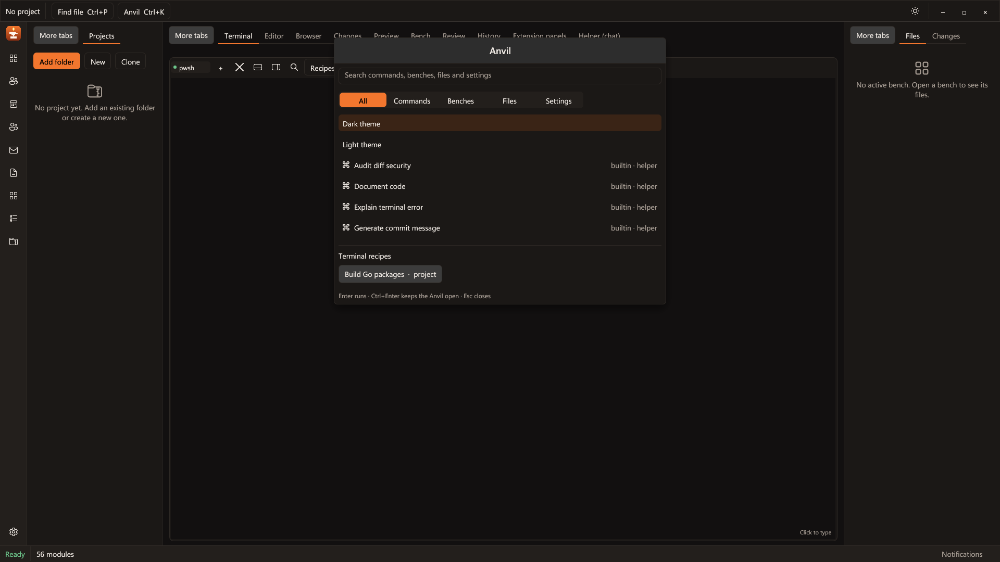

# Anvil over the start screen (no project)

Tela inicial da Forja sem projeto aberto, com a sobreposição da Anvil (paleta de comandos e receitas de terminal) aberta no centro. Esta é a variante em inglês (`en`) da página de referência `pt-BR.dark.open.anvil`; a estrutura é a mesma e o que muda são os textos da interface e pequenas diferenças de coordenadas (botões da barra superior mais largos em pt-BR, mais estreitos em en).

## Como chegar
Na barra superior, clique no botão "Anvil  Ctrl+K" (ou pressione Ctrl+K); o app abre direto nessa tela com `forja-app --locale en --theme dark --open anvil` (captura em `captures/en.dark.open.anvil.png`, 1280×800 px).

## Regiões
- **Barra superior** (0,0)–(1280,42): rótulo do projeto ("No project"), botões "Find file  Ctrl+P" e "Anvil  Ctrl+K", botão de tema (ícone de sol, sem nome), botões de janela "–", "□", "×".
- **Trilho de ícones à esquerda** (0,42)–(48,768): logo da Forja (imagem em (12,50)–(40,78)) e ícones de navegação: "Board", "Helpers", "Routines", "Muster", "Requests", "Skills", "Usage", "Extensions", "Archive" e, no fim, "Settings".
- **Painel lateral esquerdo (Projects)** (48,42)–(304,768): abas "Projects" (ativa), "Benches" e "Extension panels" (cortada), botões "Add folder", "New" e "Clone", e estado vazio com ícone de pasta e o texto "No project yet. Add an existing folder or create a new one.".
- **Divisor central** (304,42)–(320,768): separador arrastável entre o painel esquerdo e a área central.
- **Barra de abas central** (310,42)–(980,82): "Terminal" (ativa), "Editor", "Browser", "Changes", "Preview", "Bench", "Review", "History" e "Extension panels" (cortada na borda).
- **Área central** (310,82)–(980,768): coberta pela janela da Anvil (321,72)–(959,792) com um pano de fundo (328,139)–(980,756); atrás dela restam botões "Recipes", "Shell" e um "+" ocultos.
- **Divisor direito** (972,42)–(988,768): separador arrastável.
- **Painel lateral direito (Files)** (988,42)–(1280,768): abas "Files" (ativa), "Changes", "Helper (chat)", "Search", "Ports" e "Extension panels" (cortada), ícone de grade vazia e o texto "No active bench. Open a bench to see its files.".
- **Barra de status** (0,768)–(1280,800): "Ready", "56 modules" e "Notifications".

## Elementos
| Elemento | Tipo | Posição (px) | Estado | O que faz |
|---|---|---|---|---|
| "Find file  Ctrl+P" | Button | (99,5)–(218,37) | — | Abre a busca de arquivos (atalho Ctrl+P). |
| "Anvil  Ctrl+K" | Button | (226,5)–(327,37) | — | Abre/fecha a Anvil (já aberta nesta captura). |
| (sem nome acessível) | Unknown | (1101,5)–(1133,37) | — | Ícone de sol: alterna tema claro/escuro. |
| "–" | Button | (1155,5)–(1187,37) | — | Minimiza a janela. |
| "□" | Button | (1195,5)–(1227,37) | — | Maximiza/restaura a janela. |
| "×" | Button | (1235,5)–(1269,37) | — | Fecha o app. |
| "No project" | Label | (11,12)–(77,31) | — | Indica que não há projeto aberto; clique reabre o painel de projetos. |
| (sem nome acessível) | Unknown | (304,42)–(320,768) | — | Divisor arrastável entre o painel esquerdo e a área central. |
| (sem nome acessível) | Unknown | (972,42)–(988,768) | — | Divisor arrastável entre a área central e o painel direito. |
| (sem nome acessível) | Image | (12,50)–(40,78) | — | Logo da Forja no topo do trilho. |
| "Projects" | Button | (64,50)–(136,82) | marcado=True | Aba ativa do painel esquerdo. |
| (sem nome acessível) | Unknown | (64,50)–(300,82) | — | Sublinhado da aba ativa do painel esquerdo. |
| "Benches" | Button | (136,50)–(211,82) | marcado=False | Aba de bancadas do painel esquerdo. |
| "Extension panels" | Button | (211,50)–(337,82) | marcado=False | Aba de painéis de extensões; retângulo invade a área central e o texto aparece cortado ("Extension pai..."). |
| "Terminal" | Button | (324,50)–(401,82) | marcado=True | Aba ativa da área central. |
| "Editor" | Button | (401,50)–(461,82) | marcado=False | Mostra o editor. |
| "Browser" | Button | (461,50)–(534,82) | marcado=False | Mostra o navegador de arquivos. |
| "Changes" | Button | (534,50)–(611,82) | marcado=False | Mostra as diferenças. |
| "Preview" | Button | (611,50)–(682,82) | marcado=False | Mostra o visualizador. |
| "Bench" | Button | (682,50)–(743,82) | marcado=False | Mostra a bancada. |
| "Review" | Button | (743,50)–(810,82) | marcado=False | Mostra a revisão. |
| "History" | Button | (810,50)–(878,82) | marcado=False | Mostra o histórico. |
| "Extension panels" | Button | (878,50)–(1004,82) | marcado=False | Aba de extensões da área central, cortada na borda com o painel direito. |
| (sem nome acessível) | Unknown | (992,50)–(1268,82) | — | Sublinhado da aba ativa do painel direito. |
| "Files" | Button | (992,50)–(1043,82) | marcado=True | Aba ativa do painel direito. |
| "Helper (chat)" | Button | (1004,50)–(1107,82) | marcado=False | Abre o chat do ajudante; retângulo sobrepõe "Files" e "Changes". |
| "Changes" | Button | (1043,50)–(1120,82) | marcado=False | Mostra as mudanças da bancada; retângulo sobrepõe "Helper (chat)". |
| "Search" | Button | (1120,50)–(1185,82) | marcado=False | Abre a busca do painel direito. |
| "Ports" | Button | (1185,50)–(1240,82) | marcado=False | Mostra as portas em uso. |
| "Extension panels" | Button | (1240,50)–(1366,82) | marcado=False | Aba final do painel direito; fica fora da captura (x além de 1280), visível só o início ("Ext"). |
| "Anvil" | Window | (321,72)–(959,792) | — | Janela de sobreposição da paleta de comandos. |
| (sem nome acessível) | Unknown | (354,73)–(926,121) | — | Faixa de título da Anvil, com o título "Anvil" centralizado em negrito. |
| (sem nome acessível) | Unknown | (64,80)–(300,82) | — | Sublinhado inferior da aba "Projects". |
| (sem nome acessível) | Unknown | (992,80)–(1268,82) | — | Sublinhado inferior da aba "Files". |
| "Board" | Button | (8,94)–(44,130) | marcado=False | Ícone do quadro no trilho. |
| "Add folder" | Button | (64,98)–(154,130) | — | Botão primário laranja: adiciona uma pasta de projeto. |
| "New" | Button | (162,98)–(213,130) | — | Cria um projeto novo. |
| "Clone" | Button | (221,98)–(280,130) | — | Clona um repositório como projeto. |
| "+" | Button | (407,102)–(441,134) | — | Botão de adicionar da área central; oculto atrás da Anvil. |
| (sem nome acessível) | Unknown | (444,102)–(476,134) | — | Primeiro ícone pequeno de filtro/visão da área central, oculto atrás da Anvil. |
| (sem nome acessível) | Unknown | (479,102)–(511,134) | — | Segundo ícone de filtro/visão da área central, oculto atrás da Anvil. |
| (sem nome acessível) | Unknown | (514,102)–(546,134) | — | Terceiro ícone de filtro/visão da área central, oculto atrás da Anvil. |
| (sem nome acessível) | Unknown | (549,102)–(581,134) | — | Quarto ícone de filtro/visão da área central, oculto atrás da Anvil. |
| "Recipes" | Button | (584,102)–(655,134) | — | Visão de receitas da área central, oculta atrás da Anvil. |
| "Shell" | Button | (658,102)–(711,134) | — | Visão de shell da área central, oculta atrás da Anvil. |
| (sem nome acessível) | Unknown | (328,107)–(404,129) | — | Elemento do cabeçalho da Anvil sob o título, parcialmente coberto pelo item seguinte. |
| (sem nome acessível) | Unknown | (385,110)–(401,126) | — | Segundo elemento do cabeçalho da Anvil sob o título. |
| "(ícone)" | Label | (1116,114)–(1144,142) | — | Ícone de grade do estado vazio do painel direito. |
| (sem nome acessível) | TextInput | (330,130)–(950,162) | foco | Campo de busca da Anvil, com borda laranja e o texto "Search commands, benches, files and settings". |
| "Helpers" | Button | (8,138)–(44,174) | marcado=False | Ícone de ajudantes no trilho. |
| (sem nome acessível) | Unknown | (328,139)–(980,756) | — | Pano de fundo da sobreposição da Anvil. |
| "No active bench. Open a bench to see its files." | Label | (1004,150)–(1256,188) | — | Estado vazio do painel direito. |
| "(ícone)" | Label | (168,158)–(196,186) | — | Ícone de pasta do estado vazio do painel esquerdo. |
| "All" | Button | (330,176)–(424,208) | marcado=True | Filtro ativo da Anvil: lista tudo. |
| "Commands" | Button | (424,176)–(518,208) | marcado=False | Filtro de comandos. |
| "Benches" | Button | (518,176)–(612,208) | marcado=False | Filtro de bancadas. |
| "Files" | Button | (612,176)–(706,208) | marcado=False | Filtro de arquivos. |
| "Settings" | Button | (706,176)–(800,208) | marcado=False | Filtro de ajustes. |
| "Routines" | Button | (8,182)–(44,218) | marcado=False | Ícone de rotinas no trilho. |
| "No project yet. Add an existing folder or create a new one." | Label | (67,194)–(297,232) | — | Estado vazio do painel esquerdo. |
| (sem nome acessível) | Unknown | (330,220)–(950,252) | — | Primeira linha de resultado da busca ("Audit diff security"), com fundo destacado e a tag "builtin · helper" à direita. |
| (sem nome acessível) | Unknown | (330,220)–(950,580) | — | Container da lista de resultados da busca da Anvil. |
| (sem nome acessível) | Unknown | (948,220)–(950,580) | — | Barra de rolagem da lista de resultados. |
| "Muster" | Button | (8,226)–(44,262) | marcado=False | Ícone do mutirão no trilho. |
| (sem nome acessível) | Unknown | (330,260)–(950,292) | — | Segunda linha de resultado ("Document code"), tag "builtin · helper". |
| "Requests" | Button | (8,270)–(44,306) | marcado=False | Ícone de pedidos no trilho. |
| (sem nome acessível) | Unknown | (330,300)–(950,332) | — | Terceira linha de resultado ("Explain terminal error"), tag "builtin · helper". |
| "Skills" | Button | (8,314)–(44,350) | marcado=False | Ícone de skills no trilho. |
| (sem nome acessível) | Unknown | (330,340)–(950,372) | — | Quarta linha de resultado ("Generate commit message"), tag "builtin · helper". |
| "Usage" | Button | (8,358)–(44,394) | marcado=False | Ícone de uso no trilho. |
| (sem nome acessível) | Unknown | (330,380)–(950,412) | — | Quinta linha de resultado ("Optimize performance"), com fundo destacado e tag "builtin · helper". |
| "Extensions" | Button | (8,402)–(44,438) | marcado=False | Ícone de extensões no trilho. |
| (sem nome acessível) | Unknown | (330,420)–(950,452) | — | Sexta linha de resultado ("Prepare PR description"), tag "builtin · helper". |
| "Archive" | Button | (8,446)–(44,482) | marcado=False | Ícone do acervo no trilho. |
| (sem nome acessível) | Unknown | (330,460)–(950,492) | — | Sétima linha de resultado ("Refactor for clarity"), tag "builtin · helper". |
| (sem nome acessível) | Unknown | (330,500)–(950,532) | — | Oitava linha de resultado ("Review bench changes"), tag "builtin · helper". |
| (sem nome acessível) | Unknown | (330,540)–(950,572) | — | Nona linha de resultado ("Summarize bench changes"), tag "builtin · helper". |
| (sem nome acessível) | Unknown | (330,580)–(950,612) | — | Décima linha da lista de resultados, na borda inferior da lista. |
| "Terminal recipes" | Label | (330,602)–(430,621) | — | Título da seção de receitas da Anvil. |
| (sem nome acessível) | Unknown | (330,620)–(950,652) | — | Primeira linha de fundo da lista de receitas. |
| "Build Go packages  ·  project" | Button | (330,629)–(529,664) | — | Chip que executa a receita no projeto. |
| (sem nome acessível) | Unknown | (330,629)–(572,753) | — | Grade/chips de receitas visíveis na área da janela. |
| (sem nome acessível) | Unknown | (570,629)–(572,783) | — | Barra de rolagem da área de receitas. |
| (sem nome acessível) | Unknown | (330,660)–(950,692) | — | Segunda linha de fundo da lista de receitas. |
| "Check gofmt formatting  ·  project" | Button | (330,672)–(564,707) | — | Chip de verificação gofmt. |
| (sem nome acessível) | Unknown | (330,700)–(950,732) | — | Terceira linha de fundo da lista de receitas. |
| "Format code with gofmt  ·  project" | Button | (330,715)–(565,750) | — | Chip de formatação gofmt. |
| "Settings" | Button | (8,724)–(44,760) | marcado=False | Ícone de ajustes no fim do trilho. |
| (sem nome acessível) | Unknown | (330,740)–(950,772) | — | Quarta linha de fundo da lista de receitas. |
| "Run golangci-lint  ·  project" | Button | (330,758)–(522,793) | — | Chip do linter Go; invade a faixa da barra de status. |
| "Ready" | Label | (10,775)–(48,794) | — | Status atual na barra inferior, em verde. |
| "56 modules" | Label | (70,775)–(142,794) | — | Quantidade de módulos carregados. |
| "Notifications" | Label | (1168,775)–(1246,794) | — | Atalho de notificações na barra inferior. |
| (sem nome acessível) | Unknown | (330,780)–(950,812) | — | Quinta linha de fundo da lista de receitas, além do corte da imagem. |
| "Enter runs · Ctrl+Enter keeps the Anvil open · Esc closes" | Label | (330,797)–(622,813) | — | Dica de teclado da Anvil; fica fora do retângulo da janela e invade a faixa da barra de status. |
| "Run Go tests  ·  project" | Button | (330,801)–(494,836) | — | Chip de testes Go; fora do corte visível da imagem. |
| (sem nome acessível) | Unknown | (330,820)–(950,852) | — | Linha de fundo da lista de receitas; fora do corte visível. |
| "Build Node project  ·  project" | Button | (330,844)–(532,879) | — | Chip de build Node; fora do corte visível. |
| (sem nome acessível) | Unknown | (330,860)–(950,892) | — | Linha de fundo da lista de receitas; fora do corte visível. |
| "Check Prettier formatting  ·  project" | Button | (330,887)–(571,922) | — | Chip de verificação Prettier; fora do corte visível. |
| (sem nome acessível) | Unknown | (330,900)–(950,932) | — | Linha de fundo da lista de receitas; fora do corte visível. |
| "Format code with Prettier  ·  project" | Button | (330,930)–(572,965) | — | Chip de formatação Prettier; fora do corte visível. |
| (sem nome acessível) | Unknown | (330,940)–(950,972) | — | Linha de fundo da lista de receitas; fora do corte visível. |
| "Run Node linter  ·  project" | Button | (330,973)–(513,1008) | — | Chip do linter Node; fora do corte visível. |
| (sem nome acessível) | Unknown | (330,980)–(950,1012) | — | Linha de fundo da lista de receitas; fora do corte visível. |
| "Run Node tests  ·  project" | Button | (330,1016)–(510,1051) | — | Chip de testes Node; fora do corte visível. |
| (sem nome acessível) | Unknown | (330,1020)–(950,1052) | — | Linha de fundo da lista de receitas; fora do corte visível. |
| "Build Python package  ·  project" | Button | (330,1059)–(549,1094) | — | Chip de build Python; fora do corte visível. |
| (sem nome acessível) | Unknown | (330,1060)–(950,1092) | — | Linha de fundo da lista de receitas; fora do corte visível. |
| (sem nome acessível) | Unknown | (330,1100)–(950,1132) | — | Linha de fundo da lista de receitas; fora do corte visível. |
| "Check Ruff formatting  ·  project" | Button | (330,1102)–(551,1137) | — | Chip de verificação Ruff; fora do corte visível. |
| (sem nome acessível) | Unknown | (330,1140)–(950,1172) | — | Linha de fundo da lista de receitas; fora do corte visível. |
| "Format code with Ruff  ·  project" | Button | (330,1145)–(552,1180) | — | Chip de formatação Ruff; fora do corte visível. |
| (sem nome acessível) | Unknown | (330,1180)–(950,1212) | — | Linha de fundo da lista de receitas; fora do corte visível. |
| "Run Ruff linter  ·  project" | Button | (330,1188)–(504,1223) | — | Chip do linter Ruff; fora do corte visível. |
| (sem nome acessível) | Unknown | (330,1220)–(950,1252) | — | Linha de fundo da lista de receitas; fora do corte visível. |
| "Run tests with pytest  ·  project" | Button | (330,1231)–(544,1266) | — | Chip de testes pytest; fora do corte visível. |
| (sem nome acessível) | Unknown | (330,1260)–(950,1292) | — | Linha de fundo da lista de receitas; fora do corte visível. |
| "Build Rust workspace  ·  project" | Button | (330,1274)–(546,1309) | — | Chip de build Rust; fora do corte visível. |
| (sem nome acessível) | Unknown | (330,1300)–(950,1332) | — | Linha de fundo da lista de receitas; fora do corte visível. |
| "Check Rust formatting  ·  project" | Button | (330,1317)–(553,1352) | — | Chip de verificação Rust; fora do corte visível. |
| (sem nome acessível) | Unknown | (330,1340)–(950,1372) | — | Linha de fundo da lista de receitas; fora do corte visível. |
| "Format Rust code  ·  project" | Button | (330,1360)–(524,1395) | — | Chip de formatação Rust; fora do corte visível. |
| (sem nome acessível) | Unknown | (330,1380)–(950,1412) | — | Linha de fundo da lista de receitas; fora do corte visível. |
| "Run Clippy linter  ·  project" | Button | (330,1403)–(518,1438) | — | Chip do Clippy; fora do corte visível. |
| (sem nome acessível) | Unknown | (330,1420)–(950,1452) | — | Linha de fundo da lista de receitas; fora do corte visível. |
| "Run Rust tests  ·  project" | Button | (330,1446)–(503,1481) | — | Chip de testes Rust; fora do corte visível. |
| (sem nome acessível) | Unknown | (330,1460)–(950,1492) | — | Linha de fundo da lista de receitas; fora do corte visível. |
| (sem nome acessível) | Unknown | (330,1500)–(950,1532) | — | Linha de fundo residual da lista de receitas; fora do corte visível. |
| (sem nome acessível) | Unknown | (330,1540)–(950,1572) | — | Linha de fundo residual da lista de receitas; fora do corte visível. |
| (sem nome acessível) | Unknown | (330,1580)–(950,1612) | — | Linha de fundo residual da lista de receitas; fora do corte visível. |
| (sem nome acessível) | Unknown | (330,1620)–(950,1652) | — | Linha de fundo residual da lista de receitas; fora do corte visível. |
| (sem nome acessível) | Unknown | (330,1660)–(950,1692) | — | Linha de fundo residual da lista de receitas; fora do corte visível. |
| (sem nome acessível) | Unknown | (330,1700)–(950,1732) | — | Linha de fundo residual da lista de receitas; fora do corte visível. |
| (sem nome acessível) | Unknown | (330,1740)–(950,1772) | — | Linha de fundo residual da lista de receitas; fora do corte visível. |
| (sem nome acessível) | Unknown | (330,1780)–(950,1812) | — | Última linha de fundo residual da lista de receitas; fora do corte visível. |

## Aparência
Tema escuro: fundo quase preto (#1a1a1a aproximado) na barra superior, trilho e painéis, e um tom levemente mais claro (#242424) na área central e na Anvil. Acento laranja (Brasa) nas abas ativas ("Projects", "Terminal", "Files", "All"), no botão primário "Add folder" e na borda do campo de busca focado; o item selecionado da lista usa um destaque marrom-alaranjado translúcido. Texto em cinza claro (#e0e0e0) para itens ativos e cinza médio (#8a8a8a) para inativos, tags "builtin · helper" e estados vazios. Chips de receitas em cinza escuro arredondado com borda sutil. Tipografia sans-serif de um único tamanho, com o título "Anvil" em negrito centralizado. Abas com altura fixa de 32 px, sublinhado laranja de 2 px sob a aba ativa, ícones do trilho em quadrados de 36 px espaçados de 44 px, chips alinhados à esquerda em coluna com espaçamento de ~13 px e a barra de status em texto pequeno. Em relação à referência pt-BR, os textos são em inglês e alguns retângulos mudam de largura conforme o tamanho das palavras (por exemplo, "Anvil  Ctrl+K" ocupa (226,5)–(327,37) em en contra (299,5)–(417,37) em pt-BR).

## Problemas encontrados
- Vários elementos têm retângulos além dos limites da captura (1280×800): a aba "Extension panels" do painel direito vai até x=1366, e o conteúdo da Anvil (linhas de receita e lista) se estende até y=1812 — a lista de receitas e as abas finais são cortadas na imagem.
- A dica "Enter runs · Ctrl+Enter keeps the Anvil open · Esc closes" (330,797)–(622,813) fica fora do retângulo da janela da Anvil (que termina em y=792), invade a faixa da barra de status e passa do limite inferior da captura (y=800).
- Sobreposição de retângulos entre abas: "Extension panels" do painel esquerdo (211–337) sobrepõe a aba central "Terminal" (324–401); no painel direito, "Helper (chat)" (1004–1107) sobrepõe "Files" (992–1043) e "Changes" (1043–1120), e a aba central "Extension panels" (878–1004) sobrepõe "Files".
- Botões "Recipes", "Shell" e "+" (y≈102–134) ficam totalmente ocultos atrás da sobreposição da Anvil, sobreposição de camadas sem indicação visual.
- Elementos interativos sem nome acessível: o botão de alternar tema (ícone de sol, (1101,5)–(1133,37)), o campo de busca da Anvil, as dez linhas de resultado da busca, os quatro ícones de filtro da área central e os divisores dos painéis.
- As linhas de resultado da Anvil não expõem o texto visível como nome acessível (só aparência na imagem), o que prejudica leitores de tela.
- Abas com texto cortado na renderização: "Extension pai..." no painel esquerdo, "Extension pane" no fim das abas centrais e "Ext" no início do painel direito, truncadas pelas bordas dos painéis.
- O chip "Run golangci-lint  ·  project" (330,758)–(522,793) ultrapassa a base da janela da Anvil (y=792) e invade a faixa da barra de status.
- As barras de rolagem das listas têm apenas 2 px de largura ((948,220)–(950,580) e (570,629)–(572,783)), muito finas e de baixo contraste.
