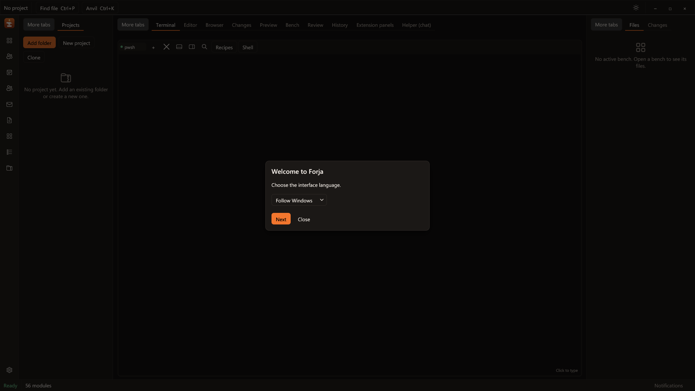

state: en.dark.open.onboarding
capture_sha: pending
model: opencode/glm-5.3-flash-free
---

# Onboarding — Welcome and language selection

Variant in English (`en`) and dark theme of the reference page [pt-BR.dark.open.onboarding](../pt-BR.dark.open.onboarding.md): first-use screen displayed over the main window, where the person chooses the interface language and proceeds through the initial Forja setup. The layout, regions, and states are identical to the reference; what changes are the texts, shown in English below.

## How to get there
Direct opening via command line: `forja-app --locale en --theme dark --open onboarding`. In the normal app, the screen appears on the first run (when there is no project yet) and can be resumed via Settings (button "Settings" at the bottom of the rail on the left, rectangle (8,724)–(44,760)).

## Regions
- **Top bar** — (0,0)–(1280,42): on the left the label "No project" and the buttons "Find file  Ctrl+P" and "Anvil  Ctrl+K"; on the right the unnamed button with the sun icon (toggle theme), followed by the window buttons "–", "□" and "×".
- **Rail on the left** — (0,42)–(56,768): the logo (image without accessible name at (12,50)–(40,78)) and a column of icon buttons: "Board", "Helpers", "Routines", "Muster", "Requests", "Skills", "Usage", "Extensions" and "Archive", with "Settings" pinned at the bottom.
- **Left side panel (Projects)** — (56,42)–(320,768): tabs "Projects" (checked), "Benches" and "Extension panels"; below, the buttons "Add folder", "New" and "Clone"; further down, a folder icon and the message "No project yet. Add an existing folder or create a new one."
- **Central area (Terminal + onboarding card)** — (320,42)–(980,768): tab strip "Terminal" (checked), "Editor", "Browser", "Changes", "Preview", "Bench", "Review", "History" and "Extension panels"; terminal bar with the "+" separator, unnamed icon buttons and the "Recipes" and "Shell" buttons; "pwsh" session tab (unnamed) and the terminal area at (328,139)–(980,756), empty, with the hint "Click to type" in the lower right corner. Over the terminal, the onboarding card (approx. (414,304)–(866,496)) with the title "Welcome to Forja", the text "Choose the interface language.", the language dropdown showing "Follow Windows" and the "Next" button.
- **Right side panel (Files)** — (988,42)–(1280,768): tabs "Files" (checked), "Helper (chat)", "Changes", "Search", "Ports" and "Extension panels"; below, a grid icon (label "(ícone)" at (1116,114)–(1144,142)) and the message "No active bench. Open a bench to see its files."
- **Status bar** — (0,768)–(1280,800): "Ready" on the left in green, "56 modules" next to it and "Notifications" on the right.

## Elements
| Element | Type | Position (px) | State | What it does |
|---|---|---|---|---|
| "Find file  Ctrl+P" | Button | (99,5)–(218,37) | — | Quick file search via the Ctrl+P command |
| "Anvil  Ctrl+K" | Button | (226,5)–(327,37) | — | Command palette (Ctrl+K) |
| (sem nome acessível) | Unknown | (1101,5)–(1133,37) | — | Sun icon: toggles light/dark theme |
| "–" | Button | (1155,5)–(1187,37) | — | Minimizes the window |
| "□" | Button | (1195,5)–(1227,37) | — | Maximizes/restores the window |
| "×" | Button | (1235,5)–(1269,37) | — | Closes the window |
| "No project" | Label | (11,12)–(77,31) | — | Shows that no project is open; clickable |
| (sem nome acessível) | Unknown | (304,42)–(320,768) | focus | Vertical separator between the left panel and the central area |
| (sem nome acessível) | Unknown | (972,42)–(988,768) | focus | Vertical separator between the central area and the right panel |
| (sem nome acessível) | Image | (12,50)–(40,78) | — | Forja logo at the top of the rail |
| "Projects" | Button | (64,50)–(136,82) | checked=True | Active tab of the left panel: project list |
| (sem nome acessível) | Unknown | (64,50)–(300,82) | focus | Container of the left panel tab strip |
| "Benches" | Button | (136,50)–(211,82) | checked=False | Tab that would switch to the bench list |
| "Extension panels" | Button | (211,50)–(337,82) | checked=False | Extension panels tab of the left panel |
| "Terminal" | Button | (324,50)–(401,82) | checked=True | Active tab of the central area: terminal |
| "Editor" | Button | (401,50)–(461,82) | checked=False | Switches the central area to the editor |
| "Browser" | Button | (461,50)–(534,82) | checked=False | Switches to the file browser |
| "Changes" | Button | (534,50)–(611,82) | checked=False | Switches to the diffs view |
| "Preview" | Button | (611,50)–(682,82) | checked=False | Switches to the file preview |
| "Bench" | Button | (682,50)–(743,82) | checked=False | Switches to the bench view |
| "Review" | Button | (743,50)–(810,82) | checked=False | Switches to the review view |
| "History" | Button | (810,50)–(878,82) | checked=False | Switches to the history |
| "Extension panels" | Button | (878,50)–(1004,82) | checked=False | Extension panels tab of the central area |
| (sem nome acessível) | Unknown | (992,50)–(1268,82) | focus | Container of the right panel tab strip |
| "Files" | Button | (992,50)–(1043,82) | checked=True | Active tab of the right panel: bench files |
| "Helper (chat)" | Button | (1004,50)–(1107,82) | checked=False | Tab for the chat with the helper |
| "Changes" | Button | (1043,50)–(1120,82) | checked=False | Tab for changes (diffs) |
| "Search" | Button | (1120,50)–(1185,82) | checked=False | Search tab |
| "Ports" | Button | (1185,50)–(1240,82) | checked=False | Tab for ports in use |
| "Extension panels" | Button | (1240,50)–(1366,82) | checked=False | Extension panels tab of the right panel |
| (sem nome acessível) | Unknown | (64,80)–(300,82) | — | Underline/indicator strip of the left panel tabs |
| (sem nome acessível) | Unknown | (992,80)–(1268,82) | — | Underline/indicator strip of the right panel tabs |
| "Board" | Button | (8,94)–(44,130) | checked=False | Rail icon: opens the board |
| "Add folder" | Button | (64,98)–(154,130) | — | Orange highlight: adds a folder as a project |
| "New" | Button | (162,98)–(213,130) | — | Creates a new project |
| "Clone" | Button | (221,98)–(280,130) | — | Clones a repository as a project |
| "+" | Button | (407,102)–(441,134) | — | New terminal tab/session |
| (sem nome acessível) | Unknown | (444,102)–(476,134) | — | Split terminal icon |
| (sem nome acessível) | Unknown | (479,102)–(511,134) | — | Kill session icon (X) |
| (sem nome acessível) | Unknown | (514,102)–(546,134) | — | Clear terminal icon |
| (sem nome acessível) | Unknown | (549,102)–(581,134) | — | Search in terminal icon |
| "Recipes" | Button | (584,102)–(655,134) | — | Toggles the terminal recipes panel |
| "Shell" | Button | (658,102)–(711,134) | — | Toggles the shell panel |
| (sem nome acessível) | Unknown | (328,107)–(404,129) | — | "pwsh" session tab with a green dot for the active session |
| (sem nome acessível) | Unknown | (385,110)–(401,126) | — | Close X of the "pwsh" tab |
| (ícone) | Label | (1116,114)–(1144,142) | — | Grid icon of the empty Files panel |
| "Helpers" | Button | (8,138)–(44,174) | checked=False | Rail icon: opens the helpers |
| (sem nome acessível) | Unknown | (328,139)–(980,756) | — | Terminal area (empty, with the hint "Click to type") |
| "No active bench. Open a bench to see its files." | Label | (1004,150)–(1256,188) | — | Empty-state message of the Files panel |
| "Routines" | Button | (8,182)–(44,218) | checked=False | Rail icon: opens the routines |
| (ícone) | Label | (168,158)–(196,186) | — | Folder icon of the empty Projects panel |
| "Muster" | Button | (8,226)–(44,262) | checked=False | Rail icon: opens the muster |
| "No project yet. Add an existing folder or create a new one." | Label | (67,194)–(297,232) | — | Empty-state message of the Projects panel |
| "Requests" | Button | (8,270)–(44,306) | checked=False | Rail icon: opens the requests |
| "Skills" | Button | (8,314)–(44,350) | checked=False | Rail icon: opens the skills |
| "Welcome to Forja" | Label | (430,321)–(573,345) | — | Title of the onboarding card |
| "Usage" | Button | (8,358)–(44,394) | checked=False | Rail icon: opens the usage |
| "Choose the interface language." | Label | (430,361)–(621,380) | — | Instruction for the language step |
| (sem nome acessível) | Unknown | (430,396)–(583,428) | — | Language dropdown showing "Follow Windows" |
| (sem nome acessível) | Unknown | (640,400)–(640,400) | — | Zero-sized element associated with the language dropdown |
| "Extensions" | Button | (8,402)–(44,438) | checked=False | Rail icon: opens the extensions |
| "Archive" | Button | (8,446)–(44,482) | checked=False | Rail icon: opens the archive |
| "Next" | Button | (430,448)–(483,480) | — | Orange highlight button: proceeds to the next onboarding step |
| "Settings" | Button | (8,724)–(44,760) | checked=False | Rail footer icon: opens the settings |
| "Ready" | Label | (10,775)–(48,794) | — | General state, in green, on the status bar |
| "56 modules" | Label | (70,775)–(142,794) | — | Count of loaded modules |
| "Notifications" | Label | (1168,775)–(1246,794) | — | Notifications shortcut on the status bar |

## Appearance
Identical to the reference (pt-BR.dark.open.onboarding): dark theme with an almost black background, panels in dark gray, and the onboarding card in a slightly lighter tone with rounded corners. Orange highlight ("Brasa" palette) on "Next", "Add folder", on the checked tabs ("Projects", "Terminal", "Files") and on the tab underlines. Sans-serif typography in two levels; empty states in medium gray accompanied by icons. What changes in this variant are only the texts, in English ("Welcome to Forja", "No project yet…", "Ready", etc.); the strings "Recipes", "Shell", "Skills" and "Notifications" coincide with the reference. English texts are shorter, which reduces but does not eliminate the truncations of the "Extension panels" tabs.

## Issues found
- The "Extension panels" tab of the right panel has the rectangle (1240,50)–(1366,82), extending 86 px beyond the window width (1280 px): the text is cut off in the image, where only "Ext" appears.
- The tab strips overlap: the left panel "Extension panels" tab (211,50)–(337,82) overlaps "Terminal" (324,50)–(401,82) and crosses the left panel boundary (separator at x=304–320); the central area "Extension panels" tab (878,50)–(1004,82) covers the start of the right panel tab strip ("Files", (992,50)–(1043,82)), and "Helper (chat)" (1004,50)–(1107,82) overlaps "Files" and "Changes" (1043,50)–(1120,82).
- The text of the left panel "Extension panels" tab appears truncated in the image ("Extension pan") because the tab strip is cut off by the central area.
- The language dropdown ("Follow Windows") and its associated element at (640,400)–(640,400) have no accessible name; the latter is zero-sized.
- The four icon buttons of the terminal bar (split, kill, clear, search) and the "pwsh" session tab have no accessible name.
- The theme toggle button (sun icon, (1101,5)–(1133,37)) has no accessible name.
