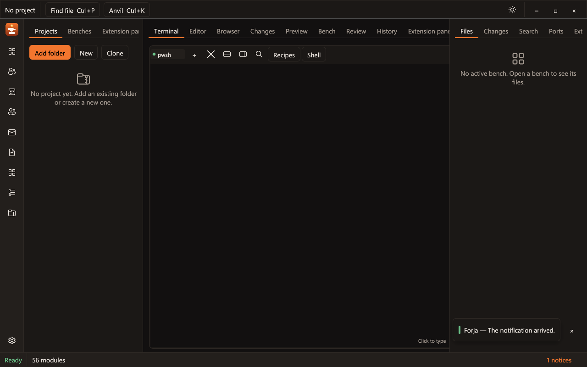

state: en.dark.open.toast
capture_sha: 4650d71cffcabdec
model: opencode/glm-5.3-flash-free
---

# Notification (toast)

Captura da janela principal com uma notificação (toast) aberta no canto inferior direito; o restante da tela mostra o estado inicial sem projeto, com o painel Terminal ativo ao centro. Variante em inglês da página de referência (pt-BR.dark.open.toast): mesma estrutura e layout; mudam apenas os textos da interface, que aparecem em inglês.

## Como chegar
Na janela principal, dispare uma notificação (o alvo desta captura é o toast aberto sobre o painel direito). Comando de captura: `forja-app --locale en --theme dark --open toast`.

## Regiões
- **Barra superior** — (0,0)–(1280,42): rótulo "No project" à esquerda, botões "Find file  Ctrl+P" e "Anvil  Ctrl+K", alternador de tema (ícone de sol, sem nome acessível) e os botões de janela "–", "□" e "×" à direita.
- **Trilho à esquerda** — (0,42)–(52,768): coluna de ícones de navegação: logotipo da Forja (12,50)–(40,78) e, de cima para baixo, "Board", "Helpers", "Routines", "Muster", "Requests", "Skills", "Usage", "Extensions", "Archive" e, no fim, "Settings".
- **Painel esquerdo (Projects)** — (52,42)–(304,768): abas "Projects" (marcada), "Benches" e "Extension panels"; botões "Add folder" (destaque laranja), "New" e "Clone"; estado vazio com ícone de pasta e o texto "No project yet. Add an existing folder or create a new one.".
- **Área central (Terminal)** — (320,42)–(980,768): abas do painel ("Terminal" marcada, "Editor", "Browser", "Changes", "Preview", "Bench", "Review", "History" e "Extension panels"), barra de ferramentas do terminal com a aba "pwsh" e botões de ícone, os filtros "Recipes" e "Shell", e a área vazia do terminal com a dica "Click to type" no canto inferior.
- **Painel direito (Files)** — (988,42)–(1280,768): abas "Files" (marcada), "Helper (chat)", "Changes", "Search" e "Ports"; estado vazio com ícone de grade e o texto "No active bench. Open a bench to see its files."; sobre ele, o toast com "Forja — The notification arrived." e botão de fechar "×".
- **Barra de status** — (0,768)–(1280,800): "Ready" à esquerda, "56 modules" ao lado e "1 notices" em laranja à direita.

## Elementos
| Elemento | Tipo | Posição (px) | Estado | O que faz |
|---|---|---|---|---|
| "No project" | Label | (11,12)–(77,31) | — | Indica que não há projeto aberto. |
| "Find file  Ctrl+P" | Button | (99,5)–(218,37) | — | Abre a busca rápida de arquivos (Ctrl+P). |
| "Anvil  Ctrl+K" | Button | (226,5)–(327,37) | — | Abre a paleta de comandos (Ctrl+K). |
| (sem nome acessível) | Unknown | (1101,5)–(1133,37) | — | Botão de alternância de tema (ícone de sol); alterna para o tema claro. |
| "–" | Button | (1155,5)–(1187,37) | — | Minimiza a janela. |
| "□" | Button | (1195,5)–(1227,37) | — | Maximiza/restaura a janela. |
| "×" | Button | (1235,5)–(1269,37) | — | Fecha a janela. |
| (sem nome acessível) | Unknown | (304,42)–(320,768) | — | Divisor arrastável entre o painel esquerdo e a área central. |
| (sem nome acessível) | Unknown | (972,42)–(988,768) | — | Divisor arrastável entre a área central e o painel direito. |
| (sem nome acessível) | Image | (12,50)–(40,78) | — | Logotipo da Forja no topo do trilho. |
| "Projects" | Button | (64,50)–(136,82) | marcado=True | Aba ativa do painel esquerdo; mostra a lista de projetos. |
| (sem nome acessível) | Unknown | (64,50)–(300,82) | — | Linha de fundo/sublinhado da barra de abas do painel esquerdo. |
| "Benches" | Button | (136,50)–(211,82) | marcado=False | Alterna o painel esquerdo para a lista de bancadas (benches). |
| "Extension panels" | Button | (211,50)–(337,82) | marcado=False | Terceira aba do painel esquerdo; texto cortado na borda do painel. |
| "Terminal" | Button | (324,50)–(401,82) | marcado=True | Aba ativa da área central; mostra o terminal. |
| "Editor" | Button | (401,50)–(461,82) | marcado=False | Mostra o editor na área central. |
| "Browser" | Button | (461,50)–(534,82) | marcado=False | Mostra o navegador de conteúdo na área central. |
| "Changes" | Button | (534,50)–(611,82) | marcado=False | Mostra a visão de diferenças (mudanças). |
| "Preview" | Button | (611,50)–(682,82) | marcado=False | Mostra o visualizador/preview. |
| "Bench" | Button | (682,50)–(743,82) | marcado=False | Mostra a visão da bancada. |
| "Review" | Button | (743,50)–(810,82) | marcado=False | Mostra a visão de revisão. |
| "History" | Button | (810,50)–(878,82) | marcado=False | Mostra o histórico. |
| "Extension panels" | Button | (878,50)–(1004,82) | marcado=False | Última aba da área central; retângulo invade o painel direito e só aparece uma barra vertical na imagem. |
| (sem nome acessível) | Unknown | (992,50)–(1268,82) | — | Linha de fundo da barra de abas do painel direito. |
| "Files" | Button | (992,50)–(1043,82) | marcado=True | Aba ativa do painel direito; lista de arquivos da bancada. |
| "Helper (chat)" | Button | (1004,50)–(1107,82) | marcado=False | Retângulo sobreposto às abas "Changes", "Search" e "Ports"; não visível na imagem. |
| "Changes" | Button | (1043,50)–(1120,82) | marcado=False | Mostra as mudanças da bancada. |
| "Search" | Button | (1120,50)–(1185,82) | marcado=False | Mostra a busca no painel direito. |
| "Ports" | Button | (1185,50)–(1240,82) | marcado=False | Mostra a lista de portas. |
| "Extension panels" | Button | (1240,50)–(1366,82) | marcado=False | Aba extra cujo retângulo vai além da largura da imagem (1280 px); não visível. |
| (sem nome acessível) | Unknown | (64,80)–(300,82) | — | Sublinhado da aba ativa do painel esquerdo. |
| (sem nome acessível) | Unknown | (992,80)–(1268,82) | — | Sublinhado da aba ativa do painel direito. |
| "Board" | Button | (8,94)–(44,130) | marcado=False | Ícone do trilho: abre o quadro. |
| "Add folder" | Button | (64,98)–(154,130) | — | Abre o seletor para adicionar uma pasta de projeto. |
| "New" | Button | (162,98)–(213,130) | — | Cria um novo projeto. |
| "Clone" | Button | (221,98)–(280,130) | — | Clona um repositório como novo projeto. |
| "+" | Button | (407,102)–(441,134) | — | Abre nova aba/instância de terminal. |
| (sem nome acessível) | Unknown | (444,102)–(476,134) | — | Botão de ícone da barra do terminal (encerra/fecha o terminal; ícone em X). |
| (sem nome acessível) | Unknown | (479,102)–(511,134) | — | Botão de ícone da barra do terminal (dividir o terminal). |
| (sem nome acessível) | Unknown | (514,102)–(546,134) | — | Botão de ícone da barra do terminal (limpar/executar). |
| (sem nome acessível) | Unknown | (549,102)–(581,134) | — | Botão de ícone da barra do terminal (buscar no terminal; ícone de lupa). |
| "Recipes" | Button | (584,102)–(655,134) | — | Alterna o filtro de receitas do terminal. |
| "Shell" | Button | (658,102)–(711,134) | — | Alterna o filtro de shells do terminal. |
| (sem nome acessível) | Unknown | (328,107)–(404,129) | — | Aba da sessão de terminal "pwsh", com indicador verde. |
| (sem nome acessível) | Unknown | (385,110)–(401,126) | — | Ponto verde de status dentro da aba "pwsh". |
| (ícone) | Label | (1116,114)–(1144,142) | — | Ícone de grade do estado vazio do painel direito. |
| "Helpers" | Button | (8,138)–(44,174) | marcado=False | Ícone do trilho: abre os ajudantes de código. |
| (sem nome acessível) | Unknown | (328,139)–(980,756) | — | Área do terminal (vazia); clique concentra o teclado; mostra "Click to type" no canto inferior. |
| "No active bench. Open a bench to see its files." | Label | (1004,150)–(1256,188) | — | Estado vazio do painel de arquivos. |
| "Routines" | Button | (8,182)–(44,218) | marcado=False | Ícone do trilho: abre as rotinas. |
| (ícone) | Label | (168,158)–(196,186) | — | Ícone de pasta do estado vazio do painel de projetos. |
| "No project yet. Add an existing folder or create a new one." | Label | (67,194)–(297,232) | — | Estado vazio do painel de projetos. |
| "Muster" | Button | (8,226)–(44,262) | marcado=False | Ícone do trilho: abre o mutirão. |
| "Requests" | Button | (8,270)–(44,306) | marcado=False | Ícone do trilho: abre os pedidos. |
| "Skills" | Button | (8,314)–(44,350) | marcado=False | Ícone do trilho: abre as skills. |
| "Usage" | Button | (8,358)–(44,394) | marcado=False | Ícone do trilho: abre o uso. |
| (sem nome acessível) | Unknown | (640,400)–(640,400) | — | Elemento de dimensão zero no centro da janela; sem efeito visível. |
| "Extensions" | Button | (8,402)–(44,438) | marcado=False | Ícone do trilho: abre as extensões. |
| "Archive" | Button | (8,446)–(44,482) | marcado=False | Ícone do trilho: abre o acervo. |
| (sem nome acessível) | Unknown | (987,694)–(1264,760) | — | Contêiner do toast no canto inferior direito. |
| "×" | Button | (1230,703)–(1264,735) | — | Fecha o toast. |
| "Forja — The notification arrived." | Label | (1012,710)–(1209,729) | — | Texto da notificação, com barra vertical laranja à esquerda. |
| "Settings" | Button | (8,724)–(44,760) | marcado=False | Ícone do trilho: abre os ajustes. |
| "Ready" | Label | (10,775)–(48,794) | — | Estado geral na barra de status, em verde. |
| "56 modules" | Label | (70,775)–(142,794) | — | Quantidade de módulos carregados. |
| "1 notices" | Label | (1193,775)–(1246,794) | — | Contador de avisos, em laranja, com foco do teclado. |

## Aparência
Idêntica à referência pt-BR: tema escuro com fundo marrom-escuro nos painéis e preto mais profundo na área do terminal; divisórias finas em marrom-acinzentado separam as regiões. A cor de destaque é o laranja (Brasa): fundo do botão "Add folder", sublinhado e texto das abas marcadas ("Projects", "Terminal", "Files"), barra vertical do toast e o contador "1 notices" na barra de status — este último em laranja, como na referência. Tipografia sem serifa em dois tamanhos: rótulos de interface (~15 px) e textos de apoio em cinza médio; atalhos ("Ctrl+P", "Ctrl+K") em cinza mais apagado dentro dos botões da barra superior. Ícones do trilho monocromáticos em cinza, em coluna única de 36 px. Estados vazios centrados (ícone acima do texto) nos painéis de projetos e arquivos; o terminal exibe "Click to type" em cinza escuro no canto inferior direito. O rótulo "Ready" da barra de status aparece em verde. O toast tem fundo do tom de painel, barra vertical laranja à esquerda do texto e o botão "×" em cinza. Única diferença visual esperada da variante: os textos da interface, todos em inglês.

## Problemas encontrados
- A terceira aba do painel esquerdo, "Extension panels", tem texto cortado na borda do painel ("Extension pan" visível), pois seu retângulo (211,50)–(337,82) ultrapassa a largura do painel (~304 px).
- A aba "Extension panels" da área central tem retângulo (878,50)–(1004,82) que invade o painel direito; na imagem só aparece uma barra vertical estreita junto ao divisor.
- A aba "Extension panels" do painel direito tem retângulo (1240,50)–(1366,82) que vai além da largura da imagem (1280 px); não é visível.
- O retângulo do botão "Helper (chat)" (1004,50)–(1107,82) se sobrepõe às abas "Changes", "Search" e "Ports"; o botão não aparece na imagem.
- Cinco botões de ícone da barra do terminal (444,102)–(581,134) e o botão de tema (1101,5)–(1133,37) não têm nome acessível.
- Há dois botões nomeados apenas "×" (fechar janela em (1235,5) e fechar toast em (1230,703)), o que os torna ambíguos para leitores de tela.
- O texto "Click to type", visível na área do terminal, não aparece na árvore de acessibilidade.
- O contador "1 notices" está no plural para valor singular (deveria ser "1 notice").
- Elemento de dimensão zero (640,400)–(640,400) sem nome na área central.
