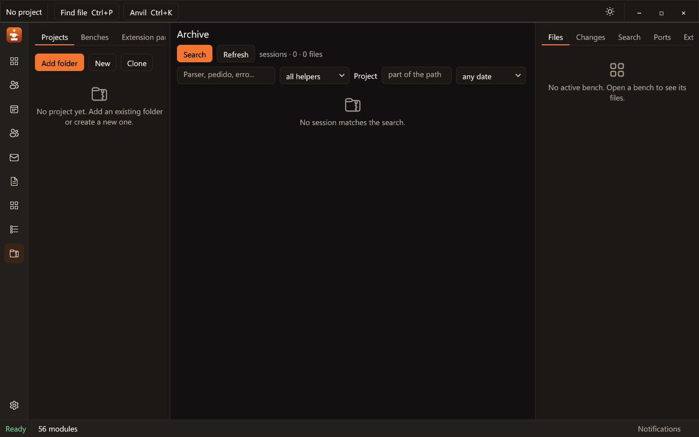

# Archive (rail tab)

Variante em inglês da tela do módulo Archive, que lista e filtra sessões anteriores dos ajudantes e os arquivos de que eles dispõem, com estados vazios quando não há projeto ou bancada ativa. Página de referência: pt-BR.dark.rail.archive.tab; a estrutura é a mesma e mudam os textos (em inglês), algumas posições e larguras de botões.

## Como chegar
No trilho à esquerda, clique no botão "Archive" (o último dos ícones do grupo principal, destacado em laranja quando ativo). Equivalente por comando de captura: `forja-app --locale en --theme dark --rail archive.tab`.

## Regiões
- **Barra superior** (0,0)–(1280,40): indicador de projeto ("No project"), botões de comando "Find file  Ctrl+P" e "Anvil  Ctrl+K", alternador de tema (ícone de sol, sem nome acessível) e os botões de janela "–", "□" e "×".
- **Trilho à esquerda** (0,40)–(50,768): logo do app (imagem em (12,50)–(40,78)) e a coluna de botões-ícone de navegação ("Board", "Helpers", "Routines", "Muster", "Requests", "Skills", "Usage", "Extensions", "Archive"), com "Settings" fixado na base.
- **Painel lateral esquerdo** (50,40)–(304,768): abas "Projects" (ativa), "Benches" e "Extension panels"; ações "Add folder", "New" e "Clone"; ícone e mensagem de estado vazio "No project yet. Add an existing folder or create a new one."; no topo, o rótulo "No project" pertence à barra superior.
- **Divisor vertical** (304,42)–(320,768): separador fino entre o painel esquerdo e a área central.
- **Área central** (320,42)–(972,768): título "Archive", botões "Search" e "Refresh", contador "sessions · 0 · 0 files", campo de filtro, seletor "all helpers", campo "Project" ("part of the path"), seletor de período "any date" e o estado vazio "No session matches the search." com ícone de pasta acima.
- **Divisor vertical** (972,42)–(988,768): separador entre a área central e o painel direito.
- **Painel direito** (988,42)–(1280,768): abas "Files" (ativa), "Changes", "Search", "Ports" e "Extension panels"; ícone (sem nome acessível) em (1116,114)–(1144,142) e a mensagem "No active bench. Open a bench to see its files."
- **Barra de status** (0,768)–(1280,800): rótulos "Ready" (em verde) à esquerda, "56 modules" ao lado e "Notifications" à direita.

## Elementos
| Elemento | Tipo | Posição (px) | Estado | O que faz |
|---|---|---|---|---|
| "Find file  Ctrl+P" | Button | (99,5)–(218,37) | — | Abre a busca rápida de arquivos (atalho Ctrl+P). |
| "Anvil  Ctrl+K" | Button | (226,5)–(327,37) | — | Abre a paleta de comandos (atalho Ctrl+K). |
| (sem nome acessível) | Unknown | (1101,5)–(1133,37) | — | Alternador de tema (ícone de sol). |
| "–" | Button | (1155,5)–(1187,37) | — | Minimiza a janela. |
| "□" | Button | (1195,5)–(1227,37) | — | Maximiza/restaura a janela. |
| "×" | Button | (1235,5)–(1269,37) | — | Fecha a janela. |
| "No project" | Label | (11,12)–(77,31) | — | Mostra que não há projeto selecionado na sessão atual. |
| (sem nome acessível) | Unknown | (304,42)–(320,768) | — | Divisor vertical entre painel esquerdo e área central. |
| (sem nome acessível) | Unknown | (972,42)–(988,768) | — | Divisor vertical entre área central e painel direito. |
| (sem nome acessível) | Image | (12,50)–(40,78) | clicável | Logo do app no topo do trilho. |
| "Projects" | Button | (64,50)–(136,82) | marcado=True | Aba ativa do painel esquerdo; lista os projetos. |
| (sem nome acessível) | Unknown | (64,50)–(300,82) | — | Contêiner da linha de abas do painel esquerdo. |
| "Benches" | Button | (136,50)–(211,82) | marcado=False | Aba que listaria as bancadas (branches de trabalho). |
| "Extension panels" | Button | (211,50)–(337,82) | marcado=False | Aba de painéis de extensões do painel esquerdo; truncada na renderização ("Extension pan"). |
| "Archive" | Label | (324,50)–(382,74) | — | Título da área central. |
| (sem nome acessível) | Unknown | (992,50)–(1268,82) | — | Contêiner da linha de abas do painel direito. |
| "Files" | Button | (992,50)–(1043,82) | marcado=True | Aba ativa do painel direito; mostraria os arquivos acessíveis à bancada. |
| "Changes" | Button | (1043,50)–(1120,82) | marcado=False | Aba de alterações pendentes da bancada. |
| "Search" | Button | (1120,50)–(1185,82) | marcado=False | Aba de busca de texto no acervo. |
| "Ports" | Button | (1185,50)–(1240,82) | marcado=False | Aba de portas/recursos expostos pela bancada. |
| "Extension panels" | Button | (1240,50)–(1366,82) | marcado=False | Aba de painéis de extensões do painel direito; retângulo além da largura da janela, visível apenas como "Ext". |
| (sem nome acessível) | Unknown | (64,80)–(300,82) | clicável | Contêiner/rodapé fino sob as abas do painel esquerdo. |
| (sem nome acessível) | Unknown | (992,80)–(1268,82) | clicável | Contêiner/rodapé fino sob as abas do painel direito. |
| "Search" | Button | (324,82)–(389,114) | — | Aplica os filtros de busca do acervo (botão preenchido de laranja). |
| "Refresh" | Button | (397,82)–(467,114) | — | Recarrega a lista de sessões do acervo. |
| "sessions · 0 · 0 files" | Label | (475,89)–(590,108) | — | Contador do resultado atual (0 sessões, 0 arquivos). |
| "Board" | Button | (8,94)–(44,130) | marcado=False | Botão-ícone do trilho que abre a visão de quadro. |
| "Add folder" | Button | (64,98)–(154,130) | — | Adiciona uma pasta existente como projeto (botão preenchido com laranja e texto branco). |
| "New" | Button | (162,98)–(213,130) | — | Cria um projeto novo. |
| "Clone" | Button | (221,98)–(280,130) | — | Clona um repositório como novo projeto. |
| (ícone) | Label | (1116,114)–(1144,142) | clicável | Ícone do estado vazio do painel direito. |
| (sem nome acessível) | TextInput | (324,122)–(504,154) | — | Campo de filtro textual; sugestão exibida: "Parser, pedido, erro...". |
| (sem nome acessível) | Unknown | (512,122)–(640,154) | clicável | Seletor de ajudante com o valor "all helpers". |
| "Project" | Label | (648,122)–(691,154) | — | Rótulo do filtro por projeto ao lado. |
| (sem nome acessível) | TextInput | (699,122)–(827,154) | — | Campo do filtro por projeto (sugestão: "part of the path"). |
| (sem nome acessível) | Unknown | (835,122)–(963,154) | clicável | Seletor de período com o valor "any date". |
| "Helpers" | Button | (8,138)–(44,174) | marcado=False | Botão-ícone do trilho que abre os ajudantes. |
| "No active bench. Open a bench to see its files." | Label | (1004,150)–(1256,188) | — | Estado vazio do painel direito. |
| (ícone) | Label | (168,158)–(196,186) | clicável | Ícone de pasta do estado vazio do painel esquerdo. |
| (ícone) | Label | (632,178)–(660,206) | clicável | Ícone de pasta do estado vazio da área central. |
| "Routines" | Button | (8,182)–(44,218) | marcado=False | Botão-ícone do trilho que abre as rotinas. |
| "No project yet. Add an existing folder or create a new one." | Label | (67,194)–(297,232) | — | Estado vazio do painel esquerdo. |
| "No session matches the search." | Label | (550,214)–(743,233) | — | Estado vazio da busca do acervo. |
| "Muster" | Button | (8,226)–(44,262) | marcado=False | Botão-ícone do trilho que abre o mutirão. |
| "Requests" | Button | (8,270)–(44,306) | marcado=False | Botão-ícone do trilho que abre os pedidos. |
| "Skills" | Button | (8,314)–(44,350) | marcado=False | Botão-ícone do trilho que abre as skills. |
| "Usage" | Button | (8,358)–(44,394) | marcado=False | Botão-ícone do trilho que abre o uso. |
| "Extensions" | Button | (8,402)–(44,438) | marcado=False | Botão-ícone do trilho que abre as extensões. |
| "Archive" | Button | (8,446)–(44,482) | marcado=True | Botão-ícone do trilho da tela atual, em destaque laranja. |
| "Settings" | Button | (8,724)–(44,760) | marcado=False | Botão-ícone do trilho que abre os ajustes. |
| "Ready" | Label | (10,775)–(48,794) | — | Status geral do app. |
| "56 modules" | Label | (70,775)–(142,794) | — | Quantidade de módulos carregados. |
| "Notifications" | Label | (1168,775)–(1246,794) | — | Acesso às notificações na barra de status. |

## Aparência
Igual à referência pt-BR (tema escuro "Brasa"): fundo quase preto, painéis em tons de carvão/marrom-escuro mais claros que o trilho, destaque em laranja nos elementos ativos — sublinhado da aba "Projects", botão "Add folder" e botão "Search" preenchidos de laranja com texto branco, botão-ícone "Archive" do trilho com fundo laranja e linha laranja sob a aba "Files". Tipografia sans-serif clara; título "Archive" maior; mensagens de estado vazio em cinza médio, centralizadas nos respectivos painéis. Botões do trilho com 44 px de lado e passo de 44 px, abas de 32 px de altura, cantos levemente arredondados. Barra de status com 32 px de altura, "Ready" em verde e os demais rótulos em cinza. O que muda da referência: todos os textos em inglês e larguras de botões ligeiramente diferentes (por exemplo, "Add folder" em (64,98)–(154,130) contra (64,98)–(183,130) em pt-BR), com os três botões "Add folder", "New" e "Clone" na mesma linha.

## Problemas encontrados
- Texto de sugestão do campo de filtro não traduzido: aparece "Parser, pedido, erro..." (português) na interface em inglês.
- A aba "Extension panels" do painel esquerdo aparece truncada como "Extension pan" e seu retângulo (211,50)–(337,82) se sobrepõe ao rótulo "Archive" (324,50)–(382,74).
- A aba "Extension panels" do painel direito tem retângulo (1240,50)–(1366,82), ultrapassando a largura da janela (1280 px); o texto é cortado fora da tela, visível apenas como "Ext".
- Vários elementos sem nome acessível: os dois divisores verticais, os contêineres das linhas de abas, o alternador de tema da barra superior, o logo do trilho, os dois campos de filtro (TextInput) e os dois seletores de valores ("all helpers" e "any date"), o que dificulta a navegação por leitor de telas.
- Os botões de janela usam apenas os símbolos "–", "□" e "×" como nome acessível, sem rótulo descritivo.
- A barra de abas do painel direito não cabe na largura disponível (cinco abas se estendem além da borda), indicando estouro de layout.
- Os contêineres "Unknown" das linhas de abas em (64,80)–(300,82) e (992,80)–(1268,82) têm apenas 2 px de altura, sugerindo retângulos residuais possivelmente decorrentes de truncamento.
