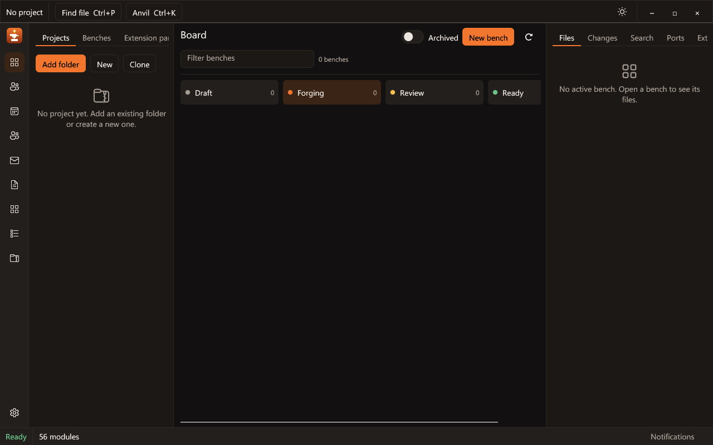

state: en.dark.rail.board.page
capture_sha: (ver arquivo de captura)
model: opencode/glm-5.3-flash-free
---

# Board (Projects panel page)

Tela inicial da área de projetos: mostra um quadro Kanban de bancadas em colunas de fluxo (Draft, Forging, Review, Ready), com painel de projetos à esquerda e painel de arquivos à direita, ambos vazios porque não há projeto aberto.

> Variante em inglês (`en`) da página de referência **pt-BR.dark.rail.board.page**; a estrutura é a mesma e o que muda são os textos da interface, em inglês. Coordenadas dos elementos mudam levemente em relação à referência porque os rótulos em inglês são mais curtos.

## Como chegar
Na janela principal, clique no primeiro ícone do trilho à esquerda, o botão "Board" (retângulo (8,94)–(44,130)), abaixo da logomarca da Forja; a aba "Projects" do painel esquerdo fica marcada. A captura foi gerada com o comando `forja-app --locale en --theme dark --rail board.page`.

## Regiões
- **Barra superior** — (0,0)–(1280,42): rótulo "No project", botões "Find file  Ctrl+P" e "Anvil  Ctrl+K" à esquerda; à direita, ícone de tema (sol, sem nome acessível) e os botões de janela "–", "□" e "×".
- **Trilho à esquerda** — (0,42)–(56,768): logomarca (imagem sem nome acessível em (12,50)–(40,78)) e coluna de ícones: "Board", "Helpers", "Routines", "Muster", "Requests", "Skills", "Usage", "Extensions", "Archive", com "Settings" fixado no rodapé.
- **Painel esquerdo (Projects)** — (56,42)–(320,768): abas "Projects", "Benches" e "Extension panels"; botões "Add folder", "New" e "Clone"; mensagem de vazio "No project yet. Add an existing folder or create a new one." com ícone de pasta.
- **Área central (Board)** — (320,42)–(972,768): título "Board", interruptor "Archived", botão "New bench" e botão "⟳"; campo de filtro sem nome acessível, contador "0 benches", as quatro colunas com cabeçalhos e contadores "0", e uma barra de rolagem horizontal sem nome em (324,758)–(968,760).
- **Painel direito (Files)** — (988,42)–(1280,768): abas "Files", "Changes", "Search", "Ports" e "Extension panels"; ícone de grade e mensagem "No active bench. Open a bench to see its files."
- **Barra de status** — (0,768)–(1280,800): "Ready" (em verde), "56 modules" à esquerda e "Notifications" à direita.

## Elementos
| Elemento | Tipo | Posição (px) | Estado | O que faz |
|---|---|---|---|---|
| "Find file  Ctrl+P" | Button | (99,5)–(218,37) | normal | Abre a busca/arquivos rápidos pelo atalho Ctrl+P. |
| "Anvil  Ctrl+K" | Button | (226,5)–(327,37) | normal | Abre o lançador de ajudantes/agentes pelo atalho Ctrl+K. |
| (sem nome acessível) | Unknown | (1101,5)–(1133,37) | normal | Ícone de sol; alterna o tema da interface. |
| "–" | Button | (1155,5)–(1187,37) | normal | Minimiza a janela. |
| "□" | Button | (1195,5)–(1227,37) | normal | Maximiza/restaura a janela. |
| "×" | Button | (1235,5)–(1269,37) | normal | Fecha a janela. |
| "No project" | Label | (11,12)–(77,31) | normal | Mostra que não há projeto aberto. |
| (sem nome acessível) | Unknown | (304,42)–(320,768) | normal | Divisor vertical entre o painel esquerdo e a área central. |
| (sem nome acessível) | Unknown | (972,42)–(988,768) | normal | Divisor vertical entre a área central e o painel direito. |
| (sem nome acessível) | Image | (12,50)–(40,78) | normal | Logomarca da Forja no topo do trilho. |
| "Projects" | Button | (64,50)–(136,82) | marcado=True | Aba ativa do painel esquerdo, com sublinhado laranja. |
| (sem nome acessível) | Unknown | (64,50)–(300,82) | normal | Faixa da aba ativa "Projects". |
| "Benches" | Button | (136,50)–(211,82) | normal | Aba que listaria as bancadas do projeto. |
| "Extension panels" | Button | (211,50)–(337,82) | normal | Aba de painéis de extensões; o texto aparece cortado na borda do painel ("Extension pai"). |
| "Board" | Label | (324,50)–(371,74) | normal | Título da página central. |
| "New bench" | Button | (830,50)–(923,82) | normal | Botão em destaque laranja para criar uma bancada. |
| "⟳" | Button | (931,50)–(968,82) | normal | Recarrega/atualiza o quadro. |
| (sem nome acessível) | Unknown | (992,50)–(1268,82) | normal | Faixa das abas do painel direito. |
| "Files" | Button | (992,50)–(1043,82) | marcado=True | Aba ativa do painel direito, com sublinhado laranja. |
| "Changes" | Button | (1043,50)–(1120,82) | normal | Aba que mostraria as mudanças (controle de versão). |
| "Search" | Button | (1120,50)–(1185,82) | normal | Aba de busca nos arquivos. |
| "Ports" | Button | (1185,50)–(1240,82) | normal | Aba que mostraria portas/terminais. |
| "Extension panels" | Button | (1240,50)–(1366,82) | normal | Aba de painéis de extensões; fica parcialmente fora da janela. |
| "Archived" | CheckBox | (721,54)–(822,78) | marcado=False | Interruptor para exibir somente bancadas arquivadas. |
| (sem nome acessível) | Unknown | (64,80)–(300,82) | normal | Linha de sublinhado da aba ativa do painel esquerdo. |
| (sem nome acessível) | Unknown | (992,80)–(1268,82) | normal | Linha de sublinhado da aba ativa do painel direito. |
| (sem nome acessível) | TextInput | (324,90)–(564,122) | normal | Campo de filtro com o texto de marca d'água "Filter benches". |
| "Board" | Button | (8,94)–(44,130) | marcado=True | Ícone do trilho que abre esta página do quadro. |
| "Add folder" | Button | (64,98)–(154,130) | normal | Botão em destaque laranja para importar uma pasta como projeto. |
| "New" | Button | (162,98)–(213,130) | normal | Cria um projeto novo. |
| "Clone" | Button | (221,98)–(280,130) | normal | Clona um projeto existente. |
| "0 benches" | Label | (572,98)–(625,114) | normal | Contador de bancadas visíveis no quadro. |
| (ícone) | Label | (1116,114)–(1144,142) | normal | Ícone de grade do estado vazio do painel direito. |
| "Helpers" | Button | (8,138)–(44,174) | normal | Ícone do trilho para a área de ajudantes (agentes de IA). |
| (sem nome acessível) | Unknown | (324,144)–(968,760) | normal | Área rolável do quadro com as colunas. |
| "No active bench. Open a bench to see its files." | Label | (1004,150)–(1256,188) | normal | Mensagem de vazio do painel direito. |
| "Draft" | Label | (350,157)–(381,176) | normal | Cabeçalho da primeira coluna do fluxo. |
| "Forging" | Label | (534,157)–(581,176) | normal | Cabeçalho da segunda coluna, com fundo âmbar escuro (coluna destacada). |
| "Review" | Label | (718,157)–(761,176) | normal | Cabeçalho da terceira coluna. |
| "Ready" | Label | (902,157)–(940,176) | normal | Cabeçalho da quarta coluna; o cartão da coluna é cortado pela borda da área central. |
| (ícone) | Label | (168,158)–(196,186) | normal | Ícone de pasta ilustrando o estado vazio do painel esquerdo. |
| "0" | Label | (486,158)–(492,174) | normal | Contador de cartões na coluna Draft. |
| "0" | Label | (670,158)–(676,174) | normal | Contador de cartões na coluna Forging. |
| "0" | Label | (854,158)–(860,174) | normal | Contador de cartões na coluna Review. |
| "0" | Label | (1038,158)–(1044,174) | normal | Contador de cartões na coluna Ready. |
| "Routines" | Button | (8,182)–(44,218) | normal | Ícone do trilho para a área de rotinas. |
| "No project yet. Add an existing folder or create a new one." | Label | (67,194)–(297,232) | normal | Mensagem de vazio do painel de projetos. |
| "Muster" | Button | (8,226)–(44,262) | normal | Ícone do trilho para a área de mutirão. |
| "Requests" | Button | (8,270)–(44,306) | normal | Ícone do trilho para a área de pedidos. |
| "Skills" | Button | (8,314)–(44,350) | normal | Ícone do trilho para a área de skills. |
| "Usage" | Button | (8,358)–(44,394) | normal | Ícone do trilho para a área de uso. |
| "Extensions" | Button | (8,402)–(44,438) | normal | Ícone do trilho para a área de extensões. |
| "Archive" | Button | (8,446)–(44,482) | normal | Ícone do trilho para a área de acervo. |
| "Settings" | Button | (8,724)–(44,760) | normal | Ícone do trilho para os ajustes, fixado no rodapé do trilho. |
| (sem nome acessível) | Unknown | (324,758)–(968,760) | normal | Barra de rolagem horizontal do quadro. |
| "Ready" | Label | (10,775)–(48,794) | normal | Estado geral do app na barra de status, em verde. |
| "56 modules" | Label | (70,775)–(142,794) | normal | Quantidade de módulos carregados. |
| "Notifications" | Label | (1168,775)–(1246,794) | normal | Indicador de notificações, clicável, no canto direito. |
| (ícone) | Label | (632,792)–(660,820) | normal | Ícone de estado vazio do quadro; fica quase todo abaixo da barra de status, fora da área visível. |
| "No bench in this board yet. Create one to start." | Label | (502,828)–(791,847) | normal | Mensagem de vazio do quadro; inteiramente abaixo da altura da janela, invisível na captura. |

## Aparência
Igual à referência pt-BR: tema escuro com fundo quase preto (tons entre #191917 e #222220), painéis ligeiramente mais claros que a barra superior. O acento laranja ("Brasa") aparece no botão "New bench", no botão "Add folder", no sublinhado das abas ativas e no texto laranja do contador da coluna destacada "Forging", que tem fundo âmbar escuro (#3a2410 aprox.) com ponto laranja; as demais colunas usam pontos cinza, amarelo e verde para Draft, Review e Ready. O texto é predominantemente cinza claro sobre escuro, com "Ready" na barra de status em verde (#6cbf6c aprox.). Tipografia sem serifa de um único tamanho, com botões de trilho de 36 px alinhados a um trilho de 56 px; abas e botões do cabeçalho ocupam faixas de 32 px de altura com cantos arredondados pequenos. Como os rótulos em inglês são mais curtos, alguns elementos encolhem em relação à referência (por exemplo, "New bench" em (830,50)–(923,82) e o rótulo de janela "No project").

## Problemas encontrados
- O botão "Extension panels" do painel direito tem retângulo (1240,50)–(1366,82), estendendo-se além da largura da janela (1280 px); a aba fica cortada (aparece só "Ext").
- O botão "Extension panels" do painel esquerdo tem retângulo (211,50)–(337,82), que cruza o divisor em x=320, e seu texto aparece truncado na borda do painel ("Extension pai").
- O cartão da quarta coluna, "Ready", é cortado pela borda direita da área central em x=972 (o rótulo, em (902,157)–(940,176), cabe inteiro, diferentemente da referência pt-BR).
- O Label "(ícone)" em (632,792)–(660,820) invade a barra de status e ultrapassa a altura da janela (800 px).
- A mensagem "No bench in this board yet. Create one to start." (502,828)–(791,847) está inteiramente abaixo da área visível e não aparece na tela.
- O campo de filtro de bancadas (TextInput em (324,90)–(564,122)) não tem nome acessível; o rótulo visível é só a marca d'água "Filter benches".
- Elementos sem nome acessível além do esperado: divisores verticais, faixas de abas, área do quadro, barra de rolagem horizontal e ícone de tema da barra superior.
