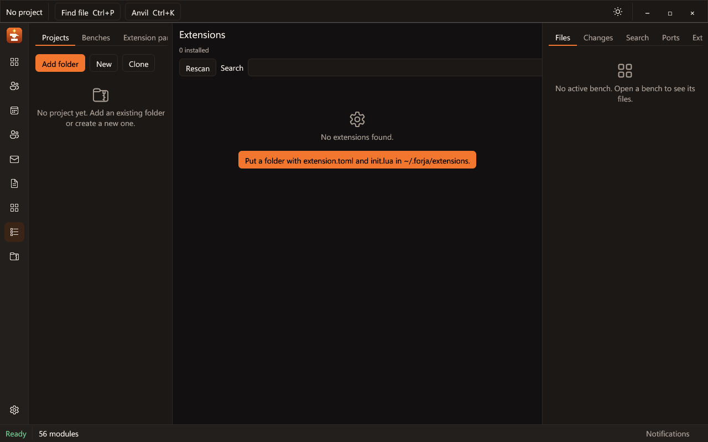

# Painel de extensões (Extensions)

Tela do painel central de extensões do app (variante em inglês), onde se vê a lista de extensões instaladas do projeto (vazia nesta captura) e a instrução para instalá-las manualmente em `~/.forja/extensions`.

## Como chegar
Abrir a Forja e, no trilho vertical à esquerda, clicar no botão "Extensions" (nono ícone do trilho, destacado com fundo laranja). Equivale a abrir o app com o trilho apontando para o painel de extensões. Comando de captura: `forja-app --locale en --theme dark --rail extension.page`.

## Regiões
- **Barra superior** (0,0)–(1280,40): rótulo do projeto atual "No project", botões de comando "Find file  Ctrl+P" e "Anvil  Ctrl+K" com atalhos, botão sem nome acessível para alternar tema (ícone de sol em ~1101,5) e os botões de janela "–", "□" e "×" no canto direito.
- **Trilho à esquerda** (0,42)–(48,768): logotipo do app (imagem em 12,50) e uma coluna de ícones de navegação: "Board", "Helpers", "Routines", "Muster", "Requests", "Skills", "Usage", "Extensions" (ativo) e "Archive", com "Settings" isolado na base (8,724).
- **Painel lateral esquerdo (Projetos)** (48,42)–(304,768): abas "Projects" (ativa), "Benches" e "Extension panels"; botões "Add folder" (destacado em laranja), "New" e "Clone"; estado vazio com ícone de pasta e o texto "No project yet. Add an existing folder or create a new one.".
- **Área central (painel de extensões)** (320,42)–(972,768): título "Extensions" com contador "0 installed", botão "Rescan", rótulo "Search" e campo de texto de busca em largura quase total (324,146)–(968,178); estado vazio com ícone de engrenagem, o texto "No extensions found." e um botão-aviso com o caminho de instalação.
- **Painel direito (Files)** (988,42)–(1280,768): abas "Files" (ativa), "Changes", "Search", "Ports" e "Extension panels"; estado vazio com ícone de grade e o texto "No active bench. Open a bench to see its files.".
- **Barra de status** (0,768)–(1280,800): status "Ready" em verde à esquerda, contador "56 modules" ao lado e "Notifications" à direita.

## Elementos
| Elemento | Tipo | Posição (px) | Estado | O que faz |
|---|---|---|---|---|
| "No project" | Rótulo | (11,12)–(77,31) | — | Mostra que nenhum projeto está aberto. |
| "Find file  Ctrl+P" | Botão | (99,5)–(218,37) | clicável, focável | Abre a busca rápida de arquivos (Ctrl+P). |
| "Anvil  Ctrl+K" | Botão | (226,5)–(327,37) | clicável, focável | Abre a paleta de comandos (Ctrl+K). |
| (sem nome acessível) | Desconhecido | (1101,5)–(1133,37) | clicável, focável | Ícone de sol na barra superior: alterna tema claro/escuro. |
| "–" | Botão | (1155,5)–(1187,37) | clicável, focável | Minimiza a janela. |
| "□" | Botão | (1195,5)–(1227,37) | clicável, focável | Maximiza/restaura a janela. |
| "×" | Botão | (1235,5)–(1269,37) | clicável, focável | Fecha a janela. |
| (sem nome acessível) | Desconhecido | (304,42)–(320,768) | focável | Divisor arrastável entre o painel de projetos e a área central. |
| (sem nome acessível) | Desconhecido | (972,42)–(988,768) | focável | Divisor arrastável entre a área central e o painel de arquivos. |
| (sem nome acessível) | Imagem | (12,50)–(40,78) | clicável, focável | Logotipo do app no topo do trilho. |
| "Projects" | Botão (aba) | (64,50)–(136,82) | marcado=True | Aba ativa do painel lateral: lista de projetos. |
| (sem nome acessível) | Desconhecido | (64,50)–(300,82) | focável | Faixa de destaque da aba ativa "Projects". |
| "Benches" | Botão (aba) | (136,50)–(211,82) | clicável, focável, marcado=False | Troca o painel lateral para a lista de bancadas. |
| "Extension panels" | Botão (aba) | (211,50)–(337,82) | clicável, focável, marcado=False | Troca o painel lateral para a lista de painéis de extensão; texto truncado no borda do painel. |
| "Extensions" | Rótulo | (324,50)–(407,74) | clicável | Título do painel central. |
| (sem nome acessível) | Desconhecido | (992,50)–(1268,82) | focável | Faixa de destaque da aba ativa "Files" no painel direito. |
| "Files" | Botão (aba) | (992,50)–(1043,82) | marcado=True | Aba ativa do painel direito: navegador de arquivos da bancada. |
| "Changes" | Botão (aba) | (1043,50)–(1120,82) | clicável, focável, marcado=False | Mostra as mudanças (diff) da bancada. |
| "Search" | Botão (aba) | (1120,50)–(1185,82) | clicável, focável, marcado=False | Abre a busca no projeto. |
| "Ports" | Botão (aba) | (1185,50)–(1240,82) | clicável, focável, marcado=False | Lista portas em uso no projeto. |
| "Extension panels" | Botão (aba) | (1240,50)–(1366,82) | clicável, focável, marcado=False | Aba do painel direito para painéis de extensão; seu retângulo ultrapassa a largura da janela (1280 px). |
| (sem nome acessível) | Desconhecido | (64,80)–(300,82) | clicável, focável | Linha inferior/separador do cabeçalho de abas do painel lateral. |
| (sem nome acessível) | Desconhecido | (992,80)–(1268,82) | clicável, focável | Linha inferior/separador do cabeçalho de abas do painel direito. |
| "0 installed" | Rótulo | (324,82)–(377,98) | clicável | Contador de extensões instaladas (vazio). |
| "Board" | Botão (ícone) | (8,94)–(44,130) | clicável, focável, marcado=False | Vai à tela de quadro do trilho. |
| "Add folder" | Botão | (64,98)–(154,130) | clicável, focável | Abre o seletor para adicionar uma pasta de projeto; botão primário em laranja. |
| "New" | Botão | (162,98)–(213,130) | clicável, focável | Cria um novo projeto. |
| "Clone" | Botão | (221,98)–(280,130) | clicável, focável | Clona um repositório como novo projeto. |
| "Rescan" | Botão | (324,106)–(391,138) | clicável, focável | Reescaneia as pastas de extensões e atualiza a lista. |
| "Search" | Rótulo | (399,106)–(440,138) | clicável | Rótulo do campo de busca de extensões. |
| (ícone) | Rótulo | (1116,114)–(1144,142) | clicável | Ícone de grade do estado vazio do painel de arquivos. |
| "Helpers" | Botão (ícone) | (8,138)–(44,174) | clicável, focável, marcado=False | Vai à tela de ajudantes (agentes de IA). |
| (sem nome acessível) | Campo de texto | (324,146)–(968,178) | clicável, focável | Campo de busca por nome de extensão. |
| "No active bench. Open a bench to see its files." | Rótulo | (1004,150)–(1256,188) | clicável | Estado vazio do painel de arquivos. |
| (ícone) | Rótulo | (168,158)–(196,186) | clicável | Ícone de pasta do estado vazio do painel de projetos. |
| "Routines" | Botão (ícone) | (8,182)–(44,218) | clicável, focável, marcado=False | Vai à tela de rotinas. |
| "No project yet. Add an existing folder or create a new one." | Rótulo | (67,194)–(297,232) | clicável | Estado vazio do painel de projetos. |
| (ícone) | Rótulo | (632,202)–(660,230) | clicável | Ícone de engrenagem do estado vazio do painel de extensões. |
| "Muster" | Botão (ícone) | (8,226)–(44,262) | clicável, focável, marcado=False | Vai à tela de mutirão. |
| "No extensions found." | Rótulo | (581,238)–(712,257) | clicável | Mensagem de lista vazia de extensões. |
| "Put a folder with extension.toml and init.lua in ~/.forja/extensions." | Botão | (431,273)–(861,305) | clicável, focável | Instrução de instalação manual de extensões, exposta como botão clicável (destaque laranja). |
| "Requests" | Botão (ícone) | (8,270)–(44,306) | clicável, focável, marcado=False | Vai à tela de pedidos. |
| "Skills" | Botão (ícone) | (8,314)–(44,350) | clicável, focável, marcado=False | Vai à tela de skills. |
| "Usage" | Botão (ícone) | (8,358)–(44,394) | clicável, focável, marcado=False | Vai à tela de uso. |
| "Extensions" | Botão (ícone) | (8,402)–(44,438) | clicável, focável, marcado=True | Item ativo do trilho: mostra o painel de extensões (esta tela). |
| "Archive" | Botão (ícone) | (8,446)–(44,482) | clicável, focável, marcado=False | Vai à tela de acervo. |
| "Settings" | Botão (ícone) | (8,724)–(44,760) | clicável, focável, marcado=False | Vai à tela de ajustes, fixado na base do trilho. |
| "Ready" | Rótulo | (10,775)–(48,794) | clicável | Status geral do app na barra inferior. |
| "56 modules" | Rótulo | (70,775)–(142,794) | clicável | Contador de módulos carregados. |
| "Notifications" | Rótulo | (1168,775)–(1246,794) | clicável, focável | Abre a área de notificações, no canto direito da barra de status. |

## Aparência
Idêntica à variante pt-BR: tema escuro, fundo quase preto com leve tom amarronzado nas laterais e no trilho, área central ligeiramente mais clara que o painel esquerdo. A cor de destaque é o laranja ("Brasa"): preenchimento do botão "Add folder" e do botão-aviso de instalação, fundo do item ativo "Extensions" no trilho e sublinhado das abas ativas "Projects" e "Files"; o status "Ready" é verde-claro na barra de status. Texto principal em cinza-claro e textos secundários/estados vazios em cinza médio esmaecido. Tipografia sem serifa, ~13–14 px, atalhos ("Ctrl+P", "Ctrl+K") na mesma linha do comando. O que muda em relação à página de referência são só os textos, todos em inglês ("Projects", "Benches", "Add folder", "No project yet…", "Rescan", "No extensions found.", "Files", "Ready", "56 modules" etc.), com contraste e layout iguais; os rótulos em inglês ocupam menos espaço, mas os cortes e estouros de largura das abas "Extension panels" persistem.

## Problemas encontrados
- A aba "Extension panels" do painel lateral esquerdo (botão em (211,50)–(337,82)) é cortada pelo limite do painel em ~x=304: na imagem aparece só "Extension pan", embora o retângulo acessível vá até x=337.
- A aba "Extension panels" do painel direito (botão em (1240,50)–(1366,82)) tem retângulo além da largura da janela (1280 px); o rótulo fica fora da área visível e inacessível.
- O botão de alternar tema na barra superior (1101,5)–(1133,37) não tem nome acessível; só se identifica pela imagem do sol.
- O campo de busca de extensões (324,146)–(968,178) é um TextInput sem nome acessível; o rótulo "Search" fica fora do campo, sem associação.
- O logotipo do app (imagem em 12,50) e os três ícones de estado vazio (1116,114), (168,158) e (632,202) estão sem nome acessível.
- A instrução "Put a folder with extension.toml and init.lua in ~/.forja/extensions." é exposta com papel de Botão; semanticamente é um texto de ajuda, o que pode confundir leitores de tela.
