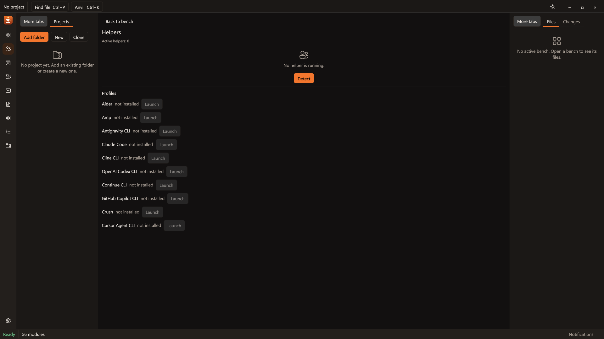

state: en.dark.rail.helper.tab
capture_sha: 1f158359ba82a85f
---

# Helpers (trilho, aba helper.tab)

Tela do painel central "Helpers", que lista os perfis de ajudantes de código (agentes de IA) e permite detectar e iniciar cada um, com o trilho esquerdo na aba Helpers e o painel direito em Files.

## Como chegar
Variante em inglês da página de referência `pt-BR.dark.rail.helper.tab`; a estrutura de regiões e elementos é a mesma, com todos os textos de interface em inglês. Na janela principal, clique no segundo ícone do trilho à esquerda (ícone de pessoas, botão "Helpers", (8,138)–(44,174), marcado como ativo). Comando de captura/abertura: `forja-app --locale en --theme dark --rail helper.tab` (arquivo `captures/en.dark.rail.helper.tab.png`, 1280×800 px). O que muda em relação à referência pt-BR: os rótulos estão em inglês ("Find file  Ctrl+P" em vez de "Achar arquivo", "Anvil  Ctrl+K" em vez de "Bigorna", "No project" em vez de "Nenhum projeto", "not installed" em vez de "não instalado", "Launch" em vez de "Iniciar", "Ready" em vez de "Pronto", "56 modules" em vez de "56 módulos"), e as coordenadas mudam ligeiramente conforme a largura dos textos (por exemplo, o botão "Find file  Ctrl+P" fica em (99,5)–(218,37) na variante en, contra (135,5)–(291,37) na pt-BR). Tema e cores idênticos; nenhum impacto de contraste.

## Regiões
- **Barra de título** — (0,0)–(1280,42): rótulo do projeto ("No project"), ações rápidas "Find file  Ctrl+P" e "Anvil  Ctrl+K", botão de tema (ícone de sol, sem nome acessível) e botões de janela "–", "□", "×".
- **Trilho esquerdo (rail)** — (0,42)–(48,768): logotipo da Forja (imagem sem nome acessível) e ícones de navegação: "Board", "Helpers" (ativo), "Routines", "Muster", "Requests", "Skills", "Usage", "Extensions", "Archive" e "Settings".
- **Painel lateral esquerdo** — (48,42)–(304,768): abas "Projects" (ativa), "Benches" e "Extension panels" (texto truncado), botões "Add folder", "New" e "Clone", e estado vazio com ícone de pasta (rótulo "(ícone)" em (168,158)–(196,186)) e a mensagem "No project yet. Add an existing folder or create a new one.".
- **Divisor 1** — (304,42)–(320,768): divisor arrastável entre o painel esquerdo e a área central.
- **Área central** — (320,42)–(972,768): cabeçalho "Helpers" e contador "Active helpers: 0"; estado vazio com ícone (rótulo "(ícone)" em (632,122)–(660,150)), texto "No helper is running." e botão laranja "Detect"; seção "Profiles" com a lista de ajudantes (Aider, Amp, Antigravity CLI, Claude Code, Cline CLI, OpenAI Codex CLI, Continue CLI, GitHub Copilot CLI, Crush, Cursor Agent CLI, Gemini CLI, Goose, Kimi Code CLI, Kiro CLI, OpenCode, Qwen Code), cada um com a etiqueta "not installed" e um botão "Launch" desativado; a lista continua abaixo do corte da janela (rolagem).
- **Divisor 2** — (972,42)–(988,768): divisor arrastável entre a área central e o painel direito.
- **Painel direito** — (988,42)–(1280,768): abas "Files" (ativa), "Changes", "Search", "Ports" e "Extension panels" (fora da janela); estado vazio com ícone de grade (rótulo "(ícone)" em (1116,114)–(1144,142)) e a mensagem "No active bench. Open a bench to see its files.".
- **Barra de status** — (0,768)–(1280,800): "Ready", "56 modules" e "Notifications" à direita.

## Elementos
| Elemento | Tipo | Posição (px) | Estado | O que faz |
|---|---|---|---|---|
| "Find file  Ctrl+P" | Button | (99,5)–(218,37) | — | Abre a busca rápida de arquivos (atalho Ctrl+P). |
| "Anvil  Ctrl+K" | Button | (226,5)–(327,37) | — | Abre a paleta de comandos (atalho Ctrl+K). |
| (sem nome acessível) | Unknown | (1101,5)–(1133,37) | — | Ícone de sol: alterna tema claro/escuro. |
| "–" | Button | (1155,5)–(1187,37) | — | Minimiza a janela. |
| "□" | Button | (1195,5)–(1227,37) | — | Maximiza/restaura a janela. |
| "×" | Button | (1235,5)–(1269,37) | — | Fecha a janela. |
| "No project" | Label | (11,12)–(77,31) | — | Mostra que nenhum projeto está aberto. |
| (sem nome acessível) | Unknown | (304,42)–(320,768) | foco | Divisor arrastável entre painel esquerdo e área central. |
| (sem nome acessível) | Unknown | (972,42)–(988,768) | foco | Divisor arrastável entre área central e painel direito. |
| (sem nome acessível) | Image | (12,50)–(40,78) | — | Logotipo da Forja no trilho (ícone de bigorna laranja). |
| "Projects" | Button | (64,50)–(136,82) | marcado=True | Aba ativa do painel esquerdo (sublinhado laranja). |
| (sem nome acessível) | Unknown | (64,50)–(300,82) | foco | Contêiner/barra das abas do painel esquerdo. |
| "Benches" | Button | (136,50)–(211,82) | marcado=False | Aba das bancadas (branches de trabalho). |
| "Extension panels" | Button | (211,50)–(337,82) | marcado=False | Aba dos painéis de extensões; retângulo passa do limite do painel e o texto aparece truncado ("Extension pai"). |
| "Helpers" | Label | (324,50)–(384,74) | — | Título do painel central. |
| (sem nome acessível) | Unknown | (992,50)–(1268,82) | foco | Contêiner/barra das abas do painel direito. |
| "Files" | Button | (992,50)–(1043,82) | marcado=True | Aba ativa do painel direito (sublinhado laranja). |
| "Changes" | Button | (1043,50)–(1120,82) | marcado=False | Aba de mudanças (diffs) da bancada. |
| "Search" | Button | (1120,50)–(1185,82) | marcado=False | Aba de busca no projeto. |
| "Ports" | Button | (1185,50)–(1240,82) | marcado=False | Aba de portas em uso. |
| "Extension panels" | Button | (1240,50)–(1366,82) | marcado=False | Aba dos painéis de extensões; fica além da largura da janela (1280 px), visível apenas como "Ext". |
| (sem nome acessível) | Unknown | (64,80)–(300,82) | — | Linha divisória sob as abas do painel esquerdo. |
| (sem nome acessível) | Unknown | (992,80)–(1268,82) | — | Linha divisória sob as abas do painel direito. |
| "Active helpers: 0" | Label | (324,82)–(410,98) | — | Contador de ajudantes em execução. |
| "Board" | Button | (8,94)–(44,130) | marcado=False | Ícone do trilho: abre o quadro. |
| "Add folder" | Button | (64,98)–(154,130) | — | Adiciona uma pasta de projeto existente. |
| "New" | Button | (162,98)–(213,130) | — | Cria um projeto novo. |
| (ícone) | Label | (1116,114)–(1144,142) | — | Ícone de grade do estado vazio do painel direito. |
| (ícone) | Label | (632,122)–(660,150) | — | Ícone de pessoas do estado vazio do painel central. |
| "Helpers" | Button | (8,138)–(44,174) | marcado=True | Ícone do trilho: abre esta tela de Helpers (ativa). |
| "Clone" | Button | (221,98)–(280,130) | — | Clona um repositório como projeto. |
| "No active bench. Open a bench to see its files." | Label | (1004,150)–(1256,188) | — | Estado vazio do painel de arquivos. |
| "No helper is running." | Label | (582,158)–(711,177) | — | Estado vazio da lista de ajudantes. |
| "Routines" | Button | (8,182)–(44,218) | marcado=False | Ícone do trilho: abre rotinas. |
| "Detect" | Button | (614,193)–(678,225) | — | Detecta os ajudantes instalados na máquina. |
| (ícone) | Label | (168,158)–(196,186) | — | Ícone de pasta do estado vazio do painel esquerdo. |
| "Muster" | Button | (8,226)–(44,262) | marcado=False | Ícone do trilho: abre o mutirão. |
| "No project yet. Add an existing folder or create a new one." | Label | (67,194)–(297,232) | — | Estado vazio da lista de projetos. |
| "Profiles" | Label | (324,247)–(369,266) | — | Título da seção que lista os perfis de ajudantes. |
| "Requests" | Button | (8,270)–(44,306) | marcado=False | Ícone do trilho: abre pedidos. |
| (sem nome acessível) | Unknown | (324,274)–(599,694) | foco | Área da lista rolável de perfis. |
| "Launch" | Button | (449,274)–(517,309) | desativado | Iniciaria o Aider; indisponível por não estar instalado. |
| (sem nome acessível) | Unknown | (597,274)–(599,694) | — | Barra de rolagem da lista de perfis. |
| "Aider" | Label | (324,281)–(357,300) | — | Nome do perfil de ajudante. |
| "not installed" | Label | (365,281)–(441,300) | — | Estado do Aider. |
| "Skills" | Button | (8,314)–(44,350) | marcado=False | Ícone do trilho: abre skills. |
| "Launch" | Button | (445,317)–(513,352) | desativado | Iniciaria o Amp. |
| "Amp" | Label | (324,324)–(353,343) | — | Nome do perfil de ajudante. |
| "not installed" | Label | (361,324)–(437,343) | — | Estado do Amp. |
| "Usage" | Button | (8,358)–(44,394) | marcado=False | Ícone do trilho: abre uso/consumo. |
| "Launch" | Button | (506,360)–(574,395) | desativado | Iniciaria o Antigravity CLI. |
| "Antigravity CLI" | Label | (324,367)–(414,386) | — | Nome do perfil de ajudante. |
| "not installed" | Label | (422,367)–(498,386) | — | Estado do Antigravity CLI. |
| "Extensions" | Button | (8,402)–(44,438) | marcado=False | Ícone do trilho: abre extensões. |
| "Launch" | Button | (495,403)–(563,438) | desativado | Iniciaria o Claude Code. |
| "Claude Code" | Label | (324,410)–(402,429) | — | Nome do perfil de ajudante. |
| "not installed" | Label | (410,410)–(487,429) | — | Estado do Claude Code. |
| "Archive" | Button | (8,446)–(44,482) | marcado=False | Ícone do trilho: abre o acervo. |
| "Launch" | Button | (469,446)–(537,481) | desativado | Iniciaria o Cline CLI. |
| "Cline CLI" | Label | (324,453)–(377,472) | — | Nome do perfil de ajudante. |
| "not installed" | Label | (385,453)–(461,472) | — | Estado do Cline CLI. |
| "Launch" | Button | (528,489)–(596,524) | desativado | Iniciaria o OpenAI Codex CLI. |
| "OpenAI Codex CLI" | Label | (324,496)–(436,515) | — | Nome do perfil de ajudante. |
| "not installed" | Label | (444,496)–(520,515) | — | Estado do OpenAI Codex CLI. |
| "Launch" | Button | (495,532)–(563,567) | desativado | Iniciaria o Continue CLI. |
| "Continue CLI" | Label | (324,539)–(403,558) | — | Nome do perfil de ajudante. |
| "not installed" | Label | (411,539)–(487,558) | — | Estado do Continue CLI. |
| "Launch" | Button | (531,575)–(599,610) | desativado | Iniciaria o GitHub Copilot CLI. |
| "GitHub Copilot CLI" | Label | (324,582)–(439,601) | — | Nome do perfil de ajudante. |
| "not installed" | Label | (447,582)–(523,601) | — | Estado do GitHub Copilot CLI. |
| "Launch" | Button | (451,618)–(519,653) | desativado | Iniciaria o Crush. |
| "Crush" | Label | (324,625)–(359,644) | — | Nome do perfil de ajudante. |
| "not installed" | Label | (367,625)–(443,644) | — | Estado do Crush. |
| "Launch" | Button | (520,661)–(588,696) | desativado | Iniciaria o Cursor Agent CLI. |
| "Cursor Agent CLI" | Label | (324,668)–(428,687) | — | Nome do perfil de ajudante. |
| "not installed" | Label | (436,668)–(512,687) | — | Estado do Cursor Agent CLI. |
| "Launch" | Button | (482,704)–(550,739) | desativado | Iniciaria o Gemini CLI. |
| "Gemini CLI" | Label | (324,711)–(390,730) | — | Nome do perfil de ajudante. |
| "not installed" | Label | (398,711)–(474,730) | — | Estado do Gemini CLI. |
| "Settings" | Button | (8,724)–(44,760) | marcado=False | Ícone do trilho: abre os ajustes. |
| "Launch" | Button | (456,747)–(524,782) | desativado | Iniciaria o Goose; retângulo invade a faixa da barra de status. |
| "Goose" | Label | (324,754)–(363,773) | — | Nome do perfil de ajudante. |
| "not installed" | Label | (371,754)–(448,773) | — | Estado do Goose. |
| "Ready" | Label | (10,775)–(48,794) | — | Status geral do app na barra de status. |
| "56 modules" | Label | (70,775)–(142,794) | — | Quantidade de módulos carregados. |
| "Notifications" | Label | (1168,775)–(1246,794) | — | Atalho/área de notificações na barra de status. |
| "Launch" | Button | (502,790)–(570,825) | desativado | Iniciaria o Kimi Code CLI; fica abaixo do corte da janela (800 px). |
| "Kimi Code CLI" | Label | (324,797)–(410,816) | — | Nome do perfil de ajudante; parcialmente fora da janela. |
| "not installed" | Label | (418,797)–(494,816) | — | Estado do Kimi Code CLI; fora da janela. |
| "Launch" | Button | (463,833)–(531,868) | desativado | Iniciaria o Kiro CLI; fora da janela. |
| "Kiro CLI" | Label | (324,840)–(371,859) | — | Nome do perfil de ajudante; fora da janela. |
| "not installed" | Label | (379,840)–(455,859) | — | Estado do Kiro CLI; fora da janela. |
| "Launch" | Button | (483,876)–(551,911) | desativado | Iniciaria o OpenCode; fora da janela. |
| "OpenCode" | Label | (324,883)–(390,902) | — | Nome do perfil de ajudante; fora da janela. |
| "not installed" | Label | (398,883)–(475,902) | — | Estado do OpenCode; fora da janela. |
| "Launch" | Button | (488,919)–(556,954) | desativado | Iniciaria o Qwen Code; fora da janela. |
| "Qwen Code" | Label | (324,926)–(395,945) | — | Nome do perfil de ajudante; fora da janela. |
| "not installed" | Label | (403,926)–(480,945) | — | Estado do Qwen Code; fora da janela. |

## Aparência
Idêntica à referência pt-BR (tema escuro): fundo quase preto (~#1a1a1a) na área central e painel direito, faixas levemente mais claras na barra de título, painel esquerdo e barra de status. Cor de destaque laranja (accent "Brasa") no logotipo, no sublinhado das abas ativas ("Projects" e "Files") e nos botões primários "Add folder" e "Detect". Texto em cinza claro; etiquetas "not installed" e botões "Launch" em cinza apagado (desativados). Tipografia sem serifa de tamanho único, com hierarquia por peso e cor (título "Helpers" maior). A única diferença visível da variante en são as larguras dos textos (os rótulos em inglês são, em geral, mais curtos), o que desloca um pouco as posições dos botões "Launch" e das etiquetas "not installed". Espaçamento regular: linhas de perfis com ~43 px de altura, alinhamento à esquerda consistente em x=324, botões "Launch" com largura constante (68–78 px conforme o rótulo da linha) e posição variável conforme o comprimento do nome do ajudante.

## Problemas encontrados
- A lista de perfis não cabe na janela: os elementos a partir de "Launch" (502,790)–(570,825) e "Kimi Code CLI" (324,797)–(410,816) ficam abaixo da altura da imagem (800 px), e as linhas de Kiro CLI, OpenCode e Qwen Code ficam inteiramente fora dela, sem indício visível de rolagem além da barra estreita em x=597.
- Sobreposição na base da janela: o botão "Launch" (456,747)–(524,782) e a área da lista invadem a faixa da barra de status (y≥768), onde estão "Ready", "56 modules" e "Notifications" (y 775–794).
- Texto truncado: a aba "Extension panels" (211,50)–(337,82) ultrapassa o limite do painel esquerdo (divisor em x 304–320) e aparece cortada como "Extension pai".
- Elemento fora da janela: a aba "Extension panels" do painel direito (1240,50)–(1366,82) fica parcialmente além da largura de 1280 px, visível apenas como "Ext".
- Botões de janela com nomes acessíveis simbólicos "–", "□" e "×" em vez de rótulos descritivos (Minimize/Maximize/Close).
- Vários elementos sem nome acessível: dois divisores, o contêiner de abas de cada painel, o botão de tema e as imagens/ícones de estado vazio (registrados como "(sem nome acessível)" ou "(ícone)").
- Dezesseis botões com o mesmo nome acessível "Launch" na mesma tela, o que dificulta a identificação por leitor de tela (o alvo só é inferido pela linha do perfil).
