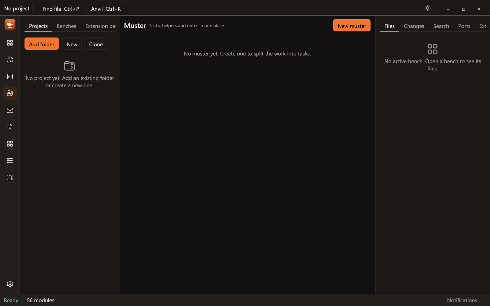

state: en.dark.rail.muster.page
capture_sha: —
model: opencode/glm-5.3-flash-free
---

# Muster (muster.page)

Variante em inglês da tela do trilho "Mutirão" (`pt-BR.dark.rail.muster.page`), que reúne tarefas, ajudantes e recados do projeto; sem projeto aberto, mostra estados vazios nas três colunas. Mudam os textos da interface, os nomes acessíveis e as larguras resultantes dos rótulos; cores, tema e layout são os mesmos.

## Como chegar
Inicie o app com o trilho Muster ativo: `forja-app --locale en --theme dark --rail muster.page`. Na interface, clique no quinto ícone do trilho à esquerda (o de pessoas, "Muster"), que é a entrada marcada.

## Regiões
- **Barra superior** (0,0)–(1280,42): à esquerda o chip "No project" e os botões "Find file  Ctrl+P" e "Anvil  Ctrl+K"; à direita o botão de tema (ícone de sol, sem nome) e os botões de janela "–", "□" e "×".
- **Trilho à esquerda** (0,42)–(56,768): a marca do app no topo e uma coluna de ícones ("Board", "Helpers", "Routines", "Muster", "Requests", "Skills", "Usage", "Extensions", "Archive") e, no rodapé, "Settings".
- **Painel esquerdo** (56,42)–(304,768): abas "Projects" (marcada), "Benches" e "Extension panels", com os botões "Add folder", "New" e "Clone" e a mensagem de estado vazio "No project yet. Add an existing folder or create a new one." sobre um ícone de pasta.
- **Área central** (320,42)–(972,768): cabeçalho com o título "Muster" e o subtítulo "Tasks, helpers and notes in one place.", o botão laranja "New muster" e o estado vazio "No muster yet. Create one to split the work into tasks." centralizado na coluna.
- **Painel direito** (988,42)–(1280,768): abas "Files" (marcada), "Changes", "Search", "Ports" e "Extension panels", com ícone de grade e a mensagem "No active bench. Open a bench to see its files.".
- **Barra de status** (0,768)–(1280,800): "Ready" em verde à esquerda, "56 modules" ao lado e "Notifications" à direita.

## Elementos
| Elemento | Tipo | Posição (px) | Estado | O que faz |
|---|---|---|---|---|
| "Find file  Ctrl+P" | Button | (99,5)–(218,37) | clicável, focável | Abre o localizador de arquivos do projeto; atalho Ctrl+P indicado no rótulo. |
| "Anvil  Ctrl+K" | Button | (226,5)–(327,37) | clicável, focável | Abre a paleta de comandos ("Anvil", equivalente da "Bigorna" em pt-BR); atalho Ctrl+K indicado no rótulo. |
| (sem nome acessível) | Unknown | (1101,5)–(1133,37) | clicável, focável | Botão de alternância de tema, desenhado como ícone de sol na extremidade direita da barra de título. |
| "–" | Button | (1155,5)–(1187,37) | clicável, focável | Minimiza a janela. |
| "□" | Button | (1195,5)–(1227,37) | clicável, focável | Maximiza/restaura a janela. |
| "×" | Button | (1235,5)–(1269,37) | clicável, focável | Fecha a janela. |
| "No project" | Label | (11,12)–(77,31) | clicável, focável | Indicador do projeto atual na barra de título; sem projeto, exibe este texto. |
| (sem nome acessível) | Unknown | (304,42)–(320,768) | focável | Divisor vertical entre o painel esquerdo e a área central (arrastável/redimensionável). |
| (sem nome acessível) | Unknown | (972,42)–(988,768) | focável | Divisor vertical entre a área central e o painel direito. |
| (sem nome acessível) | Image | (12,50)–(40,78) | clicável, focável | Marca/logo do app no topo do trilho (ícone laranja). |
| "Projects" | Button | (64,50)–(136,82) | marcado=True | Aba do painel esquerdo que lista os projetos; é a aba ativa. |
| (sem nome acessível) | Unknown | (64,50)–(300,82) | focável | Contêiner/fundo da tira de abas do painel esquerdo. |
| "Benches" | Button | (136,50)–(211,82) | marcado=False | Aba que alterna o painel esquerdo para a lista de bancadas. |
| "Extension panels" | Button | (211,50)–(337,82) | marcado=False | Aba que alterna o painel esquerdo para os painéis de extensões; retângulo invade a região do divisor. |
| "New muster" | Button | (870,50)–(968,82) | clicável, focável | Botão primário laranja que cria um mutirão na área central. |
| (sem nome acessível) | Unknown | (992,50)–(1268,82) | focável | Contêiner/fundo da tira de abas do painel direito. |
| "Files" | Button | (992,50)–(1043,82) | marcado=True | Aba do painel direito com o navegador de arquivos; é a aba ativa. |
| "Changes" | Button | (1043,50)–(1120,82) | marcado=False | Aba de mudanças (arquivos alterados) do painel direito. |
| "Search" | Button | (1120,50)–(1185,82) | marcado=False | Aba de busca do painel direito. |
| "Ports" | Button | (1185,50)–(1240,82) | marcado=False | Aba de portas do painel direito. |
| "Extension panels" | Button | (1240,50)–(1366,82) | marcado=False | Aba de painéis de extensões do painel direito; retângulo se estende além da largura da janela. |
| "Muster" | Label | (324,54)–(381,78) | clicável | Título da tela na área central. |
| "Tasks, helpers and notes in one place." | Label | (389,58)–(587,74) | clicável | Subtítulo descritivo ao lado do título. |
| (sem nome acessível) | Unknown | (64,80)–(300,82) | clicável, focável | Linha sublinhada que indica a aba ativa ("Projects") do painel esquerdo. |
| (sem nome acessível) | Unknown | (992,80)–(1268,82) | clicável, focável | Linha sublinhada que indica a aba ativa ("Files") do painel direito. |
| "Board" | Button | (8,94)–(44,130) | marcado=False | Entrada do trilho para o quadro; ícone de grade. |
| "Add folder" | Button | (64,98)–(154,130) | clicável, focável | Botão destacado do painel Projects para adicionar uma pasta de projeto. |
| "New" | Button | (162,98)–(213,130) | clicável, focável | Cria um projeto novo no painel Projects. |
| "Clone" | Button | (221,98)–(280,130) | clicável, focável | Ação do painel Projects para clonar um repositório/pasta. |
| (ícone) | Label | (1116,114)–(1144,142) | clicável | Ícone decorativo (grade de quadradinhos) do estado vazio do painel Files. |
| "No muster yet. Create one to split the work into tasks." | Label | (480,130)–(812,149) | clicável | Estado vazio da área central; orienta criar um mutirão. |
| "Helpers" | Button | (8,138)–(44,174) | marcado=False | Entrada do trilho para ajudantes de código. |
| "No active bench. Open a bench to see its files." | Label | (1004,150)–(1256,188) | clicável | Estado vazio do painel Files; orienta abrir uma bancada. |
| (ícone) | Label | (168,158)–(196,186) | clicável | Ícone decorativo (pasta aberta) do estado vazio do painel Projects. |
| "Routines" | Button | (8,182)–(44,218) | marcado=False | Entrada do trilho para rotinas. |
| "No project yet. Add an existing folder or create a new one." | Label | (67,194)–(297,232) | clicável | Estado vazio do painel Projects; orienta adicionar pasta ou criar projeto. |
| "Muster" | Button | (8,226)–(44,262) | marcado=True | Entrada do trilho da tela atual; é a entrada marcada. |
| "Requests" | Button | (8,270)–(44,306) | marcado=False | Entrada do trilho para pedidos. |
| "Skills" | Button | (8,314)–(44,350) | marcado=False | Entrada do trilho para skills. |
| "Usage" | Button | (8,358)–(44,394) | marcado=False | Entrada do trilho para uso. |
| "Extensions" | Button | (8,402)–(44,438) | marcado=False | Entrada do trilho para extensões. |
| "Archive" | Button | (8,446)–(44,482) | marcado=False | Entrada do trilho para o acervo. |
| "Settings" | Button | (8,724)–(44,760) | marcado=False | Entrada do trilho para ajustes, fixada no rodapé do trilho. |
| "Ready" | Label | (10,775)–(48,794) | clicável | Status geral na barra inferior, em verde. |
| "56 modules" | Label | (70,775)–(142,794) | clicável | Contagem de módulos carregados. |
| "Notifications" | Label | (1168,775)–(1246,794) | clicável, focável | Área de notificações no canto direito da barra de status. |

## Aparência
Idêntica à variável pt-BR: tema escuro com fundo quase preto (tons de marrom-escuro/grafite) e divisórias discretas entre trilho, painéis e área central. O laranja é a cor de destaque: marca do app no trilho, aba "Projects" sublinhada, ícone do trilho "Muster" com fundo laranja escuro, botão primário "New muster" e botão "Add folder" em laranja sólido com texto escuro. Tipografia sem serifa em dois tamanhos: título "Muster" maior em negrito, o resto em corpo pequeno; subtítulo e estados vazios em cinza médio, com contraste mais baixo que o texto principal. A aba ativa de cada tira é marcada por um sublinhado claro. Espaçamento uniforme: ícones do trilho com 32 px de lado e passo vertical de 44 px; botões de janela de 32 px alinhados no topo. Em inglês os rótulos são mais curtos, então a aba "Extension panels" da esquerda corta menos que "Painéis de extensões" em pt-BR, mas ainda invade o divisor.

## Problemas encontrados
- O botão "Extension panels" da tira direita tem retângulo (1240,50)–(1366,82), que ultrapassa a largura da janela (1280 px); o texto fica cortado fora da área visível.
- O botão "Extension panels" da tira esquerda (211,50)–(337,82) invade a região do divisor em (304,42)–(320,768); o rótulo aparece truncado ("Extension pa") no painel.
- Dois botões com o mesmo nome acessível "Extension panels" em abas diferentes, o que dificulta a identificação por leitores de tela.
- Botão de alternância de tema e as duas divisórias verticais estão sem nome acessível.
- Textos de estado vazio e subtítulo em cinza sobre fundo escuro têm contraste reduzido (por exemplo, "Tasks, helpers and notes in one place.").
