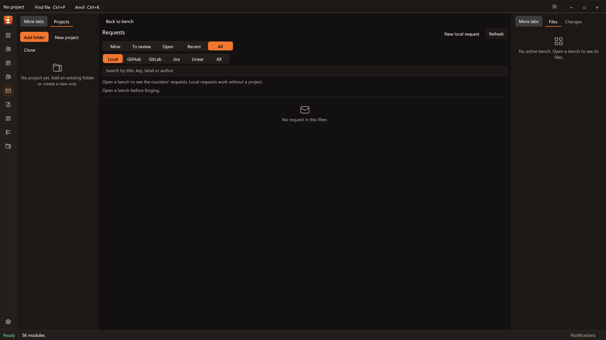

# Requests (request.page rail page)

Variant in **English** (`en`) of the reference page [pt-BR.dark.rail.request.page](pt-BR.dark.rail.request.page.md): same structure and same layout; what changes are the interface texts, now in English, and the width of some controls, which adjusts to the length of the text (for example, "Find file  Ctrl+P" starts at x=99 in pt-BR it started at x=135). Screen for listing and filtering requests (tasks/demands) from the counters, with the projects panel on the left and the bench files panel on the right; works without an open project for local requests.

## How to get there
In the main window, click the envelope icon "Requests" on the rail at the left (9th rail button, at (8,270)–(44,306)). Via capture command: `forja-app --locale en --theme dark --rail request.page`.

## Regions
- **Top bar** (0,0)–(1280,42): project selector "No project", shortcuts "Find file  Ctrl+P" and "Anvil  Ctrl+K", theme toggle button (sun icon, no accessible name) and window buttons –, □, ×.
- **Rail at the left** (0,42)–(52,768): Forja logo at the top (12,50)–(40,78) and 36×36 px icon buttons: Board, Helpers, Routines, Muster, Requests (active, marcado=True), Skills, Usage, Extensions, Archive; "Settings" pinned to the footer (8,724).
- **Left side panel** (52,42)–(304,768): tabs "Projects" (active), "Benches" and "Extension panels"; actions "Add folder", "New" and "Clone"; empty state with folder icon (168,158)–(196,186) and the text "No project yet. Add an existing folder or create a new one.".
- **Central area** (320,42)–(972,768): header "Requests" with "New local request" and "Refresh"; list filters (Mine, To review, Open, Recent, All — "All" active); source filters (Local — active, GitHub, GitLab, Jira, Linear, All); search field with placeholder "Search by title, key, label or author" (324,170)–(968,202); two warnings ("Open a bench to see the counters' requests. Local requests work without a project." and "Open a bench before forging."); empty state with envelope icon (632,294)–(660,322) and "No request in this filter.".
- **Right panel** (988,42)–(1280,768): tabs "Files" (active), "Changes", "Search", "Ports" and "Extension panels" (the latter cut off by the window edge); empty state with grid icon (1116,114)–(1144,142) and the text "No active bench. Open a bench to see its files.".
- **Status bar** (0,768)–(1280,800): "Ready" in green, "56 modules" and "Notifications" on the right.

Thin 16 px vertical separators divide the panels at x=304–320 and x=972–988.

## Elements
| Element | Type | Position (px) | State | What it does |
|---|---|---|---|---|
| "No project" | Label | (11,12)–(77,31) | — | Indicates the current project (none selected); opens the project list. |
| "Find file  Ctrl+P" | Button | (99,5)–(218,37) | — | Opens the quick file search (Ctrl+P shortcut). |
| "Anvil  Ctrl+K" | Button | (226,5)–(327,37) | — | Opens the command palette (Ctrl+K shortcut). |
| (no accessible name) | Unknown | (1101,5)–(1133,37) | — | Sun icon button: toggles light/dark theme. |
| "–" | Button | (1155,5)–(1187,37) | — | Minimizes the window. |
| "□" | Button | (1195,5)–(1227,37) | — | Maximizes/restores the window. |
| "×" | Button | (1235,5)–(1269,37) | — | Closes the window. |
| (no accessible name) | Unknown | (304,42)–(320,768) | focus | Vertical separator between left panel and central area. |
| (no accessible name) | Unknown | (972,42)–(988,768) | focus | Vertical separator between central area and right panel. |
| (no accessible name) | Image | (12,50)–(40,78) | — | Forja logo at the top of the rail. |
| "Projects" | Button | (64,50)–(136,82) | marcado=True | Active tab of the left panel; shows the project list. |
| (no accessible name) | Unknown | (64,50)–(300,82) | focus | Tab strip of the left panel (background/indicator). |
| "Benches" | Button | (136,50)–(211,82) | marcado=False | Tab that switches the left panel to the bench list. |
| "Extension panels" | Button | (211,50)–(337,82) | marcado=False | Left panel tab; appears truncated as "Extension pai". |
| "Requests" | Label | (324,50)–(396,74) | — | Central area title. |
| "New local request" | Button | (756,50)–(890,82) | — | Creates a local request (works without a project). |
| "Refresh" | Button | (898,50)–(968,82) | — | Reloads the request list. |
| (no accessible name) | Unknown | (992,50)–(1268,82) | focus | Tab strip of the right panel. |
| "Files" | Button | (992,50)–(1043,82) | marcado=True | Active tab of the right panel; lists the bench files. |
| "Changes" | Button | (1043,50)–(1120,82) | marcado=False | Shows the bench changes (diff). |
| "Search" | Button | (1120,50)–(1185,82) | marcado=False | Opens the right panel search. |
| "Ports" | Button | (1185,50)–(1240,82) | marcado=False | Shows the ports in use. |
| "Extension panels" | Button | (1240,50)–(1366,82) | marcado=False | Extra tab of the right panel; rectangle goes past the window edge (1280 px) and becomes invisible. |
| (no accessible name) | Unknown | (64,80)–(300,82) | — | Underline of the active tab "Projects". |
| (no accessible name) | Unknown | (992,80)–(1268,82) | — | Underline of the active tab "Files". |
| "Mine" | Button | (324,90)–(407,122) | marcado=False | Filter for requests assigned to me. |
| "To review" | Button | (407,90)–(490,122) | marcado=False | Filter for requests awaiting review. |
| "Open" | Button | (490,90)–(573,122) | marcado=False | Filter for open requests. |
| "Recent" | Button | (573,90)–(657,122) | marcado=False | Filter for recently accessed requests. |
| "All" | Button | (657,90)–(740,122) | marcado=True | Active filter: shows all requests. |
| "Board" | Button | (8,94)–(44,130) | marcado=False | Rail icon button: opens the request board. |
| "Add folder" | Button | (64,98)–(154,130) | — | Adds an existing folder as a project (highlighted in orange). |
| "New" | Button | (162,98)–(213,130) | — | Creates a new project. |
| "Clone" | Button | (221,98)–(280,130) | — | Clones a repository to create a project. |
| (icon) | Label | (1116,114)–(1144,142) | — | Grid icon of the right panel empty state. |
| "Local" | Button | (324,130)–(391,162) | marcado=True | Active source filter: local requests. |
| "GitHub" | Button | (391,130)–(458,162) | marcado=False | Source filter: requests from GitHub. |
| "GitLab" | Button | (458,130)–(526,162) | marcado=False | Source filter: requests from GitLab. |
| "Jira" | Button | (526,130)–(593,162) | marcado=False | Source filter: requests from Jira. |
| "Linear" | Button | (593,130)–(660,162) | marcado=False | Source filter: requests from Linear. |
| "All" | Button | (660,130)–(727,162) | marcado=False | Source filter: all sources. |
| "Helpers" | Button | (8,138)–(44,174) | marcado=False | Rail icon button: opens the code helpers. |
| "No active bench. Open a bench to see its files." | Label | (1004,150)–(1256,188) | — | Right panel empty state. |
| (icon) | Label | (168,158)–(196,186) | — | Folder icon of the left panel empty state. |
| (no accessible name) | TextInput | (324,170)–(968,202) | — | Search field with the placeholder "Search by title, key, label or author". |
| "Routines" | Button | (8,182)–(44,218) | marcado=False | Rail icon button: opens the routines. |
| "No project yet. Add an existing folder or create a new one." | Label | (67,194)–(297,232) | — | Left panel empty state. |
| "Open a bench to see the counters' requests. Local requests work without a project." | Label | (324,210)–(833,229) | — | Warning about the scope of requests. |
| "Muster" | Button | (8,226)–(44,262) | marcado=False | Rail icon button: opens the muster. |
| "Open a bench before forging." | Label | (324,237)–(507,256) | — | Warning: the forge action requires an active bench. |
| "Requests" | Button | (8,270)–(44,306) | marcado=True | Rail icon button of the current screen (envelope, orange highlight). |
| (icon) | Label | (632,294)–(660,322) | — | Envelope icon of the central area empty state. |
| "Skills" | Button | (8,314)–(44,350) | marcado=False | Rail icon button: opens the skills. |
| "No request in this filter." | Label | (574,330)–(718,349) | — | Empty state of the request list. |
| "Usage" | Button | (8,358)–(44,394) | marcado=False | Rail icon button: opens resource usage. |
| "Extensions" | Button | (8,402)–(44,438) | marcado=False | Rail icon button: opens the extensions. |
| "Archive" | Button | (8,446)–(44,482) | marcado=False | Rail icon button: opens the archive. |
| "Settings" | Button | (8,724)–(44,760) | marcado=False | Rail icon button (footer): opens the settings. |
| "Ready" | Label | (10,775)–(48,794) | — | General status in green. |
| "56 modules" | Label | (70,775)–(142,794) | — | Number of loaded modules. |
| "Notifications" | Label | (1168,775)–(1246,794) | — | Notification shortcut/indicator in the status bar. |

## Appearance
Identical to the pt-BR variant: dark theme with brown-gray background (window ~#1e1a17, slightly lighter panels). The highlight color is orange, applied to the primary button "Add folder", to the active filters "All" (list) and "Local" (source), to the underline of the active tabs "Projects" and "Files" and to the left border of the active rail button "Requests". Text in light gray; inactive labels ("Benches", "Changes", "Search") in medium gray with lower contrast. Sans-serif typography of a single size in tabs and buttons, with smaller sizes in warnings and the status bar. Buttons and tabs with rounded corners and subtle borders; consistent spacing of ~8 px between filters and ~16 px between sections. In the status bar, "Ready" appears in green on a darker background. Difference restricted to the texts, now in English, which alters the width of the top bar buttons and of the "Refresh"/"New local request" actions.

## Issues found
- The right panel tab "Extension panels" has a rectangle (1240,50)–(1366,82), which goes past the image width (1280 px): the button is cut off, visibly showing only "Ext", and becomes unreachable by visible click.
- The left panel tab "Extension panels" has a rectangle (211,50)–(337,82), which advances over the separator and the central area (left panel ends at x=304); the text appears truncated as "Extension pai".
- The theme toggle button at the top right (1101,5)–(1133,37) has no accessible name; it is identifiable only by the sun icon.
- The search field (TextInput) has no accessible name, only the visible placeholder.
- The three empty state icons (folder, envelope, grid) are Labels "(icon)" without accessible description.
- The name "All" is repeated in two filter groups (list and source) with distinct rectangles, which may generate ambiguity for screen readers.
