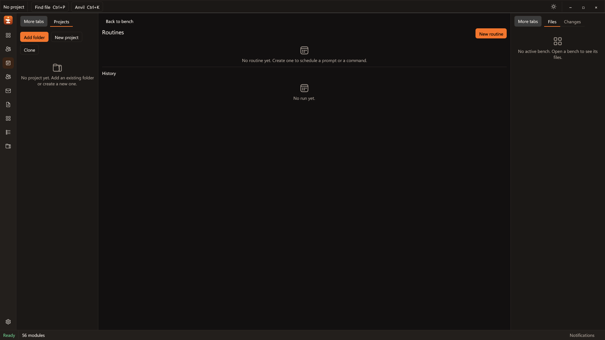

state: en.dark.rail.routine.page
capture_sha: —
model: opencode/glm-5.3-flash-free
---

# Routines (rail page, with empty panels)

Página inicial da área de rotinas do app em inglês, com os painéis de projetos (à esquerda), rotinas (centro) e arquivos de bancada (à direita) ainda sem conteúdo. Variante de idioma da página de referência `pt-BR.dark.rail.routine.page`: mesma estrutura e layout, com todos os textos da interface em inglês.

## Como chegar
Abrir o Forja em inglês com tema dark, com o trilho esquerdo posicionado em "Routines" (o botão "Routines" do trilho aparece marcado). Comando de captura: `forja-app --locale en --theme dark --rail routine.page`.

## Regiões
Mesmas regiões da referência pt-BR; muda apenas o texto dos rótulos (em inglês):
- **Barra superior (0,0)–(1280,42):** rótulo do projeto ("No project") à esquerda; botões "Find file  Ctrl+P" e "Anvil  Ctrl+K"; ícone de tema (sol) à direita; e os botões de janela ("–", "□", "×") no canto superior direito.
- **Trilho à esquerda (0,42)–(56,768):** logomarca (12,50)–(40,78) no topo e os botões-ícone "Board", "Helpers", "Routines" (marcado, em laranja), "Muster", "Requests", "Skills", "Usage", "Extensions", "Archive" e, na base, "Settings".
- **Painel lateral esquerdo (56,42)–(320,768):** abas "Projects" (marcada), "Benches" e "Extension panels" (texto cortado); botões "Add folder" (destaque laranja), "New" e "Clone"; estado vazio com ícone de pasta e a mensagem "No project yet. Add an existing folder or create a new one.".
- **Área central (320,42)–(988,768):** título "Routines" com o botão de destaque "New routine"; estado vazio com ícone e a mensagem "No routine yet. Create one to schedule a prompt or a command."; abaixo, a seção "History" com ícone e a mensagem "No run yet.".
- **Painel direito (988,42)–(1280,768):** abas "Files" (marcada), "Changes", "Search", "Ports" e "Extension panels" (cortada na borda da janela); estado vazio com ícone e a mensagem "No active bench. Open a bench to see its files.".
- **Barra de status (0,768)–(1280,800):** "Ready" em verde à esquerda, "56 modules" ao lado; "Notifications" à direita.

## Elementos
| Elemento | Tipo | Posição (px) | Estado | O que faz |
|---|---|---|---|---|
| "Find file  Ctrl+P" | Button | (99,5)–(218,37) | — | Atalho global de busca de arquivos (Ctrl+P). |
| "Anvil  Ctrl+K" | Button | (226,5)–(327,37) | — | Atalho global de comandos (Ctrl+K); equivalente ao "Bigorna" da referência pt-BR. |
| (sem nome acessível) | Unknown | (1101,5)–(1133,37) | — | Ícone de tema (sol) na barra superior; alterna o tema. |
| "–" | Button | (1155,5)–(1187,37) | — | Minimizar a janela. |
| "□" | Button | (1195,5)–(1227,37) | — | Maximizar/restaurar a janela. |
| "×" | Button | (1235,5)–(1269,37) | — | Fechar a janela. |
| "No project" | Label | (11,12)–(77,31) | clicável | Indica que nenhum projeto está aberto; abre a seletora de projetos. |
| (sem nome acessível) | Unknown | (304,42)–(320,768) | — | Divisor/calha entre o painel esquerdo e a área central (arrastável). |
| (sem nome acessível) | Unknown | (972,42)–(988,768) | — | Divisor/calha entre a área central e o painel direito (arrastável). |
| (sem nome acessível) | Image | (12,50)–(40,78) | clicável | Logomarca do Forja no topo do trilho. |
| "Projects" | Button | (64,50)–(136,82) | marcado=True | Aba do painel esquerdo que exibe a lista de projetos (ativa). |
| (sem nome acessível) | Unknown | (64,50)–(300,82) | — | Faixa da aba ativa "Projects" (linha de sublinhado até a borda do painel). |
| "Benches" | Button | (136,50)–(211,82) | marcado=False | Aba do painel esquerdo que lista as bancadas do projeto. |
| "Extension panels" | Button | (211,50)–(337,82) | marcado=False | Aba do painel esquerdo que lista painéis de extensões; texto cortado na largura visível do painel. |
| "Routines" | Label | (324,50)–(393,74) | clicável | Título da página central. |
| "New routine" | Button | (869,50)–(968,82) | — | Cria uma nova rotina (ação principal da página, em destaque laranja). |
| (sem nome acessível) | Unknown | (992,50)–(1268,82) | — | Faixa das abas do painel direito (linha de sublinhado da aba ativa). |
| "Files" | Button | (992,50)–(1043,82) | marcado=True | Aba do painel direito que mostra os arquivos da bancada (ativa). |
| "Changes" | Button | (1043,50)–(1120,82) | marcado=False | Aba do painel direito que mostra as mudanças da bancada. |
| "Search" | Button | (1120,50)–(1185,82) | marcado=False | Aba do painel direito de busca em arquivos. |
| "Ports" | Button | (1185,50)–(1240,82) | marcado=False | Aba do painel direito de portas/terminais. |
| "Extension panels" | Button | (1240,50)–(1366,82) | marcado=False | Aba do painel direito que lista painéis de extensões; retângulo se estende além da largura da janela. |
| (sem nome acessível) | Unknown | (64,80)–(300,82) | clicável | Linha de sublinhado da aba ativa "Projects". |
| (sem nome acessível) | Unknown | (992,80)–(1268,82) | clicável | Linha de sublinhado da aba ativa "Files". |
| "Board" | Button | (8,94)–(44,130) | marcado=False | Botão-ícone do trilho para a tela do quadro. |
| "Add folder" | Button | (64,98)–(154,130) | — | Adiciona uma pasta de projeto existente (botão em destaque laranja). |
| "New" | Button | (162,98)–(213,130) | — | Cria um projeto novo. |
| "Clone" | Button | (221,98)–(280,130) | — | Clona um projeto (repositório) existente. |
| (ícone) | Label | (632,106)–(660,134) | clicável | Ícone ilustrativo do estado vazio das rotinas (centralizado). |
| (ícone) | Label | (1116,114)–(1144,142) | clicável | Ícone ilustrativo do estado vazio do painel de arquivos (centralizado). |
| "Helpers" | Button | (8,138)–(44,174) | marcado=False | Botão-ícone do trilho para a tela de ajudantes. |
| "No routine yet. Create one to schedule a prompt or a command." | Label | (448,142)–(844,161) | clicável | Mensagem de estado vazio das rotinas. |
| "No active bench. Open a bench to see its files." | Label | (1004,150)–(1256,188) | clicável | Mensagem de estado vazio do painel de arquivos, em duas linhas. |
| "Routines" | Button | (8,182)–(44,218) | marcado=True | Botão-ícone do trilho da página atual, destacado em laranja. |
| "History" | Label | (324,183)–(368,202) | clicável | Título da seção de histórico de execuções abaixo das rotinas. |
| "No project yet. Add an existing folder or create a new one." | Label | (67,194)–(297,232) | clicável | Mensagem de estado vazio do painel de projetos, em duas linhas. |
| "Muster" | Button | (8,226)–(44,262) | marcado=False | Botão-ícone do trilho para a tela de mutirão. |
| (ícone) | Label | (632,226)–(660,254) | clicável | Ícone ilustrativo do estado vazio do histórico (centralizado). |
| "No run yet." | Label | (612,262)–(681,281) | clicável | Mensagem de estado vazio do histórico de execuções. |
| "Requests" | Button | (8,270)–(44,306) | marcado=False | Botão-ícone do trilho para a tela de pedidos. |
| "Skills" | Button | (8,314)–(44,350) | marcado=False | Botão-ícone do trilho para a tela de skills. |
| "Usage" | Button | (8,358)–(44,394) | marcado=False | Botão-ícone do trilho para a tela de uso. |
| "Extensions" | Button | (8,402)–(44,438) | marcado=False | Botão-ícone do trilho para a tela de extensões. |
| "Archive" | Button | (8,446)–(44,482) | marcado=False | Botão-ícone do trilho para a tela de acervo. |
| "Settings" | Button | (8,724)–(44,760) | marcado=False | Botão-ícone do trilho (engrenagem), fixado na base, para os ajustes. |
| "Ready" | Label | (10,775)–(48,794) | clicável | Indicador de estado na barra de status, em verde. |
| "56 modules" | Label | (70,775)–(142,794) | clicável | Contagem de módulos carregados, na barra de status. |
| "Notifications" | Label | (1168,775)–(1246,794) | clicável | Abre as notificações, à direita da barra de status. |

## Aparência
Idêntica à referência pt-BR (mesma geometria e cores): tema escuro com fundo marrom-escuro quase preto (aprox. #221a14 na área de conteúdo) e tom levemente mais claro na barra superior e na barra de status; destaque laranja no botão "New routine", no botão "Add folder", no ícone "Routines" do trilho (fundo laranja com ícone escuro) e no sublinhado das abas ativas ("Projects" e "Files"). O indicador "Ready" usa verde. Rótulos e mensagens vazias em cinza claro, com as mensagens de estado vazio centralizadas nas suas regiões e um ícone acima do texto. Tipografia sem serifa, pequena, com títulos ("Routines", "History") levemente maiores. Trilho com ícones de 36 px em passos de 44 px; divisores verticais de 16 px (304–320 e 972–988) separando os três painéis; barra de status de 32 px com "Ready"/"56 modules" à esquerda e "Notifications" à direita.

## Problemas encontrados
- O botão "Extension panels" do painel direito tem o retângulo (1240,50)–(1366,82) estendido além da largura da imagem/janela (1280 px): parte do elemento fica fora da tela, e o texto visível aparece truncado como "Ext".
- O texto da aba "Extension panels" do painel esquerdo (211,50)–(337,82) é cortado visualmente pela área central, aparecendo como "Extension pa" na captura.
- Botões-ícone do trilho ("Board", "Helpers", "Muster", "Requests", "Skills", "Usage", "Extensions", "Archive") dependem exclusivamente de ícone na interface; o nome acessível existe na árvore, mas não há rótulo visível nem dica na tela.
- Os três ícones ilustrativos dos estados vazios, a logomarca, o ícone de tema e os divisores são expostos como "(sem nome acessível)", sem descrição para leitores de tela.
