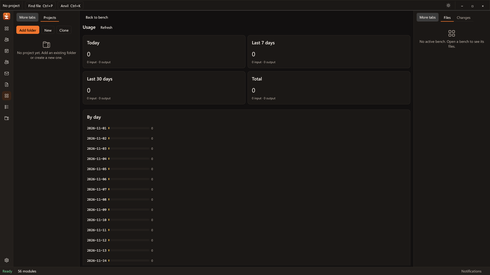

# Uso (página central, com trilho e painéis laterais) — variante `en`

Tela de estatísticas de uso de tokens dos ajudantes, exibida na área central enquanto o trilho lateral e os painéis de projetos e arquivos continuam visíveis. Página de referência: `pt-BR.dark.rail.usage.page` (idioma pt-BR). Estrutura idêntica; o que muda aqui é o idioma dos textos (inglês), a janela de 1920×1080 e, por consequência, todas as séries de datas ficarem visíveis sem corte.

## Como chegar
Na barra superior ou no trilho à esquerda, clique no botão "Usage" (o sétimo ícone do trilho, marcado como ativo). Equivalente a abrir o app com `forja-app --locale en --theme dark --rail usage.page`. Captura: `captures/en.dark.rail.usage.page.png` (1920×1080 px, escala 1.0).

## Regiões
- **Barra superior** (0,0)–(1920,42): rótulo de projeto "No project", botões "Find file  Ctrl+P" e "Anvil  Ctrl+K", botão de alternância de tema (ícone de sol, sem nome acessível) e os botões de janela "–", "□", "×".
- **Trilho de ícones à esquerda** (0,42)–(48,1048): logotipo do app (imagem) em cima, seguido dos botões "Board", "Helpers", "Routines", "Muster", "Requests", "Skills", "Usage" (ativo, em destaque laranja), "Extensions" e "Archive"; "Settings" fixado embaixo.
- **Painel de projetos (esquerda)** (48,42)–(304,1048): botão "More tabs", aba "Projects" (ativa), botões "Add folder" (destaque laranja), "New" e "Clone", e o estado vazio com ícone de pasta e a mensagem "No project yet. Add an existing folder or create a new one.".
- **Área central** (320,42)–(1612,1048): botão "Back to bench" no topo, título "Usage" com botão "Refresh"; cartões "Today", "Last 7 days", "Last 30 days" e "Total"; cartão "By day" com a lista de datas de 2026-11-01 a 2026-11-14, cada uma com barra e valor "0"; área de conteúdo rolável com barra de rolagem vertical na borda direita.
- **Painel direito** (1628,42)–(1920,1048): botão "More tabs", abas "Files" (ativa) e "Changes", e o estado vazio com ícone de grade e a mensagem "No active bench. Open a bench to see its files.".
- **Barra de status** (0,1048)–(1920,1080): "Ready" em verde, "56 modules" e, à direita, "Notifications".

## Elementos
| Elemento | Tipo | Posição (px) | Estado | O que faz |
|---|---|---|---|---|
| "Find file  Ctrl+P" | Button | (99,5)–(218,37) | — | Abre a busca de arquivos (atalho Ctrl+P) |
| "Anvil  Ctrl+K" | Button | (226,5)–(327,37) | — | Abre a paleta de comandos (atalho Ctrl+K) |
| (sem nome acessível) | Unknown | (1741,5)–(1773,37) | — | Ícone de sol: alterna tema claro/escuro |
| "–" | Button | (1795,5)–(1827,37) | — | Minimiza a janela |
| "□" | Button | (1835,5)–(1867,37) | — | Maximiza/restaura a janela |
| "×" | Button | (1875,5)–(1909,37) | — | Fecha a janela |
| "No project" | Label | (11,12)–(77,31) | — | Mostra que não há projeto aberto; clique abre o seletor de projeto |
| (sem nome acessível) | Unknown | (304,42)–(320,1048) | — | Divisor redimensionável entre painel esquerdo e área central |
| (sem nome acessível) | Unknown | (1612,42)–(1628,1048) | — | Divisor redimensionável entre área central e painel direito |
| (sem nome acessível) | Image | (12,50)–(40,78) | — | Logotipo da Forja no topo do trilho |
| "More tabs" | Button | (64,50)–(151,85) | — | Agrupa as demais abas do painel esquerdo (no pt-BR: "Bancadas" e "Painéis de extensões"); no en elas aparecem recolhidas aqui |
| "Projects" | Button | (159,52)–(231,84) | marcado=True | Aba ativa do painel esquerdo; mostra a lista de projetos |
| "Back to bench" | Button | (324,50)–(435,82) | — | Volta à bancada; exibido no topo da área central mesmo sem bancada ativa |
| "More tabs" | Button | (1632,50)–(1719,85) | — | Agrupa as demais abas do painel direito (no pt-BR: "Busca", "Portas" e "Painéis de extensões"); no en aparecem recolhidas aqui |
| "Files" | Button | (1727,52)–(1778,84) | marcado=True | Aba ativa do painel direito; lista de arquivos da bancada |
| "Changes" | Button | (1778,52)–(1855,84) | marcado=False | Aba de mudanças (diffs) da bancada |
| "Usage" | Label | (324,90)–(374,122) | — | Título da página central |
| "Refresh" | Button | (382,90)–(452,122) | — | Recarrega os dados de uso |
| "Board" | Button | (8,94)–(44,130) | marcado=False | Ícone do trilho: abre o quadro de projetos |
| "Add folder" | Button | (64,101)–(154,133) | — | Destaque laranja: adiciona uma pasta de projeto |
| "New" | Button | (162,101)–(213,133) | — | Cria um projeto novo |
| "Clone" | Button | (221,101)–(280,133) | — | Clona um repositório para usar como projeto |
| (ícone) | Label | (1756,117)–(1784,145) | — | Ícone de grade do estado vazio do painel direito |
| "Helpers" | Button | (8,138)–(44,174) | marcado=False | Ícone do trilho: lista os ajudantes |
| (sem nome acessível) | Unknown | (324,138)–(1608,1040) | — | Área de conteúdo rolável da página de uso |
| (sem nome acessível) | Unknown | (1606,138)–(1608,1040) | — | Barra de rolagem vertical da área central |
| "No active bench. Open a bench to see its files." | Label | (1644,153)–(1896,191) | — | Estado vazio do painel direito |
| "Today" | Label | (341,155)–(945,179) | — | Título do cartão de uso de hoje |
| "Last 7 days" | Label | (987,155)–(1591,179) | — | Título do cartão dos últimos 7 dias |
| (ícone) | Label | (168,161)–(196,189) | — | Ícone de pasta do estado vazio do painel esquerdo |
| "Routines" | Button | (8,182)–(44,218) | marcado=False | Ícone do trilho: abre as rotinas |
| "0" | Label | (341,195)–(945,227) | — | Valor do cartão "Today" |
| "0" | Label | (987,195)–(1591,227) | — | Valor do cartão "Last 7 days" |
| "No project yet. Add an existing folder or create a new one." | Label | (67,197)–(297,235) | — | Estado vazio da lista de projetos |
| "0 input · 0 output" | Label | (341,235)–(945,251) | — | Detalhe de tokens do cartão "Today" |
| "0 input · 0 output" | Label | (987,235)–(1591,251) | — | Detalhe de tokens do cartão "Last 7 days" |
| "Muster" | Button | (8,226)–(44,262) | marcado=False | Ícone do trilho: abre o mutirão |
| "Requests" | Button | (8,270)–(44,306) | marcado=False | Ícone do trilho: abre os pedidos |
| "Last 30 days" | Label | (341,297)–(945,321) | — | Título do cartão dos últimos 30 dias |
| "Total" | Label | (987,297)–(1591,321) | — | Título do cartão de total acumulado |
| "Skills" | Button | (8,314)–(44,350) | marcado=False | Ícone do trilho: abre as skills |
| "0" | Label | (341,337)–(945,369) | — | Valor do cartão "Last 30 days" |
| "0" | Label | (987,337)–(1591,369) | — | Valor do cartão "Total" |
| "Usage" | Button | (8,358)–(44,394) | marcado=True | Ícone do trilho ativo: mostra esta página de uso |
| "0 input · 0 output" | Label | (341,377)–(945,393) | — | Detalhe de tokens do cartão "Last 30 days" |
| "0 input · 0 output" | Label | (987,377)–(1591,393) | — | Detalhe de tokens do cartão "Total" |
| "Extensions" | Button | (8,402)–(44,438) | marcado=False | Ícone do trilho: abre as extensões |
| "Archive" | Button | (8,446)–(44,482) | marcado=False | Ícone do trilho: abre o acervo |
| "By day" | Label | (341,447)–(395,471) | — | Título do cartão com a série diária |
| "0" | Label | (593,495)–(599,511) | — | Valor do dia 2026-11-01 |
| "2026-11-01" | Label | (341,496)–(417,511) | — | Primeira linha da série diária |
| "0" | Label | (593,535)–(599,551) | — | Valor do dia 2026-11-02 |
| "2026-11-02" | Label | (341,536)–(417,551) | — | Data da linha seguinte |
| "0" | Label | (593,575)–(599,591) | — | Valor do dia 2026-11-03 |
| "2026-11-03" | Label | (341,576)–(417,591) | — | Data da linha seguinte |
| "0" | Label | (593,615)–(599,631) | — | Valor do dia 2026-11-04 |
| "2026-11-04" | Label | (341,616)–(417,631) | — | Data da linha seguinte |
| "0" | Label | (593,655)–(599,671) | — | Valor do dia 2026-11-05 |
| "2026-11-05" | Label | (341,656)–(417,671) | — | Data da linha seguinte |
| "0" | Label | (593,695)–(599,711) | — | Valor do dia 2026-11-06 |
| "2026-11-06" | Label | (341,696)–(417,711) | — | Data da linha seguinte |
| "0" | Label | (593,735)–(599,751) | — | Valor do dia 2026-11-07 |
| "2026-11-07" | Label | (341,736)–(417,751) | — | Data da linha seguinte |
| "0" | Label | (593,775)–(599,791) | — | Valor do dia 2026-11-08 |
| "2026-11-08" | Label | (341,776)–(417,791) | — | Data da linha seguinte |
| "0" | Label | (593,815)–(599,831) | — | Valor do dia 2026-11-09 |
| "2026-11-09" | Label | (341,816)–(417,831) | — | Data da linha seguinte |
| "0" | Label | (593,855)–(599,871) | — | Valor do dia 2026-11-10 |
| "2026-11-10" | Label | (341,856)–(417,871) | — | Data da linha seguinte |
| "0" | Label | (593,895)–(599,911) | — | Valor do dia 2026-11-11 |
| "2026-11-11" | Label | (341,896)–(417,911) | — | Data da linha seguinte |
| "0" | Label | (593,935)–(599,951) | — | Valor do dia 2026-11-12 |
| "2026-11-12" | Label | (341,936)–(417,951) | — | Data da linha seguinte |
| "0" | Label | (593,975)–(599,991) | — | Valor do dia 2026-11-13 |
| "2026-11-13" | Label | (341,976)–(417,991) | — | Data da linha seguinte |
| "Settings" | Button | (8,1004)–(44,1040) | marcado=False | Ícone do trilho, fixado embaixo: abre os ajustes |
| "0" | Label | (593,1015)–(599,1031) | — | Valor do dia 2026-11-14 (última linha da série) |
| "2026-11-14" | Label | (341,1016)–(417,1031) | — | Última data da série; visível inteira na janela de 1080 px |
| "Ready" | Label | (10,1055)–(48,1074) | — | Status do app, em verde |
| "56 modules" | Label | (70,1055)–(142,1074) | — | Quantidade de módulos carregados |
| "Notifications" | Label | (1808,1055)–(1886,1074) | — | Abre as notificações, na barra de status |

## Aparência
Igual à variável de referência: tema escuro com fundo quase preto na barra superior e na barra de status, painéis em cinza-escuro e cartões levemente mais claros com bordas arredondadas finas. O acento laranja (Brasa) aparece no botão primário "Add folder", no botão ativo "Usage" do trilho e na marca inicial das barras da série "By day" (trilho cinza, valor zero). Texto principal em branco, secundários e estados vazios em cinza médio; "Ready" em verde na barra de status. Tipografia sans-serif de peso médio, títulos de cartão maiores e valores em número grande. Cartões em duas colunas (341–945 e 987–1591), linhas da série com data à esquerda, barra no meio e valor à direita; ícones do trilho centralizados em coluna única de 36 px. Diferença em relação ao pt-BR: a janela de 1920×1080 expõe a série completa até "2026-11-14", sem linha encostada na borda do cartão.

## Problemas encontrados
- O botão de alternância de tema na barra superior (1741,5)–(1773,37) não tem nome acessível (apenas ícone de sol).
- Os botões de janela usam os símbolos "–", "□" e "×" como nome acessível, em vez de rótulos descritivos ("Minimize", "Maximize", "Close").
- O logotipo do app (12,50)–(40,78) é uma imagem sem nome acessível.
- As demais abas dos painéis esquerdo e direito (equivalentes a "Bancadas", "Painéis de extensões", "Busca" e "Portas" do pt-BR) não aparecem na árvore de acessibilidade nesta variante; somente os botões "More tabs" que as agrupam.
- O botão "Back to bench" é exibido no topo da área central mesmo sem bancada ativa, enquanto o painel direito mostra "No active bench. Open a bench to see its files.".
