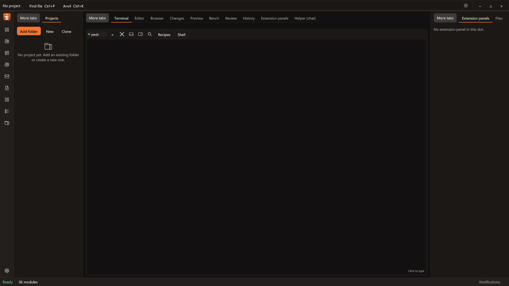

# Painel de extensões (slot direito)

Tela principal da Forja no estado inicial (nenhum projeto aberto), com o painel direito exibindo o slot "Extension panels", vazio. Variante em inglês da página de referência pt-BR; a janela aqui tem 1920×1080 (a referência usa 1280×800), então os retângulos são maiores.

## Como chegar
Abrir o app com o painel direito apontado para o slot de painéis de extensão: `forja-app --locale en --theme dark --right-tab extension.panels.right`. Na interface, clicando na aba "Extension panels" da faixa de abas do painel direito — nesta variante essa aba está visível e ativa (na referência pt-BR ela ficava fora da janela).

## Regiões
- **Barra superior** (0,0)–(1920,42): rótulo "No project" à esquerda; botões "Find file  Ctrl+P" e "Anvil  Ctrl+K"; ícone de tema (sol) e botões de janela ("–", "□", "×") à direita.
- **Trilho de ícones à esquerda** (0,42)–(48,1048): logotipo da Forja (bigorna laranja) e, de cima para baixo, os botões "Board", "Helpers", "Routines", "Muster", "Requests", "Skills", "Usage", "Extensions", "Archive" e, no rodapé do trilho, "Settings".
- **Painel esquerdo** (48,42)–(304,1048): faixa de abas com "More tabs" e "Projects" (ativa, sublinhada); botões "Add folder" (destaque laranja), "New" e "Clone"; estado vazio com ícone de pasta e o texto "No project yet. Add an existing folder or create a new one.".
- **Divisor vertical 1** (304,42)–(320,1048): separador redimensionável entre o painel esquerdo e a área central.
- **Área central** (320,42)–(1616,1048): faixa de abas com "More tabs", "Terminal" (ativa), "Editor", "Browser", "Changes", "Preview", "Bench", "Review", "History", "Extension panels" e "Helper (chat)"; barra de ferramentas do terminal com a aba "pwsh" (bolinha verde), "+", ícones de fechar/dividir/maximizar/busca e os botões "Recipes" e "Shell"; área do terminal vazia com a dica "Click to type" no canto inferior direito.
- **Divisor vertical 2** (1616,42)–(1632,1048): separador entre a área central e o painel direito.
- **Painel direito** (1632,42)–(1920,1048): faixa de abas com "More tabs", "Extension panels" (ativa, sublinhada) e "Files"; mensagem "No extension panel in this slot." indicando o slot vazio.
- **Barra de status** (0,1048)–(1920,1080): "Ready" em verde à esquerda, "56 modules" em seguida e "Notifications" à direita.

## Elementos
| Elemento | Tipo | Posição (px) | Estado | O que faz |
|---|---|---|---|---|
| "Find file  Ctrl+P" | Button | (99,5)–(218,37) | — | Abre a busca rápida de arquivos (atalho Ctrl+P) |
| "Anvil  Ctrl+K" | Button | (226,5)–(327,37) | — | Abre a paleta de comandos (atalho Ctrl+K) |
| (sem nome acessível) | Unknown | (1741,5)–(1773,37) | — | Ícone de sol na barra superior: alterna tema claro/escuro |
| "–" | Button | (1795,5)–(1827,37) | — | Minimiza a janela |
| "□" | Button | (1835,5)–(1867,37) | — | Maximiza/restaura a janela |
| "×" | Button | (1875,5)–(1909,37) | — | Fecha a janela |
| "No project" | Label | (11,12)–(77,31) | — | Indica que nenhum projeto está aberto |
| (sem nome acessível) | Unknown | (304,42)–(320,1048) | — | Divisor vertical entre painel esquerdo e área central (arrastar redimensiona) |
| (sem nome acessível) | Unknown | (1616,42)–(1632,1048) | — | Divisor vertical entre área central e painel direito |
| (sem nome acessível) | Image | (12,50)–(40,78) | — | Logotipo da Forja (bigorna laranja) no topo do trilho |
| "More tabs" | Button | (64,50)–(151,85) | — | Botão de estouro da faixa de abas do painel esquerdo (abas adicionais em menu) |
| "More tabs" | Button | (324,50)–(411,85) | — | Botão de estouro da faixa de abas da área central |
| "More tabs" | Button | (1636,50)–(1723,85) | — | Botão de estouro da faixa de abas do painel direito |
| "Projects" | Button | (159,52)–(231,84) | marcado=True | Aba ativa do painel esquerdo; mostra a lista de projetos |
| "Terminal" | Button | (419,52)–(496,84) | marcado=True | Aba ativa da área central; mostra o terminal |
| "Editor" | Button | (496,52)–(556,84) | marcado=False | Aba da área central; mostra o editor |
| "Browser" | Button | (556,52)–(629,84) | marcado=False | Aba da área central; mostra o navegador |
| "Changes" | Button | (629,52)–(706,84) | marcado=False | Aba da área central; mostra as mudanças pendentes |
| "Preview" | Button | (706,52)–(777,84) | marcado=False | Aba da área central; visualiza arquivos |
| "Bench" | Button | (777,52)–(838,84) | marcado=False | Aba da área central; mostra a visão da bancada |
| "Review" | Button | (838,52)–(905,84) | marcado=False | Aba da área central; revisão de mudanças |
| "History" | Button | (905,52)–(973,84) | marcado=False | Aba da área central; histórico da bancada |
| "Extension panels" | Button | (973,52)–(1099,84) | marcado=False | Aba da área central; painéis de extensão no slot central |
| "Helper (chat)" | Button | (1099,52)–(1202,84) | marcado=False | Aba da área central; chat com o ajudante |
| "Extension panels" | Button | (1731,52)–(1857,84) | marcado=True | Aba ativa do slot direito; mostra o slot de painéis de extensão, vazio — visível e dentro da janela |
| "Files" | Button | (1857,52)–(1908,84) | marcado=False | Aba do painel direito; lista de arquivos |
| "Board" | Button | (8,94)–(44,130) | marcado=False | Item do trilho: quadro geral do app |
| "Add folder" | Button | (64,101)–(154,133) | — | Botão em destaque laranja: adiciona uma pasta de projeto |
| "New" | Button | (162,101)–(213,133) | — | Cria um projeto novo |
| "Clone" | Button | (221,101)–(280,133) | — | Clona um repositório para começar um projeto |
| "No extension panel in this slot." | Label | (1636,101)–(1825,120) | — | Mensagem de estado vazio do slot direito |
| "+" | Button | (407,113)–(441,145) | — | Abre um novo terminal |
| (sem nome acessível) | Unknown | (444,113)–(476,145) | — | Ícone X: fecha o terminal atual |
| (sem nome acessível) | Unknown | (479,113)–(511,145) | — | Ícone de dividir terminal |
| (sem nome acessível) | Unknown | (514,113)–(546,145) | — | Ícone de maximizar o painel do terminal |
| (sem nome acessível) | Unknown | (549,113)–(581,145) | — | Ícone de lupa: busca no terminal |
| "Recipes" | Button | (584,113)–(655,145) | — | Lista de receitas do terminal |
| "Shell" | Button | (658,113)–(711,145) | — | Seletor de shell/perfil do terminal |
| (sem nome acessível) | Unknown | (328,118)–(404,140) | — | Aba do terminal "pwsh" com indicador de status |
| (sem nome acessível) | Unknown | (385,121)–(401,137) | — | Bolinha verde de status dentro da aba "pwsh" |
| "Helpers" | Button | (8,138)–(44,174) | marcado=False | Item do trilho: lista de ajudantes (agentes de IA) |
| (sem nome acessível) | Unknown | (328,150)–(1608,1036) | — | Área de conteúdo do terminal, vazia; exibe a dica "Click to type" no canto inferior direito |
| "(ícone)" | Label | (168,161)–(196,189) | — | Ícone de pasta do estado vazio do painel esquerdo; nome acessível em português |
| "Routines" | Button | (8,182)–(44,218) | marcado=False | Item do trilho: rotinas/tarefas |
| "No project yet. Add an existing folder or create a new one." | Label | (67,197)–(297,235) | — | Mensagem de estado vazio do painel esquerdo |
| "Muster" | Button | (8,226)–(44,262) | marcado=False | Item do trilho: mutirão de ajudantes |
| "Requests" | Button | (8,270)–(44,306) | marcado=False | Item do trilho: pedidos |
| "Skills" | Button | (8,314)–(44,350) | marcado=False | Item do trilho: skills dos ajudantes |
| "Usage" | Button | (8,358)–(44,394) | marcado=False | Item do trilho: uso de recursos |
| "Extensions" | Button | (8,402)–(44,438) | marcado=False | Item do trilho: extensões instaladas |
| "Archive" | Button | (8,446)–(44,482) | marcado=False | Item do trilho: acervo de conteúdo |
| "Settings" | Button | (8,1004)–(44,1040) | marcado=False | Item do trilho: abre os ajustes |
| "Ready" | Label | (10,1055)–(48,1074) | — | Status geral na barra de status, em verde |
| "56 modules" | Label | (70,1055)–(142,1074) | — | Quantidade de módulos carregados |
| "Notifications" | Label | (1808,1055)–(1886,1074) | — | Atalho/indicador de notificações na barra de status |

## Aparência
Mesmo tema escuro da referência: fundo geral marrom-escuro quase preto, painéis distintos por bordas finas. Cor de destaque laranja (identidade "Brasa") no logotipo, no botão "Add folder" (fundo laranja sólido com texto escuro) e no sublinhado das abas ativas ("Projects", "Terminal" e "Extension panels" do painel direito). Bolinha verde na aba "pwsh" e "Ready" em verde na barra de status. Tipografia sans-serif de tamanho uniforme, textos em inglês; abas e botões em cinza claro com contraste razoável, textos de estado vazio em cinza médio. Botões "New", "Clone", "Recipes" e "Shell" com contornos arredondados discretos. Alinhamento consistente: trilho com botões quadrados de 36 px de lado espaçados 44 px; faixas de abas e barra do terminal com 32–35 px de altura. O que muda em relação à referência pt-BR: apenas os textos (agora em inglês) e a geometria — com a janela de 1920×1080, as três faixas de abas cabem sem cortes nem sobreposições.

## Problemas encontrados
- Nome acessível "(ícone)" no rótulo da pasta do estado vazio (168,161)–(196,189): texto em português na variante em inglês (vazamento de i18n) e sem valor descritivo.
- Botão de tema (sol) na barra superior (1741,5)–(1773,37) sem nome acessível; idem nos ícones de fechar/dividir/maximizar/busca do terminal, na aba "pwsh", na bolinha de status, nos dois divisores verticais e na área de conteúdo do terminal.
- Botões de janela nomeados apenas com os símbolos "–", "□" e "×", sem rótulos descritivos.
- As três faixas de abas exibem o botão "More tabs" mesmo com poucas abas visíveis ("Projects" à esquerda; "Terminal" a "Helper (chat)" no centro; "Extension panels" e "Files" à direita), sem indicação de quais abas estariam ocultas no menu de estouro.
- Diferença em relação à referência pt-BR (constato, não defeito): as sobreposições de abas e a aba ativa fora da janela descritas na referência não ocorrem nesta variante; o estado declarado (slot direito "Extension panels" ativo e visível) confere com a imagem.
