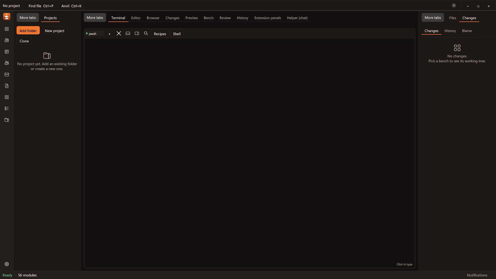

state: en.dark.right-tab.git.changes
model: opencode/glm-5.3-flash-free
---

# Janela principal — painel direito "Changes" (git.changes)

Tela principal do app com o painel direito aberto na aba "Changes" (git), mostrando estado vazio porque nenhuma bancada está selecionada. Variante en (inglês), tema dark, layout "right-tab" com alvo "git.changes" — mesma estrutura da referência pt-BR; mudam os textos (em inglês), as coordenadas (janela 1920×1080 px) e as faixas de abas, que aqui colapsam abas extras nos botões "More tabs".

## Como chegar
Na janela principal, clique em "Changes" na faixa de abas do topo do painel direito (à direita de "Files"). A subaba "Changes" já vem selecionada. Comando de captura: `forja-app --locale en --theme dark --right-tab git.changes` (imagem: `captures/en.dark.right-tab.git.changes.png`, 1920×1080 px, escala 1.0).

## Regiões
- **Barra superior** (0,0)–(1920,42): seletor de projeto "No project", botões "Find file  Ctrl+P" e "Anvil  Ctrl+K", e à direita o alternador de tema (ícone de sol) e os botões de janela "–", "□", "×".
- **Trilho à esquerda** (0,42)–(52,1048): coluna de ícones de navegação — "Board", "Helpers", "Routines", "Muster", "Requests", "Skills", "Usage", "Extensions", "Archive" e, no rodapé, "Settings"; o logotipo da Forja (bigorna laranja) no topo.
- **Painel esquerdo** (52,42)–(304,1048): faixa de abas colapsada com "More tabs" e a aba "Projects" (ativa, com sublinhado laranja); ações "Add folder" (destaque laranja), "New" e "Clone"; estado vazio com ícone de pasta e o texto "No project yet. Add an existing folder or create a new one.".
- **Divisor** (304,42)–(320,1048): separador vertical arrastável entre o painel esquerdo e a área central.
- **Área central** (320,42)–(1612,1048): faixa de abas com "More tabs", "Terminal" (ativa), "Editor", "Browser", "Changes", "Preview", "Bench", "Review", "History", "Extension panels" e "Helper (chat)"; barra do terminal com chip "pwsh" (ponto verde), botão "+", quatro botões de ícone e os chips "Recipes" e "Shell"; abaixo, o terminal vazio com a dica "Click to type" no canto inferior direito.
- **Divisor** (1612,42)–(1628,1048): separador vertical entre a área central e o painel direito.
- **Painel direito** (1628,42)–(1920,1048): faixa de abas com "More tabs", "Changes" (ativa) e "Files"; subabas "Changes" (ativa), "History" e "Blame"; estado vazio com ícone de grade e o texto "No changes. Pick a bench to see its working tree.".
- **Barra de status** (0,1048)–(1920,1080): "Ready" em verde à esquerda, "56 modules" ao lado e "Notifications" à direita.

## Elementos
| Elemento | Tipo | Posição (px) | Estado | O que faz |
|---|---|---|---|---|
| "Find file  Ctrl+P" | Button | (99,5)–(218,37) | — | Abre a busca rápida de arquivos (atalho Ctrl+P). |
| "Anvil  Ctrl+K" | Button | (226,5)–(327,37) | — | Abre a paleta de comandos (atalho Ctrl+K). |
| (sem nome acessível) | Unknown | (1741,5)–(1773,37) | — | Ícone de sol: alterna tema claro/escuro. |
| "–" | Button | (1795,5)–(1827,37) | — | Minimiza a janela. |
| "□" | Button | (1835,5)–(1867,37) | — | Maximiza/restaura a janela. |
| "×" | Button | (1875,5)–(1909,37) | — | Fecha a janela. |
| "No project" | Label | (11,12)–(77,31) | — | Indicador do projeto ativo na barra superior (chip clicável). |
| (sem nome acessível) | Unknown | (304,42)–(320,1048) | — | Divisor vertical entre painel esquerdo e área central. |
| (sem nome acessível) | Unknown | (1612,42)–(1628,1048) | — | Divisor vertical entre área central e painel direito. |
| (sem nome acessível) | Image | (12,50)–(40,78) | — | Logotipo da Forja (bigorna laranja) no topo do trilho. |
| "More tabs" | Button | (64,50)–(151,85) | — | Lista as abas ocultas da faixa do painel esquerdo (só "Projects" cabe). |
| "More tabs" | Button | (324,50)–(411,85) | — | Lista as abas ocultas do início da faixa central. |
| "More tabs" | Button | (1632,50)–(1719,85) | — | Lista as abas ocultas da faixa do painel direito. |
| "Projects" | Button | (159,52)–(231,84) | marcado=True | Aba ativa do painel esquerdo; mostra a lista de projetos. |
| "Terminal" | Button | (419,52)–(496,84) | marcado=True | Aba ativa da área central; mostra o terminal integrado. |
| "Editor" | Button | (496,52)–(556,84) | marcado=False | Aba do editor de arquivos. |
| "Browser" | Button | (556,52)–(629,84) | marcado=False | Aba do navegador. |
| "Changes" | Button | (629,52)–(706,84) | marcado=False | Aba de visualização de mudanças na faixa central. |
| "Preview" | Button | (706,52)–(777,84) | marcado=False | Aba do visualizador/preview. |
| "Bench" | Button | (777,52)–(838,84) | marcado=False | Aba da bancada. |
| "Review" | Button | (838,52)–(905,84) | marcado=False | Aba de revisão. |
| "History" | Button | (905,52)–(973,84) | marcado=False | Aba de histórico na faixa central. |
| "Extension panels" | Button | (973,52)–(1099,84) | marcado=False | Aba de painéis de extensão na faixa central. |
| "Helper (chat)" | Button | (1099,52)–(1202,84) | marcado=False | Aba do chat do ajudante na faixa central. |
| "Changes" | Button | (1727,52)–(1804,84) | marcado=True | Aba ativa do painel direito; mostra as mudanças (git) da bancada. |
| "Files" | Button | (1804,52)–(1855,84) | marcado=False | Aba do painel de arquivos. |
| "Board" | Button | (8,94)–(44,130) | marcado=False | Ícone do trilho: abre o quadro. |
| "Add folder" | Button | (64,101)–(154,133) | — | Ação destacada em laranja: adiciona uma pasta de projeto. |
| "New" | Button | (162,101)–(213,133) | — | Cria um novo projeto. |
| "Clone" | Button | (221,101)–(280,133) | — | Clona um repositório para criar um projeto. |
| "Changes" | Button | (1632,101)–(1709,133) | marcado=True | Subaba ativa do painel de git: lista de mudanças. |
| "History" | Button | (1709,101)–(1777,133) | marcado=False | Subaba de histórico de commits. |
| "Blame" | Button | (1777,101)–(1838,133) | marcado=False | Subaba de blame. |
| "+" | Button | (407,113)–(441,145) | — | Nova instância/aba de terminal. |
| (sem nome acessível) | Unknown | (444,113)–(476,145) | — | Ícone "X": fecha o terminal/painel atual. |
| (sem nome acessível) | Unknown | (479,113)–(511,145) | — | Ícone de retângulo cheio: alterna modo de preenchimento/divisão do painel. |
| (sem nome acessível) | Unknown | (514,113)–(546,145) | — | Ícone de retângulo dividido: divide o terminal. |
| (sem nome acessível) | Unknown | (549,113)–(581,145) | — | Ícone de lupa: busca no terminal. |
| "Recipes" | Button | (584,113)–(655,145) | — | Chip que abre a lista de receitas do terminal. |
| "Shell" | Button | (658,113)–(711,145) | — | Chip para escolher/trocar o shell. |
| (sem nome acessível) | Unknown | (328,118)–(404,140) | — | Chip da sessão "pwsh" com ponto verde (sessão ativa). |
| (sem nome acessível) | Unknown | (385,121)–(401,137) | — | Controle dentro do chip "pwsh" (fechar/indicador). |
| "Helpers" | Button | (8,138)–(44,174) | marcado=False | Ícone do trilho: abre a lista de ajudantes. |
| (sem nome acessível) | Unknown | (328,150)–(1604,1036) | — | Área do terminal, vazia; dica "Click to type" no canto inferior direito. |
| (ícone) | Label | (168,161)–(196,189) | — | Ícone de pasta do estado vazio do painel esquerdo. |
| (ícone) | Label | (1756,171)–(1784,199) | — | Ícone de grade (quatro quadrados) do estado vazio do painel direito. |
| "Routines" | Button | (8,182)–(44,218) | marcado=False | Ícone do trilho: abre rotinas. |
| "No project yet. Add an existing folder or create a new one." | Label | (67,197)–(297,235) | — | Mensagem de estado vazio da lista de projetos. |
| "No changes.\nPick a bench to see its working tree." | Label | (1660,207)–(1881,245) | — | Mensagem de estado vazio das mudanças (git). |
| "Muster" | Button | (8,226)–(44,262) | marcado=False | Ícone do trilho: abre o mutirão. |
| "Requests" | Button | (8,270)–(44,306) | marcado=False | Ícone do trilho: abre pedidos. |
| "Skills" | Button | (8,314)–(44,350) | marcado=False | Ícone do trilho: abre skills. |
| "Usage" | Button | (8,358)–(44,394) | marcado=False | Ícone do trilho: abre uso. |
| "Extensions" | Button | (8,402)–(44,438) | marcado=False | Ícone do trilho: abre extensões. |
| "Archive" | Button | (8,446)–(44,482) | marcado=False | Ícone do trilho: abre o acervo. |
| "Settings" | Button | (8,1004)–(44,1040) | marcado=False | Ícone do trilho (rodapé): abre os ajustes. |
| "Ready" | Label | (10,1055)–(48,1074) | — | Status geral na barra de status, em verde. |
| "56 modules" | Label | (70,1055)–(142,1074) | — | Contador de módulos carregados. |
| "Notifications" | Label | (1808,1055)–(1886,1074) | — | Abre notificações, à direita da barra de status. |

## Aparência
Igual à referência pt-BR: tema escuro de fundo marrom-muito-escuro/quase preto em toda a janela, com texto claro, e laranja (Brasa) como cor de destaque — no logotipo, no botão "Add folder", no sublinhado das abas ativas ("Projects", "Terminal", "Changes" do painel direito e a subaba "Changes") e no ponto verde do chip "pwsh" (sessão ativa). Tipografia sem serifa de ~13 px em abas, botões e status; mensagens de estado vazio em cinza médio, centralizadas, com ícone acima. Chips ("pwsh", "Recipes", "Shell") são retângulos arredondados com borda sutil; abas inativas em cinza médio sem sublinhado. O que muda nesta variante são só os textos, agora em inglês ("Ready", "56 modules", "No changes.", "Add folder" etc.), com os mesmos papéis e cores; como a janela é 1920×1080 (a referência usa 1280×800), todos os retângulos escalam junto e sobra mais espaço na faixa central — as abas "Extension panels" e "Helper (chat)" aparecem sem serem cobertas pelo painel direito. Os três botões "More tabs" indicam que há mais abas do que cabe em cada faixa.

## Problemas encontrados
- Botões de janela rotulados apenas com os caracteres "–", "□" e "×" como nome acessível.
- Vários controles sem nome acessível: alternador de tema (1741,5)–(1773,37), os quatro botões de ícone da barra do terminal (444–581), o chip "pwsh", os divisores verticais, o logotipo e a área do terminal.
- A dica "Click to type" (≈1508,1016–1597,1028), visível na imagem dentro do terminal, não tem entrada na árvore de acessibilidade.
- Faixas de abas dependem de botões genéricos "More tabs" (três ocorrências) para reaching abas ocultas; não fica acessível quais abas estão escondidas sem abrir o menu.
- Abas e textos inativos em cinza médio sobre fundo escuro (por exemplo "Editor", "Browser", "Preview", "Files") têm contraste baixo.
