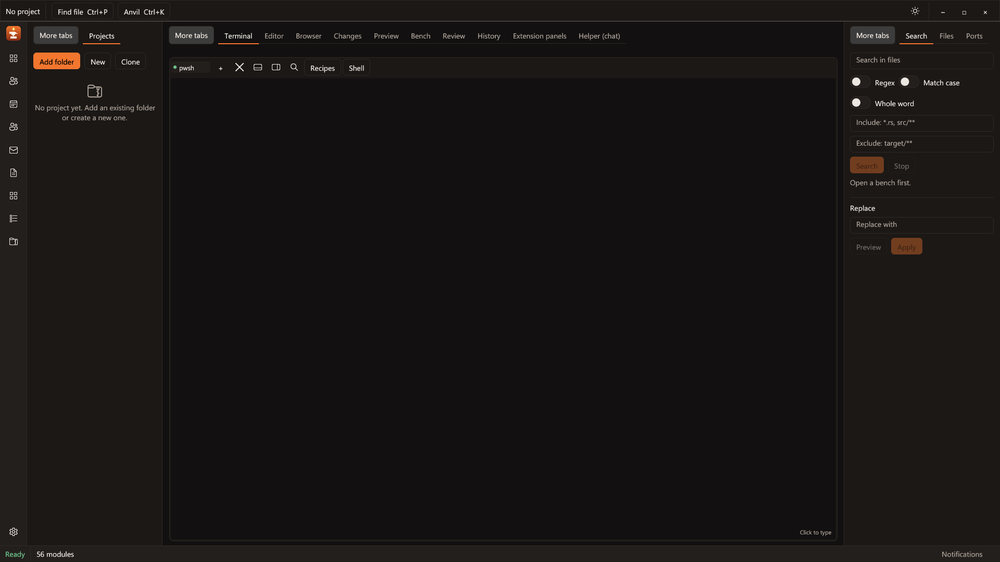

# Painel Search (painel direito) — variante en

Tela de busca e substituição de texto nos arquivos da bancada, exibida como aba do painel direito; com o estado inicial "No project", a busca está desativada até que uma bancada seja aberta. Variante em inglês da página de referência (pt-BR), capturada em janela de 1920×1080 (a referência tem 1280×800); tema dark idêntico.

## Como chegar
Na faixa de abas do painel direito, clique em "Search" (é a aba marcada); pela barra superior, "Find file  Ctrl+P" abre a busca rápida de arquivos e "Anvil  Ctrl+K" abre a paleta de comandos (equivalente à "Bigorna" da referência). Por linha de comando: `forja-app --locale en --theme dark --right-tab search.panel`.

## Regiões
- **Barra superior** (0,0)–(1920,42): rótulo de projeto "No project", botões "Find file  Ctrl+P" e "Anvil  Ctrl+K", ícone de tema sem nome à direita e botões de janela "–", "□", "×".
- **Trilho à esquerda** (0,42)–(48,1048): logotipo (imagem sem nome em (12,50)–(40,78)) e coluna de botões-ícone "Board", "Helpers", "Routines", "Muster", "Requests", "Skills", "Usage", "Extensions", "Archive" e, na base, "Settings"; nenhum está marcado.
- **Painel lateral esquerdo** (48,42)–(304,1048): botão "More tabs" e a aba "Projects" (marcada); as demais abas da referência ficam recolhidas em "More tabs". Botões "Add folder" (laranja), "New" e "Clone"; estado vazio com ícone de pasta e o texto "No project yet. Add an existing folder or create a new one.".
- **Divisores**: faixas sem nome em (304,42)–(320,1048) e (1612,42)–(1628,1048), arrastáveis entre os painéis.
- **Área central** (320,42)–(1612,1048): faixa com "More tabs" e abas ("Terminal" marcada, "Editor", "Browser", "Changes", "Preview", "Bench", "Review", "History", "Extension panels", "Helper (chat)"), barra de ferramentas do terminal (chip "pwsh", botão "+", quatro ícones sem nome, "Recipes", "Shell") e o terminal vazio com a dica "Click to type" no canto inferior direito.
- **Painel direito** (1628,42)–(1920,1048): botão "More tabs" e abas "Search" (marcada), "Files" e "Ports" (na referência pt-BR há também "Arquivos", "Mudanças" e "Painéis de extensões"); formulário de busca (campo "Search in files", opções "Regex", "Match case", "Whole word", campos de incluir/excluir, botões "Search"/"Stop"), aviso "Open a bench first." e seção "Replace" (campo "Replace with", botões "Preview"/"Apply").
- **Barra de status** (0,1048)–(1920,1080): "Ready" à esquerda, "56 modules" e "Notifications" à direita.

## Elementos
| Elemento | Tipo | Posição (px) | Estado | O que faz |
|---|---|---|---|---|
| "Find file  Ctrl+P" | Button | (99,5)–(218,37) | normal | Abre a busca rápida de arquivos pelo atalho Ctrl+P. |
| "Anvil  Ctrl+K" | Button | (226,5)–(327,37) | normal | Abre a paleta de comandos (Anvil/Bigorna) pelo atalho Ctrl+K. |
| (sem nome acessível) | Unknown | (1741,5)–(1773,37) | normal | Ícone de sol/tema na barra superior; alterna o tema pelo clique. |
| "–" | Button | (1795,5)–(1827,37) | normal | Minimiza a janela. |
| "□" | Button | (1835,5)–(1867,37) | normal | Maximiza/restaura a janela. |
| "×" | Button | (1875,5)–(1909,37) | normal | Fecha a janela. |
| "No project" | Label | (11,12)–(77,31) | normal | Indica que nenhum projeto está aberto. |
| (sem nome acessível) | Unknown | (304,42)–(320,1048) | normal | Divisor arrastável entre o painel esquerdo e a área central. |
| (sem nome acessível) | Unknown | (1612,42)–(1628,1048) | normal | Divisor arrastável entre a área central e o painel direito. |
| (sem nome acessível) | Image | (12,50)–(40,78) | normal | Logotipo da Forja no topo do trilho esquerdo. |
| "More tabs" | Button | (64,50)–(151,85) | normal | Exibe as abas ocultas da faixa do painel esquerdo (estouro). |
| "More tabs" | Button | (324,50)–(411,85) | normal | Estouro da faixa de abas da área central. |
| "More tabs" | Button | (1632,50)–(1719,85) | normal | Estouro da faixa de abas do painel direito. |
| "Projects" | Button | (159,52)–(231,84) | marcado=True | Aba ativa do painel esquerdo: lista de projetos. |
| "Terminal" | Button | (419,52)–(496,84) | marcado=True | Aba ativa da área central: terminal integrado. |
| "Editor" | Button | (496,52)–(556,84) | marcado=False | Aba do editor de arquivos. |
| "Browser" | Button | (556,52)–(629,84) | marcado=False | Aba do navegador de repositório. |
| "Changes" | Button | (629,52)–(706,84) | marcado=False | Aba de mudanças pendentes. |
| "Preview" | Button | (706,52)–(777,84) | marcado=False | Aba do visualizador de arquivos. |
| "Bench" | Button | (777,52)–(838,84) | marcado=False | Aba da visão de bancada. |
| "Review" | Button | (838,52)–(905,84) | marcado=False | Aba de revisão. |
| "History" | Button | (905,52)–(973,84) | marcado=False | Aba do histórico de commits. |
| "Extension panels" | Button | (973,52)–(1099,84) | marcado=False | Aba de painéis de extensões da área central. |
| "Helper (chat)" | Button | (1099,52)–(1202,84) | marcado=False | Aba do chat do ajudante. |
| "Search" | Button | (1727,52)–(1792,84) | marcado=True | Aba ativa do painel direito: busca e substituição nos arquivos. |
| "Files" | Button | (1792,52)–(1843,84) | marcado=False | Aba de árvore de arquivos do painel direito. |
| "Ports" | Button | (1843,52)–(1898,84) | marcado=False | Aba de portas/serviços em escuta. |
| "Board" | Button | (8,94)–(44,130) | marcado=False | Botão-ícone do trilho: abre o quadro (kanban). |
| "Add folder" | Button | (64,101)–(154,133) | normal | Botão em destaque laranja: adiciona uma pasta de projeto. |
| "New" | Button | (162,101)–(213,133) | normal | Cria um projeto novo. |
| "Clone" | Button | (221,101)–(280,133) | normal | Clona um repositório como novo projeto. |
| (sem nome acessível) | TextInput | (1632,101)–(1908,133) | normal | Campo "Search in files" (placeholder visível); sem nome acessível. |
| "+" | Button | (407,113)–(441,145) | normal | Abre nova aba/sessão de terminal. |
| (sem nome acessível) | Unknown | (444,113)–(476,145) | normal | Ícone de fechar sessão (X) na barra do terminal. |
| (sem nome acessível) | Unknown | (479,113)–(511,145) | normal | Ícone de dividir terminal. |
| (sem nome acessível) | Unknown | (514,113)–(546,145) | normal | Ícone de copiar/limpar do terminal. |
| (sem nome acessível) | Unknown | (549,113)–(581,145) | normal | Ícone de lupa (busca no terminal). |
| "Recipes" | Button | (584,113)–(655,145) | normal | Abre a lista de receitas de terminal. |
| "Shell" | Button | (658,113)–(711,145) | normal | Seletor do shell da sessão (pwsh). |
| (sem nome acessível) | Unknown | (328,118)–(404,140) | normal | Chip da sessão "pwsh". |
| (sem nome acessível) | Unknown | (385,121)–(401,137) | normal | Indicador verde de estado dentro do chip "pwsh". |
| "Helpers" | Button | (8,138)–(44,174) | marcado=False | Botão-ícone do trilho: lista de ajudantes de código. |
| "Regex" | CheckBox | (1632,145)–(1717,169) | marcado=False | Interpreta o termo buscado como expressão regular. |
| "Match case" | CheckBox | (1725,145)–(1843,169) | marcado=False | Diferencia maiúsculas de minúsculas na busca. |
| (sem nome acessível) | Unknown | (328,150)–(1604,1036) | normal | Área do terminal (viewport da sessão pwsh), vazia. |
| (ícone) | Label | (168,161)–(196,189) | normal | Ícone de pasta do estado vazio do painel de projetos. |
| "Routines" | Button | (8,182)–(44,218) | marcado=False | Botão-ícone do trilho: rotinas/tarefas. |
| "Whole word" | CheckBox | (1632,185)–(1755,209) | marcado=False | Casa apenas palavras inteiras. |
| "No project yet. Add an existing folder or create a new one." | Label | (67,197)–(297,235) | normal | Mensagem de estado vazio do painel de projetos. |
| (sem nome acessível) | TextInput | (1632,221)–(1908,253) | normal | Padrões de inclusão, com placeholder "Include: *.rs, src/**"; sem nome acessível. |
| "Muster" | Button | (8,226)–(44,262) | marcado=False | Botão-ícone do trilho: mutirão (execução em vários projetos). |
| (sem nome acessível) | TextInput | (1632,261)–(1908,293) | normal | Padrões de exclusão, com placeholder "Exclude: target/**"; sem nome acessível. |
| "Requests" | Button | (8,270)–(44,306) | marcado=False | Botão-ícone do trilho: pedidos (solicitações ao ajudante). |
| "Search" | Button | (1632,301)–(1697,333) | desativado | Inicia a busca; desativado porque não há bancada aberta. |
| "Stop" | Button | (1705,301)–(1757,333) | desativado | Interrompe a busca em andamento; desativado. |
| "Skills" | Button | (8,314)–(44,350) | marcado=False | Botão-ícone do trilho: skills dos ajudantes. |
| "Open a bench first." | Label | (1632,341)–(1748,360) | normal | Explica por que a busca está indisponível. |
| "Usage" | Button | (8,358)–(44,394) | marcado=False | Botão-ícone do trilho: uso de recursos. |
| "Replace" | Label | (1632,390)–(1680,409) | normal | Título da seção de substituição. |
| "Extensions" | Button | (8,402)–(44,438) | marcado=False | Botão-ícone do trilho: extensões instaladas. |
| (sem nome acessível) | TextInput | (1632,417)–(1908,449) | normal | Campo de substituição, com placeholder "Replace with"; sem nome acessível. |
| "Archive" | Button | (8,446)–(44,482) | marcado=False | Botão-ícone do trilho: acervo de conteúdo. |
| "Preview" | Button | (1632,457)–(1703,489) | desativado | Mostra a prévia das substituições; desativado. |
| "Apply" | Button | (1711,457)–(1771,489) | desativado | Aplica as substituições; desativado. |
| "Settings" | Button | (8,1004)–(44,1040) | marcado=False | Botão-ícone do trilho, na base: abre os ajustes. |
| "Ready" | Label | (10,1055)–(48,1074) | normal | Estado geral na barra de status. |
| "56 modules" | Label | (70,1055)–(142,1074) | normal | Quantidade de módulos carregados. |
| "Notifications" | Label | (1808,1055)–(1886,1074) | normal | Abre o centro de notificações. |

## Aparência
Paleta idêntica à da referência pt-BR (mesmo tema dark): fundo quase preto (#0d0d0d nas faixas de abas/trilho, #161616 nos painéis) com bordas em cinza-escuro. Acento laranja (Brasa) no sublinhado das abas ativas ("Projects", "Terminal", "Search"), no botão "Add folder", no botão "Apply" (apagado por estar desativado) e no logotipo. Texto em cinza claro (#e6e6e6) para itens ativos e cinza médio (#9a9a9a) para inativos e placeholders; "Ready" na barra de status em verde suave. Tipografia sans-serif de ~13–14 px, campos com ~32 px de altura, 8 px entre botões do formulário e divisores de 16 px entre painéis. O que muda em relação à referência são só os textos (em inglês) e as proporções, pela janela maior de 1920×1080; contraste e cores permanecem os mesmos.

## Problemas encontrados
- Os quatro campos de texto do painel Search (busca, incluir, excluir e substituir) não têm nome acessível; só são identificáveis pelo placeholder ("Search in files", "Include: *.rs, src/**", "Exclude: target/**", "Replace with").
- Os quatro botões-ícone da barra do terminal ((444,113)–(476,145) a (549,113)–(581,145)) e o ícone de tema da barra superior ((1741,5)–(1773,37)) são elementos Unknown sem nome acessível.
- O chip "pwsh" ((328,118)–(404,140)) contém um segundo elemento Unknown sobreposto ((385,121)–(401,137)), duplicando a região na árvore.
- Botões "Search", "Stop", "Preview" e "Apply" estão desativados sem tooltip; a razão só aparece no texto "Open a bench first." abaixo dos botões.
- A dica "Click to type", visível no canto inferior direito do terminal, não aparece na árvore de acessibilidade.
- Os nomes acessíveis "Find file  Ctrl+P" e "Anvil  Ctrl+K" contêm espaços duplos entre o rótulo e o atalho, o que pode soar truncado em leitores de tela.
