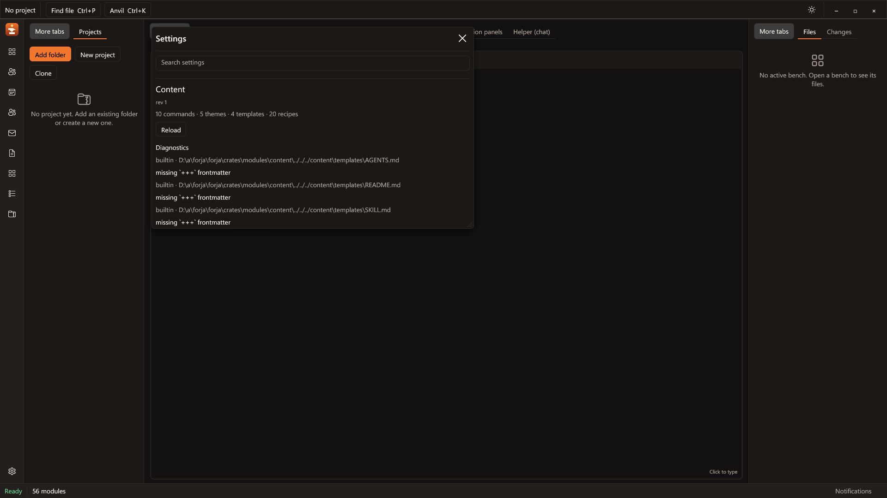

# Ajustes (janela modal "Settings")

Janela modal de configurações da Forja, aberta sobre a tela principal, mostrando a seção "Content" com o resumo do acervo embutido e os diagnósticos dos modelos de conteúdo. Variante em inglês (en) da página de referência pt-BR.dark.settings.content; a captura desta variante tem 1920×1080 px (a de referência, 1280×800), portanto todas as coordenadas mudam de escala e posição.

## Como chegar
Na tela principal, clique no botão "Settings" (ícone de engrenagem) na base do trilho à esquerda (8,1004)–(44,1040); a janela "Settings" abre centralizada sobre a área central. Comando de captura: `forja-app --locale en --theme dark --settings content`.

## Regiões
- **Barra superior** (0,0)–(1920,42): pílula "No project" à esquerda, botões "Find file  Ctrl+P" e "Anvil  Ctrl+K", ícone de tema (sol) e os botões de janela "–", "□", "×" à direita.
- **Trilho à esquerda** (0,42)–(52,1048): logotipo laranja no topo (12,50)–(40,78) e coluna de botões-ícone ("Board", "Helpers", "Routines", "Muster", "Requests", "Skills", "Usage", "Extensions", "Archive" e, na base, "Settings"), com nomes acessíveis mas sem rótulo visível.
- **Painel esquerdo (Projects)** (52,42)–(304,1048): faixa de abas com o botão "More tabs" e a aba "Projects" (marcada, com sublinhado laranja), botões "Add folder" (laranja), "New" e "Clone", ícone de pasta e o texto "No project yet. Add an existing folder or create a new one.".
- **Divisores** (304,42)–(320,1048) e (1612,42)–(1628,1048): separadores arrastáveis entre os painéis.
- **Área central** (320,42)–(1612,1048): faixa de abas no topo ("Terminal", "Editor", "Browser", "Changes", "Preview", "Bench", "Review", "History", "Extension panels", "Helper (chat)") e um grande painel de terminal vazio (328,150)–(1604,1036) com o aviso "Click to type" no canto inferior direito; a maior parte fica encoberta pela janela "Settings".
- **Janela modal "Settings"** (328,58)–(1026,496): barra de título com o rótulo "Settings" e o botão "Close window" (×) à direita, campo de busca "Search settings", título "Content", contagem "rev 1" e "10 commands · 5 themes · 4 templates · 20 recipes", botão "Reload" e a seção "Diagnostics" com pares de caminho/mensagem.
- **Painel direito (Files)** (1628,42)–(1920,1048): botão "More tabs" e abas "Files" (marcada) e "Changes"; abaixo, ícone de grade e o texto "No active bench. Open a bench to see its files.".
- **Barra de status** (0,1048)–(1920,1080): "Ready" em verde e "56 modules" à esquerda, "Notifications" à direita.

## Elementos
| Elemento | Tipo | Posição (px) | Estado | O que faz |
|---|---|---|---|---|
| "No project" | Label | (11,12)–(77,31) | — | Indica que não há projeto aberto; clicável. |
| "Find file  Ctrl+P" | Button | (99,5)–(218,37) | — | Abre a busca rápida de arquivos (atalho Ctrl+P). |
| "Anvil  Ctrl+K" | Button | (226,5)–(327,37) | — | Abre a paleta de comandos (atalho Ctrl+K). |
| (sem nome acessível) | Unknown | (1741,5)–(1773,37) | — | Ícone de sol para alternar o tema, no canto superior direito. |
| "–" | Button | (1795,5)–(1827,37) | — | Minimiza a janela. |
| "□" | Button | (1835,5)–(1867,37) | — | Maximiza/restaura a janela. |
| "×" | Button | (1875,5)–(1909,37) | — | Fecha a janela do app. |
| (sem nome acessível) | Image | (12,50)–(40,78) | — | Logotipo da Forja no topo do trilho. |
| "More tabs" | Button | (64,50)–(151,85) | — | Abre a lista de abas recolhidas da faixa esquerda; à esquerda de "Projects". |
| "Projects" | Button | (159,52)–(231,84) | marcado=True | Aba ativa do painel esquerdo, com sublinhado laranja. |
| "More tabs" | Button | (324,50)–(411,85) | — | Abre a lista de abas recolhidas da faixa central; encoberto pela modal. |
| "Terminal" | Button | (419,52)–(496,84) | marcado=True | Aba do terminal na faixa central; encoberta pela modal. |
| "Editor" | Button | (496,52)–(556,84) | marcado=False | Aba do editor; encoberta pela modal. |
| "Browser" | Button | (556,52)–(629,84) | marcado=False | Aba do navegador de arquivos; encoberta pela modal. |
| "Changes" | Button | (629,52)–(706,84) | marcado=False | Aba de difusão (diff); encoberta pela modal. |
| "Preview" | Button | (706,52)–(777,84) | marcado=False | Aba do visualizador; encoberta pela modal. |
| "Bench" | Button | (777,52)–(838,84) | marcado=False | Aba da bancada; encoberta pela modal. |
| "Review" | Button | (838,52)–(905,84) | marcado=False | Aba de revisão; encoberta pela modal. |
| "History" | Button | (905,52)–(973,84) | marcado=False | Aba de histórico; encoberta pela modal. |
| "Extension panels" | Button | (973,52)–(1099,84) | marcado=False | Aba de painéis de extensões da faixa central; parcialmente encoberta pela modal. |
| "Helper (chat)" | Button | (1099,52)–(1202,84) | marcado=False | Aba do chat do ajudante; encoberta pela modal. |
| "More tabs" | Button | (1632,50)–(1719,85) | — | Abre a lista de abas recolhidas da faixa direita; à esquerda de "Files". |
| "Files" | Button | (1727,52)–(1778,84) | marcado=True | Aba ativa do painel direito, com sublinhado laranja. |
| "Changes" | Button | (1778,52)–(1855,84) | marcado=False | Aba de mudanças do projeto. |
| (sem nome acessível) | Unknown | (339,51)–(1016,67) | — | Faixa superior da área central (borda/rolagem da faixa de abas). |
| "Settings" | Window | (328,58)–(1026,496) | foco | Janela modal de configurações em primeiro plano. |
| "Close window" | Button | (985,67)–(1017,99) | — | Ícone × que fecha a janela de ajustes. |
| (sem nome acessível) | Unknown | (321,69)–(337,486) | — | Borda esquerda da modal (redimensionar). |
| (sem nome acessível) | Unknown | (1018,69)–(1034,486) | — | Borda direita da modal (redimensionar). |
| "Settings" | Label | (337,71)–(403,95) | — | Rótulo do título da janela modal, no canto esquerdo da barra de título. |
| "Board" | Button | (8,94)–(44,130) | marcado=False | Botão-ícone do quadro geral (kanban) no trilho. |
| "Add folder" | Button | (64,101)–(154,133) | — | Adiciona uma pasta de projeto ao acervo; destaque laranja. |
| "New" | Button | (162,101)–(213,133) | — | Cria um novo projeto. |
| "Clone" | Button | (221,101)–(280,133) | — | Clona um repositório para o acervo de projetos. |
| "+" | Button | (407,113)–(441,145) | — | Abre novo terminal (na faixa central, sob a modal). |
| (sem nome acessível) | Unknown | (444,113)–(476,145) | — | Botão-ícone da faixa de terminais, sem rótulo. |
| (sem nome acessível) | Unknown | (479,113)–(511,145) | — | Botão-ícone da faixa de terminais, sem rótulo. |
| (sem nome acessível) | Unknown | (514,113)–(546,145) | — | Botão-ícone da faixa de terminais, sem rótulo. |
| (sem nome acessível) | Unknown | (549,113)–(581,145) | — | Botão-ícone da faixa de terminais, sem rótulo. |
| "Recipes" | Button | (584,113)–(655,145) | — | Abre a lista de receitas; encoberto pela modal. |
| "Shell" | Button | (658,113)–(711,145) | — | Abre um shell; encoberto pela modal. |
| (ícone) | Label | (1756,117)–(1784,145) | — | Ícone de grade do painel de arquivos, à direita. |
| (sem nome acessível) | Unknown | (328,118)–(404,140) | — | Elemento da modal sobre o campo de busca (provável área de rolagem). |
| (sem nome acessível) | TextInput | (337,121)–(1017,153) | — | Campo de busca com o texto de apoio "Search settings". |
| (sem nome acessível) | Unknown | (385,121)–(401,137) | — | Pequeno elemento dentro do campo de busca (provável ícone de lupa). |
| "Helpers" | Button | (8,138)–(44,174) | marcado=False | Botão-ícone dos ajudantes (agentes de IA). |
| (sem nome acessível) | Unknown | (328,150)–(1604,1036) | — | Área do terminal na região central, vazia, com o aviso "Click to type". |
| "No active bench. Open a bench to see its files." | Label | (1644,153)–(1896,191) | — | Mensagem do painel de arquivos quando não há bancada aberta. |
| (ícone) | Label | (168,161)–(196,189) | — | Ícone de pasta ilustrando o estado vazio do painel de projetos. |
| "Content" | Label | (337,181)–(400,205) | — | Título da seção de ajustes exibida. |
| "Routines" | Button | (8,182)–(44,218) | marcado=False | Botão-ícone das rotinas no trilho. |
| "No project yet. Add an existing folder or create a new one." | Label | (67,197)–(297,235) | — | Estado vazio do painel de projetos, em duas linhas. |
| "rev 1" | Label | (337,213)–(361,229) | — | Versão/geração do conteúdo embutido. |
| "Muster" | Button | (8,226)–(44,262) | marcado=False | Botão-ícone do mutirão (lista de agentes em ação). |
| "10 commands · 5 themes · 4 templates · 20 recipes" | Label | (337,237)–(645,256) | — | Resumo do acervo de conteúdo carregado. |
| "Reload" | Button | (337,264)–(403,296) | — | Recarrega o conteúdo (comandos, temas, modelos, receitas). |
| "Requests" | Button | (8,270)–(44,306) | marcado=False | Botão-ícone dos pedidos (solicitações) no trilho. |
| "Diagnostics" | Label | (337,310)–(408,329) | — | Título da lista de problemas do conteúdo. |
| "Skills" | Button | (8,314)–(44,350) | marcado=False | Botão-ícone das skills no trilho. |
| "builtin · D:\a\forja\forja\crates\modules\content\../../../content\templates\AGENTS.md" | Label | (337,337)–(864,356) | — | Caminho do modelo AGENTS.md examinado pelo diagnóstico. |
| (sem nome acessível) | Unknown | (337,337)–(867,487) | — | Área de rolagem da lista de diagnósticos. |
| (sem nome acessível) | Unknown | (865,337)–(867,487) | — | Barra de rolagem vertical da lista de diagnósticos. |
| "missing `+++` frontmatter" | Label | (337,364)–(499,383) | — | Diagnóstico: falta frontmatter `+++` no arquivo. |
| "builtin · D:\a\forja\forja\crates\modules\content\../../../content\templates\README.md" | Label | (337,391)–(867,410) | — | Caminho do README.md examinado. |
| "Usage" | Button | (8,358)–(44,394) | marcado=False | Botão-ícone de uso/consumo no trilho. |
| "Extensions" | Button | (8,402)–(44,438) | marcado=False | Botão-ícone das extensões no trilho. |
| "missing `+++` frontmatter" | Label | (337,418)–(499,437) | — | Diagnóstico repetido para o README.md. |
| "builtin · D:\a\forja\forja\crates\modules\content\../../../content\templates\SKILL.md" | Label | (337,445)–(845,464) | — | Caminho do modelo SKILL.md examinado. |
| "Archive" | Button | (8,446)–(44,482) | marcado=False | Botão-ícone do acervo de conteúdo no trilho. |
| "missing `+++` frontmatter" | Label | (337,472)–(499,491) | — | Diagnóstico repetido para o SKILL.md. |
| (sem nome acessível) | Unknown | (319,486)–(339,506) | — | Canto inferior esquerdo da modal (redimensionar). |
| (sem nome acessível) | Unknown | (1016,486)–(1036,506) | — | Canto inferior direito da modal (redimensionar). |
| (sem nome acessível) | Unknown | (339,488)–(1016,504) | — | Borda inferior da modal (redimensionar). |
| (sem nome acessível) | Unknown | (304,42)–(320,1048) | — | Divisor vertical entre o painel esquerdo e a área central. |
| (sem nome acessível) | Unknown | (1612,42)–(1628,1048) | — | Divisor vertical entre a área central e o painel direito. |
| (sem nome acessível) | Unknown | (319,49)–(339,69) | — | Canto superior esquerdo da área central (rolagem). |
| (sem nome acessível) | Unknown | (1016,49)–(1036,69) | — | Canto superior direito da área central (rolagem). |
| "Settings" | Button | (8,1004)–(44,1040) | marcado=False | Botão-ícone de engrenagem que abre esta janela; na base do trilho. |
| "Ready" | Label | (10,1055)–(48,1074) | — | Status geral do app, em verde. |
| "56 modules" | Label | (70,1055)–(142,1074) | — | Quantidade de módulos carregados. |
| "Notifications" | Label | (1808,1055)–(1886,1074) | — | Área de notificações na barra de status. |

## Aparência
Tema escuro, idêntico ao da referência pt-BR: fundo geral marrom-escuro quase preto (aprox. #1c1917), painéis e modal em tons ligeiramente mais claros, barra de título da modal em cinza-escuro. Destaque laranja (identidade "Brasa") no logotipo, no botão "Add folder" e no sublinhado das abas marcadas ("Projects" e "Files"); "Ready" na barra de status em verde discreto. Tipografia sem serifa, cerca de 13–15 px nesta resolução, com hierarquia por peso: títulos ("Settings", "Content", "Diagnostics") em branco e corpo secundário ("rev 1", contagens, caminhos, mensagens de estado vazio) em cinza médio. Espaçamento regular de 8–16 px; modal centralizada sobre a área central; alturas de botão consistentes (32 px na barra superior, 32–36 px nas faixas de abas).

## O que muda em relação à referência (pt-BR.dark.settings.content)
- Todos os textos da interface aparecem em inglês: "No project", "Find file  Ctrl+P", "Anvil  Ctrl+K" (em vez de "Bigorna"), abas "Projects", "Terminal", "Editor", "Browser", "Changes", "Preview", "Bench", "Review", "History", "Extension panels", "Helper (chat)", "Files"; na modal, "Search settings", "Content", "Reload", "Diagnostics"; estados vazios "No project yet…" e "No active bench…"; barra de status "Ready", "56 modules", "Notifications". As mensagens de diagnóstico "missing `+++` frontmatter" estão em inglês, coerentes com este idioma (na variante pt-BR eram um defeito de tradução).
- A contagem do acervo diz "4 templates" onde a referência diz "4 modelos".
- A captura tem 1920×1080 px (referência: 1280×800), então todos os retângulos mudam; o botão "Settings" do trilho fica em (8,1004)–(44,1040) e a barra de status em y≈1055.
- Nas faixas de abas esquerda e direita aparecem botões "More tabs" ("More tabs" (64,50) antes de "Projects"; "More tabs" (1632,50) antes de "Files"): as abas excedentes estão recolhidas, o que elimina, nesta variante, a sobreposição de abas vista na referência ("Busca"/"Portas"/"Painéis de extensões").
- O painel direito mostra apenas "Files" e "Changes"; as demais abas ficam atrás de "More tabs".

## Problemas encontrados
- Botão-ícone de tema (1741,5)–(1773,37) na barra superior sem nome acessível.
- Os três botões "More tabs" têm o mesmo nome acessível em faixas diferentes, sem indicar qual faixa representam.
- Grupo de quatro botões-ícone sem rótulo (444–581,113–145) na faixa de terminais, totalmente encobertos pela modal.
- A modal encobre a faixa de abas central, incluindo a aba ativa "Terminal" (marcada), e os botões "More tabs", "Recipes" e "Shell" dessa faixa.
- A aba "Helper (chat)" (1099,52)–(1202,84) da faixa central só aparece parcialmente à direita da modal; "Extension panels" (973,52)–(1099,84) fica cortada pela borda da modal.
- O texto visível "Click to type" no rodapé da área central (aprox. 1530,1017–1600,1030) não corresponde a nenhum elemento nomeado na árvore de acessibilidade.
- Caminhos dos diagnósticos exibidos com separadores misturados e trecho relativo cru ("…\modules\content\../../../content\templates\…"), difíceis de ler.
- Textos secundários em cinza médio sobre fundo escuro (por exemplo, "rev 1" e os caminhos dos diagnósticos) têm contraste baixo.
- O rodapé da lista de diagnósticos ("missing `+++` frontmatter" em (337,472)–(499,491)) encosta na borda inferior da janela modal (496 px), sem folga visível.
