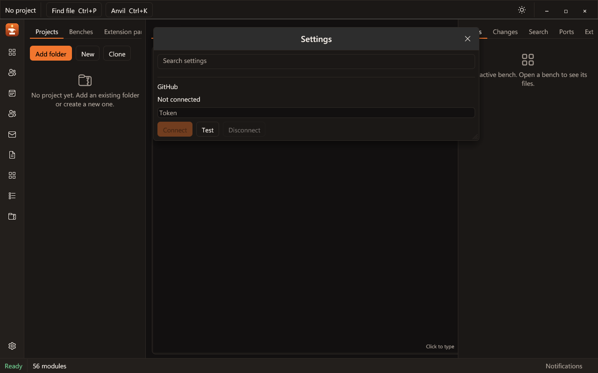

# Settings — GitHub (token de conexão)

Tela de configuração exibida como janela modal "Settings" sobre a área de trabalho, aberta na seção GitHub, onde se informa um token para conectar a conta (alvo `counter_github`), com estado "Not connected".

Variante em inglês (`en`, tema dark) da página de referência pt-BR.dark.settings.counter_github: mesma estrutura e cores; mudam os textos da interface, exibidos em inglês ("Settings", "Not connected", "Connect" etc.), e as coordenadas, pois esta captura tem 1920×1080 px (a de referência, 1280 px de largura).

## Como chegar
Na janela principal, clique no botão "Settings" no trilho de ícones à esquerda (parte inferior) e selecione a seção GitHub; ou abra o app já direto na seção com o comando de captura `forja-app --locale en --theme dark --settings counter_github`.

## Regiões
- **Barra superior** (0,0)–(1920,42): rótulo "No project" à esquerda, botões "Find file  Ctrl+P" e "Anvil  Ctrl+K", ícone de sol (tema) e os botões de janela "–", "□", "×" à direita.
- **Trilho à esquerda** (0,42)–(56,1048): coluna de ícones com os botões "Board", "Helpers", "Routines", "Muster", "Requests", "Skills", "Usage", "Extensions", "Archive" e, no rodapé, "Settings".
- **Painel lateral esquerdo** (56,42)–(304,1048): logotipo (bigorna laranja), botão "More tabs", aba "Projects" (ativa), botões "Add folder" (laranja), "New" e "Clone"; estado vazio com ícone de pasta e a mensagem "No project yet. Add an existing folder or create a new one.".
- **Área central** (320,42)–(1612,1048): faixa de abas ("Terminal" ativa, "Editor", "Browser", "Changes", "Preview", "Bench", "Review", "History", "Extension panels", "Helper (chat)"), barra de ferramentas ("+", ícones, "Recipes", "Shell") e editor com a dica "Click to type" no canto inferior direito; o topo fica encoberto pelo modal.
- **Painel direito** (1628,42)–(1920,1048): botão "More tabs", abas "Files" (ativa) e "Changes", ícone de grade e a mensagem "No active bench. Open a bench to see its files.".
- **Barra de status** (0,1048)–(1920,1080): "Ready" (em verde) e "56 modules" à esquerda; "Notifications" à direita.
- **Janela modal "Settings"** (328,58)–(1026,307): título "Settings" com botão "Close window", campo de busca ("Search settings"), seção "GitHub" com status "Not connected", campo de token e botões "Connect" (desativado), "Test" e "Disconnect" (desativado).

## Elementos
| Elemento | Tipo | Posição (px) | Estado | O que faz |
|---|---|---|---|---|
| "No project" | Label | (11,12)–(77,31) | — | Indica que não há projeto aberto. |
| "Find file  Ctrl+P" | Button | (99,5)–(218,37) | — | Busca rápida de arquivos (atalho Ctrl+P). |
| "Anvil  Ctrl+K" | Button | (226,5)–(327,37) | — | Paleta de comandos (atalho Ctrl+K). |
| (sem nome acessível) | Unknown | (1741,5)–(1773,37) | — | Ícone de sol: alternância de tema claro/escuro. |
| "–" | Button | (1795,5)–(1827,37) | — | Minimizar janela. |
| "□" | Button | (1835,5)–(1867,37) | — | Maximizar/restaurar janela. |
| "×" | Button | (1875,5)–(1909,37) | — | Fechar janela. |
| (sem nome acessível) | Image | (12,50)–(40,78) | — | Logotipo da Forja (bigorna laranja). |
| "More tabs" | Button | (64,50)–(151,85) | — | Menu de abas restantes do painel esquerdo. |
| "Projects" | Button | (159,52)–(231,84) | marcado=True | Aba ativa do painel esquerdo. |
| "More tabs" | Button | (324,50)–(411,85) | — | Menu de abas restantes da área central; encoberto pelo modal (só uma faixa no topo aparece). |
| "Terminal" | Button | (419,52)–(496,84) | marcado=True | Aba do terminal, encoberta pelo modal. |
| "Editor" | Button | (496,52)–(556,84) | marcado=False | Aba do editor de texto. |
| "Browser" | Button | (556,52)–(629,84) | marcado=False | Aba do navegador de projeto. |
| "Changes" | Button | (629,52)–(706,84) | marcado=False | Aba de mudanças pendentes da área central. |
| "Preview" | Button | (706,52)–(777,84) | marcado=False | Aba de visualização de arquivos. |
| "Bench" | Button | (777,52)–(838,84) | marcado=False | Aba da bancada ativa. |
| "Review" | Button | (838,52)–(905,84) | marcado=False | Aba de revisão. |
| "History" | Button | (905,52)–(973,84) | marcado=False | Aba de histórico. |
| "Extension panels" | Button | (973,52)–(1099,84) | marcado=False | Aba de painéis de extensões da área central; parcialmente encoberta pelo modal (vê-se "…ion panels"). |
| "Helper (chat)" | Button | (1099,52)–(1202,84) | marcado=False | Aba do chat com ajudantes. |
| "More tabs" | Button | (1632,50)–(1719,85) | — | Menu de abas restantes do painel direito. |
| "Files" | Button | (1727,52)–(1778,84) | marcado=True | Aba ativa do painel direito (arquivos da bancada). |
| "Changes" | Button | (1778,52)–(1855,84) | marcado=False | Aba de mudanças do painel direito. |
| "Settings" | Window | (328,58)–(1026,307) | focus | Janela modal de configurações. |
| "Close window" | Button | (985,67)–(1017,99) | — | Botão × do modal para fechar a janela de configurações. |
| "Settings" | Label | (337,71)–(403,95) | — | Título do modal (clicável). |
| "Board" | Button | (8,94)–(44,130) | marcado=False | Botão-ícone do quadro no trilho esquerdo. |
| "Add folder" | Button | (64,101)–(154,133) | — | Abre seletor para adicionar um projeto existente (destaque laranja). |
| "New" | Button | (162,101)–(213,133) | — | Cria um projeto novo. |
| "Clone" | Button | (221,101)–(280,133) | — | Clona um repositório. |
| "+" | Button | (407,113)–(441,145) | — | Botão de adicionar da barra do editor (atrás do modal). |
| (sem nome acessível) | Unknown | (444,113)–(476,145) | — | Ícone de ferramenta da barra do editor (atrás do modal). |
| (sem nome acessível) | Unknown | (479,113)–(511,145) | — | Ícone de ferramenta da barra do editor (atrás do modal). |
| (sem nome acessível) | Unknown | (514,113)–(546,145) | — | Ícone de ferramenta da barra do editor (atrás do modal). |
| (sem nome acessível) | Unknown | (549,113)–(581,145) | — | Ícone de ferramenta da barra do editor (atrás do modal). |
| "Recipes" | Button | (584,113)–(655,145) | — | Aba/painel de receitas da área central (atrás do modal). |
| "Shell" | Button | (658,113)–(711,145) | — | Aba/painel de shell da área central (atrás do modal). |
| (ícone) | Label | (1756,117)–(1784,145) | — | Ícone de grade no topo do painel direito. |
| (sem nome acessível) | TextInput | (337,121)–(1017,153) | — | Campo "Search settings" (placeholder visível) para filtrar seções. |
| "Helpers" | Button | (8,138)–(44,174) | marcado=False | Botão-ícone de ajudantes. |
| "No active bench. Open a bench to see its files." | Label | (1644,153)–(1896,191) | — | Mensagem de estado vazio do painel de arquivos. |
| (ícone) | Label | (168,161)–(196,189) | — | Ícone de pasta do estado vazio do painel esquerdo. |
| "GitHub" | Label | (337,181)–(380,200) | — | Título da seção de conexão com o GitHub. |
| "Routines" | Button | (8,182)–(44,218) | marcado=False | Botão-ícone de rotinas. |
| "No project yet. Add an existing folder or create a new one." | Label | (67,197)–(297,235) | — | Mensagem de estado vazio do painel de projetos. |
| "Not connected" | Label | (337,208)–(428,227) | — | Estado atual da integração. |
| "Muster" | Button | (8,226)–(44,262) | marcado=False | Botão-ícone do mutirão. |
| (sem nome acessível) | PasswordInput | (337,235)–(1017,258) | — | Campo de token, com placeholder "Token", texto oculto. |
| "Connect" | Button | (337,266)–(412,298) | desativado | Salvaria e validaria o token; inativo enquanto o campo está vazio. |
| "Test" | Button | (420,266)–(469,298) | — | Testa o token informado. |
| "Disconnect" | Button | (477,266)–(568,298) | desativado | Removeria a conexão; inativo por não haver conexão. |
| "Requests" | Button | (8,270)–(44,306) | marcado=False | Botão-ícone de pedidos. |
| "Skills" | Button | (8,314)–(44,350) | marcado=False | Botão-ícone de skills. |
| "Usage" | Button | (8,358)–(44,394) | marcado=False | Botão-ícone de uso. |
| "Extensions" | Button | (8,402)–(44,438) | marcado=False | Botão-ícone de extensões. |
| "Archive" | Button | (8,446)–(44,482) | marcado=False | Botão-ícone do acervo. |
| "Settings" | Button | (8,1004)–(44,1040) | marcado=False | Botão-ícone que abre esta tela de configurações. |
| "Ready" | Label | (10,1055)–(48,1074) | — | Status geral na barra inferior (texto verde). |
| "56 modules" | Label | (70,1055)–(142,1074) | — | Quantidade de módulos carregados. |
| "Notifications" | Label | (1808,1055)–(1886,1074) | — | Acesso a notificações. |

Elementos sem nome da árvore, pelos retângulos: divisores verticais entre painéis em (304,42)–(320,1048) e (1612,42)–(1628,1048); alças de redimensionamento do modal nos cantos (319,49)–(339,69) e (1016,49)–(1036,69), nas laterais (321,69)–(337,297) e (1018,69)–(1034,297) e na base (319,297)–(339,317), (1016,297)–(1036,317); faixa de título do modal em (339,51)–(1016,67) e borda inferior em (339,299)–(1016,315); resíduos de controles ocultos atrás do modal em (328,118)–(404,140) e (385,121)–(401,137); área do editor atrás e ao redor do modal em (328,150)–(1604,1036), com a dica "Click to type" visível no canto inferior direito.

## Aparência
Idêntica à da referência pt-BR (mesmo tema dark): fundo marrom-carvão na janela e painéis em tons próximos; o modal "Settings" usa fundo cinza-escuro com faixa de título e sombra projetada. Cor de destaque laranja no logotipo da bigorna, no botão primário "Add folder", nos sublinhados das abas ativas ("Projects", "Files") e no botão desativado "Connect" (laranja escurecido). Botões secundários ("New", "Clone", "Test") têm contorno cinza sutil. Tipografia sem serifa em dois tamanhos: título do modal e rótulos de seção ("GitHub", "Not connected", "Token") maiores; abas, botões e barra de status menores. Campos de busca e token ocupam quase toda a largura do modal, alinhados à esquerda em x=337; os três botões de ação formam uma fileira sob o campo. Estados vazios dos painéis usam texto cinza centralizado com ícone acima. Ícones do trilho esquerdo em cinza claro, uniformes, em colunas de 36 px. Diferença de texto: todos os rótulos em inglês; "Ready" aparece em verde na barra de status.

## Problemas encontrados
- O campo de busca e o campo de token não têm nome acessível (dependem apenas dos placeholders "Search settings" e "Token").
- O ícone de tema (sol) da barra superior, os quatro botões-ícone da barra do editor (444–581 px) e o logotipo (Image) estão sem nome acessível.
- O modal sobrepõe o "More tabs" da área central, as abas de "Terminal" a "Extension panels" (esta só aparece como "…ion panels"), a barra de ferramentas do editor ("+", ícones, "Recipes", "Shell") e o topo da área de edição.
- Os retângulos de controles ocultos atrás do modal, (328,118)–(404,140) e (385,121)–(401,137), se sobrepõem ao retângulo do campo de busca do próprio modal.
- Texto "Click to type" visível na área central sem elemento correspondente na árvore de acessibilidade.
- Textos de apoio em cinza médio sobre fundo escuro (placeholders "Search settings" e "Token", "Not connected", mensagens de estado vazio e a dica "Click to type") têm contraste baixo; os botões desativados "Connect" e "Disconnect" também perdem contraste.
