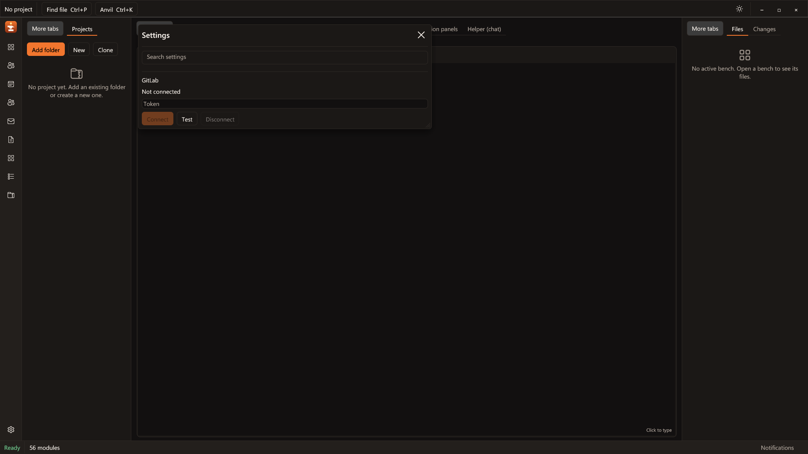

# Configurações do contador GitLab (janela "Settings")

Tela de configuração do contador GitLab, aberta como janela flutuante "Settings" sobre a área de trabalho, para informar o token de acesso e conectar/desconectar a conta.

Variante em inglês (locale `en`) da página de referência pt-BR, capturada em 1920×1080 px (a referência, 1280×800): todos os textos da interface passam ao inglês ("No project", "Add folder", "Not connected", "Ready" etc.); o título do modal fica alinhado à esquerda (na referência, centralizado); as faixas de abas dos três painéis ganham botões de estouro "More tabs"; o painel direito mostra só as abas "Files" e "Changes" e nenhuma aba transborda a largura da janela (na referência, "Painéis de extensões" ultrapassava 1280 px); "Close window" é consistente com o locale `en` (na referência pt-BR constava sem tradução). Cores e contraste seguem a referência (tema `dark`).

## Como chegar
Na janela principal, clicar no botão "Settings" (ícone de engrenagem no rodapé do trilho de ícones, à esquerda); a janela "Settings" abre sobre a área central já na seção "GitLab". Comando de captura: `forja-app --locale en --theme dark --settings counter_gitlab`.

## Regiões
- **Barra superior (título):** (0,0)–(1920,42). Rótulo "No project" à esquerda; botões "Find file  Ctrl+P" e "Anvil  Ctrl+K"; à direita, ícone de sol/tema (sem nome acessível, ~1741–1773 px) e os botões de janela "–", "□" e "×".
- **Trilho de ícones à esquerda:** (0,42)–(52,1048). Logotipo do app (imagem, 12–40 px) no topo e os botões-ícone "Board", "Helpers", "Routines", "Muster", "Requests", "Skills", "Usage", "Extensions" e "Archive"; "Settings" fixado no rodapé (8,1004).
- **Painel esquerdo (Projects):** (52,42)–(304,1048). Botão "More tabs" e aba "Projects" (ativa, sublinhada); botões "Add folder" (destaque laranja), "New" e "Clone"; estado vazio com ícone de pasta (168,161)–(196,189) e o texto "No project yet. Add an existing folder or create a new one.".
- **Área central:** (320,42)–(1612,1048). Barra de abas ("More tabs", "Terminal" ativa, "Editor", "Browser", "Changes", "Preview", "Bench", "Review", "History", "Extension panels", "Helper (chat)"), barra de ferramentas com "+", quatro botões-ícone sem nome, "Recipes" e "Shell", e um painel de terminal vazio (328,150)–(1604,1036) com o texto "Click to type" no canto inferior direito (~1536–1598 px, y≈1023). A maior parte desta região está encoberta pela janela "Settings".
- **Janela "Settings" (modal):** (328,58)–(1026,307). Título "Settings" à esquerda com botão "Close window" (×) à direita; campo de busca "Search settings"; seção "GitLab" com status "Not connected", campo "Token" (senha) e botões "Connect" (desativado), "Test" e "Disconnect" (desativado); pegada de redimensionamento em hachura no canto inferior direito.
- **Painel direito:** (1628,42)–(1920,1048). Botão "More tabs" e abas "Files" (ativa, sublinhada) e "Changes"; ícone de grade (~1756–1784 px) e a mensagem "No active bench. Open a bench to see its files.".
- **Barra de status:** (0,1048)–(1920,1080). "Ready" (em verde), "56 modules" e "Notifications" à direita.

## Elementos
| Elemento | Tipo | Posição (px) | Estado | O que faz |
|---|---|---|---|---|
| "Find file  Ctrl+P" | Button | (99,5)–(218,37) | — | Abre a busca rápida de arquivos (atalho Ctrl+P). |
| "Anvil  Ctrl+K" | Button | (226,5)–(327,37) | — | Abre a paleta de comandos "Anvil" (atalho Ctrl+K). |
| (sem nome acessível) | Unknown | (1741,5)–(1773,37) | clique, foco | Ícone de sol; alterna tema claro/escuro. |
| "–" | Button | (1795,5)–(1827,37) | — | Minimiza a janela. |
| "□" | Button | (1835,5)–(1867,37) | — | Maximiza/restaura a janela. |
| "×" | Button | (1875,5)–(1909,37) | — | Fecha a janela do app. |
| "No project" | Label | (11,12)–(77,31) | — | Indica que não há projeto aberto. |
| (sem nome acessível) | Unknown | (304,42)–(320,1048) | foco | Divisor vertical entre o painel esquerdo e a área central. |
| (sem nome acessível) | Unknown | (1612,42)–(1628,1048) | foco | Divisor vertical entre a área central e o painel direito. |
| (sem nome acessível) | Unknown | (319,49)–(339,69) | foco | Canto superior esquerdo da janela "Settings" (arraste/redimensionamento). |
| (sem nome acessível) | Unknown | (1016,49)–(1036,69) | foco | Canto superior direito da janela "Settings". |
| (sem nome acessível) | Image | (12,50)–(40,78) | clique, foco | Logotipo da Forja (bigorna laranja) no topo do trilho. |
| "More tabs" | Button | (64,50)–(151,85) | clique, foco | Estouro de abas do painel esquerdo; revela abas ocultas da faixa. |
| "More tabs" | Button | (324,50)–(411,85) | clique, foco | Estouro de abas da área central; praticamente encoberto pelo modal. |
| "More tabs" | Button | (1632,50)–(1719,85) | clique, foco | Estouro de abas do painel direito; revela abas ocultas da faixa. |
| (sem nome acessível) | Unknown | (339,51)–(1016,67) | foco | Barra de título arrastável da janela "Settings". |
| "Projects" | Button | (159,52)–(231,84) | marcado=True | Aba ativa do painel esquerdo; mostra a lista de projetos. |
| "Terminal" | Button | (419,52)–(496,84) | marcado=True | Aba ativa da área central; oculta atrás do modal. |
| "Editor" | Button | (496,52)–(556,84) | marcado=False | Aba do editor; oculta atrás do modal. |
| "Browser" | Button | (556,52)–(629,84) | marcado=False | Aba do navegador; oculta atrás do modal. |
| "Changes" | Button | (629,52)–(706,84) | marcado=False | Aba de mudanças da área central; oculta atrás do modal. |
| "Preview" | Button | (706,52)–(777,84) | marcado=False | Aba de visualização; oculta atrás do modal. |
| "Bench" | Button | (777,52)–(838,84) | marcado=False | Aba da bancada; oculta atrás do modal. |
| "Review" | Button | (838,52)–(905,84) | marcado=False | Aba de revisão; oculta atrás do modal. |
| "History" | Button | (905,52)–(973,84) | marcado=False | Aba de histórico; oculta atrás do modal. |
| "Extension panels" | Button | (973,52)–(1099,84) | marcado=False | Aba de painéis de extensões da área central; parcialmente atrás do modal — só o fragmento "…ion panels" aparece à direita dele. |
| "Helper (chat)" | Button | (1099,52)–(1202,84) | marcado=False | Aba do chat do ajudante de código; visível à direita do modal. |
| "Files" | Button | (1727,52)–(1778,84) | marcado=True | Aba ativa do painel direito. |
| "Changes" | Button | (1778,52)–(1855,84) | marcado=False | Aba de mudanças do painel direito. |
| "Settings" | Window | (328,58)–(1026,307) | foco | Janela flutuante de configurações em foco. |
| "Close window" | Button | (985,67)–(1017,99) | clique, foco | Fecha a janela "Settings" (× no cabeçalho). |
| (sem nome acessível) | Unknown | (321,69)–(337,297) | foco | Borda esquerda de redimensionamento do modal. |
| (sem nome acessível) | Unknown | (1018,69)–(1034,297) | foco | Borda direita de redimensionamento do modal. |
| "Settings" | Label | (337,71)–(403,95) | clique | Título da janela, alinhado à esquerda. |
| "Board" | Button | (8,94)–(44,130) | marcado=False | Botão-ícone do quadro no trilho esquerdo. |
| "Add folder" | Button | (64,101)–(154,133) | clique, foco | Adiciona uma pasta de projeto; botão primário em laranja. |
| "New" | Button | (162,101)–(213,133) | clique, foco | Cria um projeto novo. |
| "Clone" | Button | (221,101)–(280,133) | clique, foco | Clona um repositório para o painel de projetos. |
| "+" | Button | (407,113)–(441,145) | clique, foco | Novo item na área central; oculto atrás do modal. |
| (sem nome acessível) | Unknown | (444,113)–(476,145) | clique, foco | Botão-ícone da barra de ferramentas central; oculto atrás do modal. |
| (sem nome acessível) | Unknown | (479,113)–(511,145) | clique, foco | Botão-ícone da barra de ferramentas central; oculto atrás do modal. |
| (sem nome acessível) | Unknown | (514,113)–(546,145) | clique, foco | Botão-ícone da barra de ferramentas central; oculto atrás do modal. |
| (sem nome acessível) | Unknown | (549,113)–(581,145) | clique, foco | Botão-ícone da barra de ferramentas central; oculto atrás do modal. |
| "Recipes" | Button | (584,113)–(655,145) | clique, foco | Abre receitas; oculto atrás do modal. |
| "Shell" | Button | (658,113)–(711,145) | clique, foco | Abre o shell; oculto atrás do modal. |
| (ícone) | Label | (1756,117)–(1784,145) | clique | Ícone de grade/ilustração do estado vazio do painel direito. |
| (sem nome acessível) | Unknown | (328,118)–(404,140) | clique, foco | Controle da área central; oculto atrás do modal. |
| (sem nome acessível) | TextInput | (337,121)–(1017,153) | clique, foco | Campo de busca de ajustes, com o texto de apoio "Search settings". |
| (sem nome acessível) | Unknown | (385,121)–(401,137) | clique, foco | Ícone dentro do controle anterior; oculto atrás do modal. |
| "Helpers" | Button | (8,138)–(44,174) | marcado=False | Botão-ícone de ajudantes no trilho esquerdo. |
| (sem nome acessível) | Unknown | (328,150)–(1604,1036) | clique, foco | Painel central de fundo (área de terminal vazia), com o texto "Click to type" no canto inferior direito (~1536–1598 px, y≈1023). |
| "No active bench. Open a bench to see its files." | Label | (1644,153)–(1896,191) | clique | Mensagem de estado vazio do painel direito. |
| (ícone) | Label | (168,161)–(196,189) | clique | Ícone de pasta do estado vazio do painel esquerdo. |
| "GitLab" | Label | (337,181)–(376,200) | clique | Título da seção de configuração do contador GitLab. |
| "Routines" | Button | (8,182)–(44,218) | marcado=False | Botão-ícone de rotinas no trilho esquerdo. |
| "No project yet. Add an existing folder or create a new one." | Label | (67,197)–(297,235) | clique | Mensagem de estado vazio do painel de projetos. |
| "Not connected" | Label | (337,208)–(428,227) | clique | Status atual da integração GitLab. |
| "Muster" | Button | (8,226)–(44,262) | marcado=False | Botão-ícone do mutirão no trilho esquerdo. |
| (sem nome acessível) | PasswordInput | (337,235)–(1017,258) | clique, foco | Campo de senha para o token do GitLab (texto de apoio "Token"). |
| "Connect" | Button | (337,266)–(412,298) | desativado | Conecta à conta GitLab; inativo até haver token preenchido. |
| "Test" | Button | (420,266)–(469,298) | clique, foco | Testa o token informado. |
| "Disconnect" | Button | (477,266)–(568,298) | desativado | Desconecta a conta; inativo por não haver conexão. |
| "Requests" | Button | (8,270)–(44,306) | marcado=False | Botão-ícone de pedidos no trilho esquerdo. |
| (sem nome acessível) | Unknown | (319,297)–(339,317) | foco | Canto inferior esquerdo de redimensionamento do modal. |
| (sem nome acessível) | Unknown | (1016,297)–(1036,317) | foco | Pegada de redimensionamento (hachura diagonal) no canto inferior direito do modal. |
| (sem nome acessível) | Unknown | (339,299)–(1016,315) | foco | Borda inferior de redimensionamento do modal. |
| "Skills" | Button | (8,314)–(44,350) | marcado=False | Botão-ícone de skills no trilho esquerdo. |
| "Usage" | Button | (8,358)–(44,394) | marcado=False | Botão-ícone de uso no trilho esquerdo. |
| "Extensions" | Button | (8,402)–(44,438) | marcado=False | Botão-ícone de extensões no trilho esquerdo. |
| "Archive" | Button | (8,446)–(44,482) | marcado=False | Botão-ícone do acervo no trilho esquerdo. |
| "Settings" | Button | (8,1004)–(44,1040) | marcado=False | Botão-ícone de engrenagem que abre esta janela de ajustes. |
| "Ready" | Label | (10,1055)–(48,1074) | clique | Status geral do app, em verde. |
| "56 modules" | Label | (70,1055)–(142,1074) | clique | Quantidade de módulos carregados. |
| "Notifications" | Label | (1808,1055)–(1886,1074) | clique, foco | Área de notificações na barra de status. |

## Aparência
Tema escuro: fundo quase preto com variações de cinza-escuro para painéis, trilho e barra de status; a janela "Settings" é levemente mais clara que o fundo, com sombra e cantos arredondados. Cor de destaque laranja (âmbar) no logotipo, no botão "Add folder", nos sublinhados das abas ativas "Projects" e "Files" (a aba "Terminal", também ativa, está encoberta pelo modal) e no botão "Connect" desativado, com preenchimento âmbar apagado. Texto em cinza-claro sobre fundo escuro, em fonte sem serifa; "Ready" na barra de status em verde. Botões com cantos arredondados e contornos sutis; campos do modal ocupam toda a largura (337–1017 px) com espaçamento vertical regular de ~8–12 px entre as linhas do formulário; título "Settings" alinhado à esquerda (na referência pt-BR era centralizado). O modal é centralizado horizontalmente (328–1026 px) e posicionado no topo da área central.

## Problemas encontrados
- A janela "Settings" sobrepõe a barra de abas central ("Terminal", "Editor", "Browser", "Changes", "Preview", "Bench", "Review" e "History" ficam totalmente encobertas; de "Extension panels" resta só o fragmento "…ion panels" à direita do modal) e a barra de ferramentas central ("+", quatro botões-ícone sem nome, "Recipes", "Shell"); o botão "More tabs" da área central ((324,50)–(411,85)) também fica praticamente inatingível.
- Três botões compartilham o mesmo nome acessível "More tabs" e dois compartilham "Changes" (ambiguidade para leitores de tela).
- Quatro botões-ícone da barra de ferramentas central ((444,113), (479,113), (514,113), (549,113)) estão sem nome acessível, e o texto "Click to type" do painel central não tem elemento acessível correspondente.
- O controle de alternância de tema ((1741,5)–(1773,37), ícone de sol) é um elemento sem nome acessível e sem papel definido (Unknown).
- O botão "Connect" está desativado, mas com preenchimento âmbar que o faz parecer acionável; os botões desativados ("Connect", "Disconnect") têm contraste reduzido.
- Os nomes "Find file  Ctrl+P" e "Anvil  Ctrl+K" contêm espaço duplo entre o rótulo e o atalho.
