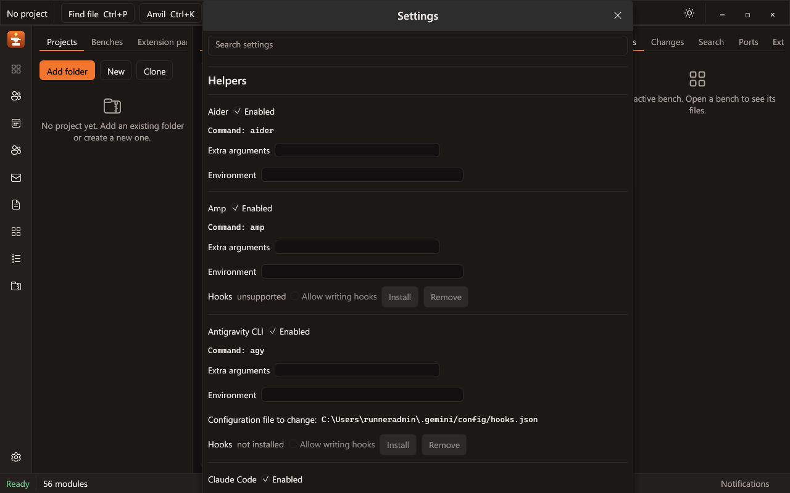

# Settings — Helpers

Variante em inglês (locale en) da tela "Ajustes — Ajudantes": configuração dos ajudantes de código (agentes de IA), para habilitar cada ajudante, definir comando, argumentos extras e ambiente e gerenciar hooks, em uma janela modal compacta sobre a área de trabalho do app.

## Como chegar
Na janela principal, acionar o botão de engrenagem "Settings" no fim do trilho esquerdo (ou o comando de ajustes) e escolher a seção "Helpers"; a captura corresponde ao comando `forja-app --locale en --theme dark --settings helper`.

## Regiões
Captura de 1920×1080 px (a referência pt-BR tem 1280×800; as coordenadas mudam de escala).
- **Janela-mãe (fundo)**: (0,0)–(1920,1080). Barra superior (0,0)–(1920,42) com "No project", "Find file  Ctrl+P", "Anvil  Ctrl+K", ícone de tema (sol) e controles "–", "□", "×"; trilho esquerdo (0,42)–(56,1048) com o logotipo (bigorna laranja) e os botões "Board", "Helpers", "Routines", "Muster", "Requests", "Skills", "Usage", "Extensions", "Archive" e "Settings"; painel de projetos (56,42)–(304,1048) com "More tabs", "Projects", "Add folder", "New", "Clone" e o estado vazio "No project yet. Add an existing folder or create a new one."; separador (304,42)–(320,1048); faixa de abas centrais (320,42)–(1612,90) com "Terminal", "Editor", "Browser", "Changes", "Preview", "Bench", "Review", "History", "Extension panels" e "Helper (chat)" (na maior parte sob o modal); área central (320,90)–(1612,1048) com superfície de trabalho e a dica "Click to type" no canto inferior direito; separador (1612,42)–(1628,1048); painel direito (1628,42)–(1920,1048) com "More tabs", "Files", "Changes", ícone de grade e o aviso "No active bench. Open a bench to see its files."; barra de status (0,1048)–(1920,1080) com "Ready", "56 modules" e "Notifications".
- **Modal "Settings"**: (328,58)–(1026,496) — difere da referência, em que a janela era declarada com 3579 px de altura; aqui é uma janela compacta com rolagem interna. Barra de título com "Settings" e "Close window"; campo de busca "Search settings" (337,121)–(1017,153); área de conteúdo (337,167)–(1017,487) com o título "Helpers" e um cartão por ajudante; garra de redimensionamento no canto inferior direito.
- **Cartão de ajudante (padrão repetido)**: nome + caixa "Enabled"; linha "Command: <cmd>"; campos "Extra arguments" e "Environment"; quando aplicável, linha "Configuration file to change:" com o caminho; seção "Hooks" com estado ("unsupported", "not installed" ou "Loading…"), caixa "Allow writing hooks" e botões "Install"/"Remove".

## Elementos
| Elemento | Tipo | Posição (px) | Estado | O que faz |
|---|---|---|---|---|
| "Find file  Ctrl+P" | Button | (99,5)–(218,37) | — | Abre a busca de arquivos (Ctrl+P) |
| "Anvil  Ctrl+K" | Button | (226,5)–(327,37) | — | Abre a paleta de comandos (Ctrl+K) |
| Ícone de tema/sol (sem nome acessível) | Unknown | (1741,5)–(1773,37) | clique | Alterna o tema |
| "–" | Button | (1795,5)–(1827,37) | — | Minimiza a janela |
| "□" | Button | (1835,5)–(1867,37) | — | Maximiza/restaura a janela |
| "×" | Button | (1875,5)–(1909,37) | — | Fecha a janela-mãe |
| "No project" | Label | (11,12)–(77,31) | clique | Indica que não há projeto aberto |
| Separador vertical esquerdo (sem nome) | Unknown | (304,42)–(320,1048) | — | Divide painel de projetos e área central |
| Separador vertical direito (sem nome) | Unknown | (1612,42)–(1628,1048) | — | Divide área central e painel direito |
| Canto sup. esquerdo do modal (sem nome) | Unknown | (319,49)–(339,69) | foco | Alça de redimensionamento |
| Canto sup. direito do modal (sem nome) | Unknown | (1016,49)–(1036,69) | foco | Alça de redimensionamento |
| Logotipo da Forja (sem nome acessível) | Image | (12,50)–(40,78) | clique | Identidade do app no trilho |
| "More tabs" (painel de projetos) | Button | (64,50)–(151,85) | clique | Abas adicionais do painel esquerdo |
| "More tabs" (centro) | Button | (324,50)–(411,85) | clique | Abas do painel central; encoberto pelo modal |
| "More tabs" (painel direito) | Button | (1632,50)–(1719,85) | clique | Abas adicionais do painel direito |
| Faixa de título do modal (sem nome) | Unknown | (339,51)–(1016,67) | foco | Área de arraste do título |
| "Projects" | Button | (159,52)–(231,84) | marcado=True | Aba ativa do painel esquerdo |
| "Terminal" | Button | (419,52)–(496,84) | marcado=True | Aba do terminal; encoberta pelo modal |
| "Editor" | Button | (496,52)–(556,84) | marcado=False | Aba do editor; encoberta pelo modal |
| "Browser" | Button | (556,52)–(629,84) | marcado=False | Aba do navegador; encoberta pelo modal |
| "Changes" (centro) | Button | (629,52)–(706,84) | marcado=False | Aba de mudanças; encoberta pelo modal |
| "Preview" | Button | (706,52)–(777,84) | marcado=False | Aba de visualização; encoberta pelo modal |
| "Bench" | Button | (777,52)–(838,84) | marcado=False | Aba da bancada; encoberta pelo modal |
| "Review" | Button | (838,52)–(905,84) | marcado=False | Aba de revisão; encoberta pelo modal |
| "History" | Button | (905,52)–(973,84) | marcado=False | Aba de histórico; encoberta pelo modal |
| "Extension panels" (centro) | Button | (973,52)–(1099,84) | marcado=False | Aba de extensões; parcialmente encoberta pelo modal |
| "Helper (chat)" | Button | (1099,52)–(1202,84) | marcado=False | Aba do chat do ajudante |
| "Files" | Button | (1727,52)–(1778,84) | marcado=True | Aba ativa do painel direito |
| "Changes" (direita) | Button | (1778,52)–(1855,84) | marcado=False | Aba de mudanças do painel direito |
| "Settings" | Window | (328,58)–(1026,496) | foco | Janela modal de ajustes |
| "Close window" | Button | (985,67)–(1017,99) | — | Fecha o modal (ícone ×) |
| Borda esquerda do modal (sem nome) | Unknown | (321,69)–(337,486) | foco | Contorno lateral |
| Borda direita do modal (sem nome) | Unknown | (1018,69)–(1034,486) | foco | Contorno lateral |
| "Settings" | Label | (337,71)–(403,95) | clique | Título do modal |
| "Board" | Button | (8,94)–(44,130) | marcado=False | Vai ao quadro (trilho) |
| "Add folder" | Button | (64,101)–(154,133) | clique | Adiciona pasta de projeto (destaque laranja) |
| "New" | Button | (162,101)–(213,133) | clique | Cria um projeto novo |
| "Clone" | Button | (221,101)–(280,133) | clique | Clona um projeto |
| "+" | Button | (407,113)–(441,145) | clique | Adiciona item (sob o modal) |
| Controle sem nome 1 | Unknown | (444,113)–(476,145) | clique | Controle da barra central (sob o modal) |
| Controle sem nome 2 | Unknown | (479,113)–(511,145) | clique | Controle da barra central (sob o modal) |
| Controle sem nome 3 | Unknown | (514,113)–(546,145) | clique | Controle da barra central (sob o modal) |
| Controle sem nome 4 | Unknown | (549,113)–(581,145) | clique | Controle da barra central (sob o modal) |
| "Recipes" | Button | (584,113)–(655,145) | clique | Aba/ação de receitas (sob o modal) |
| "Shell" | Button | (658,113)–(711,145) | clique | Aba/ação de shell (sob o modal) |
| "(ícone)" (grade) | Label | (1756,117)–(1784,145) | clique | Ícone de grade do painel direito, sem rótulo |
| Contorno do campo de busca (sem nome) | Unknown | (328,118)–(404,140) | clique | Segmento junto ao topo do campo de busca |
| Campo "Search settings" (sem nome acessível) | TextInput | (337,121)–(1017,153) | clique | Filtra as seções de ajustes |
| Detalhe interno do campo (sem nome) | Unknown | (385,121)–(401,137) | clique | Pequeno ícone no canto esquerdo do campo |
| "Helpers" | Button | (8,138)–(44,174) | marcado=False | Atalho do trilho para esta seção |
| Superfície central (sem nome) | Unknown | (328,150)–(1604,1036) | clique | Área de trabalho atrás do modal; mostra "Click to type" |
| "No active bench. Open a bench to see its files." | Label | (1644,153)–(1896,191) | clique | Estado vazio do painel direito |
| "(ícone)" (pasta) | Label | (168,161)–(196,189) | clique | Ícone do estado vazio de projetos |
| Área de conteúdo do modal (sem nome) | Unknown | (337,167)–(1017,487) | foco | Superfície rolável com os cartões |
| Barra de rolagem do modal (sem nome) | Unknown | (1015,167)–(1017,487) | clique | Indicador fino de rolagem (2 px) |
| "Helpers" | Label | (337,181)–(399,205) | clique | Título da seção |
| "Routines" | Button | (8,182)–(44,218) | marcado=False | Seção rotinas (trilho) |
| "No project yet. Add an existing folder or create a new one." | Label | (67,197)–(297,235) | clique | Estado vazio do painel de projetos |
| "Muster" | Button | (8,226)–(44,262) | marcado=False | Seção mutirão (trilho) |
| "Enabled" (Aider) | CheckBox | (378,227)–(445,259) | marcado=True | Liga/desliga o ajudante Aider |
| "Aider" | Label | (337,234)–(370,253) | clique | Nome do cartão |
| "Command: aider" | Label | (337,267)–(444,282) | clique | Mostra o comando `aider` (monoespaçado) |
| "Requests" | Button | (8,270)–(44,306) | marcado=False | Seção pedidos (trilho) |
| Campo "Extra arguments" do Aider (sem nome) | TextInput | (445,295)–(713,318) | clique | Argumentos adicionais |
| "Extra arguments" (Aider) | Label | (337,297)–(437,316) | clique | Rótulo do campo |
| "Skills" | Button | (8,314)–(44,350) | marcado=False | Seção skills (trilho) |
| Campo "Environment" do Aider (sem nome) | TextInput | (423,335)–(751,358) | clique | Variáveis de ambiente |
| "Environment" (Aider) | Label | (337,337)–(415,356) | clique | Rótulo do campo |
| "Usage" | Button | (8,358)–(44,394) | marcado=False | Seção uso (trilho) |
| "Enabled" (Amp) | CheckBox | (374,384)–(441,416) | marcado=True | Liga/desliga o ajudante Amp |
| "Amp" | Label | (337,391)–(366,410) | clique | Nome do cartão |
| "Extensions" | Button | (8,402)–(44,438) | marcado=False | Seção extensões (trilho) |
| "Command: amp" | Label | (337,424)–(428,439) | clique | Mostra o comando `amp` |
| "Archive" | Button | (8,446)–(44,482) | marcado=False | Seção acervo (trilho) |
| Campo "Extra arguments" do Amp (sem nome) | TextInput | (445,452)–(713,475) | clique | Argumentos adicionais |
| "Extra arguments" (Amp) | Label | (337,454)–(437,473) | clique | Rótulo do campo |
| Canto inf. esquerdo do modal (sem nome) | Unknown | (319,486)–(339,506) | foco | Alça de redimensionamento |
| Canto inf. direito do modal (sem nome) | Unknown | (1016,486)–(1036,506) | foco | Garra de redimensionamento visível |
| Borda inferior do modal (sem nome) | Unknown | (339,488)–(1016,504) | foco | Contorno inferior |
| Campo "Environment" do Amp (sem nome) | TextInput | (423,492)–(751,515) | clique | Variáveis de ambiente; cortado pela borda do modal |
| "Environment" (Amp) | Label | (337,494)–(415,513) | clique | Rótulo do campo; cortado pela borda do modal |
| "Allow writing hooks" (Amp) | CheckBox | (471,527)–(610,559) | desativado, marcado=False | Autorizaria escrita de hooks (indisponível) |
| "Install" (Amp) | Button | (618,527)–(678,562) | desativado | Instalaria hooks |
| "Remove" (Amp) | Button | (686,527)–(759,562) | desativado | Removeria hooks |
| "Hooks" (Amp) | Label | (337,534)–(376,553) | clique | Rótulo da seção |
| "unsupported" | Label | (384,534)–(463,553) | clique | Estado dos hooks do Amp: sem suporte |
| "Enabled" (Antigravity CLI) | CheckBox | (435,584)–(502,616) | marcado=True | Liga/desliga o ajudante |
| "Antigravity CLI" | Label | (337,591)–(427,610) | clique | Nome do cartão |
| "Command: agy" | Label | (337,624)–(428,639) | clique | Mostra o comando `agy` |
| Campo "Extra arguments" (Antigravity, sem nome) | TextInput | (445,652)–(713,675) | clique | Argumentos adicionais |
| "Extra arguments" (Antigravity) | Label | (337,654)–(437,673) | clique | Rótulo do campo |
| Campo "Environment" (Antigravity, sem nome) | TextInput | (423,692)–(751,715) | clique | Variáveis de ambiente |
| "Environment" (Antigravity) | Label | (337,694)–(415,713) | clique | Rótulo do campo |
| "Configuration file to change:" (Antigravity) | Label | (337,734)–(513,753) | clique | Avisa qual arquivo os hooks tocam |
| "C:\Users\runneradmin\.gemini/config/hooks.json" | Label | (521,736)–(871,751) | clique | Caminho do arquivo (monoespaçado) |
| "Allow writing hooks" (Antigravity) | CheckBox | (468,767)–(607,799) | desativado, marcado=False | Autorização de hooks |
| "Install" (Antigravity) | Button | (615,767)–(675,802) | desativado | Instalaria hooks |
| "Remove" (Antigravity) | Button | (683,767)–(756,802) | desativado | Removeria hooks |
| "Hooks" (Antigravity) | Label | (337,774)–(376,793) | clique | Rótulo da seção |
| "not installed" (Antigravity) | Label | (384,774)–(460,793) | clique | Estado: hooks não instalados |
| "Enabled" (Claude Code) | CheckBox | (423,824)–(491,856) | marcado=True | Liga/desliga o ajudante |
| "Claude Code" | Label | (337,831)–(415,850) | clique | Nome do cartão |
| "Command: claude" | Label | (337,864)–(451,879) | clique | Mostra o comando `claude` |
| Campo "Extra arguments" (Claude, sem nome) | TextInput | (445,892)–(713,915) | clique | Argumentos adicionais |
| "Extra arguments" (Claude) | Label | (337,894)–(437,913) | clique | Rótulo do campo |
| Campo "Environment" (Claude, sem nome) | TextInput | (423,932)–(751,955) | clique | Variáveis de ambiente |
| "Environment" (Claude) | Label | (337,934)–(415,953) | clique | Rótulo do campo |
| "Configuration file to change:" (Claude) | Label | (337,974)–(513,993) | clique | Avisa qual arquivo os hooks tocam |
| "C:\Users\runneradmin\.claude/settings.json" | Label | (521,976)–(841,991) | clique | Caminho do arquivo |
| "Settings" | Button | (8,1004)–(44,1040) | marcado=False | Atalho do trilho para Ajustes (engrenagem) |
| "Allow writing hooks" (Claude) | CheckBox | (468,1007)–(607,1039) | desativado, marcado=False | Autorização de hooks |
| "Install" (Claude) | Button | (615,1007)–(675,1042) | desativado | Instalaria hooks |
| "Remove" (Claude) | Button | (683,1007)–(756,1042) | desativado | Removeria hooks |
| "Hooks" (Claude) | Label | (337,1014)–(376,1033) | clique | Rótulo da seção |
| "not installed" (Claude) | Label | (384,1014)–(460,1033) | clique | Estado: hooks não instalados |
| "Ready" | Label | (10,1055)–(48,1074) | clique | Status geral (texto verde) |
| "56 modules" | Label | (70,1055)–(142,1074) | clique | Contagem de módulos carregados |
| "Notifications" | Label | (1808,1055)–(1886,1074) | clique,foco | Indicador de notificações |
| "Enabled" (Cline CLI) | CheckBox | (398,1064)–(465,1096) | marcado=True | Liga/desliga o ajudante; retângulo ultrapassa a borda da imagem |
| "Cline CLI" | Label | (337,1071)–(390,1090) | clique | Nome do cartão; cortado na borda da imagem |
| "Command: cline" | Label | (337,1104)–(444,1119) | clique | Mostra o comando `cline` |
| Campo "Extra arguments" (Cline, sem nome) | TextInput | (445,1132)–(713,1155) | clique | Argumentos adicionais |
| "Extra arguments" (Cline) | Label | (337,1134)–(437,1153) | clique | Rótulo do campo |
| Campo "Environment" (Cline, sem nome) | TextInput | (423,1172)–(751,1195) | clique | Variáveis de ambiente |
| "Environment" (Cline) | Label | (337,1174)–(415,1193) | clique | Rótulo do campo |
| "Enabled" (OpenAI Codex CLI) | CheckBox | (457,1221)–(524,1253) | marcado=True | Liga/desliga o ajudante |
| "OpenAI Codex CLI" | Label | (337,1228)–(449,1247) | clique | Nome do cartão |
| "Command: codex" | Label | (337,1261)–(444,1276) | clique | Mostra o comando `codex` |
| Campo "Extra arguments" (Codex, sem nome) | TextInput | (445,1289)–(713,1312) | clique | Argumentos adicionais |
| "Extra arguments" (Codex) | Label | (337,1291)–(437,1310) | clique | Rótulo do campo |
| Campo "Environment" (Codex, sem nome) | TextInput | (423,1329)–(751,1352) | clique | Variáveis de ambiente |
| "Environment" (Codex) | Label | (337,1331)–(415,1350) | clique | Rótulo do campo |
| "Configuration file to change:" (Codex) | Label | (337,1371)–(513,1390) | clique | Avisa qual arquivo os hooks tocam |
| "C:\Users\runneradmin\.codex/hooks.json" | Label | (521,1373)–(810,1388) | clique | Caminho do arquivo |
| "Allow writing hooks" (Codex) | CheckBox | (468,1404)–(607,1436) | desativado, marcado=False | Autorização de hooks |
| "Install" (Codex) | Button | (615,1404)–(675,1439) | desativado | Instalaria hooks |
| "Remove" (Codex) | Button | (683,1404)–(756,1439) | desativado | Removeria hooks |
| "Hooks" (Codex) | Label | (337,1411)–(376,1430) | clique | Rótulo da seção |
| "not installed" (Codex) | Label | (384,1411)–(460,1430) | clique | Estado: hooks não instalados |
| "Enabled" (Continue CLI) | CheckBox | (424,1461)–(491,1493) | marcado=True | Liga/desliga o ajudante |
| "Continue CLI" | Label | (337,1468)–(416,1487) | clique | Nome do cartão |
| "Command: cn" | Label | (337,1501)–(421,1516) | clique | Mostra o comando `cn` |
| Campo "Extra arguments" (Continue, sem nome) | TextInput | (445,1529)–(713,1552) | clique | Argumentos adicionais |
| "Extra arguments" (Continue) | Label | (337,1531)–(437,1550) | clique | Rótulo do campo |
| Campo "Environment" (Continue, sem nome) | TextInput | (423,1569)–(751,1592) | clique | Variáveis de ambiente |
| "Environment" (Continue) | Label | (337,1571)–(415,1590) | clique | Rótulo do campo |
| "Enabled" (GitHub Copilot CLI) | CheckBox | (460,1618)–(527,1650) | marcado=True | Liga/desliga o ajudante |
| "GitHub Copilot CLI" | Label | (337,1625)–(452,1644) | clique | Nome do cartão |
| "Command: copilot" | Label | (337,1658)–(459,1673) | clique | Mostra o comando `copilot` |
| Campo "Extra arguments" (Copilot, sem nome) | TextInput | (445,1686)–(713,1709) | clique | Argumentos adicionais |
| "Extra arguments" (Copilot) | Label | (337,1688)–(437,1707) | clique | Rótulo do campo |
| Campo "Environment" (Copilot, sem nome) | TextInput | (423,1726)–(751,1749) | clique | Variáveis de ambiente |
| "Environment" (Copilot) | Label | (337,1728)–(415,1747) | clique | Rótulo do campo |
| "Configuration file to change:" (Copilot) | Label | (337,1768)–(513,1787) | clique | Avisa qual arquivo os hooks tocam |
| ".github/hooks/*.json" | Label | (521,1770)–(673,1785) | clique | Padrão de caminho dos hooks |
| "Allow writing hooks" (Copilot) | CheckBox | (451,1801)–(590,1833) | desativado, marcado=False | Autorização de hooks |
| "Install" (Copilot) | Button | (598,1801)–(658,1836) | desativado | Instalaria hooks |
| "Remove" (Copilot) | Button | (666,1801)–(739,1836) | desativado | Removeria hooks |
| "Hooks" (Copilot) | Label | (337,1808)–(376,1827) | clique | Rótulo da seção |
| "Loading…" (Copilot) | Label | (384,1808)–(443,1827) | clique | Estado dos hooks não resolvido |
| "Enabled" (Crush) | CheckBox | (380,1858)–(447,1890) | marcado=True | Liga/desliga o ajudante |
| "Crush" | Label | (337,1865)–(372,1884) | clique | Nome do cartão |
| "Command: crush" | Label | (337,1898)–(444,1913) | clique | Mostra o comando `crush` |
| Campo "Extra arguments" (Crush, sem nome) | TextInput | (445,1926)–(713,1949) | clique | Argumentos adicionais |
| "Extra arguments" (Crush) | Label | (337,1928)–(437,1947) | clique | Rótulo do campo |
| Campo "Environment" (Crush, sem nome) | TextInput | (423,1966)–(751,1989) | clique | Variáveis de ambiente |
| "Environment" (Crush) | Label | (337,1968)–(415,1987) | clique | Rótulo do campo |
| "Configuration file to change:" (Crush) | Label | (337,2008)–(513,2027) | clique | Avisa qual arquivo os hooks tocam |
| "crush.json" | Label | (521,2010)–(597,2025) | clique | Caminho do arquivo |
| "Allow writing hooks" (Crush) | CheckBox | (451,2041)–(590,2073) | desativado, marcado=False | Autorização de hooks |
| "Install" (Crush) | Button | (598,2041)–(658,2076) | desativado | Instalaria hooks |
| "Remove" (Crush) | Button | (666,2041)–(739,2076) | desativado | Removeria hooks |
| "Hooks" (Crush) | Label | (337,2048)–(376,2067) | clique | Rótulo da seção |
| "Loading…" (Crush) | Label | (384,2048)–(443,2067) | clique | Estado não resolvido |
| "Enabled" (Cursor Agent CLI) | CheckBox | (449,2098)–(516,2130) | marcado=True | Liga/desliga o ajudante |
| "Cursor Agent CLI" | Label | (337,2105)–(441,2124) | clique | Nome do cartão |
| "Command: cursor-agent" | Label | (337,2138)–(497,2153) | clique | Mostra o comando `cursor-agent` |
| Campo "Extra arguments" (Cursor, sem nome) | TextInput | (445,2166)–(713,2189) | clique | Argumentos adicionais |
| "Extra arguments" (Cursor) | Label | (337,2168)–(437,2187) | clique | Rótulo do campo |
| Campo "Environment" (Cursor, sem nome) | TextInput | (423,2206)–(751,2229) | clique | Variáveis de ambiente |
| "Environment" (Cursor) | Label | (337,2208)–(415,2227) | clique | Rótulo do campo |
| "Enabled" (Gemini CLI) | CheckBox | (411,2255)–(478,2287) | marcado=True | Liga/desliga o ajudante |
| "Gemini CLI" | Label | (337,2262)–(403,2281) | clique | Nome do cartão |
| "Command: gemini" | Label | (337,2295)–(451,2310) | clique | Mostra o comando `gemini` |
| Campo "Extra arguments" (Gemini, sem nome) | TextInput | (445,2323)–(713,2346) | clique | Argumentos adicionais |
| "Extra arguments" (Gemini) | Label | (337,2325)–(437,2344) | clique | Rótulo do campo |
| Campo "Environment" (Gemini, sem nome) | TextInput | (423,2363)–(751,2386) | clique | Variáveis de ambiente |
| "Environment" (Gemini) | Label | (337,2365)–(415,2384) | clique | Rótulo do campo |
| "Configuration file to change:" (Gemini) | Label | (337,2405)–(513,2424) | clique | Avisa qual arquivo os hooks tocam |
| "C:\Users\runneradmin\.gemini/settings.json" | Label | (521,2407)–(841,2422) | clique | Caminho do arquivo |
| "Allow writing hooks" (Gemini) | CheckBox | (451,2438)–(590,2470) | desativado, marcado=False | Autorização de hooks |
| "Install" (Gemini) | Button | (598,2438)–(658,2473) | desativado | Instalaria hooks |
| "Remove" (Gemini) | Button | (666,2438)–(739,2473) | desativado | Removeria hooks |
| "Hooks" (Gemini) | Label | (337,2445)–(376,2464) | clique | Rótulo da seção |
| "Loading…" (Gemini) | Label | (384,2445)–(443,2464) | clique | Estado não resolvido |
| "Enabled" (Goose) | CheckBox | (384,2495)–(452,2527) | marcado=True | Liga/desliga o ajudante |
| "Goose" | Label | (337,2502)–(376,2521) | clique | Nome do cartão |
| "Command: goose" | Label | (337,2535)–(444,2550) | clique | Mostra o comando `goose` |
| Campo "Extra arguments" (Goose, sem nome) | TextInput | (445,2563)–(713,2586) | clique | Argumentos adicionais |
| "Extra arguments" (Goose) | Label | (337,2565)–(437,2584) | clique | Rótulo do campo |
| Campo "Environment" (Goose, sem nome) | TextInput | (423,2603)–(751,2626) | clique | Variáveis de ambiente |
| "Environment" (Goose) | Label | (337,2605)–(415,2624) | clique | Rótulo do campo |
| "Configuration file to change:" (Goose) | Label | (337,2645)–(513,2664) | clique | Avisa qual arquivo os hooks tocam |
| "C:\Users\runneradmin\.agents/plugins/<nome>/hooks/hooks.json" | Label | (521,2647)–(978,2662) | clique | Caminho do arquivo |
| "Allow writing hooks" (Goose) | CheckBox | (451,2678)–(590,2710) | desativado, marcado=False | Autorização de hooks |
| "Install" (Goose) | Button | (598,2678)–(658,2713) | desativado | Instalaria hooks |
| "Remove" (Goose) | Button | (666,2678)–(739,2713) | desativado | Removeria hooks |
| "Hooks" (Goose) | Label | (337,2685)–(376,2704) | clique | Rótulo da seção |
| "Loading…" (Goose) | Label | (384,2685)–(443,2704) | clique | Estado não resolvido |
| "Enabled" (Kimi Code CLI) | CheckBox | (431,2735)–(498,2767) | marcado=True | Liga/desliga o ajudante |
| "Kimi Code CLI" | Label | (337,2742)–(423,2761) | clique | Nome do cartão |
| "Command: kimi" | Label | (337,2775)–(436,2790) | clique | Mostra o comando `kimi` |
| Campo "Extra arguments" (Kimi, sem nome) | TextInput | (445,2803)–(713,2826) | clique | Argumentos adicionais |
| "Extra arguments" (Kimi) | Label | (337,2805)–(437,2824) | clique | Rótulo do campo |
| Campo "Environment" (Kimi, sem nome) | TextInput | (423,2843)–(751,2866) | clique | Variáveis de ambiente |
| "Environment" (Kimi) | Label | (337,2845)–(415,2864) | clique | Rótulo do campo |
| "Allow writing hooks" (Kimi) | CheckBox | (451,2878)–(590,2910) | desativado, marcado=False | Autorização de hooks (sem linha de arquivo) |
| "Install" (Kimi) | Button | (598,2878)–(658,2913) | desativado | Instalaria hooks |
| "Remove" (Kimi) | Button | (666,2878)–(739,2913) | desativado | Removeria hooks |
| "Hooks" (Kimi) | Label | (337,2885)–(376,2904) | clique | Rótulo da seção |
| "Loading…" (Kimi) | Label | (384,2885)–(443,2904) | clique | Estado não resolvido |
| "Enabled" (Kiro CLI) | CheckBox | (392,2935)–(459,2967) | marcado=True | Liga/desliga o ajudante |
| "Kiro CLI" | Label | (337,2942)–(384,2961) | clique | Nome do cartão |
| "Command: kiro-cli" | Label | (337,2975)–(467,2990) | clique | Mostra o comando `kiro-cli` |
| Campo "Extra arguments" (Kiro, sem nome) | TextInput | (445,3003)–(713,3026) | clique | Argumentos adicionais |
| "Extra arguments" (Kiro) | Label | (337,3005)–(437,3024) | clique | Rótulo do campo |
| Campo "Environment" (Kiro, sem nome) | TextInput | (423,3043)–(751,3066) | clique | Variáveis de ambiente |
| "Environment" (Kiro) | Label | (337,3045)–(415,3064) | clique | Rótulo do campo |
| "Configuration file to change:" (Kiro) | Label | (337,3085)–(513,3104) | clique | Avisa qual arquivo os hooks tocam |
| ".kiro/hooks/<id>.json" | Label | (521,3087)–(681,3102) | clique | Padrão de caminho dos hooks |
| "Allow writing hooks" (Kiro) | CheckBox | (451,3118)–(590,3150) | desativado, marcado=False | Autorização de hooks |
| "Install" (Kiro) | Button | (598,3118)–(658,3153) | desativado | Instalaria hooks |
| "Remove" (Kiro) | Button | (666,3118)–(739,3153) | desativado | Removeria hooks |
| "Hooks" (Kiro) | Label | (337,3125)–(376,3144) | clique | Rótulo da seção |
| "Loading…" (Kiro) | Label | (384,3125)–(443,3144) | clique | Estado não resolvido |
| "Enabled" (OpenCode) | CheckBox | (411,3175)–(479,3207) | marcado=True | Liga/desliga o ajudante |
| "OpenCode" | Label | (337,3182)–(403,3201) | clique | Nome do cartão |
| "Command: opencode" | Label | (337,3215)–(467,3230) | clique | Mostra o comando `opencode` |
| Campo "Extra arguments" (OpenCode, sem nome) | TextInput | (445,3243)–(713,3266) | clique | Argumentos adicionais |
| "Extra arguments" (OpenCode) | Label | (337,3245)–(437,3264) | clique | Rótulo do campo |
| Campo "Environment" (OpenCode, sem nome) | TextInput | (423,3283)–(751,3306) | clique | Variáveis de ambiente |
| "Environment" (OpenCode) | Label | (337,3285)–(415,3304) | clique | Rótulo do campo |
| "Configuration file to change:" (OpenCode) | Label | (337,3325)–(513,3344) | clique | Avisa qual arquivo os hooks tocam |
| "opencode.json" | Label | (521,3327)–(620,3342) | clique | Caminho do arquivo |
| "Allow writing hooks" (OpenCode) | CheckBox | (451,3358)–(590,3390) | desativado, marcado=False | Autorização de hooks |
| "Install" (OpenCode) | Button | (598,3358)–(658,3393) | desativado | Instalaria hooks |
| "Remove" (OpenCode) | Button | (666,3358)–(739,3393) | desativado | Removeria hooks |
| "Hooks" (OpenCode) | Label | (337,3365)–(376,3384) | clique | Rótulo da seção |
| "Loading…" (OpenCode) | Label | (384,3365)–(443,3384) | clique | Estado não resolvido |
| "Enabled" (Qwen Code) | CheckBox | (416,3415)–(484,3447) | marcado=True | Liga/desliga o ajudante |
| "Qwen Code" | Label | (337,3422)–(408,3441) | clique | Nome do cartão |
| "Command: qwen" | Label | (337,3455)–(436,3470) | clique | Mostra o comando `qwen` |
| Campo "Extra arguments" (Qwen, sem nome) | TextInput | (445,3483)–(713,3506) | clique | Argumentos adicionais |
| "Extra arguments" (Qwen) | Label | (337,3485)–(437,3504) | clique | Rótulo do campo |
| Campo "Environment" (Qwen, sem nome) | TextInput | (423,3523)–(751,3546) | clique | Variáveis de ambiente |
| "Environment" (Qwen) | Label | (337,3525)–(415,3544) | clique | Rótulo do campo |
| "Configuration file to change:" (Qwen) | Label | (337,3565)–(513,3584) | clique | Avisa qual arquivo os hooks tocam |
| ".qwen/settings.json" | Label | (521,3567)–(666,3582) | clique | Caminho do arquivo |
| "Allow writing hooks" (Qwen) | CheckBox | (451,3598)–(590,3630) | desativado, marcado=False | Autorização de hooks |
| "Install" (Qwen) | Button | (598,3598)–(658,3633) | desativado | Instalaria hooks |
| "Remove" (Qwen) | Button | (666,3598)–(739,3633) | desativado | Removeria hooks |
| "Hooks" (Qwen) | Label | (337,3605)–(376,3624) | clique | Rótulo da seção |
| "Loading…" (Qwen) | Label | (384,3605)–(443,3624) | clique | Estado não resolvido |

Os elementos com y > 496 (a partir do "Environment" do Amp) estão fora da área visível do modal, e os com y > 1080 fora da captura; são alcançados rolando. Na dobra exibida: Aider sem seção de hooks; Amp com hooks "unsupported"; Antigravity CLI e Claude Code com hooks "not installed". Aider, Amp, Cline CLI, Continue CLI e Cursor Agent CLI não têm linha de arquivo de configuração; Copilot CLI, Crush, Kiro CLI, OpenCode e Qwen Code usam caminhos relativos (".github/hooks/*.json", "crush.json", ".kiro/hooks/<id>.json", "opencode.json", ".qwen/settings.json"); Antigravity, Claude, Codex, Gemini e Goose usam caminhos absolutos em `C:\Users\runneradmin\...`. O que muda em relação à referência pt-BR: todos os textos em inglês, resolução 1920×1080 e modal compacto com rolagem interna.

## Aparência
Tema escuro igual ao da referência: fundo quase preto na janela-mãe e no modal, painéis em cinza muito escuro, separadores verticais discretos. Acento laranja ("Brasa") no botão "Add folder" e nas sublinhas das abas ativas "Projects" e "Files"; "Ready" na barra de status em verde. Texto em cinza-claro; rótulos ("Extra arguments", "Environment", "Hooks") em cinza médio; botões desativados ("Install", "Remove", "Allow writing hooks") esmaecidos. Comandos (`aider`, `amp`, `agy`…), caminhos de arquivos e placeholders em fonte monoespaçada. Cartões alinhados à esquerda a partir de x≈337, com divisórias horizontais, campos de largura fixa (~268–328 px) e ritmo vertical consistente (~37–40 px entre linhas). O modal flutua sobre a área central com borda e garra de redimensionamento próprias, sem escurecimento visível do fundo.

## Problemas encontrados
- A árvore lista conteúdo do modal até y≈3624, muito além do retângulo da janela "Settings" (termina em y=496) e da altura da imagem (1080 px); os cartões abaixo de Amp só são acessíveis rolando, e o único indicador é uma barra de rolagem de 2 px ((1015,167)–(1017,487)).
- "Enabled" (Cline CLI) (398,1064)–(465,1096) ultrapassa a borda inferior da imagem e "Cline CLI" (337,1071)–(390,1090) é cortado nela.
- Botão de tema/sol (1741,5)–(1773,37) sem nome acessível.
- Quatro controles sem nome em (444,113)–(581,145) (barra do painel central, sob o modal).
- Todos os TextInput ("Search settings", "Extra arguments", "Environment") sem nome acessível ou rótulo associado.
- Oito cartões exibem "Loading…" persistente no estado de hooks (GitHub Copilot CLI, Crush, Gemini CLI, Goose, Kimi Code CLI, Kiro CLI, OpenCode, Qwen Code).
- Caminhos absolutos misturam separadores "\" e "/" (ex.: "C:\Users\runneradmin\.gemini/config/hooks.json").
- O botão "Settings" do trilho esquerdo permanece marcado=False enquanto a tela de ajustes está aberta.
- Cantos de redimensionamento do modal com retângulos parcialmente acima do topo declarado da janela ((319,49)–(339,69) e (1016,49)–(1036,69), contra topo em y=58).
- As abas centrais "Terminal" a "History" e o "More tabs" do centro ficam encobertos pelo modal aberto.
