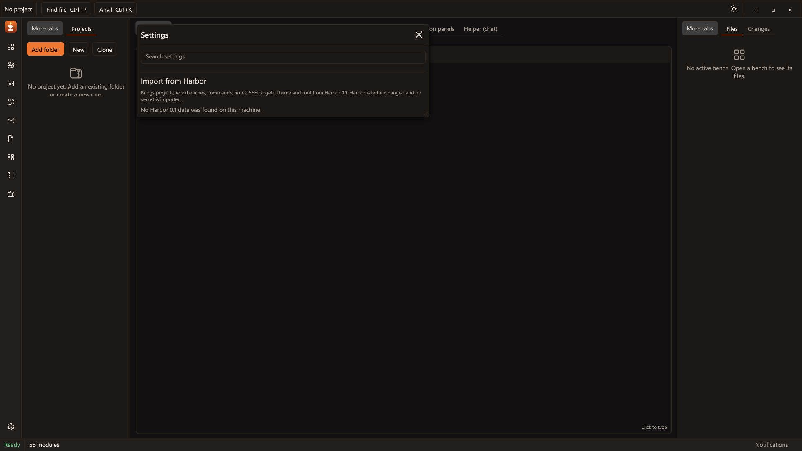

# Settings — Import from Harbor

Tela de configurações que exibe a seção "Import from Harbor", para trazer dados de uma instalação anterior do Harbor 0.1 (nada encontrado nesta máquina).

## Como chegar
No trilho esquerdo de ícones, clique no botão "Settings" (engrenagem, base do trilho, (8,1004)–(44,1040)); na janela "Settings" que se abre sobre a área central, a seção "Import from Harbor" aparece no topo do conteúdo. Comando de captura: `forja-app --locale en --theme dark --settings import`.

## Regiões
Variante em inglês da referência pt-BR.dark.settings.import: a estrutura é a mesma; mudam os textos (em inglês) e a escala — esta captura tem 1920×1080 e a referência 1280×800. Aqui as abas que não cabem viram botões de transbordo "More tabs" (um por painel) e nenhum elemento é cortado pela borda da janela.

- **Barra superior** (0,0)–(1920,42): etiqueta "No project", botões "Find file  Ctrl+P" e "Anvil  Ctrl+K" à esquerda; à direita, um botão sem nome acessível com ícone de sol (tema) e os botões de janela "–", "□" e "×".
- **Trilho à esquerda** (0,42)–(48,1048): logotipo do app (imagem sem nome, (12,50)–(40,78)) e coluna de botões-ícone "Board", "Helpers", "Routines", "Muster", "Requests", "Skills", "Usage", "Extensions" e "Archive"; na base, "Settings". Nenhum marcado.
- **Painel lateral esquerdo (Projects)** (48,42)–(304,1048): botão "More tabs" e aba "Projects" (marcada, com sublinhado laranja); botões "Add folder" (laranja), "New" e "Clone"; ícone de pasta ((168,161)–(196,189)) e mensagem "No project yet. Add an existing folder or create a new one.". Divisor sem nome (304,42)–(320,1048) separa do centro.
- **Área central** (320,42)–(1612,1048): botão "More tabs" e abas "Terminal" (marcada), "Editor", "Browser", "Changes", "Preview", "Bench", "Review", "History", "Extension panels" e "Helper (chat)" — de "Editor" a "History", escondidas pelo diálogo; barra do terminal com "+", quatro botões-ícone sem nome, "Recipes" e "Shell"; abaixo, a grande região sem nome (328,150)–(1604,1036) (terminal da bancada), quase toda coberta pelo diálogo, com o aviso "Click to type" no canto inferior direito.
- **Painel direito** (1628,42)–(1920,1048): botão "More tabs" e abas "Files" (marcada) e "Changes"; ícone de grade ((1756,117)–(1784,145)) e mensagem "No active bench. Open a bench to see its files.". Divisor sem nome (1612,42)–(1628,1048) separa do centro.
- **Diálogo "Settings" (janela flutuante com foco)** (328,58)–(1028,281): título "Settings", botão "Close window" (×), item de navegação sem nome sob o campo de busca, campo de busca de ajustes (placeholder "Search settings"), título "Import from Harbor", texto explicativo e a mensagem "No Harbor 0.1 data was found on this machine.". Alças de redimensionamento sem nome nas laterais.
- **Barra de status** (0,1048)–(1920,1080): "Ready" (em verde), "56 modules" e "Notifications" à direita.

## Elementos
| Elemento | Tipo | Posição (px) | Estado | O que faz |
|---|---|---|---|---|
| "Find file  Ctrl+P" | Button | (99,5)–(218,37) | | Abre a busca de arquivos (atalho Ctrl+P) |
| "Anvil  Ctrl+K" | Button | (226,5)–(327,37) | | Abre a paleta de comandos (atalho Ctrl+K) |
| (sem nome acessível) | Unknown | (1741,5)–(1773,37) | | Ícone de sol: alterna o tema |
| "–" | Button | (1795,5)–(1827,37) | | Minimiza a janela |
| "□" | Button | (1835,5)–(1867,37) | | Maximiza/restaura a janela |
| "×" | Button | (1875,5)–(1909,37) | | Fecha a janela |
| "No project" | Label | (11,12)–(77,31) | | Mostra que não há projeto aberto |
| (sem nome acessível) | Unknown | (304,42)–(320,1048) | | Divisor redimensionável entre painel esquerdo e área central |
| (sem nome acessível) | Unknown | (1612,42)–(1628,1048) | | Divisor redimensionável entre área central e painel direito |
| (sem nome acessível) | Unknown | (319,49)–(339,69) | | Alça superior do divisor esquerdo |
| (sem nome acessível) | Unknown | (1018,49)–(1038,69) | | Alça superior do divisor direito |
| (sem nome acessível) | Image | (12,50)–(40,78) | | Logotipo do app no topo do trilho |
| "More tabs" | Button | (64,50)–(151,85) | | Transbordo: abre as abas do painel esquerdo ocultas por falta de espaço |
| "More tabs" | Button | (324,50)–(411,85) | | Transbordo das abas da área central (parcialmente coberto pelo diálogo) |
| "More tabs" | Button | (1632,50)–(1719,85) | | Transbordo: abre as abas do painel direito ocultas por falta de espaço |
| (sem nome acessível) | Unknown | (339,51)–(1018,67) | | Faixa superior da área central atrás do diálogo (sobrepõe a linha de abas) |
| "Projects" | Button | (159,52)–(231,84) | marcado=True | Aba ativa do painel esquerdo; mostra a lista de projetos |
| "Terminal" | Button | (419,52)–(496,84) | marcado=True | Aba ativa da área central; mostra o terminal |
| "Editor" | Button | (496,52)–(556,84) | marcado=False | Aba do editor de arquivos (coberta pelo diálogo) |
| "Browser" | Button | (556,52)–(629,84) | marcado=False | Aba do navegador de conteúdo (coberta pelo diálogo) |
| "Changes" | Button | (629,52)–(706,84) | marcado=False | Aba de comparação de diffs (coberta pelo diálogo) |
| "Preview" | Button | (706,52)–(777,84) | marcado=False | Aba de visualização de arquivos (coberta pelo diálogo) |
| "Bench" | Button | (777,52)–(838,84) | marcado=False | Aba da bancada de trabalho (coberta pelo diálogo) |
| "Review" | Button | (838,52)–(905,84) | marcado=False | Aba de revisão (coberta pelo diálogo) |
| "History" | Button | (905,52)–(973,84) | marcado=False | Aba de histórico (coberta pelo diálogo) |
| "Extension panels" | Button | (973,52)–(1099,84) | marcado=False | Aba de painéis de extensões; só o fim do texto aparece à direita do diálogo |
| "Helper (chat)" | Button | (1099,52)–(1202,84) | marcado=False | Aba do chat com ajudantes |
| "Files" | Button | (1727,52)–(1778,84) | marcado=True | Aba ativa do painel direito; lista de arquivos |
| "Changes" | Button | (1778,52)–(1855,84) | marcado=False | Aba de mudanças pendentes |
| "Settings" | Window | (328,58)–(1028,281) | foco | Diálogo modal de configurações |
| "Close window" | Button | (987,67)–(1019,99) | | Fecha o diálogo (ícone ×) |
| (sem nome acessível) | Unknown | (321,69)–(337,271) | | Alça lateral esquerda de redimensionamento do diálogo |
| (sem nome acessível) | Unknown | (1020,69)–(1036,271) | | Alça lateral direita de redimensionamento do diálogo |
| "Settings" | Label | (337,71)–(403,95) | | Título do diálogo |
| "Board" | Button | (8,94)–(44,130) | marcado=False | Botão-ícone do trilho: quadro geral |
| "Add folder" | Button | (64,101)–(154,133) | | Abre o seletor para importar uma pasta como projeto |
| "New" | Button | (162,101)–(213,133) | | Cria um projeto novo |
| "Clone" | Button | (221,101)–(280,133) | | Clona um repositório como projeto |
| "+" | Button | (407,113)–(441,145) | | Ação de adicionar na barra do terminal |
| (sem nome acessível) | Unknown | (444,113)–(476,145) | | Botão-ícone na barra do terminal |
| (sem nome acessível) | Unknown | (479,113)–(511,145) | | Botão-ícone na barra do terminal |
| (sem nome acessível) | Unknown | (514,113)–(546,145) | | Botão-ícone na barra do terminal |
| (sem nome acessível) | Unknown | (549,113)–(581,145) | | Botão-ícone na barra do terminal |
| "Recipes" | Button | (584,113)–(655,145) | | Abre a lista de receitas do terminal |
| "Shell" | Button | (658,113)–(711,145) | | Abre um terminal shell |
| (ícone) | Label | (1756,117)–(1784,145) | | Ícone de grade no estado vazio do painel direito |
| (sem nome acessível) | Unknown | (328,118)–(404,140) | | Item da navegação do diálogo, sob o campo de busca, sem texto legível |
| (sem nome acessível) | TextInput | (337,121)–(1019,153) | | Campo de busca de ajustes com placeholder "Search settings" |
| (sem nome acessível) | Unknown | (385,121)–(401,137) | | Ícone dentro do item de navegação do diálogo |
| "Helpers" | Button | (8,138)–(44,174) | marcado=False | Botão-ícone do trilho: ajudantes de código |
| (sem nome acessível) | Unknown | (328,150)–(1604,1036) | | Área de conteúdo central (terminal da bancada), quase toda coberta pelo diálogo; contém o aviso "Click to type" no canto inferior direito |
| "No active bench. Open a bench to see its files." | Label | (1644,153)–(1896,191) | | Mensagem de estado vazio do painel direito |
| (ícone) | Label | (168,161)–(196,189) | | Ícone de pasta no estado vazio do painel de projetos |
| "Import from Harbor" | Label | (337,181)–(494,205) | | Título da seção de importação |
| "Routines" | Button | (8,182)–(44,218) | marcado=False | Botão-ícone do trilho: rotinas |
| "No project yet. Add an existing folder or create a new one." | Label | (67,197)–(297,235) | | Estado vazio do painel de projetos |
| "Brings projects, workbenches, commands, notes, SSH targets, theme and font from Harbor 0.1. Harbor is left unchanged and no secret is imported." | Label | (337,213)–(1011,245) | | Explica o que a importação traz e o que não toca |
| "Muster" | Button | (8,226)–(44,262) | marcado=False | Botão-ícone do trilho: mutirão |
| "No Harbor 0.1 data was found on this machine." | Label | (337,253)–(626,272) | | Resultado da verificação: nada a importar |
| "Requests" | Button | (8,270)–(44,306) | marcado=False | Botão-ícone do trilho: pedidos |
| (sem nome acessível) | Unknown | (319,271)–(339,291) | | Alça inferior do divisor esquerdo |
| (sem nome acessível) | Unknown | (1018,271)–(1038,291) | | Alça inferior do divisor direito |
| (sem nome acessível) | Unknown | (339,273)–(1018,289) | | Faixa logo abaixo do diálogo (borda inferior da área central atrás dele) |
| "Skills" | Button | (8,314)–(44,350) | marcado=False | Botão-ícone do trilho: skills |
| "Usage" | Button | (8,358)–(44,394) | marcado=False | Botão-ícone do trilho: uso |
| "Extensions" | Button | (8,402)–(44,438) | marcado=False | Botão-ícone do trilho: extensões |
| "Archive" | Button | (8,446)–(44,482) | marcado=False | Botão-ícone do trilho: acervo |
| "Settings" | Button | (8,1004)–(44,1040) | marcado=False | Botão-ícone do trilho: abre a janela "Settings" |
| "Ready" | Label | (10,1055)–(48,1074) | | Status geral em verde |
| "56 modules" | Label | (70,1055)–(142,1074) | | Contagem de módulos carregados |
| "Notifications" | Label | (1808,1055)–(1886,1074) | | Atalho para notificações |

## Aparência
Idêntica à da referência pt-BR (mesmo tema dark): fundo marrom-grafite quase preto (≈ #2b2624) nas regiões, painéis um tom mais claros que o fundo da janela e destaque laranja ("Brasa") — a aba "Projects" tem texto e sublinhado laranja e "Add folder" é um botão sólido laranja com texto escuro; "Terminal" e "Files" ativas usam texto claro com sublinhado claro. Textos em cinza-claro/quase branco, com descrições e estados vazios em cinza médio. O diálogo "Settings" usa um painel um tom acima do fundo, título no canto superior esquerdo e campo de busca com borda arredondada sutil. Na barra de status, "Ready" aparece em verde e o restante em cinza. Tipografia sans-serif única em dois tamanhos, alinhamento à esquerda no diálogo e ícones centrados nos botões do trilho (36 px por botão, com "Settings" isolado na base). Em relação à referência, mudam apenas os textos (agora em inglês); cores, contraste e tipografia não mudam.

## Problemas encontrados
- O diálogo "Settings" cobre as abas "Editor", "Browser", "Changes", "Preview", "Bench", "Review" e "History" (e parte de "More tabs" e "Extension panels" centrais); esperado num modal, mas a sobreposição não é indicada por sombra/contraste suficientes nas bordas.
- Vários controles sem nome acessível: o alternador de tema (1741,5), os quatro botões-ícone da barra do terminal (444–581,113), o campo de busca do diálogo, o item de navegação do diálogo (328,118)–(404,140) com seu ícone (385,121)–(401,137) e os divisores/alças, dificultando o uso por leitor de tela.
- A faixa sem nome (339,51)–(1018,67) sobrepõe a linha de abas da área central atrás do diálogo.
- O aviso "Click to type" (visível em ~(1535,1023), dentro da região sem nome (328,150)–(1604,1036)) não aparece como elemento nomeado na árvore de acessibilidade.
- O item de navegação do diálogo (328,118)–(404,140) fica sob o campo de busca, sem texto legível na imagem.
