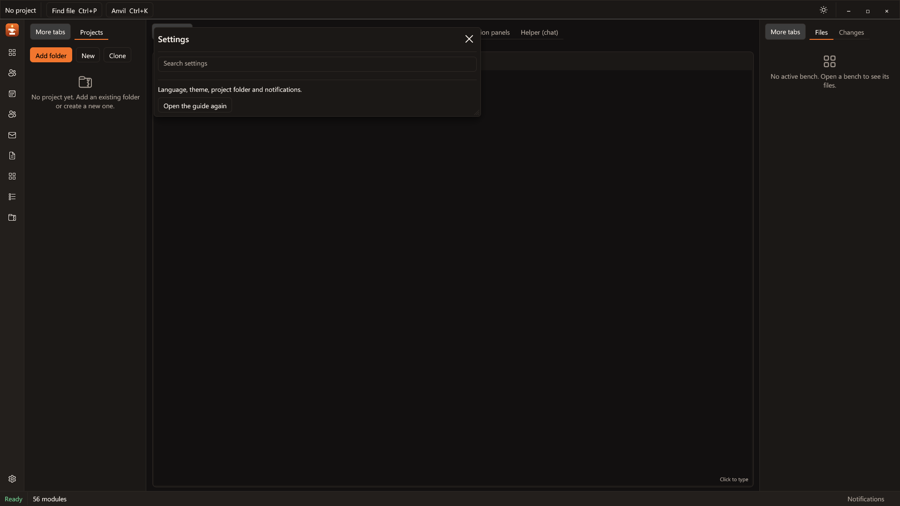

# Settings — Onboarding (janela modal)

Tela de configurações iniciais (onboarding) da Forja, apresentada como janela modal "Settings" sobre a área de trabalho, com o campo de busca de ajustes ("Search settings"), a descrição da seção ("Language, theme, project folder and notifications.") e o atalho para reapresentar o guia inicial ("Open the guide again").

## Como chegar
Na janela principal, clicar no botão "Settings" (ícone de engrenagem) na base do trilho à esquerda (8,1004)–(44,1040); a seção de onboarding abre como janela sobreposta. O botão "Open the guide again" (337,208)–(495,240) reapresenta o guia inicial. Comando de captura: `forja-app --locale en --theme dark --settings onboarding`.

## Regiões
- **Barra superior** (0,0)–(1920,42): rótulo "No project", botões "Find file  Ctrl+P" e "Anvil  Ctrl+K", ícone de tema (sol) e botões de janela "–", "□", "×".
- **Trilho à esquerda** (0,42)–(52,1048): logo da Forja (12,50)–(40,78) e coluna de ícones: "Board", "Helpers", "Routines", "Muster", "Requests", "Skills", "Usage", "Extensions", "Archive" e, na base, "Settings".
- **Painel lateral esquerdo (Projects)** (52,42)–(304,1048): botão "More tabs" (abas em excesso) e aba "Projects" (marcada); botões "Add folder", "New" e "Clone"; estado vazio com ícone de pasta (168,161)–(196,189) e o texto "No project yet. Add an existing folder or create a new one.".
- **Área central** (320,42)–(1612,1048): barra de abas ("More tabs", "Terminal" marcada, "Editor", "Browser", "Changes", "Preview", "Bench", "Review", "History", "Extension panels", "Helper (chat)"), faixa de ferramentas ("+", ícones sem nome, "Recipes", "Shell") e uma grande área de texto com a dica "Click to type" na base; o topo fica encoberto pela janela "Settings".
- **Painel direito** (1628,42)–(1920,1048): botão "More tabs", abas "Files" (marcada) e "Changes"; estado vazio com ícone (1756,117)–(1784,145) e o texto "No active bench. Open a bench to see its files.".
- **Janela modal "Settings"** (328,58)–(1026,249): título "Settings" alinhado à esquerda, botão "Close window" no canto, campo de busca com marcador "Search settings", texto "Language, theme, project folder and notifications." e botão "Open the guide again".
- **Barra de status** (0,1048)–(1920,1080): "Ready" (em verde) e "56 modules" à esquerda, "Notifications" à direita.

Diferente da referência pt-BR (capturada em 1280×800), esta captura é em 1920×1080 e os painéis laterais colapsam as abas excedentes nos botões "More tabs": o painel esquerdo mostra só "Projects" e o direito só "Files" e "Changes".

## Elementos
| Elemento | Tipo | Posição (px) | Estado | O que faz |
|---|---|---|---|---|
| "Find file  Ctrl+P" | Button | (99,5)–(218,37) | — | Abre a busca de arquivos (atalho Ctrl+P indicado no rótulo) |
| "Anvil  Ctrl+K" | Button | (226,5)–(327,37) | — | Abre a paleta de comandos (atalho Ctrl+K indicado no rótulo) |
| (sem nome acessível) | Unknown | (1741,5)–(1773,37) | — | Ícone de sol na barra superior; alterna o tema (claro/escuro) |
| "–" | Button | (1795,5)–(1827,37) | — | Minimiza a janela |
| "□" | Button | (1835,5)–(1867,37) | — | Maximiza/restaura a janela |
| "×" | Button | (1875,5)–(1909,37) | — | Fecha a janela do aplicativo |
| "No project" | Label | (11,12)–(77,31) | clicável | Indica que não há projeto aberto; clicável para seleção |
| (sem nome acessível) | Unknown | (304,42)–(320,1048) | foco | Divisor vertical entre o painel de projetos e a área central |
| (sem nome acessível) | Unknown | (1612,42)–(1628,1048) | foco | Divisor vertical entre a área central e o painel direito |
| (sem nome acessível) | Unknown | (319,49)–(339,69) | foco | Elemento pequeno no canto superior esquerdo da faixa de abas central |
| (sem nome acessível) | Unknown | (1016,49)–(1036,69) | foco | Elemento pequeno no canto superior direito da faixa de abas central |
| (sem nome acessível) | Image | (12,50)–(40,78) | clicável | Logotipo da Forja no topo do trilho esquerdo |
| "More tabs" | Button | (64,50)–(151,85) | — | Agrupa as abas ocultas do painel esquerdo (overflow) |
| "More tabs" | Button | (324,50)–(411,85) | — | Agrupa as abas ocultas da área central; encoberto pela janela "Settings" (só uma fatia visível acima dela) |
| "More tabs" | Button | (1632,50)–(1719,85) | — | Agrupa as abas ocultas do painel direito (overflow) |
| (sem nome acessível) | Unknown | (339,51)–(1016,67) | foco | Faixa fina sobre a barra de abas central; encoberta pela janela "Settings" |
| "Projects" | Button | (159,52)–(231,84) | marcado=True | Aba ativa do painel esquerdo; mostra a lista de projetos |
| "Terminal" | Button | (419,52)–(496,84) | marcado=True | Aba central ativa; oculta atrás da janela "Settings" |
| "Editor" | Button | (496,52)–(556,84) | marcado=False | Aba central do editor; oculta atrás da janela "Settings" |
| "Browser" | Button | (556,52)–(629,84) | marcado=False | Aba central do navegador; oculta atrás da janela "Settings" |
| "Changes" | Button | (629,52)–(706,84) | marcado=False | Aba central de diferenças; oculta atrás da janela "Settings" |
| "Preview" | Button | (706,52)–(777,84) | marcado=False | Aba central do visualizador; oculta atrás da janela "Settings" |
| "Bench" | Button | (777,52)–(838,84) | marcado=False | Aba central da bancada; oculta atrás da janela "Settings" |
| "Review" | Button | (838,52)–(905,84) | marcado=False | Aba central de revisão; oculta atrás da janela "Settings" |
| "History" | Button | (905,52)–(973,84) | marcado=False | Aba central de histórico; oculta atrás da janela "Settings" |
| "Extension panels" | Button | (973,52)–(1099,84) | marcado=False | Penúltima aba central; parcialmente encoberta pela janela "Settings" (aparece truncada como "ion panels") |
| "Helper (chat)" | Button | (1099,52)–(1202,84) | marcado=False | Última aba central, com o chat do ajudante |
| "Files" | Button | (1727,52)–(1778,84) | marcado=True | Aba ativa do painel direito (lista de arquivos) |
| "Changes" | Button | (1778,52)–(1855,84) | marcado=False | Aba do painel direito com as mudanças da bancada |
| "Settings" | Window | (328,58)–(1026,249) | foco | Janela modal de configurações (seção de onboarding) |
| "Close window" | Button | (985,67)–(1017,99) | — | Fecha a janela "Settings" (ícone "×") |
| (sem nome acessível) | Unknown | (321,69)–(337,239) | foco | Borda esquerda da janela (redimensionamento) |
| (sem nome acessível) | Unknown | (1018,69)–(1034,239) | foco | Borda direita da janela (redimensionamento) |
| "Settings" | Label | (337,71)–(403,95) | clicável | Título da janela, alinhado à esquerda |
| "Board" | Button | (8,94)–(44,130) | marcado=False | Ícone do trilho esquerdo; abre o quadro |
| "Add folder" | Button | (64,101)–(154,133) | — | Adiciona uma pasta de projeto (botão destacado em laranja) |
| "New" | Button | (162,101)–(213,133) | — | Cria um novo projeto |
| "Clone" | Button | (221,101)–(280,133) | — | Clona um repositório/projeto |
| "+" | Button | (407,113)–(441,145) | — | Botão de adicionar da barra central; encoberto pela janela "Settings" |
| (sem nome acessível) | Unknown | (444,113)–(476,145) | clicável | Ícone da barra central; encoberto pela janela "Settings" |
| (sem nome acessível) | Unknown | (479,113)–(511,145) | clicável | Ícone da barra central; encoberto pela janela "Settings" |
| (sem nome acessível) | Unknown | (514,113)–(546,145) | clicável | Ícone da barra central; encoberto pela janela "Settings" |
| (sem nome acessível) | Unknown | (549,113)–(581,145) | clicável | Ícone da barra central; encoberto pela janela "Settings" |
| "Recipes" | Button | (584,113)–(655,145) | — | Botão "Recipes" da barra central; encoberto pela janela "Settings" |
| "Shell" | Button | (658,113)–(711,145) | — | Botão "Shell" da barra central; encoberto pela janela "Settings" |
| (ícone) | Label | (1756,117)–(1784,145) | clicável | Ícone (quadrados enfileirados) acima da mensagem de estado vazio do painel direito |
| (sem nome acessível) | Unknown | (328,118)–(404,140) | clicável | Elemento no interior da janela, sobre a área do campo de busca; sem conteúdo visível identificável |
| (sem nome acessível) | TextInput | (337,121)–(1017,153) | clicável | Campo de busca de ajustes; exibe o marcador "Search settings" |
| (sem nome acessível) | Unknown | (385,121)–(401,137) | clicável | Pequeno elemento (16×16 px) no interior da janela, sobre a posição anterior; sem conteúdo visível identificável |
| "Helpers" | Button | (8,138)–(44,174) | marcado=False | Ícone do trilho esquerdo; abre os ajudantes de código |
| (sem nome acessível) | Unknown | (328,150)–(1604,1036) | clicável | Grande área de texto da região central, com a dica "Click to type" no canto inferior direito; topo encoberto pela janela "Settings" |
| "No active bench. Open a bench to see its files." | Label | (1644,153)–(1896,191) | clicável | Mensagem de estado vazio do painel direito |
| (ícone) | Label | (168,161)–(196,189) | clicável | Ícone de pasta acima da mensagem de estado vazio do painel de projetos |
| "Language, theme, project folder and notifications." | Label | (337,181)–(643,200) | clicável | Descrição da seção de ajustes exibida (onboarding) |
| "Routines" | Button | (8,182)–(44,218) | marcado=False | Ícone do trilho esquerdo; abre as rotinas |
| "No project yet. Add an existing folder or create a new one." | Label | (67,197)–(297,235) | clicável | Mensagem de estado vazio do painel de projetos |
| "Open the guide again" | Button | (337,208)–(495,240) | — | Reapresenta o guia de onboarding |
| "Muster" | Button | (8,226)–(44,262) | marcado=False | Ícone do trilho esquerdo; abre o mutirão |
| (sem nome acessível) | Unknown | (319,239)–(339,259) | foco | Canto inferior esquerdo da janela "Settings" (redimensionamento) |
| (sem nome acessível) | Unknown | (1016,239)–(1036,259) | foco | Canto inferior direito da janela "Settings" (redimensionamento) |
| (sem nome acessível) | Unknown | (339,241)–(1016,257) | foco | Borda inferior da janela "Settings" (redimensionamento) |
| "Requests" | Button | (8,270)–(44,306) | marcado=False | Ícone do trilho esquerdo; abre os pedidos |
| "Skills" | Button | (8,314)–(44,350) | marcado=False | Ícone do trilho esquerdo; abre as skills |
| "Usage" | Button | (8,358)–(44,394) | marcado=False | Ícone do trilho esquerdo; abre o uso |
| "Extensions" | Button | (8,402)–(44,438) | marcado=False | Ícone do trilho esquerdo; abre as extensões |
| "Archive" | Button | (8,446)–(44,482) | marcado=False | Ícone do trilho esquerdo; abre o acervo |
| "Settings" | Button | (8,1004)–(44,1040) | marcado=False | Ícone de engrenagem na base do trilho; abre esta tela de ajustes |
| "Ready" | Label | (10,1055)–(48,1074) | clicável | Indicador de estado na barra de status (texto verde) |
| "56 modules" | Label | (70,1055)–(142,1074) | clicável | Contagem de módulos carregados |
| "Notifications" | Label | (1808,1055)–(1886,1074) | clicável | Abre as notificações; à direita da barra de status |

## Aparência
Mesma paleta da referência pt-BR: tema escuro com fundo quase preto de tom levemente quente nas áreas de trabalho e cinza-escuro mais claro na janela modal e na barra de título; a barra de status e os painéis usam tons ainda mais escuros. A cor de destaque é o laranja (Brasa): botão "Add folder" preenchido em laranja com texto escuro, sublinhados das abas ativas ("Projects", "Terminal", "Files") em laranja e o logotipo no trilho também em laranja. Textos em cinza-claro para títulos e abas e em cinza médio para estados vazios e dicas ("Search settings", "Click to type"); "Ready" na barra de status em verde. Tipografia sem serifa em dois tamanhos (rótulos de barra e abas menores, mensagens e título da janela maiores, com "Settings" em negrito). Espaçamento uniforme: trilho de ícones com botões de 36 px a cada 44 px; abas com sublinhado de 2 px na base da faixa; a janela modal é flutuante, com sombra, cantos retos e bordas de redimensionamento fora do retângulo declarado. O que muda da referência: todos os textos da interface em inglês; captura em 1920×1080 (referência em 1280×800), o que desloca todas as coordenadas; o título da janela aparece alinhado à esquerda (na referência pt-BR estava centrado); e as abas excedentes dos painéis laterais colapsam nos botões "More tabs" em vez de ficar todas visíveis.

## Problemas encontrados
- Campo de busca de ajustes (TextInput em 337,121)–(1017,153) sem nome acessível; só o marcador visual "Search settings" identifica a função.
- Botão-ícone de tema (1741,5)–(1773,37) e o logotipo (Image em 12,50)–(40,78) sem nome acessível.
- Três botões compartilham o mesmo nome acessível "More tabs" ((64,50), (324,50) e (1632,50)), sem contexto que os distinga; o nome "Changes" também se repete (aba central em (629,52) e aba do painel direito em (1778,52)).
- A janela "Settings" sobrepõe a faixa de abas central: a aba ativa "Terminal" (419,52)–(496,84), o "More tabs" central (324,50)–(411,85) e parte de "Extension panels" (973,52)–(1099,84) ficam encobertos; "Extension panels" aparece truncado ("ion panels").
- Os botões "+" (407,113), "Recipes" (584,113) e "Shell" (658,113) e os quatro ícones sem nome da faixa central (444–581,113) ficam totalmente ocultos atrás da janela "Settings".
- Os elementos (328,118)–(404,140) e (385,121)–(401,137), no interior da janela sobre a área do campo de busca, não têm nome acessível nem conteúdo visível identificável.
