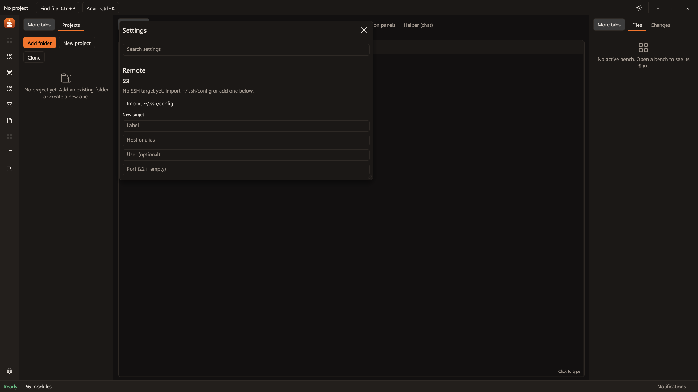

# Settings — Remote

Tela de configurações do app aberta na seção "Remote", para gerenciar destinos SSH (importados do `~/.ssh/config` ou cadastrados manualmente) e listar distros WSL; aparece como janela modal sobre a tela principal. É a variante em inglês (`en`, tema dark) da página de referência pt-BR.

**O que muda em relação à referência pt-BR:** textos em inglês; captura em 1920×1080 (a referência tem 1280×800), portanto todas as coordenadas mudam; as faixas de abas exibem um botão "More tabs" e menos abas inline (painel de projetos mostra só "Projects"; painel direito só "Files" e "Changes"); a janela modal é mais baixa — (328,58)–(1026,496) contra (328,58)–(1026,635) — e corta o próprio conteúdo (botão "Save target" e toda a seção WSL ficam fora do retângulo visível). Cores, contraste e tema são iguais aos da referência.

## Como chegar
Na tela principal, clique no ícone de engrenagem "Settings" na base do trilho à esquerda (8,1004)–(44,1040) e escolha a seção "Remote". Equivalente por linha de comando: `forja-app --locale en --theme dark --settings remote`. A captura correspondente fica em `captures/en.dark.settings.remote.png`.

## Regiões
- **Barra superior** (0,0)–(1920,42): rótulo do projeto atual ("No project"), botões "Find file  Ctrl+P" e "Anvil  Ctrl+K", alternador de tema (ícone de sol, sem nome acessível) e os botões de janela "–", "□", "×".
- **Trilho à esquerda** (0,42)–(52,1048): logotipo laranja (bigorna) no topo e uma coluna de botões de ícone: Board, Helpers, Routines, Muster, Requests, Skills, Usage, Extensions, Archive e, na base, Settings.
- **Painel de projetos** (52,42)–(304,1048): botão "More tabs" e aba "Projects" (ativa, com sublinhado laranja); botões "Add folder", "New" e "Clone"; estado vazio com ícone de pasta e a mensagem "No project yet. Add an existing folder or create a new one.".
- **Área central (terminal)** (320,42)–(1612,1048): painel de terminal com faixa de abas "Terminal" (ativa), "Editor", "Browser", "Changes", "Preview", "Bench", "Review", "History", "Extension panels" e "Helper (chat)"; quase todo coberto pela janela modal; nota "Click to type" visível na base (~1538,1017).
- **Janela modal "Settings"** (328,58)–(1026,496): título "Settings" com botão "Close window", campo de busca ("Search settings") e o conteúdo da seção Remote (SSH e WSL); o retângulo da janela termina em y=496 e corta o botão "Save target" e toda a seção WSL.
- **Painel direito** (1628,42)–(1920,1048): botão "More tabs", abas "Files" (ativa, com sublinhado) e "Changes"; estado vazio com ícone de grade e a mensagem "No active bench. Open a bench to see its files.".
- **Barra de status** (0,1048)–(1920,1080): "Ready" (em verde) e "56 modules" à esquerda, "Notifications" à direita.

## Elementos
| Elemento | Tipo | Posição (px) | Estado | O que faz |
|---|---|---|---|---|
| "Find file  Ctrl+P" | Button | (99,5)–(218,37) | — | Abre a busca/seleção de arquivos (atalho Ctrl+P). |
| "Anvil  Ctrl+K" | Button | (226,5)–(327,37) | — | Abre a paleta de comandos (atalho Ctrl+K). |
| (sem nome acessível) | Unknown | (1741,5)–(1773,37) | — | Ícone de sol na barra superior: alternador de tema claro/escuro. |
| "–" | Button | (1795,5)–(1827,37) | — | Minimiza a janela. |
| "□" | Button | (1835,5)–(1867,37) | — | Maximiza/restaura a janela. |
| "×" | Button | (1875,5)–(1909,37) | — | Fecha a janela do app. |
| "No project" | Label | (11,12)–(77,31) | — | Indica que nenhum projeto está aberto. |
| (sem nome acessível) | Unknown | (304,42)–(320,1048) | — | Divisor vertical entre o painel de projetos e a área central; passa por trás do modal. |
| (sem nome acessível) | Unknown | (1612,42)–(1628,1048) | — | Divisor vertical entre a área central e o painel direito. |
| (sem nome acessível) | Unknown | (319,49)–(339,69) | — | Pequeno controle no canto superior esquerdo do painel central, coberto pelo modal. |
| (sem nome acessível) | Unknown | (1016,49)–(1036,69) | — | Pequeno controle no canto superior direito do painel central, coberto pelo modal. |
| (sem nome acessível) | Image | (12,50)–(40,78) | — | Logotipo do app (bigorna laranja) no topo do trilho. |
| "More tabs" | Button | (64,50)–(151,85) | — | Lista as abas restantes do painel de projetos (só "Projects" fica inline). |
| "More tabs" | Button | (324,50)–(411,85) | — | Lista as abas restantes da área central; parcialmente coberto pelo modal. |
| "More tabs" | Button | (1632,50)–(1719,85) | — | Lista as abas restantes do painel direito (só "Files" e "Changes" ficam inline). |
| (sem nome acessível) | Unknown | (339,51)–(1016,67) | — | Faixa do cabeçalho do painel central, atrás do topo do modal. |
| "Projects" | Button | (159,52)–(231,84) | marcado=True | Aba ativa do painel de projetos. |
| "Terminal" | Button | (419,52)–(496,84) | marcado=True | Aba ativa da área central (terminal); oculta atrás do modal. |
| "Editor" | Button | (496,52)–(556,84) | marcado=False | Aba do editor; oculta atrás do modal. |
| "Browser" | Button | (556,52)–(629,84) | marcado=False | Aba do navegador; oculta atrás do modal. |
| "Changes" | Button | (629,52)–(706,84) | marcado=False | Aba de mudanças do repositório; oculta atrás do modal. |
| "Preview" | Button | (706,52)–(777,84) | marcado=False | Aba do visualizador; oculta atrás do modal. |
| "Bench" | Button | (777,52)–(838,84) | marcado=False | Aba da bancada; oculta atrás do modal. |
| "Review" | Button | (838,52)–(905,84) | marcado=False | Aba de revisão; oculta atrás do modal. |
| "History" | Button | (905,52)–(973,84) | marcado=False | Aba de histórico; oculta atrás do modal. |
| "Extension panels" | Button | (973,52)–(1099,84) | marcado=False | Aba de painéis de extensões da área central; parcialmente coberta pelo modal (só "…ion panels" fica visível). |
| "Helper (chat)" | Button | (1099,52)–(1202,84) | marcado=False | Aba do chat com ajudantes de código; visível à direita do modal. |
| "Files" | Button | (1727,52)–(1778,84) | marcado=True | Aba ativa do painel direito (lista de arquivos). |
| "Changes" | Button | (1778,52)–(1855,84) | marcado=False | Aba de mudanças do painel direito. |
| "Settings" | Window | (328,58)–(1026,496) | foco | Janela modal de configurações; contém a seção Remote (com conteúdo cortado na base). |
| "Close window" | Button | (985,67)–(1017,99) | — | Ícone "×" no título do modal: fecha a janela de ajustes. |
| (sem nome acessível) | Unknown | (321,69)–(337,486) | — | Borda esquerda do modal (arrasto/redimensionamento). |
| (sem nome acessível) | Unknown | (1018,69)–(1034,486) | — | Borda direita do modal (arrasto/redimensionamento). |
| "Settings" | Label | (337,71)–(403,95) | — | Título da janela modal. |
| "Board" | Button | (8,94)–(44,130) | marcado=False | Botão de ícone do trilho: abre o quadro. |
| "Add folder" | Button | (64,101)–(154,133) | — | Importa uma pasta existente como projeto (botão em destaque laranja). |
| "New" | Button | (162,101)–(213,133) | — | Cria um projeto novo. |
| "Clone" | Button | (221,101)–(280,133) | — | Clona um repositório como projeto. |
| "+" | Button | (407,113)–(441,145) | — | Botão "+" da barra de ferramentas do painel de projetos; coberto pelo modal. |
| (sem nome acessível) | Unknown | (444,113)–(476,145) | — | Botão de ícone sem nome da barra de projetos; coberto pelo modal. |
| (sem nome acessível) | Unknown | (479,113)–(511,145) | — | Botão de ícone sem nome da barra de projetos; coberto pelo modal. |
| (sem nome acessível) | Unknown | (514,113)–(546,145) | — | Botão de ícone sem nome da barra de projetos; coberto pelo modal. |
| (sem nome acessível) | Unknown | (549,113)–(581,145) | — | Botão de ícone sem nome da barra de projetos; coberto pelo modal. |
| "Recipes" | Button | (584,113)–(655,145) | — | Botão "Recipes" da barra de projetos; coberto pelo modal. |
| "Shell" | Button | (658,113)–(711,145) | — | Botão "Shell" da barra de projetos; coberto pelo modal. |
| (ícone) | Label | (1756,117)–(1784,145) | — | Ícone de grade do estado vazio do painel direito. |
| (sem nome acessível) | Unknown | (328,118)–(404,140) | — | Controle sem nome junto ao canto superior esquerdo do campo de busca do modal. |
| (sem nome acessível) | TextInput | (337,121)–(1017,153) | — | Campo de busca com espaço reservado "Search settings". |
| (sem nome acessível) | Unknown | (385,121)–(401,137) | — | Pequeno elemento interno associado ao campo de busca do modal. |
| "Helpers" | Button | (8,138)–(44,174) | marcado=False | Botão de ícone do trilho: abre os ajudantes. |
| (sem nome acessível) | Unknown | (328,150)–(1604,1036) | — | Área do terminal na região central, em sua maior parte atrás do modal; traz a nota "Click to type" na base. |
| "No active bench. Open a bench to see its files." | Label | (1644,153)–(1896,191) | — | Mensagem de estado vazio do painel direito. |
| (ícone) | Label | (168,161)–(196,189) | — | Ícone de pasta do estado vazio do painel de projetos. |
| (sem nome acessível) | Unknown | (337,167)–(1017,487) | — | Área de conteúdo rolável do modal (seção Remote). |
| (sem nome acessível) | Unknown | (1015,167)–(1017,487) | — | Barra de rolagem estreita (2 px) na borda direita do conteúdo do modal. |
| "Remote" | Label | (337,181)–(400,205) | — | Título da seção de configurações exibida. |
| "Routines" | Button | (8,182)–(44,218) | marcado=False | Botão de ícone do trilho: abre rotinas. |
| "No project yet. Add an existing folder or create a new one." | Label | (67,197)–(297,235) | — | Mensagem de estado vazio do painel de projetos. |
| "SSH" | Label | (337,213)–(362,232) | — | Subtítulo da seção de destinos SSH. |
| "Muster" | Button | (8,226)–(44,262) | marcado=False | Botão de ícone do trilho: abre o mutirão. |
| "No SSH target yet. Import ~/.ssh/config or add one below." | Label | (337,240)–(698,259) | — | Mensagem de estado vazio da lista de destinos SSH. |
| "Import ~/.ssh/config" | Button | (337,267)–(488,299) | — | Importa os hosts do arquivo de configuração SSH do usuário. |
| "Requests" | Button | (8,270)–(44,306) | marcado=False | Botão de ícone do trilho: abre os pedidos. |
| "New target" | Label | (337,307)–(396,323) | — | Rótulo do formulário de novo destino SSH. |
| "Skills" | Button | (8,314)–(44,350) | marcado=False | Botão de ícone do trilho: abre skills. |
| (sem nome acessível) | TextInput | (337,331)–(1017,363) | — | Campo "Label" do novo destino SSH. |
| "Usage" | Button | (8,358)–(44,394) | marcado=False | Botão de ícone do trilho: abre o uso. |
| (sem nome acessível) | TextInput | (337,371)–(1017,403) | — | Campo "Host or alias" do novo destino SSH. |
| "Extensions" | Button | (8,402)–(44,438) | marcado=False | Botão de ícone do trilho: abre extensões. |
| (sem nome acessível) | TextInput | (337,411)–(1017,443) | — | Campo "User (optional)" do novo destino SSH. |
| "Archive" | Button | (8,446)–(44,482) | marcado=False | Botão de ícone do trilho: abre o acervo. |
| (sem nome acessível) | TextInput | (337,451)–(1017,483) | — | Campo "Port (22 if empty)" do novo destino SSH. |
| (sem nome acessível) | Unknown | (319,486)–(339,506) | — | Pequeno controle no canto inferior esquerdo do painel central, atrás do modal. |
| (sem nome acessível) | Unknown | (1016,486)–(1036,506) | — | Pequeno controle no canto inferior direito do painel central, atrás do modal. |
| (sem nome acessível) | Unknown | (339,488)–(1016,504) | — | Faixa inferior do painel central, atrás da base do modal. |
| "Save target" | Button | (337,491)–(430,523) | — | Salva o destino SSH preenchido (botão em destaque laranja); fica fora do retângulo visível do modal e não aparece na captura. |
| "WSL" | Label | (337,545)–(364,564) | — | Subtítulo da seção WSL; abaixo do limite do modal (y=496), não visível na captura. |
| "Refresh distros" | Button | (337,572)–(452,604) | — | Lê a lista de distros WSL instaladas; abaixo do limite do modal, não visível na captura. |
| "Distros not read yet. Refresh to list them." | Label | (337,612)–(588,631) | — | Estado vazio da lista de distros WSL; abaixo do limite do modal, não visível na captura. |
| "Settings" | Button | (8,1004)–(44,1040) | marcado=False | Botão de ícone do trilho que abre esta tela de configurações. |
| "Ready" | Label | (10,1055)–(48,1074) | — | Status geral do app na barra de status, em verde. |
| "56 modules" | Label | (70,1055)–(142,1074) | — | Quantidade de módulos carregados. |
| "Notifications" | Label | (1808,1055)–(1886,1074) | — | Acesso às notificações na barra de status. |

## Aparência
Tema escuro: fundo quase preto na barra superior e no trilho, painéis em cinza-escuro e a janela modal "Settings" em um tom um pouco mais claro, com cantos arredondados e sombra projetada. O acento laranja (paleta "Brasa") aparece no logotipo, no botão primário "Add folder" e nos sublinhados das abas ativas "Projects", "Terminal" e "Files". Texto em cinza-claro sobre fundo escuro; espaços reservados dos campos em cinza médio. Tipografia sem serifa, corpo pequeno (aprox. 12–14 px), rótulos de seção ("Remote", "SSH", "WSL") em tamanho maior. Botões com cantos arredondados, contornos sutis e bom espaçamento vertical entre os campos do formulário; os campos ocupam toda a largura do modal. Na barra de status, "Ready" aparece em verde, distinguindo-se dos demais rótulos em cinza.

## Problemas encontrados
- O retângulo da janela modal "Settings" (328,58)–(1026,496) não contém o próprio conteúdo: o botão "Save target" (337,491)–(430,523) fica cortado pelo limite inferior e toda a seção WSL — rótulo "WSL", botão "Refresh distros" e a mensagem "Distros not read yet. Refresh to list them." (y=545–631) — cai fora da janela e não é visível nem alcançável na captura (na referência pt-BR o modal ia até y=635 e tudo cabia).
- A aba "Extension panels" (973,52)–(1099,84) é parcialmente coberta pelo modal: só o fragmento "…ion panels" fica visível; as abas "Terminal", "Editor", "Browser", "Changes", "Preview", "Bench", "Review" e "History" ficam totalmente ocultas, assim como o botão "More tabs" central (324,50)–(411,85) fica parcialmente coberto (sobreposição esperada em modal, mas que esconde controles da tela de fundo).
- Os botões "+", "Recipes", "Shell" e os quatro botões de ícone sem nome da barra de projetos (444–581, 113–145) ficam totalmente escondidos atrás do modal.
- Os cinco campos de texto (busca "Search settings" e os quatro do formulário "New target") são TextInput "(sem nome acessível)": o rótulo existe apenas como texto visual/espaço reservado.
- Vários elementos sem nome acessível: alternador de tema da barra superior, divisores verticais, faixas de cabeçalho/abas, bordas do modal, barra de rolagem do conteúdo e os quatro botões de ícone da barra de projetos; os ícones de estado vazio são registrados apenas como "(ícone)".
- Os botões de janela da barra de título têm apenas símbolos como nome ("–", "□", "×").
