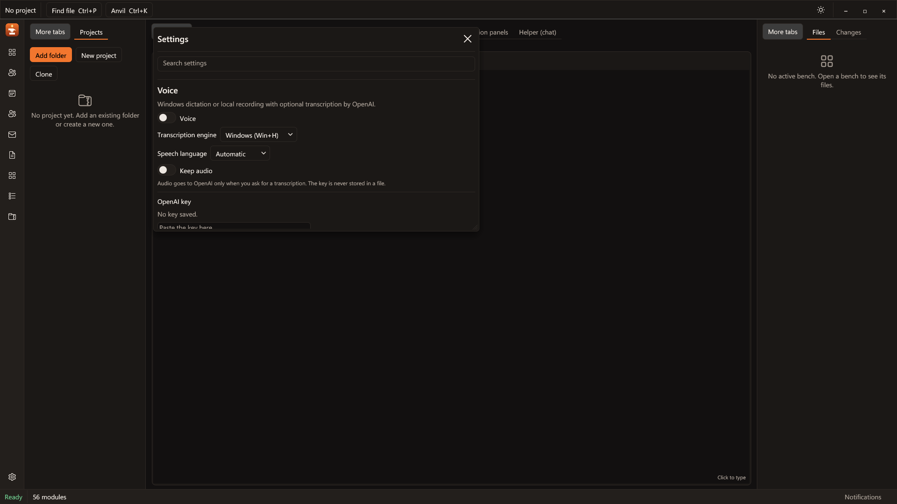

state: en.dark.settings.voice
capture_sha: —
model: opencode/glm-5.3-flash-free
reference: pt-BR.dark.settings.voice (variante em inglês; mesma estrutura da página de referência)

# Settings — Voice

Tela de configurações do app, exibida como janela modal "Settings" sobre a área de trabalho, com a seção **Voice** (ditado e transcrição) aberta. É a variante em inglês (locale `en`) da página de referência pt-BR: o layout e a ordem dos elementos são os mesmos, mudando os textos (todos em inglês) e a geometria da modal — nesta captura a janela "Settings" é mais baixa (termina em y=496) e corta o fim do conteúdo.

## Como chegar
No app, clique no botão "Settings" na base do trilho de ícones à esquerda (ou use o atalho associado); dentro da janela, a seção "Voice" aparece na lista de seções. Captura: `forja-app --locale en --theme dark --settings voice`.

## Regiões
- **Barra superior** (0,0)–(1920,42): rótulo "No project", botões "Find file  Ctrl+P" e "Anvil  Ctrl+K" à esquerda; botão de tema (sem nome, ~1741,5) e botões de janela "–", "□", "×" à direita.
- **Trilho à esquerda** (0,42)–(48,1048): coluna de ícones — logo da Forja no topo (12,50)–(40,78), depois "Board", "Helpers", "Routines", "Muster", "Requests", "Skills", "Usage", "Extensions", "Archive" e, na base, "Settings".
- **Painel lateral esquerdo** (48,42)–(304,1048): botão "More tabs", aba "Projects" (marcada); botões "Add folder" (destaque laranja), "New" e "Clone"; estado vazio "No project yet. Add an existing folder or create a new one." com ícone de pasta (168,161)–(196,189).
- **Faixa de abas central** (320,42)–(1612,90): abas "Terminal" (marcada), "Editor", "Browser", "Changes", "Preview", "Bench", "Review", "History", "Extension panels" e "Helper (chat)"; quase toda encoberta pela modal.
- **Área central** (320,90)–(1612,1048): conteúdo do terminal atrás da modal; indicação "Click to type" no canto inferior direito (~1508,1023).
- **Painel direito** (1628,42)–(1920,1048): botão "More tabs", abas "Files" (marcada) e "Changes"; estado vazio com ícone de grade (1756,117)–(1784,145) e texto "No active bench. Open a bench to see its files.".
- **Janela modal "Settings"** (328,58)–(1026,496): título "Settings" à esquerda, botão "Close window", campo de busca "Search settings" (337,121)–(1017,153) e a seção "Voice" com interruptores, seletores e campo de chave (conteúdo cortado na base).
- **Barra de status** (0,1048)–(1920,1080): "Ready" (em verde), "56 modules" à esquerda; "Notifications" à direita.

## Elementos
| Elemento | Tipo | Posição (px) | Estado | O que faz |
|---|---|---|---|---|
| "Find file  Ctrl+P" | Button | (99,5)–(218,37) | — | Abre a busca rápida de arquivos (Ctrl+P). |
| "Anvil  Ctrl+K" | Button | (226,5)–(327,37) | — | Abre a paleta de comandos (Ctrl+K). |
| (sem nome acessível) | Unknown | (1741,5)–(1773,37) | — | Ícone de alternância de tema (sol) na barra superior. |
| "–" | Button | (1795,5)–(1827,37) | — | Minimiza a janela. |
| "□" | Button | (1835,5)–(1867,37) | — | Maximiza/restaura a janela. |
| "×" | Button | (1875,5)–(1909,37) | — | Fecha a janela do app. |
| "No project" | Label | (11,12)–(77,31) | — | Indica que nenhum projeto está aberto. |
| (sem nome acessível) | Unknown | (304,42)–(320,1048) | — | Divisor vertical entre o painel esquerdo e a área central. |
| (sem nome acessível) | Unknown | (1612,42)–(1628,1048) | — | Divisor vertical entre a área central e o painel direito. |
| (sem nome acessível) | Unknown | (319,49)–(339,69) | — | Canto/ornamento da faixa de abas central; encoberto pela modal. |
| (sem nome acessível) | Unknown | (1016,49)–(1036,69) | — | Canto/ornamento da faixa de abas do painel direito; parcialmente atrás da modal. |
| (sem nome acessível) | Image | (12,50)–(40,78) | — | Logo da Forja no topo do trilho. |
| "More tabs" | Button | (64,50)–(151,85) | — | Lista de abas adicionais do painel esquerdo. |
| "More tabs" | Button | (324,50)–(411,85) | — | Botão de abas adicionais da área central; quase todo encoberto pela modal (só uma fração acima de y=58). |
| "More tabs" | Button | (1632,50)–(1719,85) | — | Lista de abas adicionais do painel direito. |
| (sem nome acessível) | Unknown | (339,51)–(1016,67) | — | Linha da faixa de abas central; atrás da modal. |
| "Projects" | Button | (159,52)–(231,84) | marcado=True | Aba ativa do painel esquerdo; mostra a lista de projetos. |
| "Terminal" | Button | (419,52)–(496,84) | marcado=True | Aba ativa da área central (terminal); encoberta pela modal. |
| "Editor" | Button | (496,52)–(556,84) | marcado=False | Aba do editor de arquivos; atrás da modal. |
| "Browser" | Button | (556,52)–(629,84) | marcado=False | Aba do navegador de arquivos; atrás da modal. |
| "Changes" | Button | (629,52)–(706,84) | marcado=False | Aba de diffs (git); atrás da modal. |
| "Preview" | Button | (706,52)–(777,84) | marcado=False | Aba do visualizador; atrás da modal. |
| "Bench" | Button | (777,52)–(838,84) | marcado=False | Aba da bancada; atrás da modal. |
| "Review" | Button | (838,52)–(905,84) | marcado=False | Aba de revisão; atrás da modal. |
| "History" | Button | (905,52)–(973,84) | marcado=False | Aba de histórico; atrás da modal. |
| "Extension panels" | Button | (973,52)–(1099,84) | marcado=False | Aba de painéis de extensões; parcialmente coberta pela modal (visível "…ion panels" à direita dela). |
| "Helper (chat)" | Button | (1099,52)–(1202,84) | marcado=False | Aba do chat com o ajudante de IA. |
| "Files" | Button | (1727,52)–(1778,84) | marcado=True | Aba ativa do painel direito; lista de arquivos. |
| "Changes" | Button | (1778,52)–(1855,84) | marcado=False | Aba de mudanças (git) do painel direito. |
| "Settings" | Window | (328,58)–(1026,496) | focus | Janela modal de configurações em foco. |
| "Close window" | Button | (985,67)–(1017,99) | — | Ícone × que fecha a janela "Settings". |
| (sem nome acessível) | Unknown | (321,69)–(337,486) | — | Borda/sombra esquerda da modal. |
| (sem nome acessível) | Unknown | (1018,69)–(1034,486) | — | Borda/sombra direita da modal. |
| "Settings" | Label | (337,71)–(403,95) | — | Título da modal, alinhado à esquerda (na referência pt-BR aparece centrado). |
| "Board" | Button | (8,94)–(44,130) | marcado=False | Ícone do quadro (board) no trilho. |
| "Add folder" | Button | (64,101)–(154,133) | — | Adiciona uma pasta de projeto (botão de destaque laranja). |
| "New" | Button | (162,101)–(213,133) | — | Cria um novo projeto. |
| "Clone" | Button | (221,101)–(280,133) | — | Clona um projeto existente. |
| "+" | Button | (407,113)–(441,145) | — | Abre nova aba/ação na área central; atrás da modal. |
| (sem nome acessível) | Unknown | (444,113)–(476,145) | — | Botão-ícone da barra de ferramentas central (setas de navegação); atrás da modal e sem nome acessível. |
| (sem nome acessível) | Unknown | (479,113)–(511,145) | — | Botão-ícone da barra de ferramentas central; atrás da modal. |
| (sem nome acessível) | Unknown | (514,113)–(546,145) | — | Botão-ícone da barra de ferramentas central; atrás da modal. |
| (sem nome acessível) | Unknown | (549,113)–(581,145) | — | Botão-ícone da barra de ferramentas central; atrás da modal. |
| "Recipes" | Button | (584,113)–(655,145) | — | Acesso a receitas (fluxos prontos); atrás da modal. |
| "Shell" | Button | (658,113)–(711,145) | — | Controle de shell do terminal; atrás da modal. |
| (ícone) | Label | (1756,117)–(1784,145) | — | Ícone de grade (sem bancada) do painel direito. |
| (sem nome acessível) | Unknown | (328,118)–(404,140) | — | Ícone de aba do terminal (canto superior da área central); atrás da modal. |
| (sem nome acessível) | TextInput | (337,121)–(1017,153) | — | Campo "Search settings" para filtrar seções da modal; sem nome acessível. |
| (sem nome acessível) | Unknown | (385,121)–(401,137) | — | Pequeno elemento dentro do campo de busca (cursor ou ícone). |
| "Helpers" | Button | (8,138)–(44,174) | marcado=False | Ícone de ajudantes no trilho. |
| (sem nome acessível) | Unknown | (328,150)–(1604,1036) | — | Área central atrás da modal (conteúdo do terminal, com "Click to type" na base). |
| "No active bench. Open a bench to see its files." | Label | (1644,153)–(1896,191) | — | Estado vazio do painel de arquivos. |
| (ícone) | Label | (168,161)–(196,189) | — | Ícone de pasta do estado vazio de projetos. |
| (sem nome acessível) | Unknown | (337,167)–(1017,487) | — | Região de conteúdo da modal (seções de configurações). |
| (sem nome acessível) | Unknown | (1015,167)–(1017,487) | — | Borda lateral fina/área de rolagem à direita do conteúdo da modal. |
| "Voice" | Label | (337,181)–(381,205) | — | Título da seção de configurações de voz. |
| "Routines" | Button | (8,182)–(44,218) | marcado=False | Ícone de rotinas no trilho. |
| "No project yet. Add an existing folder or create a new one." | Label | (67,197)–(297,235) | — | Estado vazio do painel de projetos. |
| "Windows dictation or local recording with optional transcription by OpenAI." | Label | (337,213)–(803,232) | — | Descrição da seção Voice. |
| "Muster" | Button | (8,226)–(44,262) | marcado=False | Ícone de mutirão no trilho. |
| "Voice" | CheckBox | (337,240)–(418,264) | marcado=False | Interruptor que liga/desliga a voz (aparece como toggle desligado). |
| "Transcription engine" | Label | (337,272)–(463,304) | — | Rótulo do seletor de motor de transcrição. |
| "Windows (Win+H)" | ComboBox | (471,272)–(636,304) | — | Seletor suspenso do motor de transcrição, com o valor "Windows (Win+H)". |
| "Speech language" | Label | (337,312)–(442,344) | — | Rótulo do seletor de idioma. |
| "Automatic" | ComboBox | (450,312)–(578,344) | — | Seletor suspenso do idioma da fala, com o valor "Automatic". |
| "Skills" | Button | (8,314)–(44,350) | marcado=False | Ícone de skills no trilho. |
| "Keep audio" | CheckBox | (337,352)–(454,376) | marcado=False | Interruptor para guardar o áudio das gravações (desligado). |
| "Usage" | Button | (8,358)–(44,394) | marcado=False | Ícone de uso no trilho. |
| "Audio goes to OpenAI only when you ask for a transcription. The key is never stored in a file." | Label | (337,384)–(825,400) | — | Nota de privacidade da transcrição. |
| "Extensions" | Button | (8,402)–(44,438) | marcado=False | Ícone de extensões no trilho. |
| "OpenAI key" | Label | (337,422)–(409,441) | — | Título do bloco de chave de API. |
| "Archive" | Button | (8,446)–(44,482) | marcado=False | Ícone de acervo no trilho. |
| "No key saved." | Label | (337,449)–(422,468) | — | Estado atual da chave (nenhuma salva). |
| (sem nome acessível) | PasswordInput | (337,476)–(665,499) | — | Campo para colar a chave (texto "Paste the key here"); retângulo passa da base da modal (496) e o placeholder aparece cortado. |
| (sem nome acessível) | Unknown | (319,486)–(339,506) | — | Canto inferior esquerdo da modal. |
| (sem nome acessível) | Unknown | (1016,486)–(1036,506) | — | Canto inferior direito da modal. |
| (sem nome acessível) | Unknown | (339,488)–(1016,504) | — | Borda inferior da modal. |
| "Save key" | Button | (337,507)–(414,539) | — | Salva a chave informada; fica abaixo do retângulo da janela (496) e não aparece na captura. |
| "Delete key" | Button | (422,507)–(511,539) | — | Remove a chave guardada; também fora do retângulo da modal, invisível na captura. |
| "Settings" | Button | (8,1004)–(44,1040) | marcado=False | Ícone que abre esta janela de ajustes (o estado "marcado" continua falso mesmo com a modal em foco). |
| "Ready" | Label | (10,1055)–(48,1074) | — | Status atual na barra inferior, exibido em verde. |
| "56 modules" | Label | (70,1055)–(142,1074) | — | Contagem de módulos carregados. |
| "Notifications" | Label | (1808,1055)–(1886,1074) | — | Área/atalho de notificações na barra inferior. |

## Aparência
Mesmo tema escuro da referência pt-BR: fundo geral em marrom-quase-preto (barra superior e painéis), modal mais escura e opaca com sombra suave nas bordas. Acento laranja ("Brasa") em "Add folder" e nas sublinhas das abas ativas "Projects" e "Files" (a sublinha de "Terminal" fica encoberta pela modal); os toggles desligados mostram knob claro sobre trilho escuro; "Ready" na barra de status em verde. Texto em cinza claro com títulos em branco; rótulos secundários e placeholders ("Search settings", "Paste the key here") em cinza médio, com contraste modesto sobre o fundo escuro. Tipografia sem serifa, corpos entre ~12 e 16 px; título "Settings" em peso maior, alinhado à esquerda (diferente da referência, em que "Ajustes" aparece centrado). Campo de busca ocupando toda a largura da modal (337–1017) e espaçamento vertical consistente (~40 px) entre as linhas da seção "Voice"; seletores suspensos ("Windows (Win+H)", "Automatic") alinhados à direita de seus rótulos.

## Problemas encontrados
- Conteúdo da modal cortado: o PasswordInput da chave (337,476)–(665,499) passa do retângulo da janela "Settings" (328,58)–(1026,496) e o placeholder "Paste the key here" aparece truncado na base.
- Os botões "Save key" (337,507)–(414,539) e "Delete key" (422,507)–(511,539) ficam abaixo do retângulo da modal e não são visíveis na captura — ações essenciais fora da área da janela.
- A barra de ferramentas central ("+", quatro botões-ícone sem nome, "Recipes" e "Shell", y 113–145) e as abas "Terminal" a "History" (y 52–84) estão inteiramente atrás da modal; "Extension panels" (973,52)–(1099,84) fica parcialmente coberta por ela.
- O botão "More tabs" central (324,50)–(411,85) fica quase todo encoberto pela modal.
- TextInput de busca de ajustes (337,121)–(1017,153) e PasswordInput da chave (337,476)–(665,499) não têm nome acessível; dependem apenas do placeholder.
- Vários botões-ícone sem nome acessível: barra de ferramentas central (444–581, y 113–145), ícone de aba do terminal (328,118)–(404,140) e elemento dentro do campo de busca (385,121)–(401,137), o que impede identificação por leitor de tela.
- O botão "Settings" do trilho permanece marcado=False enquanto a janela "Settings" está aberta em foco, inconsistência de estado de seleção.
- Textos secundários e placeholders em cinza médio sobre fundo escuro apresentam contraste baixo (por exemplo "No key saved.", "Search settings", "Paste the key here").
