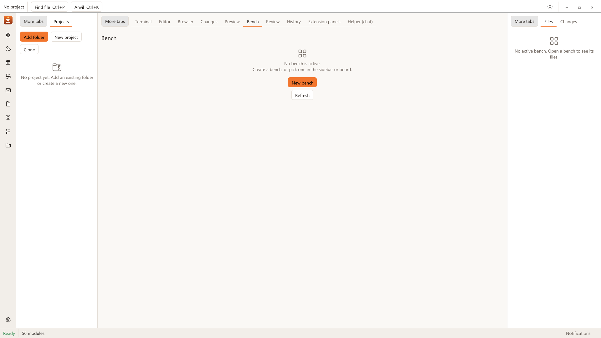

# Bancada — detalhe (sem bancada ativa)

Tela inicial da área de bancada, mostrada sem projeto e sem bancada ativa: à esquerda o painel de projetos vazio, no centro o aviso de bancada inativa e à direita o painel "Files" com estado vazio. É a variante em inglês e tema claro da página de referência (pt-BR, tema escuro); a estrutura é a mesma, mudando os textos da interface, as cores e as coordenadas (janela em 1920×1080).

## Como chegar
Abrir o aplicativo Forja (`forja-app --locale en --theme light --bench-tab bench.detail`); por padrão a tela inicial já cai nesta visão. Também se chega por `Ctrl+K` (Anvil) ou clicando em "Projects" no trilho esquerdo e depois na aba "Bench" da área central. Comando de captura: `forja atlas capture --bench-tab bench.detail --locale en --theme light`.

## Regiões
- **Barra superior** (0,0)–(1920,42): rótulo "No project", botões "Find file  Ctrl+P" e "Anvil  Ctrl+K", botão de alternância de tema (ícone de sol, sem nome acessível) e botões de janela (–, □, ×).
- **Trilho esquerdo de ícones** (0,42)–(50,1048): logo (imagem sem nome) e coluna de botões-ícone ("Board", "Helpers", "Routines", "Muster", "Requests", "Skills", "Usage", "Extensions", "Archive") e, no rodapé, "Settings".
- **Painel de projetos** (50,42)–(304,1048): botão "More tabs", aba "Projects" (marcada); ações "Add folder", "New" e "Clone"; estado vazio com ícone de pasta e o texto "No project yet. Add an existing folder or create a new one.".
- **Área central** (320,42)–(1612,1048): botão "More tabs" e fileira de abas de "Bench" (marcada) a "Helper (chat)"; título "Bench"; ícone de grade e a mensagem central "No bench is active. / Create a bench, or pick one in the sidebar or board.", com os botões "New bench" e "Refresh" abaixo.
- **Painel direito (Files)** (1628,42)–(1920,1048): botão "More tabs" e abas "Files" (marcada) e "Changes"; ícone de grade e a mensagem "No active bench. Open a bench to see its files.".
- **Barra de status** (0,1048)–(1920,1080): "Ready" em verde, "56 modules" e, à direita, "Notifications".

## Elementos
| Elemento | Tipo | Posição (px) | Estado | O que faz |
|---|---|---|---|---|
| "Find file  Ctrl+P" | Button | (99,5)–(218,37) | — | Abre a busca de arquivos pelo atalho Ctrl+P |
| "Anvil  Ctrl+K" | Button | (226,5)–(327,37) | — | Abre a paleta de comandos (Anvil) pelo atalho Ctrl+K |
| (sem nome acessível) | Unknown | (1741,5)–(1773,37) | — | Botão-ícone de sol na barra superior; alterna o tema |
| "–" | Button | (1795,5)–(1827,37) | — | Minimiza a janela |
| "□" | Button | (1835,5)–(1867,37) | — | Maximiza/restaura a janela |
| "×" | Button | (1875,5)–(1909,37) | — | Fecha a janela |
| "No project" | Label | (11,12)–(77,31) | — | Mostra que nenhum projeto está aberto |
| (sem nome acessível) | Unknown | (304,42)–(320,1048) | focus | Divisória vertical entre painel de projetos e área central |
| (sem nome acessível) | Unknown | (1612,42)–(1628,1048) | focus | Divisória vertical entre área central e painel direito |
| (sem nome acessível) | Image | (12,50)–(40,78) | — | Ícone/logo no topo do trilho esquerdo |
| "More tabs" | Button | (64,50)–(151,85) | — | Expande a lista de abas do painel de projetos |
| "More tabs" | Button | (324,50)–(411,85) | — | Expande a lista de abas da área central |
| "More tabs" | Button | (1632,50)–(1719,85) | — | Expande a lista de abas do painel direito |
| "Projects" | Button | (159,52)–(231,84) | marcado=True | Aba ativa do painel esquerdo; mostra a lista de projetos |
| "Bench" | Button | (419,52)–(480,84) | marcado=True | Aba ativa da área central; exibe o detalhe da bancada |
| "Terminal" | Button | (480,52)–(557,84) | marcado=False | Aba da área central; abriria os terminais |
| "Editor" | Button | (557,52)–(617,84) | marcado=False | Aba da área central; abriria o editor |
| "Browser" | Button | (617,52)–(690,84) | marcado=False | Aba da área central; abriria um navegador integrado |
| "Changes" | Button | (690,52)–(767,84) | marcado=False | Aba da área central; mostraria as mudanças da bancada |
| "Preview" | Button | (767,52)–(838,84) | marcado=False | Aba da área central; abriria a pré-visualização |
| "Review" | Button | (838,52)–(905,84) | marcado=False | Aba da área central; abriria a revisão |
| "History" | Button | (905,52)–(973,84) | marcado=False | Aba da área central; mostraria o histórico |
| "Extension panels" | Button | (973,52)–(1099,84) | marcado=False | Aba da área central; abre os painéis de extensões |
| "Helper (chat)" | Button | (1099,52)–(1202,84) | marcado=False | Aba da área central; abre o chat do ajudante |
| "Files" | Button | (1727,52)–(1778,84) | marcado=True | Aba ativa do painel direito; exibe o explorador de arquivos |
| "Changes" | Button | (1778,52)–(1855,84) | marcado=False | Aba do painel direito; mostraria as mudanças |
| "Board" | Button | (8,94)–(44,130) | marcado=False | Botão-ícone do trilho; abre o quadro de bancadas |
| "Add folder" | Button | (64,101)–(154,133) | — | Destaque laranja; adiciona uma pasta de projeto |
| "New" | Button | (162,101)–(213,133) | — | Cria um novo projeto |
| "Clone" | Button | (221,101)–(280,133) | — | Clona um projeto |
| "Bench" | Label | (324,109)–(372,133) | — | Título da área central |
| (ícone) | Label | (1756,117)–(1784,145) | — | Ícone de grade do estado vazio do painel Files |
| "Helpers" | Button | (8,138)–(44,174) | marcado=False | Botão-ícone do trilho; abre a lista de ajudantes |
| "No active bench. Open a bench to see its files." | Label | (1644,153)–(1896,191) | — | Estado vazio do painel Files |
| (ícone) | Label | (952,157)–(980,185) | — | Ícone de grade acima da mensagem central |
| (ícone) | Label | (168,161)–(196,189) | — | Ícone de pasta do estado vazio do painel de projetos |
| "Routines" | Button | (8,182)–(44,218) | marcado=False | Botão-ícone do trilho; abre rotinas |
| "No bench is active.\nCreate a bench, or pick one in the sidebar or board." | Label | (808,193)–(1125,231) | — | Mensagem central da área de bancada |
| "No project yet. Add an existing folder or create a new one." | Label | (67,197)–(297,235) | — | Estado vazio do painel de projetos |
| "Muster" | Button | (8,226)–(44,262) | marcado=False | Botão-ícone do trilho; abre o mutirão |
| "New bench" | Button | (920,247)–(1012,279) | — | Cria uma bancada; botão em destaque laranja |
| "Requests" | Button | (8,270)–(44,306) | marcado=False | Botão-ícone do trilho; abre pedidos |
| "Refresh" | Button | (931,287)–(1001,319) | — | Recarrega o conteúdo da área central |
| "Skills" | Button | (8,314)–(44,350) | marcado=False | Botão-ícone do trilho; abre skills |
| "Usage" | Button | (8,358)–(44,394) | marcado=False | Botão-ícone do trilho; abre uso |
| "Extensions" | Button | (8,402)–(44,438) | marcado=False | Botão-ícone do trilho; abre extensões |
| "Archive" | Button | (8,446)–(44,482) | marcado=False | Botão-ícone do trilho; abre o acervo |
| "Settings" | Button | (8,1004)–(44,1040) | marcado=False | Botão-ícone do rodapé do trilho; abre os ajustes |
| "Ready" | Label | (10,1055)–(48,1074) | — | Status geral, exibido em verde |
| "56 modules" | Label | (70,1055)–(142,1074) | — | Contagem de módulos carregados |
| "Notifications" | Label | (1808,1055)–(1886,1074) | — | Abre as notificações |

## Aparência
Tema claro: fundo branco/off-white nos painéis, com divisórias verticais cinza-claro separando as regiões; texto em cinza-escuro sobre o fundo claro, com contraste confortável (o inverso da referência escura). A cor de destaque é o laranja, usado nos botões "Add folder" e "New bench", no texto e no sublinhado das abas marcadas "Projects", "Bench" e "Files"; o "Ready" da barra de status aparece em verde. Tipografia sem serifa em dois tamanhos: abas e ações em ~13–15 px e rótulos de estado vazio em ~14 px, em cinza médio. O trilho esquerdo usa botões quadrados de 36 px só com ícones, espaçados regularmente a cada 44 px. Alinhamento consistente: ações do painel de projetos em coluna, "New bench" e "Refresh" centralizados na área central e textos de estado vazio centralizados nos painéis de projetos e Files. Diferentemente da referência (janela 1024×768), a janela em 1920×1080 faz com que nenhuma aba ou mensagem fique cortada.

## Problemas encontrados
- O botão de tema na barra superior (1741,5)–(1773,37) é um Unknown sem nome acessível; só é identificável pelo ícone de sol.
- As duas divisórias verticais (304,42)–(320,1048) e (1612,42)–(1628,1048), o logo do trilho (12,50)–(40,78) e os três ícones de estado vazio estão sem nome acessível, o que reduz a navegabilidade por leitor de tela.
- Três botões compartilham o mesmo nome acessível "More tabs" em painéis diferentes, sem contexto na árvore que os distinga.
