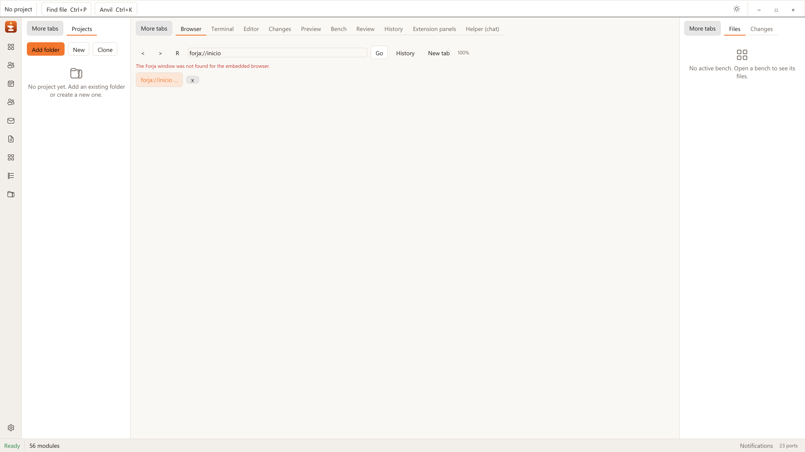

state: en.light.bench-tab.browser.tab
capture_sha: (não informado)
model: opencode/glm-5.3-flash-free
---

# Aba de bancada — painel Browser (browser.tab)

Tela principal do app em uma bancada com o painel central na aba **Browser**, que embute um navegador de URLs `forja://`; nesta captura o navegador não pôde ser iniciado e os painéis de projetos e arquivos estão vazios.

*Variante de referência: `pt-BR.dark.bench-tab.browser.tab`. Mantém a mesma estrutura; mudam o idioma (inglês), o tema (claro) e a escala — esta janela tem 1920×1080 px, contra 1024×768 da referência.*

## Como chegar
Na janela principal, clique na aba **Browser** da faixa de abas do painel central (419,52)–(492,84). A tela foi aberta com `forja-app --locale en --theme light --bench-tab browser.tab`; a captura do Atlas está em `captures/en.light.bench-tab.browser.tab.png`.

## Regiões
- **Barra superior** (0,0)–(1920,42): pílula "No project" à esquerda; botões "Find file  Ctrl+P" e "Anvil  Ctrl+K"; ícone de alternância de tema (sol, sem nome) em (1741,5)–(1773,37); botões de janela "–", "□" e "×" à direita.
- **Trilho à esquerda** (0,42)–(48,1048): logotipo (12,50)–(40,78) no topo e coluna de botões-ícone: "Board", "Helpers", "Routines", "Muster", "Requests", "Skills", "Usage", "Extensions", "Archive" e, no rodapé do trilho, "Settings".
- **Painel esquerdo (Projects)** (48,42)–(304,1048): botão "More tabs" e aba "Projects" (marcada); botões "Add folder", "New" e "Clone"; estado vazio com ícone de pasta (168,161)–(196,189) e o texto "No project yet. Add an existing folder or create a new one.".
- **Divisor** (304,42)–(320,1048): faixa vertical sem nome entre os painéis esquerdo e central.
- **Painel central (Browser)** (320,42)–(1612,1048): botão "More tabs" e abas "Browser" (marcada), "Terminal", "Editor", "Changes", "Preview", "Bench", "Review", "History", "Extension panels" e "Helper (chat)"; barra de navegação com "<", ">", "R", campo de endereço "forja://inicio", "Go", "History", "New tab" e o indicador "100%"; mensagem de erro "The Forja window was not found for the embedded browser."; chip "forja://inicio …" com botão de fechar "x".
- **Divisor** (1612,42)–(1628,1048): faixa vertical sem nome entre os painéis central e direito.
- **Painel direito (Files)** (1628,42)–(1920,1048): botão "More tabs" e abas "Files" (marcada) e "Changes"; estado vazio com ícone de grade (1756,117)–(1784,145) e o texto "No active bench. Open a bench to see its files.".
- **Barra de status** (0,1048)–(1920,1080): "Ready", "56 modules", "Notifications" e "23 ports"; o aviso do navegador "The page is hidden while a panel or window is on top." fica na borda superior dessa faixa.

## Elementos
| Elemento | Tipo | Posição (px) | Estado | O que faz |
|---|---|---|---|---|
| "Find file  Ctrl+P" | Button | (99,5)–(218,37) | click,focus | Abre a busca rápida de arquivos (atalho Ctrl+P). |
| "Anvil  Ctrl+K" | Button | (226,5)–(327,37) | click,focus | Abre a paleta de comandos (atalho Ctrl+K). |
| (sem nome acessível) | Unknown | (1741,5)–(1773,37) | click,focus | Ícone de sol: alterna o tema da interface. |
| "–" | Button | (1795,5)–(1827,37) | click,focus | Minimiza a janela. |
| "□" | Button | (1835,5)–(1867,37) | click,focus | Restaura/maximiza a janela. |
| "×" | Button | (1875,5)–(1909,37) | click,focus | Fecha a janela. |
| "No project" | Label | (11,12)–(77,31) | click,focus | Indica que nenhum projeto está aberto; provavelmente abre a lista de projetos. |
| (sem nome acessível) | Unknown | (304,42)–(320,1048) | focus | Divisor vertical entre painel esquerdo e central. |
| (sem nome acessível) | Unknown | (1612,42)–(1628,1048) | focus | Divisor vertical entre painel central e direito. |
| (sem nome acessível) | Image | (12,50)–(40,78) | click,focus | Logotipo da Forja no topo do trilho. |
| "More tabs" | Button | (64,50)–(151,85) | click,focus | Lista as abas do painel esquerdo que não couberam na faixa. |
| "More tabs" | Button | (324,50)–(411,85) | click,focus | Lista as abas do painel central que não couberam na faixa. |
| "More tabs" | Button | (1632,50)–(1719,85) | click,focus | Lista as abas do painel direito que não couberam na faixa. |
| "Projects" | Button | (159,52)–(231,84) | click,focus | marcado=True — aba ativa do painel esquerdo, mostra a lista de projetos. |
| "Browser" | Button | (419,52)–(492,84) | click,focus | marcado=True — aba atual do painel central, mostra o navegador embutido. |
| "Terminal" | Button | (492,52)–(569,84) | click,focus | marcado=False — aba do painel central para o terminal. |
| "Editor" | Button | (569,52)–(629,84) | click,focus | marcado=False — aba do painel central para o editor. |
| "Changes" | Button | (629,52)–(706,84) | click,focus | marcado=False — aba de mudanças da bancada. |
| "Preview" | Button | (706,52)–(777,84) | click,focus | marcado=False — aba de pré-visualização. |
| "Bench" | Button | (777,52)–(838,84) | click,focus | marcado=False — aba de detalhes da bancada. |
| "Review" | Button | (838,52)–(905,84) | click,focus | marcado=False — aba de revisão. |
| "History" | Button | (905,52)–(973,84) | click,focus | marcado=False — aba de histórico da bancada. |
| "Extension panels" | Button | (973,52)–(1099,84) | click,focus | marcado=False — aba de painéis de extensões. |
| "Helper (chat)" | Button | (1099,52)–(1202,84) | click,focus | marcado=False — aba do chat do ajudante. |
| "Files" | Button | (1727,52)–(1778,84) | click,focus | marcado=True — aba ativa do painel direito, lista de arquivos da bancada. |
| "Changes" | Button | (1778,52)–(1855,84) | click,focus | marcado=False — segunda aba de mudanças, no painel direito. |
| "Board" | Button | (8,94)–(44,130) | click,focus | marcado=False — botão-ícone do trilho para o quadro. |
| "Add folder" | Button | (64,101)–(154,133) | click,focus | Ação destacada (laranja) para importar uma pasta como projeto. |
| "New" | Button | (162,101)–(213,133) | click,focus | Cria um novo projeto. |
| "Clone" | Button | (221,101)–(280,133) | click,focus | Abre o fluxo de clonagem de repositório/projeto. |
| "<" | Button | (324,109)–(358,141) | click,focus | Navega para a página anterior do navegador. |
| ">" | Button | (366,109)–(399,141) | click,focus | Navega para a página seguinte do navegador. |
| "R" | Button | (407,109)–(440,141) | click,focus | Recarrega a página atual do navegador. |
| "Go" | Button | (884,109)–(925,141) | click,focus | Confirma/navega para a URL digitada no campo de endereço. |
| "History" | Button | (933,109)–(1001,141) | click,focus | Abre o histórico do navegador embutido (mesmo nome da aba "History" do painel central). |
| "New tab" | Button | (1009,109)–(1084,141) | click,focus | Abre uma nova aba do navegador. |
| "100%" | Label | (1091,109)–(1119,141) | click | Indicador de zoom da página do navegador. |
| "forja://inicio" | TextInput | (448,114)–(876,137) | click,focus | Campo de endereço do navegador, com a URL inicial. |
| (ícone) | Label | (1756,117)–(1784,145) | click | Ícone de grade do estado vazio do painel de arquivos. |
| "Helpers" | Button | (8,138)–(44,174) | click,focus | marcado=False — botão-ícone do trilho para ajudantes. |
| "The Forja window was not found for the embedded browser." | Label | (324,149)–(644,165) | click | Mensagem de erro: o navegador embutido não encontrou a janela da Forja. |
| "No active bench. Open a bench to see its files." | Label | (1644,153)–(1896,191) | click | Estado vazio do painel de arquivos. |
| (ícone) | Label | (168,161)–(196,189) | click | Ícone de pasta do estado vazio do painel de projetos. |
| "forja://inicio …" | Button | (324,173)–(436,208) | click,focus | Chip da aba "forja://inicio" aberta no navegador (sem conteúdo carregado). |
| "x" | Button | (444,181)–(475,200) | click,focus | Fecha o chip/aba "forja://inicio". |
| "Routines" | Button | (8,182)–(44,218) | click,focus | marcado=False — botão-ícone do trilho para rotinas. |
| "No project yet. Add an existing folder or create a new one." | Label | (67,197)–(297,235) | click | Estado vazio do painel de projetos. |
| "Muster" | Button | (8,226)–(44,262) | click,focus | marcado=False — botão-ícone do trilho para o mutirão. |
| "Requests" | Button | (8,270)–(44,306) | click,focus | marcado=False — botão-ícone do trilho para pedidos. |
| "Skills" | Button | (8,314)–(44,350) | click,focus | marcado=False — botão-ícone do trilho para skills. |
| "Usage" | Button | (8,358)–(44,394) | click,focus | marcado=False — botão-ícone do trilho para uso. |
| "Extensions" | Button | (8,402)–(44,438) | click,focus | marcado=False — botão-ícone do trilho para extensões. |
| "Archive" | Button | (8,446)–(44,482) | click,focus | marcado=False — botão-ícone do trilho para o acervo. |
| "Settings" | Button | (8,1004)–(44,1040) | click,focus | marcado=False — botão-ícone do trilho para os ajustes, no rodapé do trilho. |
| "The page is hidden while a panel or window is on top." | Label | (324,1048)–(609,1064) | click | Aviso do navegador embutido: a página é pausada quando coberta. |
| "Ready" | Label | (10,1055)–(48,1074) | click | Status geral na barra inferior. |
| "56 modules" | Label | (70,1055)–(142,1074) | click | Quantidade de módulos carregados. |
| "Notifications" | Label | (1765,1055)–(1843,1074) | click,focus | Área/atalho de notificações na barra de status. |
| "23 ports" | Label | (1859,1056)–(1902,1072) | click | Quantidade de portas ativas. |

## Aparência
Tema claro de fundo creme/off-white (tons próximos de #f5f1ea), com painéis em variação sutil de tom e divisores claros de 16 px — é a principal diferença visual para a referência escura. A cor de destaque continua o laranja ("Brasa"): fundo laranja no botão "Add folder", sublinhado laranja sob as abas marcadas "Projects", "Browser" e "Files", e borda e texto laranja no chip "forja://inicio …". A mensagem de erro do navegador aparece em laranja-avermelhado. Textos em cinza-escuro sobre fundo claro, sans-serif de ~12–14 px; abas e botões de barra têm ~32 px de altura com espaçamento uniforme, alinhados à esquerda nas faixas de abas e centralizados nos botões-ícone do trilho. A barra de status usa texto menor (~12 px), com "Ready" à esquerda e "Notifications"/"23 ports" à direita.

## Problemas encontrados
- Texto não traduzido no idioma "en": a URL inicial "forja://inicio" usa o português ("inicio"); o esperado seria algo como "forja://home".
- O aviso "The page is hidden while a panel or window is on top." (324,1048)–(609,1064) começa exatamente na borda da barra de status (y=1048), invadindo visualmente a faixa onde ficam "Ready" e "56 modules".
- Botões de janela nomeados apenas por símbolo: "–", "□" e "×", sem nomes acessíveis descritivos (Minimize/Maximize/Close).
- Botão "x" do chip tem nome não descritivo (letra minúscula isolada); o botão "R" da barra de navegação também não indica "Reload".
- O botão "More tabs" aparece três vezes com o mesmo nome, sem indicar a qual faixa de abas pertence.
- Nomes duplicados sem diferenciação: "History" (aba do painel central e botão do navegador), "Changes" (painéis central e direito) e os dois rótulos "(ícone)".
- Elementos sem nome acessível: alternador de tema (1741,5)–(1773,37), os dois divisores verticais, o logotipo (12,50)–(40,78) e os dois rótulos "(ícone)".
- As faixas de abas dependem de "More tabs": no painel central só "Browser" fica visível e as demais nove abas ficam escondidas atrás do menu suspenso.
- Baixo contraste relativo nos textos de estado vazio ("No project yet…", "No active bench…") e nas abas inativas, em cinza claro sobre fundo creme.
