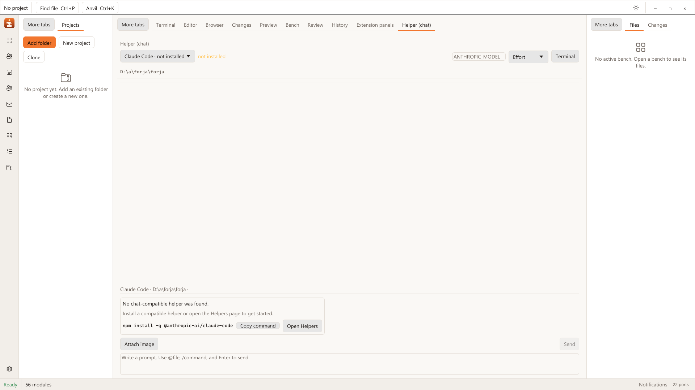

# Bancada — aba Helper (chat)

Tela da bancada com a aba "Helper (chat)" ativa: painel central de conversa com o agente de código, ladeado pelo painel de projetos à esquerda e pelo painel de arquivos da bancada à direita. Variante en, tema claro (referência: pt-BR.dark.bench-tab.chat.tab); captura em janela de 1920×1080.

## Como chegar
Na janela principal, abra uma bancada e, no grupo de abas do cabeçalho da bancada, clique em "Helper (chat)". Nesta captura nenhuma bancada está aberta e a aba já vem selecionada; o comando é: `forja-app --locale en --theme light --bench-tab chat.tab`.

## Regiões
- **Barra de título** (0,0)–(1920,37): rótulo "No project", botões "Find file  Ctrl+P" e "Anvil  Ctrl+K", botão-ícone de tema (sol) e os botões de janela "–", "□" e "×".
- **Trilho à esquerda** (0,37)–(52,1048): logotipo da Forja (imagem laranja, 12,50–40,78) e coluna de botões-ícone: "Board", "Helpers", "Routines", "Muster", "Requests", "Skills", "Usage", "Extensions", "Archive" e, no pé, "Settings".
- **Painel lateral esquerdo** (52,37)–(304,1048): botão "More tabs" e aba "Projects" (marcada); botões "Add folder" (destacado em laranja), "New" e "Clone"; estado vazio com ícone de pasta e o texto "No project yet. Add an existing folder or create a new one.".
- **Divisor 1** (304,42)–(320,1048): separador vertical arrastável entre o painel esquerdo e a área central.
- **Área central** (320,37)–(1612,1048): faixa de abas com "More tabs" e as abas "Helper (chat)" (marcada), "Terminal", "Editor", "Browser", "Changes", "Preview", "Bench", "Review", "History" e "Extension panels"; cabeçalho do chat com o título "Helper (chat)", o ajudante "Claude Code", o status "idle" (verde) e o caminho "D:\a\forja\forja" em fonte monoespaçada; à direita do mesmo cabeçalho, o campo de texto com "ANTHROPIC_MODEL", o ComboBox "Effort" e o botão "Terminal" (1249–1600, antes do divisor); área de mensagens vazia; rodapé com "Claude Code · D:\a\forja\forja ·", botões "Attach image" e "Send" e o campo multilinha.
- **Divisor 2** (1612,42)–(1628,1048): separador vertical arrastável entre a área central e o painel direito.
- **Painel direito** (1628,37)–(1920,1048): botão "More tabs" e abas "Files" (marcada) e "Changes"; estado vazio com ícone de grade e a mensagem "No active bench. Open a bench to see its files.".
- **Barra de status** (0,1048)–(1920,1080): "Ready" e "56 modules" à esquerda e "Notifications" à direita.

Diferenças vs. referência: os textos estão em inglês ("Find file" vs "Achar arquivo", "Anvil" vs "Bigorna", "idle" vs "ocioso", "More tabs" vs "Mais abas" etc.); o grupo esquerdo só exibe "Projects", com as demais abas recolhidas em "More tabs"; os grupos de abas não se sobrepõem como na referência de 1024 px — nenhuma aba, botão ou campo fica fora da janela.

## Elementos
| Elemento | Tipo | Posição (px) | Estado | O que faz |
|---|---|---|---|---|
| "Find file  Ctrl+P" | Button | (99,5)–(218,37) | — | Abre a busca rápida de arquivos (atalho Ctrl+P). |
| "Anvil  Ctrl+K" | Button | (226,5)–(327,37) | — | Abre a paleta de comandos (atalho Ctrl+K). |
| (sem nome acessível) | Unknown | (1741,5)–(1773,37) | — | Ícone de sol: alterna o tema da interface. |
| "–" | Button | (1795,5)–(1827,37) | — | Minimiza a janela. |
| "□" | Button | (1835,5)–(1867,37) | — | Maximiza/restaura a janela. |
| "×" | Button | (1875,5)–(1909,37) | — | Fecha a janela. |
| "No project" | Label | (11,12)–(77,31) | — | Mostra o projeto corrente; vazio porque nenhum projeto está aberto. |
| (sem nome acessível) | Unknown | (304,42)–(320,1048) | — | Divisor vertical arrastável entre o painel esquerdo e a área central. |
| (sem nome acessível) | Unknown | (1612,42)–(1628,1048) | — | Divisor vertical arrastável entre a área central e o painel direito. |
| (sem nome acessível) | Image | (12,50)–(40,78) | — | Logotipo da Forja no topo do trilho. |
| "More tabs" | Button | (64,50)–(151,85) | — | Reúne as abas ocultas do grupo esquerdo; só "Projects" aparece visível. |
| "More tabs" | Button | (324,50)–(411,85) | — | Menu de abas excedentes do grupo central. |
| "More tabs" | Button | (1632,50)–(1719,85) | — | Menu de abas excedentes do grupo direito. |
| "Projects" | Button | (159,52)–(231,84) | marcado=True | Aba ativa do painel esquerdo; mostra a lista de projetos. |
| "Helper (chat)" | Button | (419,52)–(522,84) | marcado=True | Aba selecionada do cabeçalho da bancada; mostra o chat — é o estado desta captura. |
| "Terminal" | Button | (522,52)–(600,84) | marcado=False | Aba do terminal da bancada. |
| "Editor" | Button | (600,52)–(659,84) | marcado=False | Aba do editor. |
| "Browser" | Button | (659,52)–(732,84) | marcado=False | Aba do navegador. |
| "Changes" | Button | (732,52)–(809,84) | marcado=False | Aba de alterações da bancada (grupo central). |
| "Preview" | Button | (809,52)–(880,84) | marcado=False | Aba de visualização. |
| "Bench" | Button | (880,52)–(941,84) | marcado=False | Aba da bancada. |
| "Review" | Button | (941,52)–(1008,84) | marcado=False | Aba de revisão. |
| "History" | Button | (1008,52)–(1076,84) | marcado=False | Aba de histórico. |
| "Extension panels" | Button | (1076,52)–(1202,84) | marcado=False | Aba dos painéis de extensão. |
| "Files" | Button | (1727,52)–(1778,84) | marcado=True | Aba ativa do painel direito; lista os arquivos da bancada. |
| "Changes" | Button | (1778,52)–(1855,84) | marcado=False | Segunda ocorrência: aba de alterações do painel direito. |
| "Board" | Button | (8,94)–(44,130) | marcado=False | Botão-ícone do trilho; abre o quadro (board). |
| "Add folder" | Button | (64,101)–(154,133) | — | Ação destacada (fundo laranja) para adicionar uma pasta de projeto. |
| "New" | Button | (162,101)–(213,133) | — | Cria um novo projeto. |
| "Clone" | Button | (221,101)–(280,133) | — | Clona um repositório/projeto. |
| "Helper (chat)" | Label | (332,111)–(411,130) | — | Título do painel de chat. |
| (ícone) | Label | (1756,117)–(1784,145) | — | Ícone do estado vazio do painel direito (grade de quadrados), sem nome acessível. |
| "Helpers" | Button | (8,138)–(44,174) | marcado=False | Botão-ícone do trilho; abre a seção de ajudantes. |
| "Terminal" | Button | (1523,138)–(1600,173) | — | Botão no fim do cabeçalho do chat, à direita do seletor "Effort". |
| "Effort" | ComboBox | (1405,140)–(1515,175) | — | Seletor do nível de esforço do ajudante. |
| "Claude Code" | Label | (332,142)–(436,166) | — | Nome do ajudante em uso no chat. |
| "idle" | Label | (444,145)–(466,164) | — | Status do ajudante, exibido em verde. |
| (sem nome acessível) | TextInput | (1249,145)–(1397,168) | — | Campo do cabeçalho do chat exibindo o identificador de modelo "ANTHROPIC_MODEL". |
| "No active bench. Open a bench to see its files." | Label | (1644,153)–(1896,191) | — | Estado vazio do painel de arquivos da bancada. |
| (ícone) | Label | (168,161)–(196,189) | — | Ícone de pasta do estado vazio do painel de projetos, sem nome acessível. |
| "Routines" | Button | (8,182)–(44,218) | marcado=False | Botão-ícone do trilho; abre a seção de rotinas. |
| "D:\a\forja\forja" | Label | (332,191)–(454,206) | — | Caminho do projeto da conversa, em fonte monoespaçada. |
| "No project yet. Add an existing folder or create a new one." | Label | (67,197)–(297,235) | — | Mensagem de estado vazio da lista de projetos. |
| "Muster" | Button | (8,226)–(44,262) | marcado=False | Botão-ícone do trilho; abre a seção Muster (pt-BR "Mutirão"). |
| "Requests" | Button | (8,270)–(44,306) | marcado=False | Botão-ícone do trilho; abre a seção de pedidos. |
| "Skills" | Button | (8,314)–(44,350) | marcado=False | Botão-ícone do trilho; abre a seção de skills. |
| "Usage" | Button | (8,358)–(44,394) | marcado=False | Botão-ícone do trilho; abre a seção de uso. |
| "Extensions" | Button | (8,402)–(44,438) | marcado=False | Botão-ícone do trilho; abre a seção de extensões. |
| "Archive" | Button | (8,446)–(44,482) | marcado=False | Botão-ícone do trilho; abre a seção de acervo. |
| "Claude Code · D:\a\forja\forja ·" | Label | (332,902)–(524,921) | — | Rodapé do chat com o contexto da conversa (ajudante e caminho). |
| "Attach image" | Button | (332,935)–(437,970) | — | Anexa uma imagem à mensagem do chat. |
| "Send" | Button | (1546,935)–(1600,970) | — | Envia a mensagem digitada. |
| (sem nome acessível) | MultilineTextInput | (332,978)–(1600,1038) | — | Campo multilinha para digitar o pedido ao ajudante; placeholder "Write a prompt. Use @file, /command, and Enter to send.". |
| "Settings" | Button | (8,1004)–(44,1040) | marcado=False | Botão-ícone do pé do trilho; abre os ajustes. |
| "Ready" | Label | (10,1055)–(48,1074) | — | Estado geral do app na barra de status. |
| "56 modules" | Label | (70,1055)–(142,1074) | — | Quantidade de módulos carregados. |
| "Notifications" | Label | (1808,1055)–(1886,1074) | — | Abre a área de notificações. |

## Aparência
Tema claro: fundo creme/off-white nas três colunas, com a área central do chat ligeiramente mais clara; texto em cinza-escuro e abas inativas em cinza médio. O laranja mantém o papel de destaque da referência (tema escuro), com a paleta invertida: logotipo do trilho, botão "Add folder" (fundo laranja com texto claro) e o sublinhado de 2 px das abas ativas "Projects", "Helper (chat)" e "Files". O status "idle" aparece em verde. O caminho "D:\a\forja\forja" usa fonte monoespaçada. Botões têm contorno arredondado fino e fundo levemente elevado; os do trilho são quadrados de 36 px, só com ícone. Abas com altura uniforme (~32 px) e linha separadora fina sob o cabeçalho do chat. Barra de status de uma linha (~32 px), texto pequeno. O contraste geral é bom; o texto do placeholder do campo multilinha é o elemento mais claro da tela.

## Problemas encontrados
- Botão-ícone de tema (sol, 1741,5–1773,37) sem nome acessível (papel Unknown).
- TextInput (1249,145–1397,168) e MultilineTextInput (332,978–1600,1038) sem nome acessível.
- Divisores verticais (304,42) e (1612,42) e a imagem do logotipo (12,50) sem nome acessível.
- Rótulos de ícone em (1756,117) e (168,161) sem nome acessível.
- O campo do cabeçalho do chat mostra o valor técnico "ANTHROPIC_MODEL" sem rótulo visível nem nome acessível que explique sua função.
- O rótulo do rodapé do chat termina com um separador "·" solto ("Claude Code · D:\a\forja\forja ·").
- Os três grupos de abas exibem o botão "More tabs" mesmo com todas as abas visíveis (no grupo central cabem as 10 abas de 419 a 1202), tornando-o redundante.
