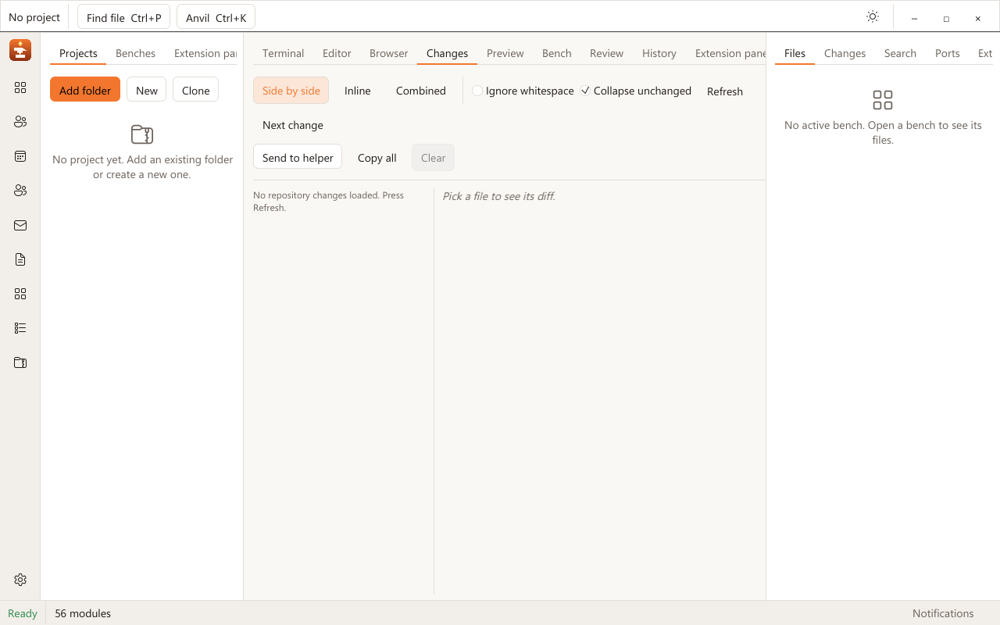

# Aba Diferenças ("Changes") do painel central — estado vazio (en, tema claro)

Tela principal do app com a aba "Changes" (diferenças) aberta no painel central, sem projeto nem bancada ativa: as áreas mostram apenas mensagens de estado vazio.

## Como chegar
Abrir o app com `forja-app --locale en --theme light --bench-tab diff.tab`; na interface, clicar na aba "Changes" na faixa de abas do painel central (a captura usa o comando acima). É a variante em inglês e tema claro da página de referência pt-BR.dark.bench-tab.diff.tab: a estrutura é a mesma; mudam os textos, as cores e o tamanho da janela (1920×1080 aqui, contra 1053×768 na referência).

## Regiões
- **Barra superior (título/comandos)**: (0,0)–(1920,42). Rótulo do projeto ("No project"), botões "Find file  Ctrl+P" e "Anvil  Ctrl+K", alternador de tema (ícone de sol, sem nome acessível) e botões de janela (–, □, ×).
- **Trilho à esquerda**: (0,42)–(56,1048). Coluna de ícones: logo da Forja no topo e botões "Board", "Helpers", "Routines", "Muster", "Requests", "Skills", "Usage", "Extensions", "Archive", com "Settings" fixado embaixo.
- **Painel lateral esquerdo (Projects)**: (56,42)–(304,1048). Botão de transbordo "More tabs", aba "Projects" (ativa), botões "Add folder" (destaque laranja), "New", "Clone"; mensagem "No project yet. Add an existing folder or create a new one." com ícone de pasta.
- **Divisor 1**: (304,42)–(320,1048). Separador vertical redimensionável entre o painel esquerdo e a área central.
- **Área central (Changes/diff)**: (320,42)–(1612,1048). Botão "More tabs"; abas "Changes" (ativa), "Terminal", "Editor", "Browser", "Preview", "Bench", "Review", "History", "Extension panels", "Helper (chat)"; barra de modo ("Side by side", "Inline", "Combined"), caixas "Ignore whitespace" e "Collapse unchanged", botões "Refresh", "Previous change" e "Next change"; segunda linha com "Send to helper", "Copy all" e "Clear" (desativado); mensagens "No repository changes loaded. Press Refresh." e "Pick a file to see its diff.".
- **Divisor 2**: (1612,42)–(1628,1048). Separador vertical entre a área central e o painel direito.
- **Painel direito (Files)**: (1628,42)–(1920,1048). Botão "More tabs"; abas "Files" (ativa) e "Changes"; ícone de grade e mensagem "No active bench. Open a bench to see its files.".
- **Barra de status**: (0,1048)–(1920,1080). "Ready" à esquerda, "56 modules" ao lado e "Notifications" à direita.

## Elementos
| Elemento | Tipo | Posição (px) | Estado | O que faz |
|---|---|---|---|---|
| "Find file  Ctrl+P" | Botão | (99,5)–(218,37) | — | Abre a busca rápida de arquivos (atalho Ctrl+P). |
| "Anvil  Ctrl+K" | Botão | (226,5)–(327,37) | — | Abre a paleta de comandos (atalho Ctrl+K); equivale à "Bigorna" da referência. |
| (sem nome acessível) | Desconhecido | (1741,5)–(1773,37) | — | Ícone de sol na barra superior; alternador de tema. |
| "–" | Botão | (1795,5)–(1827,37) | — | Minimiza a janela. |
| "□" | Botão | (1835,5)–(1867,37) | — | Maximiza/restaura a janela. |
| "×" | Botão | (1875,5)–(1909,37) | — | Fecha a janela. |
| "No project" | Rótulo | (11,12)–(77,31) | — | Mostra o projeto atual (nenhum aberto); clicável. |
| (sem nome acessível) | Desconhecido | (304,42)–(320,1048) | — | Divisor vertical redimensionável entre o painel esquerdo e a área central. |
| (sem nome acessível) | Desconhecido | (1612,42)–(1628,1048) | — | Divisor vertical entre a área central e o painel direito. |
| (sem nome acessível) | Imagem | (12,50)–(40,78) | — | Ícone/logo da Forja no topo do trilho. |
| "More tabs" | Botão | (64,50)–(151,85) | — | Transbordo da faixa de abas do painel esquerdo; revela as abas ocultas. |
| "More tabs" | Botão | (324,50)–(411,85) | — | Transbordo da faixa de abas do painel central. |
| "More tabs" | Botão | (1632,50)–(1719,85) | — | Transbordo da faixa de abas do painel direito. |
| "Projects" | Botão | (159,52)–(231,84) | marcado=True | Aba ativa do painel esquerdo; mostra a lista de projetos. |
| "Changes" | Botão | (419,52)–(496,84) | marcado=True | Aba ativa do painel central; exibe o diff (equivalente a "Diferenças"). |
| "Terminal" | Botão | (496,52)–(573,84) | marcado=False | Aba do painel central; abre o terminal. |
| "Editor" | Botão | (573,52)–(633,84) | marcado=False | Aba do painel central; abre o editor. |
| "Browser" | Botão | (633,52)–(706,84) | marcado=False | Aba do painel central; abre o navegador. |
| "Preview" | Botão | (706,52)–(777,84) | marcado=False | Aba do painel central; abre o visualizador. |
| "Bench" | Botão | (777,52)–(838,84) | marcado=False | Aba do painel central; abre a bancada. |
| "Review" | Botão | (838,52)–(905,84) | marcado=False | Aba do painel central; abre a revisão. |
| "History" | Botão | (905,52)–(973,84) | marcado=False | Aba do painel central; abre o histórico. |
| "Extension panels" | Botão | (973,52)–(1099,84) | marcado=False | Aba do painel central; abre os painéis de extensões. |
| "Helper (chat)" | Botão | (1099,52)–(1202,84) | marcado=False | Aba do painel central; abre o ajudante (chat). |
| "Files" | Botão | (1727,52)–(1778,84) | marcado=True | Aba ativa do painel direito; lista de arquivos da bancada. |
| "Changes" | Botão | (1778,52)–(1855,84) | marcado=False | Aba do painel direito; lista de mudanças. |
| "Board" | Botão | (8,94)–(44,130) | marcado=False | Botão-ícone do trilho; abre o quadro. |
| "Add folder" | Botão | (64,101)–(154,133) | — | Ação primária (laranja) para adicionar uma pasta de projeto. |
| "New" | Botão | (162,101)–(213,133) | — | Cria um novo projeto. |
| "Clone" | Botão | (221,101)–(280,133) | — | Clona um repositório como projeto. |
| "Side by side" | Botão | (324,109)–(421,144) | — | Modo de diff em duas colunas; aparece selecionado (texto laranja) na imagem. |
| "Inline" | Botão | (429,109)–(487,144) | — | Modo de diff em linha única. |
| "Combined" | Botão | (495,109)–(582,144) | — | Modo de diff combinado. |
| "Ignore whitespace" | Caixa de seleção | (604,111)–(734,143) | marcado=False | Ignora diferenças de espaço em branco; desenhada como círculo vazio. |
| "Collapse unchanged" | Caixa de seleção | (742,111)–(885,143) | marcado=True | Recolhe trechos sem mudanças; exibida com marca de seleção. |
| "Refresh" | Botão | (893,111)–(963,143) | — | Recarrega o diff. |
| "Previous change" | Botão | (971,111)–(1096,143) | — | Navega à mudança anterior. |
| "Next change" | Botão | (1104,111)–(1205,143) | — | Navega à próxima mudança. |
| (ícone) | Rótulo | (1756,117)–(1784,145) | — | Ícone de grade do estado vazio do painel de arquivos. |
| "Helpers" | Botão | (8,138)–(44,174) | marcado=False | Botão-ícone do trilho; abre os ajudantes. |
| "Send to helper" | Botão | (324,152)–(438,184) | — | Envia o diff atual ao ajudante de código. |
| "Copy all" | Botão | (446,152)–(519,184) | — | Copia todas as diferenças para a área de transferência. |
| "Clear" | Botão | (527,152)–(582,187) | desativado | Limpa a seleção/diff atual; indisponível sem conteúdo. |
| "No active bench. Open a bench to see its files." | Rótulo | (1644,153)–(1896,191) | — | Mensagem de estado vazio do painel de arquivos, em duas linhas. |
| (ícone) | Rótulo | (168,161)–(196,189) | — | Ícone de pasta do estado vazio do painel de projetos. |
| "Routines" | Botão | (8,182)–(44,218) | marcado=False | Botão-ícone do trilho; abre as rotinas. |
| "No project yet. Add an existing folder or create a new one." | Rótulo | (67,197)–(297,235) | — | Mensagem de estado vazio do painel de projetos, em duas linhas. |
| "No repository changes loaded. Press Refresh." | Rótulo | (324,209)–(519,241) | — | Mensagem de estado vazio da área de diff, em duas linhas. |
| "Pick a file to see its diff." | Rótulo | (566,209)–(710,228) | — | Mensagem em itálico do lado direito da área de diff. |
| "Muster" | Botão | (8,226)–(44,262) | marcado=False | Botão-ícone do trilho; abre o mutirão. |
| "Requests" | Botão | (8,270)–(44,306) | marcado=False | Botão-ícone do trilho; abre os pedidos. |
| "Skills" | Botão | (8,314)–(44,350) | marcado=False | Botão-ícone do trilho; abre as skills. |
| "Usage" | Botão | (8,358)–(44,394) | marcado=False | Botão-ícone do trilho; abre o uso. |
| "Extensions" | Botão | (8,402)–(44,438) | marcado=False | Botão-ícone do trilho; abre as extensões. |
| "Archive" | Botão | (8,446)–(44,482) | marcado=False | Botão-ícone do trilho; abre o acervo. |
| "Settings" | Botão | (8,1004)–(44,1040) | marcado=False | Botão-ícone do trilho fixo embaixo; abre os ajustes. |
| "Ready" | Rótulo | (10,1055)–(48,1074) | — | Status atual na barra de status; aparece em verde. |
| "56 modules" | Rótulo | (70,1055)–(142,1074) | — | Quantidade de módulos carregados. |
| "Notifications" | Rótulo | (1808,1055)–(1886,1074) | — | Abre a área de notificações. |

## Aparência
Tema claro: fundos em creme/off-white (bege quente) na barra superior, trilho e painéis, com o painel esquerdo em tom levemente mais escuro que a área central; texto em cinza-escuro sobre fundo claro, com contraste geral melhor que na variante escura de referência. Cor de destaque laranja, usada na ação primária "Add folder" (fundo laranja), nas abas ativas "Projects" e "Changes" (texto e sublinhado) e no modo selecionado "Side by side" (texto laranja); status "Ready" em verde. Tipografia sans-serif; mensagens de estado vazio em cinza itálico. Alinhamento consistente: trilho de ícones de 36 px, faixas de abas com sublinhado na base, barra de ferramentas do diff em duas linhas (y≈109 e y≈152) e divisores verticais de 16 px separando os três painéis; muito espaço vazio por serem estados sem conteúdo. Diferenças em relação à referência: janela maior (1920×1080), os textos em inglês, as abas dos painéis esquerdo e direito aparecem recolhidas atrás dos botões "More tabs" (na referência ficavam inline) e, por causa da largura extra, nenhum elemento é cortado pelo divisor ou pela borda da janela.

## Problemas encontrados
- Botão da barra superior sem nome acessível em (1741,5)–(1773,37) (ícone de sol, alternador de tema); os dois divisores verticais, o logo do trilho e os ícones de estado vazio também não têm nome acessível.
- Três botões com o mesmo nome acessível "More tabs" (64–151, 324–411 e 1632–1719) e o nome "Changes" repetido em faixas diferentes (aba ativa do painel central em 419–496 e aba do painel direito em 1778–1855), sem contexto que os distinga para leitor de tela.
- A caixa "Ignore whitespace" (marcado=False) é desenhada como um círculo vazio, semelhante a um botão de opção, em vez do quadrado com marca usado em "Collapse unchanged", o que confunde o tipo do controle.
- Mensagens de estado vazio em cinza itálico ("Pick a file to see its diff.", "No repository changes loaded. Press Refresh.", "No project yet. Add an existing folder or create a new one.") têm contraste menor que o texto padrão.
- "Clear" desativado com contraste reduzido (esperado para estado desabilitado).
