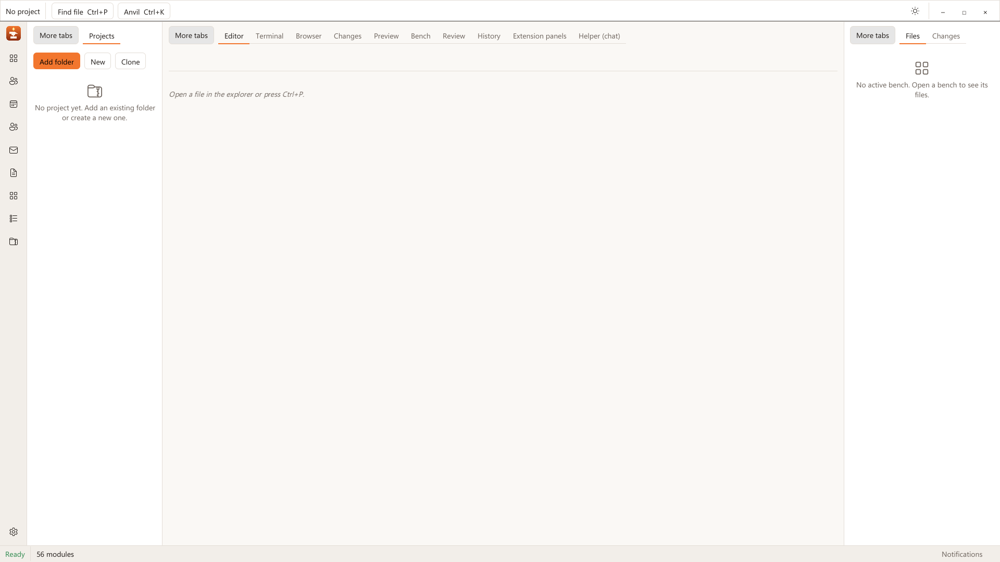

# Tela principal — aba Editor sem projeto (bench-tab editor.tab) — variante en/light

Janela principal da Forja no estado inicial, sem projeto aberto, com o painel central na aba "Editor" e o painel direito em "Files", ambos exibindo mensagens de vazio. Variante em inglês com tema claro da página de referência (pt-BR.dark): mesma estrutura, textos em inglês e fundo claro; a janela de captura é maior (1920×1080 px), o que elimina as sobreposições de abas vistas na referência.

## Como chegar
Abrir o app já leva a esta tela quando nenhum projeto está ativo: `forja-app --locale en --theme light --bench-tab editor.tab`. Pela interface, é a janela inicial; a aba "Editor" do grupo central e a aba "Files" do grupo direito estão selecionadas.

## Regiões
- **Barra superior** (0,0)–(1920,42): à esquerda o rótulo "No project" e os botões "Find file  Ctrl+P" e "Anvil  Ctrl+K"; à direita um ícone de tema (sol) sem nome acessível e os botões de janela "–", "□" e "×".
- **Trilho à esquerda** (0,42)–(52,1048): logotipo da Forja no topo e uma coluna de ícones-quadrados: "Board", "Helpers", "Routines", "Muster", "Requests", "Skills", "Usage", "Extensions", "Archive" e, no rodapé do trilho, "Settings".
- **Painel lateral esquerdo** (52,42)–(304,1048): botão "More tabs" e a aba "Projects" (selecionada); botões "Add folder" (destacado em laranja), "New" e "Clone"; ícone de pasta e a mensagem "No project yet. Add an existing folder or create a new one.".
- **Área central** (320,42)–(1612,1048): grupo de abas com "More tabs", "Editor" (selecionada, com sublinhado laranja), "Terminal", "Browser", "Changes", "Preview", "Bench", "Review", "History", "Extension panels" e "Helper (chat)"; abaixo, uma régua horizontal e a mensagem em itálico "Open a file in the explorer or press Ctrl+P." sobre fundo vazio.
- **Painel direito** (1628,42)–(1920,1048): botão "More tabs" e as abas "Files" (selecionada) e "Changes"; ícone de grade e a mensagem "No active bench. Open a bench to see its files.".
- **Barra de status** (0,1048)–(1920,1080): à esquerda "Ready" (em verde) e "56 modules"; à direita "Notifications".

## Elementos
| Elemento | Tipo | Posição (px) | Estado | O que faz |
|---|---|---|---|---|
| "Find file  Ctrl+P" | Button | (99,5)–(218,37) | — | Abre a busca rápida de arquivos pelo nome (atalho Ctrl+P); equivalente a "Achar arquivo Ctrl+P" na referência. |
| "Anvil  Ctrl+K" | Button | (226,5)–(327,37) | — | Abre a paleta de comandos (atalho Ctrl+K); equivalente a "Bigorna Ctrl+K" na referência. |
| (sem nome acessível) | Unknown | (1741,5)–(1773,37) | — | Ícone de sol; alterna o tema da interface. |
| "–" | Button | (1795,5)–(1827,37) | — | Minimiza a janela. |
| "□" | Button | (1835,5)–(1867,37) | — | Maximiza/restaura a janela. |
| "×" | Button | (1875,5)–(1909,37) | — | Fecha a janela. |
| "No project" | Label | (11,12)–(77,31) | — | Mostra que não há projeto aberto; abre a lista de projetos (equivalente a "Nenhum projeto"). |
| (sem nome acessível) | Unknown | (304,42)–(320,1048) | foco | Divisor arrastável entre o painel esquerdo e a área central. |
| (sem nome acessível) | Unknown | (1612,42)–(1628,1048) | foco | Divisor arrastável entre a área central e o painel direito. |
| (sem nome acessível) | Image | (12,50)–(40,78) | — | Logotipo da Forja no topo do trilho. |
| "More tabs" | Button | (64,50)–(151,85) | — | Lista as abas ocultas do painel esquerdo (na referência, "Bancadas" e "Painéis de extensões" apareciam como abas). |
| "More tabs" | Button | (324,50)–(411,85) | — | Lista as abas ocultas do início do grupo central. |
| "More tabs" | Button | (1632,50)–(1719,85) | — | Lista as abas ocultas do painel direito. |
| "Projects" | Button | (159,52)–(231,84) | marcado=True | Aba selecionada do painel esquerdo; mostra a lista de projetos. |
| "Editor" | Button | (419,52)–(479,84) | marcado=True | Aba central selecionada; mostra o editor de arquivos. |
| "Terminal" | Button | (479,52)–(556,84) | marcado=False | Aba central que abriria o terminal integrado. |
| "Browser" | Button | (556,52)–(629,84) | marcado=False | Aba central do navegador de código/estrutura (equivalente a "Navegador"). |
| "Changes" | Button | (629,52)–(706,84) | marcado=False | Aba central de comparação de arquivos (equivalente a "Diferenças"). |
| "Preview" | Button | (706,52)–(777,84) | marcado=False | Aba central de pré-visualização (equivalente a "Visualizador"). |
| "Bench" | Button | (777,52)–(838,84) | marcado=False | Aba central que mostraria o conteúdo da bancada. |
| "Review" | Button | (838,52)–(905,84) | marcado=False | Aba central de revisão de código. |
| "History" | Button | (905,52)–(973,84) | marcado=False | Aba central de histórico. |
| "Extension panels" | Button | (973,52)–(1099,84) | marcado=False | Aba central de painéis de extensão. |
| "Helper (chat)" | Button | (1099,52)–(1202,84) | marcado=False | Aba central do chat do ajudante (equivalente a "Ajudante (chat)"). |
| "Files" | Button | (1727,52)–(1778,84) | marcado=True | Aba selecionada do painel direito; mostra o explorador de arquivos. |
| "Changes" | Button | (1778,52)–(1855,84) | marcado=False | Aba do painel direito com as alterações da bancada. |
| "Board" | Button | (8,94)–(44,130) | marcado=False | Atalho do trilho para o quadro de tarefas (equivalente a "Quadro"). |
| "Add folder" | Button | (64,101)–(154,133) | — | Abre o seletor para adicionar uma pasta como projeto; botão primário em laranja (equivalente a "Adicionar pasta"). |
| "New" | Button | (162,101)–(213,133) | — | Cria um projeto novo (equivalente a "Novo"). |
| (ícone) | Label | (1756,117)–(1784,145) | — | Ícone de grade do estado vazio do painel "Files". |
| "Clone" | Button | (221,101)–(280,133) | — | Clona um repositório para criar um projeto (equivalente a "Clonar"). |
| "Helpers" | Button | (8,138)–(44,174) | marcado=False | Atalho do trilho para a lista de ajudantes (equivalente a "Ajudantes"). |
| "No active bench. Open a bench to see its files." | Label | (1644,153)–(1896,191) | — | Mensagem de vazio do explorador de arquivos (equivalente a "Nenhuma bancada ativa. Abra uma bancada para ver os arquivos."). |
| (ícone) | Label | (168,161)–(196,189) | — | Ícone de pasta do estado vazio da lista de projetos. |
| "Open a file in the explorer or press Ctrl+P." | Label | (324,171)–(583,190) | — | Mensagem de vazio da área do editor, em itálico (equivalente a "Abra um arquivo no explorador ou pressione Ctrl+P."). |
| "Routines" | Button | (8,182)–(44,218) | marcado=False | Atalho do trilho para rotinas (equivalente a "Rotinas"). |
| "No project yet. Add an existing folder or create a new one." | Label | (67,197)–(297,235) | — | Mensagem de vazio da lista de projetos (equivalente a "Nenhum projeto ainda. Adicione uma pasta ou crie um novo."). |
| "Muster" | Button | (8,226)–(44,262) | marcado=False | Atalho do trilho para o mutirão de ajudantes (equivalente a "Mutirão"). |
| "Requests" | Button | (8,270)–(44,306) | marcado=False | Atalho do trilho para pedidos (equivalente a "Pedidos"). |
| "Skills" | Button | (8,314)–(44,350) | marcado=False | Atalho do trilho para skills. |
| "Usage" | Button | (8,358)–(44,394) | marcado=False | Atalho do trilho para o consumo de tokens (equivalente a "Uso"). |
| "Extensions" | Button | (8,402)–(44,438) | marcado=False | Atalho do trilho para extensões (equivalente a "Extensões"). |
| "Archive" | Button | (8,446)–(44,482) | marcado=False | Atalho do trilho para o acervo (equivalente a "Acervo"). |
| "Settings" | Button | (8,1004)–(44,1040) | marcado=False | Atalho do trilho para os ajustes, fixado no fim do trilho (equivalente a "Ajustes"). |
| "Ready" | Label | (10,1055)–(48,1074) | — | Estado geral do app na barra de status, em verde (equivalente a "Pronto"). |
| "56 modules" | Label | (70,1055)–(142,1074) | — | Contagem de módulos carregados (equivalente a "56 módulos"). |
| "Notifications" | Label | (1808,1055)–(1886,1074) | — | Abre o painel de notificações. |

## Aparência
Tema claro: fundo geral bege-claro (tons próximos de #f5f0e8), com painéis laterais na mesma tonalidade e a área central ligeiramente mais clara; faixas de abas e a barra de status em tons levemente mais escuros. A cor de destaque continua sendo o laranja, usado no botão primário "Add folder", no sublinhado das abas selecionadas ("Projects", "Editor", "Files") e no texto verde "Ready" da barra de status — mesma paleta da referência escura, invertida para fundo claro, com bom contraste nos textos principais. Tipografia sans-serif de corpo pequeno (aprox. 12–13 px); a mensagem do editor vem em itálico e cinza. Abas selecionadas em texto escuro, não selecionadas em cinza médio. Os três grupos de abas (esquerdo, central, direito) ficam alinhados na mesma faixa (y 50–85), separados por divisores verticais de 16 px. Botões de ação têm fundo levemente elevado e cantos arredondados; o trilho esquerdo usa apenas ícones quadrados de 36 px centralizados.

## Problemas encontrados
- Botão sem nome acessível: o ícone de tema na barra superior (1741,5)–(1773,37) é um Unknown clicável sem rótulo.
- Ícones/imagens sem alternativa textual: o logotipo (12,50)–(40,78) e os ícones de estado vazio (1756,117) e (168,161) aparecem como "(sem nome acessível)".
- Divisores verticais (304,42)–(320,1048) e (1612,42)–(1628,1048) são Unknown sem nome acessível, o que dificulta identificação por leitor de tela.
- Textos de estado vazio em cinza ("Open a file in the explorer or press Ctrl+P.", "No project yet. Add an existing folder or create a new one.", "No active bench. Open a bench to see its files.") têm contraste reduzido sobre o fundo claro.
- Diferenças em relação à referência (pt-BR.dark), por capturarem janelas de tamanhos distintos (1920×1080 vs 1024×768): nesta variante não há sobreposição de abas nem elementos fora da janela — na referência, as abas do grupo direito se sobrepunham e "Ajudante (chat)" ficava fora da largura; aqui o grupo direito mostra apenas "Files" e "Changes", e as abas excedentes ficam sob os botões "More tabs".
