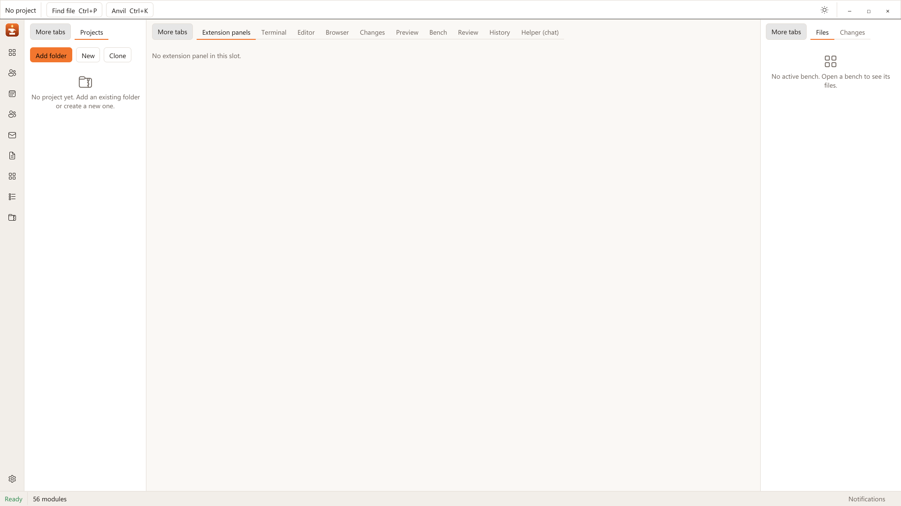

state: en.light.bench-tab.extension.panels.bench
capture_sha: 8b9dae9a56ca90d1
model: opencode/glm-5.3-flash-free
---

# Aba de bancada — Painéis de extensões (slot vazio) — variante en / light

Página de referência: `pt-BR.dark.bench-tab.extension.panels.bench`. Mesma tela e mesma estrutura; o que muda nesta variante é o idioma (todos os textos em inglês, localidade `en`), o tema (light, paleta clara do sistema "Brasa") e a janela em tamanho cheio (1920×1080 px contra 1053×768 px da referência), o que elimina os estouros e as sobreposições de abas do painel direito lá registrados.

Tela da aba de bancada com o painel central apontando para o slot `extension.panels.bench`, sem painel de extensão carregado, e os painéis laterais (Projects e Files) também em estado vazio.

## Como chegar
Abrir o app sem projeto ativo e com a aba de bancada selecionada: `forja-app --locale en --theme light --bench-tab extension.panels.bench`. Na interface: na faixa de abas da área central clicar em "Extension panels" (ou manter a aba de bancada ativa) — o painel central exibe a mensagem de slot vazio. Comando de captura: captura do estado `en.light.bench-tab.extension.panels.bench` (tema light, idioma en), imagem `captures/en.light.bench-tab.extension.panels.bench.png` (1920×1080 px, escala 1.0).

## Regiões
- **Barra superior** (0,0)–(1920,42): rótulo do projeto ("No project"), botões "Find file  Ctrl+P" e "Anvil  Ctrl+K", alternador de tema (ícone de sol, sem nome) e botões de janela (–, □, ×).
- **Trilho à esquerda** (0,42)–(52,1048): logotipo da Forja (imagem laranja) e botões-ícone na vertical: "Board", "Helpers", "Routines", "Muster", "Requests", "Skills", "Usage", "Extensions", "Archive" e, no rodapé, "Settings".
- **Painel lateral esquerdo** (52,42)–(304,1048): botão "More tabs" e a aba "Projects" (ativa, com sublinhado laranja); botões "Add folder" (destaque laranja), "New" e "Clone"; estado vazio com ícone de pasta e o texto "No project yet. Add an existing folder or create a new one.".
- **Divisor** (304,42)–(320,1048): separador redimensionável entre o painel esquerdo e a área central (sem nome acessível).
- **Área central** (320,42)–(1612,1048): botão "More tabs" e faixa de abas "Extension panels" (ativa), "Terminal", "Editor", "Browser", "Changes", "Preview", "Bench", "Review", "History" e "Helper (chat)"; abaixo, a mensagem "No extension panel in this slot." — conteúdo vazio do slot `extension.panels.bench`.
- **Divisor** (1612,42)–(1628,1048): separador redimensionável entre a área central e o painel direito (sem nome acessível).
- **Painel lateral direito** (1628,42)–(1920,1048): botão "More tabs" e abas "Files" (ativa, com sublinhado) e "Changes"; ícone de grade e a mensagem "No active bench. Open a bench to see its files.".
- **Barra de status** (0,1048)–(1920,1080): "Ready" (em verde), "56 modules" e, à direita, "Notifications".

## Elementos
| Elemento | Tipo | Posição (px) | Estado | O que faz |
|---|---|---|---|---|
| "No project" | Label | (11,12)–(77,31) | — | Rótulo na barra superior indicando ausência de projeto aberto |
| "Find file  Ctrl+P" | Button | (99,5)–(218,37) | click,focus | Abre a busca rápida de arquivos (atalho Ctrl+P) |
| "Anvil  Ctrl+K" | Button | (226,5)–(327,37) | click,focus | Abre a paleta de comandos (atalho Ctrl+K) |
| (sem nome acessível) | Unknown | (1741,5)–(1773,37) | click,focus | Ícone de sol: alternador de tema claro/escuro |
| "–" | Button | (1795,5)–(1827,37) | click,focus | Minimiza a janela |
| "□" | Button | (1835,5)–(1867,37) | click,focus | Maximiza/restaura a janela |
| "×" | Button | (1875,5)–(1909,37) | click,focus | Fecha a janela |
| (sem nome acessível) | Unknown | (304,42)–(320,1048) | focus | Divisor vertical entre o painel esquerdo e a área central |
| (sem nome acessível) | Unknown | (1612,42)–(1628,1048) | focus | Divisor vertical entre a área central e o painel direito |
| (sem nome acessível) | Image | (12,50)–(40,78) | click,focus | Logotipo da Forja (bigorna laranja) no topo do trilho |
| "More tabs" | Button | (64,50)–(151,85) | click,focus | Menu de abas ocultas do painel esquerdo (Bancadas, Painéis de extensões) |
| "Projects" | Button | (159,52)–(231,84) | click,focus; marcado=True | Aba ativa do painel esquerdo; mostra a lista de projetos |
| "More tabs" | Button | (324,50)–(411,85) | click,focus | Menu de abas ocultas do início da faixa central |
| "Extension panels" | Button | (419,52)–(545,84) | click,focus; marcado=True | Aba ativa da área central; mostra o slot `extension.panels.bench` |
| "Terminal" | Button | (545,52)–(622,84) | click,focus; marcado=False | Aba do painel central que mostra o terminal |
| "Editor" | Button | (622,52)–(682,84) | click,focus; marcado=False | Aba que mostra o editor de arquivos |
| "Browser" | Button | (682,52)–(755,84) | click,focus; marcado=False | Aba que mostra o navegador |
| "Changes" | Button | (755,52)–(832,84) | click,focus; marcado=False | Aba que mostra o visor de diferenças |
| "Preview" | Button | (832,52)–(903,84) | click,focus; marcado=False | Aba que mostra o visualizador |
| "Bench" | Button | (903,52)–(964,84) | click,focus; marcado=False | Aba que mostra a bancada |
| "Review" | Button | (964,52)–(1031,84) | click,focus; marcado=False | Aba que mostra a revisão |
| "History" | Button | (1031,52)–(1099,84) | click,focus; marcado=False | Aba que mostra o histórico |
| "Helper (chat)" | Button | (1099,52)–(1202,84) | click,focus; marcado=False | Aba do chat do ajudante |
| "More tabs" | Button | (1632,50)–(1719,85) | click,focus | Menu de abas ocultas do painel direito |
| "Files" | Button | (1727,52)–(1778,84) | click,focus; marcado=True | Aba ativa do painel direito; lista de arquivos da bancada |
| "Changes" | Button | (1778,52)–(1855,84) | click,focus; marcado=False | Aba de mudanças do painel direito |
| "Board" | Button | (8,94)–(44,130) | click,focus; marcado=False | Botão-ícone do trilho para o quadro |
| "Add folder" | Button | (64,101)–(154,133) | click,focus | Adiciona uma pasta de projeto (botão em destaque laranja) |
| "New" | Button | (162,101)–(213,133) | click,focus | Cria um novo projeto |
| "Clone" | Button | (221,101)–(280,133) | click,focus | Clona um projeto/bancada |
| "No extension panel in this slot." | Label | (324,109)–(513,128) | click | Mensagem de estado vazio do slot `extension.panels.bench` |
| (ícone) | Label | (1756,117)–(1784,145) | click | Ícone de grade do estado vazio do painel direito |
| "Helpers" | Button | (8,138)–(44,174) | click,focus; marcado=False | Botão-ícone do trilho para a lista de ajudantes |
| "No active bench. Open a bench to see its files." | Label | (1644,153)–(1896,191) | click | Mensagem de estado vazio do painel de arquivos |
| (ícone) | Label | (168,161)–(196,189) | click | Ícone de pasta do estado vazio do painel de projetos |
| "Routines" | Button | (8,182)–(44,218) | click,focus; marcado=False | Botão-ícone do trilho para rotinas |
| "No project yet. Add an existing folder or create a new one." | Label | (67,197)–(297,235) | click | Mensagem de estado vazio da lista de projetos |
| "Muster" | Button | (8,226)–(44,262) | click,focus; marcado=False | Botão-ícone do trilho para o mutirão |
| "Requests" | Button | (8,270)–(44,306) | click,focus; marcado=False | Botão-ícone do trilho para pedidos |
| "Skills" | Button | (8,314)–(44,350) | click,focus; marcado=False | Botão-ícone do trilho para skills |
| "Usage" | Button | (8,358)–(44,394) | click,focus; marcado=False | Botão-ícone do trilho para uso |
| "Extensions" | Button | (8,402)–(44,438) | click,focus; marcado=False | Botão-ícone do trilho para extensões |
| "Archive" | Button | (8,446)–(44,482) | click,focus; marcado=False | Botão-ícone do trilho para o acervo |
| "Settings" | Button | (8,1004)–(44,1040) | click,focus; marcado=False | Botão-ícone do trilho para os ajustes, fixado no rodapé |
| "Ready" | Label | (10,1055)–(48,1074) | click | Status geral na barra inferior, em verde |
| "56 modules" | Label | (70,1055)–(142,1074) | click | Contagem de módulos carregados |
| "Notifications" | Label | (1808,1055)–(1886,1074) | click,focus | Atalho para notificações, à direita da barra de status |

## Aparência
Tema light com fundo creme/off-white de tonalidade quente (coerente com o sistema "Brasa"); barra superior levemente mais clara que o conteúdo, separada por um traço fino. O destaque é laranja: logotipo no trilho, botão primário "Add folder" e o sublinhado das abas ativas ("Projects", "Extension panels" e "Files"). Texto em cinza-escuro sobre fundo claro, com bom contraste nas mensagens e nos rótulos; ícones e textos de estado vazio em cinza médio (contraste menor). Tipografia sem serifa, corpo em torno de 14 px (abas e botões) e 13 px na barra de status. Espaçamento uniforme: abas com ~32 px de altura na faixa y=52–84, botões-ícone do trilho de 36×36 px com passo de 44 px, e mensagens de estado vazio centralizadas no painel correspondente. Linhas divisórias verticais separam painel esquerdo, área central e painel direito; a barra de status é separada por um traço horizontal fino. Diferente da referência dark: fundo e textos invertidos (claro/escuro), mesmo laranja de destaque, e o "Ready"/"Pronto" continua em verde.

## Problemas encontrados
- Elementos sem nome acessível: alternador de tema (1741,5), os dois divisores verticais (304,42 e 1612,42), o logotipo (12,50) e os ícones de estado vazio (1756,117 e 168,161) — apenas "Unknown"/(sem nome acessível) na árvore.
- Botões de janela nomeados apenas pelos símbolos "–", "□" e "×", sem rótulo descritivo (minimizar/maximizar/fechar).
- Nome acessível duplicado e ambíguo: três botões "More tabs" (um por painel) e dois botões "Changes" (um na faixa central, outro no painel direito) com o mesmo texto.
- Contraste menor nos estados vazios: ícones de grade e pasta e as mensagens cinza em fundo claro ficam abaixo do destaque do restante da interface.
- Nenhum estouro de largura ou altura: todos os retângulos cabem na janela de 1920×1080 px — os estouros e sobreposições de abas registrados na referência (janela de 1053×768 px) não ocorrem nesta variante.
