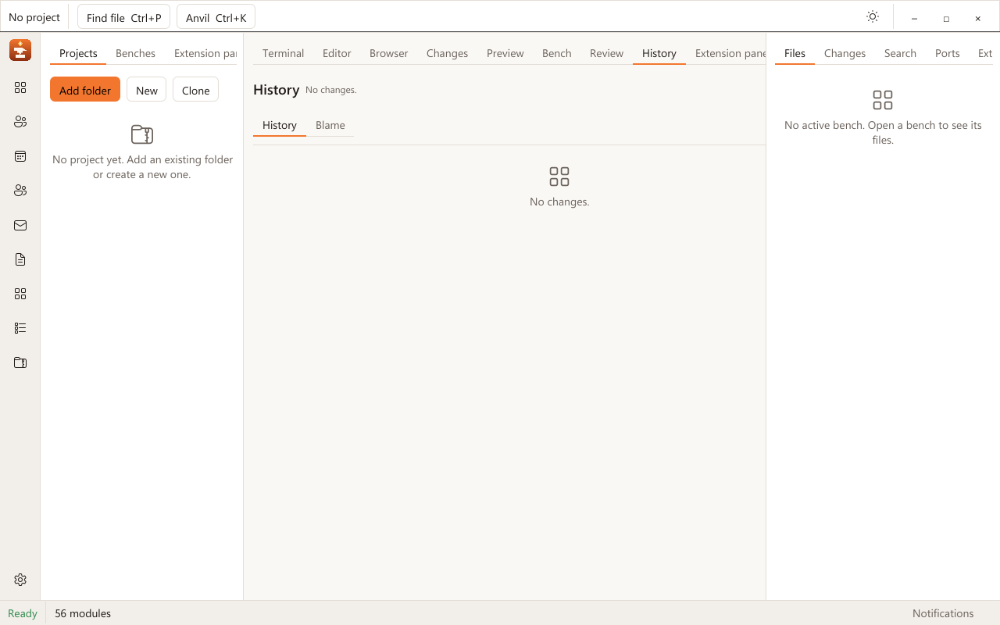

# Bancada — aba History (Git)

Tela da bancada que mostra a visão de histórico Git no painel central; nesta captura não há projeto nem bancada ativa, então histórico, projetos e arquivos aparecem vazios.

## Como chegar
Abrir a Forja, abrir uma bancada e, na faixa de abas do painel central, escolher a visão "History" (com a sub-visão "History" ativa ao lado de "Blame"); na captura não há bancada aberta, então os painéis aparecem vazios. Comando de captura: `forja-app --locale en --theme light --bench-tab git.history`.

## Regiões
- **Barra superior** (0,0)–(1920,42): rótulo "No project" à esquerda, botões "Find file  Ctrl+P" e "Anvil  Ctrl+K"; à direita, botão sem nome (ícone de sol, alternar tema) e os botões de janela "–", "□" e "×".
- **Trilho à esquerda** (0,42)–(52,1048): logotipo da Forja no topo e, abaixo, ícones de navegação "Board", "Helpers", "Routines", "Muster", "Requests", "Skills", "Usage", "Extensions", "Archive" e, na base, "Settings".
- **Faixa de abas esquerda + painel Projects** (52,42)–(304,1048): abas "More tabs" e "Projects" (ativa, com sublinhado laranja); abaixo, os botões "Add folder" (destaque laranja), "New" e "Clone" e o estado vazio com ícone de pasta e o texto "No project yet. Add an existing folder or create a new one.".
- **Divisor vertical** (304,42)–(320,1048): separador sem nome entre o painel de projetos e o painel central.
- **Painel central** (320,42)–(1612,1048): faixa de abas "More tabs", "History" (ativa), "Terminal", "Editor", "Browser", "Changes", "Preview", "Bench", "Review", "Extension panels" e "Helper (chat)" — todas visíveis nesta janela de 1920 px; abaixo, o cabeçalho "History" com a nota "No changes.", as sub-abas "History" (ativa) e "Blame" e uma grande área vazia com ícone de grade e o texto "No changes.".
- **Divisor vertical** (1612,42)–(1628,1048): separador sem nome entre o painel central e o painel direito.
- **Painel direito (Files)** (1628,42)–(1920,1048): abas "More tabs", "Files" (ativa) e "Changes"; abaixo, ícone de grade (quatro quadrados) e o estado vazio "No active bench. Open a bench to see its files.".
- **Barra de status** (0,1048)–(1920,1080): "Ready" em verde à esquerda, "56 modules" ao lado e "Notifications" à direita.

## Elementos
| Elemento | Tipo | Posição (px) | Estado | O que faz |
|---|---|---|---|---|
| "Find file  Ctrl+P" | Button | (99,5)–(218,37) | — | Abre a busca de arquivos pelo atalho Ctrl+P. |
| "Anvil  Ctrl+K" | Button | (226,5)–(327,37) | — | Abre a paleta de comandos (Anvil) pelo atalho Ctrl+K. |
| (sem nome acessível) | Unknown | (1741,5)–(1773,37) | clicável, focável | Botão com ícone de sol: alterna o tema claro/escuro. |
| "–" | Button | (1795,5)–(1827,37) | — | Minimiza a janela. |
| "□" | Button | (1835,5)–(1867,37) | — | Maximiza/restaura a janela. |
| "×" | Button | (1875,5)–(1909,37) | — | Fecha a janela. |
| "No project" | Label | (11,12)–(77,31) | — | Indica que não há projeto aberto; clicável. |
| (sem nome acessível) | Unknown | (304,42)–(320,1048) | focável | Divisor vertical entre os painéis esquerdo e central. |
| (sem nome acessível) | Unknown | (1612,42)–(1628,1048) | focável | Divisor vertical entre os painéis central e direito. |
| (sem nome acessível) | Image | (12,50)–(40,78) | clicável, focável | Logotipo da Forja no topo do trilho. |
| "More tabs" | Button | (64,50)–(151,85) | — | Botão de overflow da faixa de abas esquerda. |
| "More tabs" | Button | (324,50)–(411,85) | — | Botão de overflow da faixa de abas central. |
| "More tabs" | Button | (1632,50)–(1719,85) | — | Botão de overflow da faixa de abas direita. |
| "Projects" | Button | (159,52)–(231,84) | marcado=True | Aba ativa do grupo esquerdo; mostra o painel de projetos. |
| "History" | Button | (419,52)–(487,84) | marcado=True | Aba ativa do painel central; mostra a visão de histórico Git. |
| "Terminal" | Button | (487,52)–(564,84) | marcado=False | Aba do painel central para a visão de terminal. |
| "Editor" | Button | (564,52)–(624,84) | marcado=False | Aba do painel central para a visão de editor. |
| "Browser" | Button | (624,52)–(697,84) | marcado=False | Aba do painel central para a visão de navegador. |
| "Changes" | Button | (697,52)–(774,84) | marcado=False | Aba do painel central para a visão de mudanças/diferenças. |
| "Preview" | Button | (774,52)–(845,84) | marcado=False | Aba do painel central para a visão de pré-visualização. |
| "Bench" | Button | (845,52)–(906,84) | marcado=False | Aba do painel central para a visão da bancada. |
| "Review" | Button | (906,52)–(973,84) | marcado=False | Aba do painel central para a visão de revisão. |
| "Extension panels" | Button | (973,52)–(1099,84) | marcado=False | Aba do painel central para os painéis de extensões. |
| "Helper (chat)" | Button | (1099,52)–(1202,84) | marcado=False | Aba do painel central para o chat do ajudante. |
| "Files" | Button | (1727,52)–(1778,84) | marcado=True | Aba ativa do painel direito; mostra o explorador de arquivos da bancada. |
| "Changes" | Button | (1778,52)–(1855,84) | marcado=False | Aba do painel direito para as mudanças da bancada. |
| "Board" | Button | (8,94)–(44,130) | marcado=False | Ícone do trilho: abre o quadro geral. |
| "Add folder" | Button | (64,101)–(154,133) | — | Adiciona uma pasta de projeto existente (botão laranja em destaque). |
| "New" | Button | (162,101)–(213,133) | — | Cria um projeto novo. |
| "Clone" | Button | (221,101)–(280,133) | — | Clona um repositório como projeto. |
| "History" | Label | (324,113)–(383,137) | clicável | Título do painel central (visão de histórico Git). |
| "No changes." | Label | (391,117)–(457,133) | clicável | Nota ao lado do título: sem mudanças no histórico. |
| (ícone) | Label | (1756,117)–(1784,145) | clicável | Ícone de grade (quatro quadrados) do estado vazio do painel direito. |
| "Helpers" | Button | (8,138)–(44,174) | marcado=False | Ícone do trilho: abre a lista de ajudantes. |
| "History" | Button | (324,153)–(392,185) | marcado=True | Sub-aba ativa da visão Git: lista de commits. |
| "Blame" | Button | (392,153)–(453,185) | marcado=False | Sub-aba da visão Git: blame por linha. |
| "No active bench. Open a bench to see its files." | Label | (1644,153)–(1896,191) | clicável | Estado vazio do painel de arquivos. |
| (ícone) | Label | (168,161)–(196,189) | clicável | Ícone de pasta do estado vazio do painel de projetos. |
| "Routines" | Button | (8,182)–(44,218) | marcado=False | Ícone do trilho: abre as rotinas. |
| "No project yet. Add an existing folder or create a new one." | Label | (67,197)–(297,235) | clicável | Estado vazio do painel de projetos. |
| (ícone) | Label | (952,223)–(980,251) | clicável | Ícone de grade do estado vazio do painel central. |
| "Muster" | Button | (8,226)–(44,262) | marcado=False | Ícone do trilho: abre o mutirão ("muster"). |
| "No changes." | Label | (928,259)–(1004,278) | clicável | Texto do estado vazio do painel central, abaixo do ícone de grade. |
| "Requests" | Button | (8,270)–(44,306) | marcado=False | Ícone do trilho: abre os pedidos. |
| "Skills" | Button | (8,314)–(44,350) | marcado=False | Ícone do trilho: abre as skills. |
| "Usage" | Button | (8,358)–(44,394) | marcado=False | Ícone do trilho: abre o uso. |
| "Extensions" | Button | (8,402)–(44,438) | marcado=False | Ícone do trilho: abre as extensões. |
| "Archive" | Button | (8,446)–(44,482) | marcado=False | Ícone do trilho: abre o acervo. |
| "Settings" | Button | (8,1004)–(44,1040) | marcado=False | Ícone do trilho: abre os ajustes, fixado na base. |
| "Ready" | Label | (10,1055)–(48,1074) | clicável | Status geral na barra de status, em verde. |
| "56 modules" | Label | (70,1055)–(142,1074) | clicável | Contagem de módulos carregados. |
| "Notifications" | Label | (1808,1055)–(1886,1074) | clicável, focável | Acesso às notificações, à direita da barra de status. |

## Aparência
Variante en/light da página de referência (pt-BR/dark): mesma estrutura de tela, com textos em inglês e tema claro. Fundo geral fora-do-branco com leve tom quente, painéis na mesma tonalidade levemente mais clara e divisores em linhas cinza-claro entre eles. Texto principal em cinza-escuro/quase preto (contraste alto sobre o fundo claro); textos secundários ("No changes.", "No project yet. Add an existing folder or create a new one.", "No active bench. Open a bench to see its files.") em cinza médio. O acento laranja (identidade "Brasa") aparece no botão "Add folder" (fundo laranja, texto branco), nos sublinhados das abas ativas "Projects", "Files", da aba central "History" e da sub-aba "History", além de no título "History" e no logotipo. "Ready" na barra de status aparece em verde. Tipografia sem serifa, corpo em torno de 13–14 px e título em ~17–18 px seminegrito. Botões com cantos arredondados, fundo levemente elevado e contorno sutil; ícones do trilho em traço fino, centralizados em coluna de ~36 px; abas alinhadas em linha única com sublinhado inferior marcando a ativa. Estados vazios centralizados horizontalmente no painel, com ícone acima do texto. A janela tem 1920×1080 (a referência tinha 1024×768): por isso as abas "Extension panels" e "Helper (chat)" cabem visíveis na faixa central e o painel direito mostra apenas "Files" e "Changes".

## Problemas encontrados
- O botão de alternar tema (1741,5)–(1773,37) é um "Unknown" sem nome acessível, identificável apenas pelo ícone de sol.
- Outros elementos sem nome acessível: os dois divisores verticais (304,42)–(320,1048) e (1612,42)–(1628,1048) e a Image do logotipo (12,50)–(40,78); os três Labels declarados como "(ícone)" ((1756,117), (168,161) e (952,223)) também não têm nome que descreva o símbolo.
- Nomes ambíguos para leitores de tela: três botões "More tabs", dois botões "History" (aba central e sub-aba Git, com o título Label repetindo o nome) e dois botões "Changes" (aba central e aba do painel direito); o texto "No changes." aparece duas vezes com papéis diferentes (nota do cabeçalho e estado vazio central).
- Nenhum elemento com retângulo fora da janela (1920×1080) e nenhuma sobreposição de retângulos nesta variante — diferentemente da referência pt-BR/dark, que tinha abas além da borda e sobrepostas.
