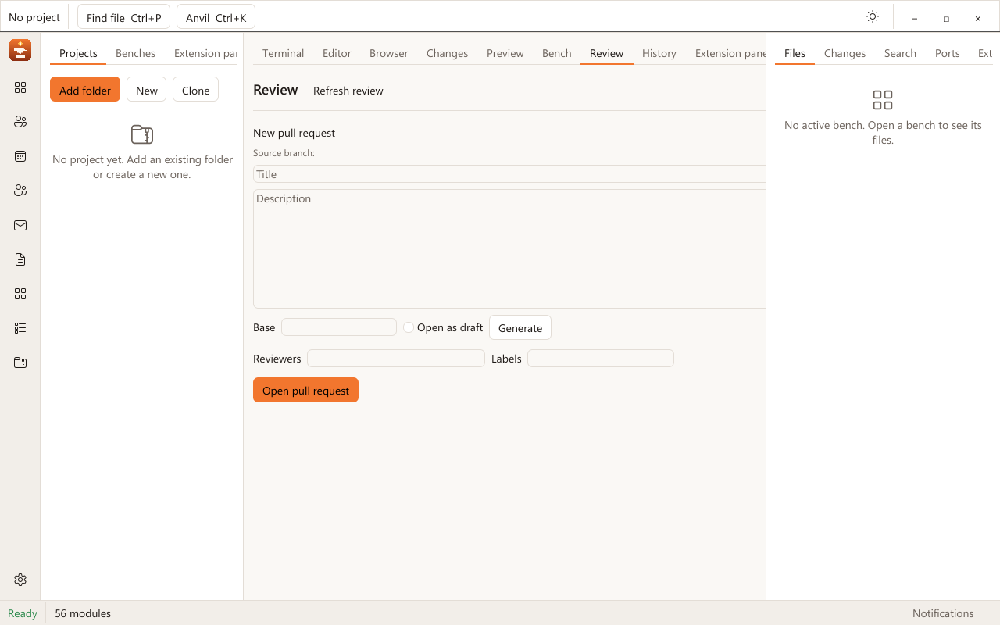

# Review (aba de bancada)

Tela da aba "Review" de uma bancada da Forja, que concentra a criação de um novo pull request; capturada sem projeto aberto, por isso os painéis laterais mostram estados vazios. Variante em inglês e tema claro da página de referência (pt-BR, tema escuro): mudam os textos (todos em inglês), as cores (fundo claro em vez de escuro) e o tamanho da janela (1920×1080 contra ~1054×768), o que faz o formulário caber inteiro na área central, sem os cortes da referência; a estrutura de regiões é a mesma.

## Como chegar
Abrir o app sem projeto carregado (rótulo "No project" na barra superior), entrar na bancada e clicar na aba "Review" do conjunto de abas da bancada. Comando de captura: `forja-app --locale en --theme light --bench-tab review.tab`.

## Regiões
- **Barra superior** — (0,0)–(1920,42): rótulo "No project", botões "Find file  Ctrl+P" e "Anvil  Ctrl+K", ícone de tema (sol, sem nome acessível) e botões de janela "–", "□", "×".
- **Trilho à esquerda** — (0,42)–(56,1048): logotipo da Forja (imagem) no topo, seguido dos botões-ícone "Board", "Helpers", "Routines", "Muster", "Requests", "Skills", "Usage", "Extensions", "Archive" e, na base, "Settings".
- **Painel esquerdo (Projects)** — (56,42)–(304,1048): botão "More tabs" e aba "Projects" (ativa); botões "Add folder", "New" e "Clone"; estado vazio com ícone de pasta e o texto "No project yet. Add an existing folder or create a new one.".
- **Área central (Review)** — (320,42)–(1612,1048): botão "More tabs" e abas da bancada "Review" (ativa), "Terminal", "Editor", "Browser", "Changes", "Preview", "Bench", "History", "Extension panels" e "Helper (chat)"; título "Review" com o botão "Refresh review"; formulário de novo pull request (título "New pull request", visível na imagem) com "Source branch:", campo de título, campo de descrição, "Base", "Open as draft", "Generate", "Reviewers", "Labels" e o botão "Open pull request".
- **Painel direito (Files)** — (1628,42)–(1920,1048): botão "More tabs", abas "Files" (ativa) e "Changes"; estado vazio com ícone de grade e o texto "No active bench. Open a bench to see its files.".
- **Barra de status** — (0,1048)–(1920,1080): "Ready" em verde e "56 modules" à esquerda; "Notifications" à direita.
- Dois divisores verticais sem nome acessível separam os painéis: (304,42)–(320,1048) e (1612,42)–(1628,1048).

## Elementos
| Elemento | Tipo | Posição (px) | Estado | O que faz |
|---|---|---|---|---|
| "Find file  Ctrl+P" | Botão | (99,5)–(218,37) | — | Abre o seletor rápido de arquivos (atalho Ctrl+P) |
| "Anvil  Ctrl+K" | Botão | (226,5)–(327,37) | — | Abre a paleta de comandos da Forja (atalho Ctrl+K) |
| (sem nome acessível) | Desconhecido | (1741,5)–(1773,37) | — | Ícone de sol; alterna o tema da interface |
| "–" | Botão | (1795,5)–(1827,37) | — | Minimiza a janela |
| "□" | Botão | (1835,5)–(1867,37) | — | Maximiza/restaura a janela |
| "×" | Botão | (1875,5)–(1909,37) | — | Fecha a janela |
| "No project" | Rótulo | (11,12)–(77,31) | — | Indica que nenhum projeto está aberto |
| (sem nome acessível) | Desconhecido | (304,42)–(320,1048) | — | Divisor vertical entre o painel esquerdo e a área central |
| (sem nome acessível) | Desconhecido | (1612,42)–(1628,1048) | — | Divisor vertical entre a área central e o painel direito |
| (sem nome acessível) | Imagem | (12,50)–(40,78) | — | Logotipo da Forja (bigorna) no topo do trilho |
| "More tabs" | Botão | (64,50)–(151,85) | — | Abre a lista das abas ocultas do conjunto de abas do painel esquerdo |
| "More tabs" | Botão | (324,50)–(411,85) | — | Abre a lista das abas ocultas do conjunto de abas da bancada (centro) |
| "More tabs" | Botão | (1632,50)–(1719,85) | — | Abre a lista das abas ocultas do conjunto de abas do painel direito |
| "Projects" | Botão | (159,52)–(231,84) | marcado=True | Aba ativa do painel esquerdo; mostra a lista de projetos |
| "Review" | Botão | (419,52)–(486,84) | marcado=True | Aba ativa da bancada; abre a tela documentada (criação de pull request) |
| "Terminal" | Botão | (486,52)–(563,84) | marcado=False | Aba da bancada; abre o terminal |
| "Editor" | Botão | (563,52)–(623,84) | marcado=False | Aba da bancada; abre o editor |
| "Browser" | Botão | (623,52)–(696,84) | marcado=False | Aba da bancada; abre o navegador |
| "Changes" | Botão | (696,52)–(773,84) | marcado=False | Aba da bancada; mudanças não commitadas |
| "Preview" | Botão | (773,52)–(844,84) | marcado=False | Aba da bancada; pré-visualização |
| "Bench" | Botão | (844,52)–(905,84) | marcado=False | Aba da bancada; visão geral da bancada |
| "History" | Botão | (905,52)–(973,84) | marcado=False | Aba da bancada; histórico de commits |
| "Extension panels" | Botão | (973,52)–(1099,84) | marcado=False | Aba da bancada; painéis de extensões |
| "Helper (chat)" | Botão | (1099,52)–(1202,84) | marcado=False | Aba da bancada; chat do ajudante |
| "Files" | Botão | (1727,52)–(1778,84) | marcado=True | Aba ativa do painel direito; lista de arquivos |
| "Changes" | Botão | (1778,52)–(1855,84) | marcado=False | Aba do painel direito; mudanças da bancada |
| "Board" | Botão | (8,94)–(44,130) | marcado=False | Ícone do trilho; abre o quadro de projetos |
| "Add folder" | Botão | (64,101)–(154,133) | — | Adiciona uma pasta de projeto existente |
| "New" | Botão | (162,101)–(213,133) | — | Cria um projeto novo |
| "Clone" | Botão | (221,101)–(280,133) | — | Clona um repositório como novo projeto |
| "Review" | Rótulo | (324,109)–(381,141) | — | Título da tela central |
| "Refresh review" | Botão | (389,109)–(502,141) | — | Recarrega os dados da revisão |
| (ícone) | Rótulo | (1756,117)–(1784,145) | — | Ícone de grade acima da mensagem de estado vazio do painel direito |
| "Helpers" | Botão | (8,138)–(44,174) | marcado=False | Ícone do trilho; abre a lista de ajudantes de código |
| "No active bench. Open a bench to see its files." | Rótulo | (1644,153)–(1896,191) | — | Estado vazio do painel de arquivos |
| (ícone) | Rótulo | (168,161)–(196,189) | — | Ícone de pasta do estado vazio do painel esquerdo |
| "Routines" | Botão | (8,182)–(44,218) | marcado=False | Ícone do trilho; abre as rotinas |
| "No project yet. Add an existing folder or create a new one." | Rótulo | (67,197)–(297,235) | — | Estado vazio do painel de projetos |
| "Source branch:" | Rótulo | (324,198)–(405,214) | — | Rótulo do campo de branch de origem do pull request |
| (sem nome acessível) | Campo de texto | (324,222)–(1608,245) | — | Campo do título do pull request; exibe o placeholder "Title" |
| "Muster" | Botão | (8,226)–(44,262) | marcado=False | Ícone do trilho; abre o mutirão |
| (sem nome acessível) | Campo de texto multilinha | (324,253)–(1608,406) | — | Campo de descrição do pull request; exibe o placeholder "Description" |
| "Requests" | Botão | (8,270)–(44,306) | marcado=False | Ícone do trilho; abre os pedidos (pull requests) |
| "Skills" | Botão | (8,314)–(44,350) | marcado=False | Ícone do trilho; abre as skills |
| "Usage" | Botão | (8,358)–(44,394) | marcado=False | Ícone do trilho; abre o uso de recursos |
| "Extensions" | Botão | (8,402)–(44,438) | marcado=False | Ícone do trilho; abre as extensões |
| "Open as draft" | Caixa de seleção | (516,414)–(618,446) | marcado=False | Marca o pull request como rascunho |
| "Generate" | Botão | (626,414)–(706,446) | — | Gera o título/descrição do pull request |
| (sem nome acessível) | Campo de texto | (360,418)–(508,441) | — | Campo do valor "Base" do pull request |
| "Base" | Rótulo | (324,420)–(352,439) | — | Rótulo do campo Base |
| "Archive" | Botão | (8,446)–(44,482) | marcado=False | Ícone do trilho; abre o acervo |
| (sem nome acessível) | Campo de texto | (393,458)–(621,481) | — | Campo de revisores do pull request |
| (sem nome acessível) | Campo de texto | (675,458)–(863,481) | — | Campo de labels do pull request |
| "Reviewers" | Rótulo | (324,460)–(385,479) | — | Rótulo do campo de revisores |
| "Labels" | Rótulo | (629,460)–(667,479) | — | Rótulo do campo de labels |
| "Open pull request" | Botão | (324,494)–(459,526) | — | Cria o pull request com os dados do formulário |
| "Settings" | Botão | (8,1004)–(44,1040) | marcado=False | Ícone do trilho; abre os ajustes (base do trilho) |
| "Ready" | Rótulo | (10,1055)–(48,1074) | — | Estado geral do app na barra de status |
| "56 modules" | Rótulo | (70,1055)–(142,1074) | — | Quantidade de módulos carregados |
| "Notifications" | Rótulo | (1808,1055)–(1886,1074) | — | Acesso às notificações na barra de status |

## Aparência
Tema claro: fundo quase branco (off-white) na barra superior, nos painéis e na barra de status, com a área central no mesmo tom, separada por divisores finos cinza. A cor de destaque é o laranja (accent "Brasa"), vista no logotipo, no sublinhado das abas ativas ("Projects", "Review", "Files") e nos botões primários "Add folder" e "Open pull request" (fundo laranja com texto branco); os demais botões têm contorno cinza sutil sobre fundo claro. Em relação à referência (tema escuro), invertem-se fundo e texto (fundo claro, texto escuro), mantendo-se o laranja de destaque e o verde do status. Texto em cinza-escuro para títulos e abas e cinza médio para textos secundários e placeholders ("Title", "Description"); "Ready" na barra de status em verde. Tipografia sans-serif em dois níveis (títulos maiores, rótulos menores). Os painéis esquerdo e direito centralizam o estado vazio verticalmente, com ícone e texto em duas linhas. O formulário central usa rótulos à esquerda e campos de contorno cinza e cantos arredondados ocupando toda a largura disponível, com espaçamento vertical constante entre as linhas.

## Problemas encontrados
- Campos de texto sem nome acessível: título (324,222), descrição (324,253), Base (360,418), Revisores (393,458) e Labels (675,458); os dois primeiros exibem placeholders ("Title", "Description") que poderiam servir de nome.
- O título do formulário "New pull request", visível na imagem entre "Refresh review" e "Source branch:", não aparece na árvore de acessibilidade.
- O rótulo "Source branch:" é seguido diretamente do campo que exibe o texto "Title"; não há campo visível para informar a branch de origem.
- Três botões homônimos "More tabs" ((64,50), (324,50) e (1632,50)) sem informação que os distinga para leitor de tela.
- Elementos interativos sem nome acessível: ícone de tema na barra superior (1741,5) e os dois divisores dos painéis (304,42) e (1612,42); os divisores só expõem a ação "focus", sem ação de arrastar/clique associada.
- A caixa "Open as draft" é desenhada como um círculo (aspecto de botão de opção) na imagem, embora seja exposta como CheckBox.
