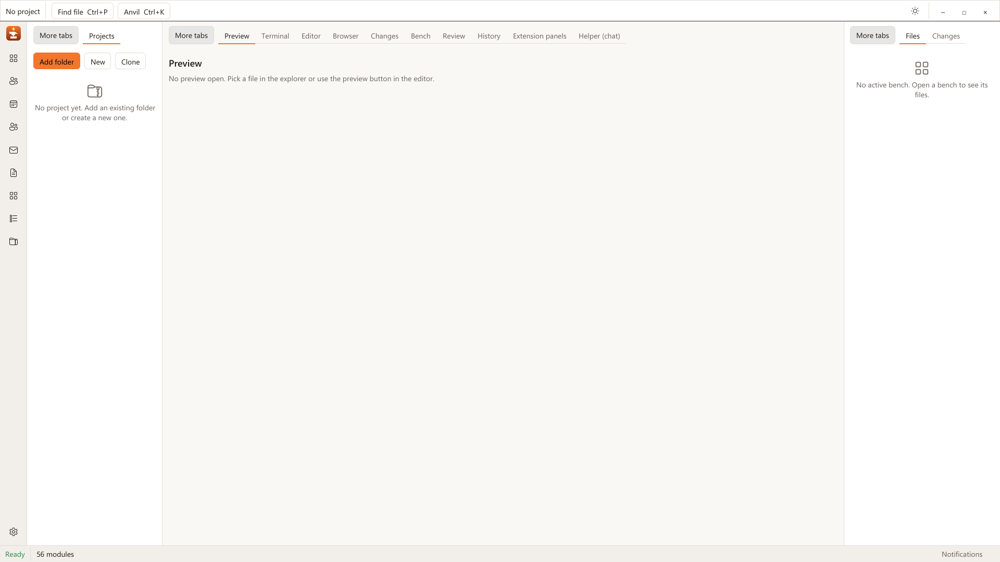

# Visualizador (aba da bancada) — estado vazio (variante en, tema claro)

Tela da aba "Preview" da bancada, que mostra prévias de arquivos; neste estado nenhum projeto está aberto e nenhuma prévia foi solicitada. Variante em inglês e tema claro da página de referência (pt-BR, tema escuro): mesma estrutura, mudando textos, cores e dimensões da janela.

## Como chegar
Abra o app (`forja-app`), clique na aba "Preview" na faixa de abas da área central. Comando de captura: `forja-app --locale en --theme light --bench-tab viewers.tab`.

## Regiões
Janela de 1920×1080 px (a referência pt-BR/escuro foi capturada em 1024×768; por isso as coordenadas diferem).
- **Barra superior** (0,0)–(1920,42): chip "No project", botões "Find file  Ctrl+P" e "Anvil  Ctrl+K" à esquerda; ícone de sol (tema, sem nome acessível) e os botões de janela "–", "□" e "×" à direita.
- **Trilho à esquerda** (0,42)–(52,1048): marca da Forja no topo, coluna de botões-ícone ("Board", "Helpers", "Routines", "Muster", "Requests", "Skills", "Usage", "Extensions", "Archive") e, no pé, "Settings".
- **Painel lateral esquerdo** (52,42)–(304,1048): botão "More tabs" e aba "Projects" (ativa), botões "Add folder", "New" e "Clone" e a mensagem "No project yet. Add an existing folder or create a new one." com ícone de pasta.
- **Divisor esquerdo** (304,42)–(320,1048): faixa sem nome que separa o painel esquerdo da área central.
- **Área central** (320,42)–(1612,1048): botão "More tabs" e as abas "Preview" (ativa), "Terminal", "Editor", "Browser", "Changes", "Bench", "Review", "History", "Extension panels" e "Helper (chat)"; abaixo, o título "Preview" e a mensagem "No preview open. Pick a file in the explorer or use the preview button in the editor.".
- **Divisor direito** (1612,42)–(1628,1048): faixa sem nome que separa a área central do painel direito.
- **Painel direito** (1628,42)–(1920,1048): botão "More tabs" e abas "Files" (ativa) e "Changes"; ícone de grade e a mensagem "No active bench. Open a bench to see its files.".
- **Barra de status** (0,1048)–(1920,1080): "Ready" à esquerda, "56 modules" ao lado e "Notifications" à direita.

## Elementos
| Elemento | Tipo | Posição (px) | Estado | O que faz |
|---|---|---|---|---|
| "Find file  Ctrl+P" | Button | (99,5)–(218,37) | — | Abre a busca rápida de arquivos (atalho Ctrl+P); "Achar arquivo" na referência. |
| "Anvil  Ctrl+K" | Button | (226,5)–(327,37) | — | Abre a paleta de comandos (atalho Ctrl+K); "Bigorna" na referência. |
| (sem nome acessível) | Unknown | (1741,5)–(1773,37) | — | Ícone de sol do tema claro; alterna o tema. |
| "–" | Button | (1795,5)–(1827,37) | — | Minimiza a janela. |
| "□" | Button | (1835,5)–(1867,37) | — | Maximiza/restaura a janela. |
| "×" | Button | (1875,5)–(1909,37) | — | Fecha a janela. |
| "No project" | Label | (11,12)–(77,31) | — | Indica que não há projeto aberto; "Nenhum projeto" na referência. |
| (sem nome acessível) | Unknown | (304,42)–(320,1048) | — | Divisor vertical entre o painel esquerdo e a área central. |
| (sem nome acessível) | Unknown | (1612,42)–(1628,1048) | — | Divisor vertical entre a área central e o painel direito. |
| (sem nome acessível) | Image | (12,50)–(40,78) | — | Ícone/marca da Forja no topo do trilho. |
| "More tabs" | Button | (64,50)–(151,85) | — | Abre a lista das demais abas do painel esquerdo. |
| "More tabs" | Button | (324,50)–(411,85) | — | Abre a lista das demais abas da área central. |
| "More tabs" | Button | (1632,50)–(1719,85) | — | Abre a lista das demais abas do painel direito. |
| "Projects" | Button | (159,52)–(231,84) | marcado=True | Aba ativa do painel esquerdo; mostra a lista de projetos. |
| "Preview" | Button | (419,52)–(490,84) | marcado=True | Aba ativa da área central; mostra este visualizador. |
| "Terminal" | Button | (490,52)–(567,84) | marcado=False | Aba do terminal. |
| "Editor" | Button | (567,52)–(627,84) | marcado=False | Aba do editor. |
| "Browser" | Button | (627,52)–(700,84) | marcado=False | Aba do navegador ("Navegador" na referência). |
| "Changes" | Button | (700,52)–(777,84) | marcado=False | Aba de diferenças ("Diferenças" na referência). |
| "Bench" | Button | (777,52)–(838,84) | marcado=False | Aba da bancada ("Bancada" na referência). |
| "Review" | Button | (838,52)–(905,84) | marcado=False | Aba de revisão ("Revisão" na referência). |
| "History" | Button | (905,52)–(973,84) | marcado=False | Aba de histórico ("Histórico" na referência). |
| "Extension panels" | Button | (973,52)–(1099,84) | marcado=False | Aba de painéis de extensões ("Painéis de extensões" na referência). |
| "Helper (chat)" | Button | (1099,52)–(1202,84) | marcado=False | Aba do ajudante em chat ("Ajudante (chat)" na referência). |
| "Files" | Button | (1727,52)–(1778,84) | marcado=True | Aba ativa do painel direito; explorador de arquivos ("Arquivos" na referência). |
| "Changes" | Button | (1778,52)–(1855,84) | marcado=False | Aba de mudanças do painel direito ("Mudanças" na referência). |
| "Board" | Button | (8,94)–(44,130) | marcado=False | Ícone do trilho; abre o quadro ("Quadro" na referência). |
| "Add folder" | Button | (64,101)–(154,133) | — | Botão laranja em destaque; abre seletor de pasta ("Adicionar pasta" na referência). |
| "New" | Button | (162,101)–(213,133) | — | Cria um projeto novo ("Novo" na referência). |
| "Clone" | Button | (221,101)–(280,133) | — | Clona um repositório ("Clonar" na referência). |
| "Preview" | Label | (324,109)–(388,133) | — | Título da área central ("Visualizador" na referência). |
| (ícone) | Label | (1756,117)–(1784,145) | — | Ícone de grade do estado vazio do painel direito. |
| "Helpers" | Button | (8,138)–(44,174) | marcado=False | Ícone do trilho; abre os ajudantes ("Ajudantes" na referência). |
| "No preview open. Pick a file in the explorer or use the preview button in the editor." | Label | (324,141)–(834,160) | — | Mensagem de estado vazio da área central ("Nenhuma prévia aberta…"); cabe inteira no painel. |
| "No active bench. Open a bench to see its files." | Label | (1644,153)–(1896,191) | — | Mensagem de estado vazio do painel direito, em duas linhas centralizadas ("Nenhuma bancada ativa…"). |
| (ícone) | Label | (168,161)–(196,189) | — | Ícone de pasta ilustrando o estado vazio do painel esquerdo. |
| "Routines" | Button | (8,182)–(44,218) | marcado=False | Ícone do trilho; abre as rotinas ("Rotinas" na referência). |
| "No project yet. Add an existing folder or create a new one." | Label | (67,197)–(297,235) | — | Mensagem de estado vazio do painel esquerdo, em duas linhas ("Nenhum projeto ainda…"). |
| "Muster" | Button | (8,226)–(44,262) | marcado=False | Ícone do trilho; abre o mutirão ("Mutirão" na referência). |
| "Requests" | Button | (8,270)–(44,306) | marcado=False | Ícone do trilho; abre os pedidos ("Pedidos" na referência). |
| "Skills" | Button | (8,314)–(44,350) | marcado=False | Ícone do trilho; abre as skills. |
| "Usage" | Button | (8,358)–(44,394) | marcado=False | Ícone do trilho; abre o uso ("Uso" na referência). |
| "Extensions" | Button | (8,402)–(44,438) | marcado=False | Ícone do trilho; abre as extensões ("Extensões" na referência). |
| "Archive" | Button | (8,446)–(44,482) | marcado=False | Ícone do trilho; abre o acervo ("Acervo" na referência). |
| "Settings" | Button | (8,1004)–(44,1040) | marcado=False | Ícone do trilho, no pé; abre os ajustes ("Ajustes" na referência). |
| "Ready" | Label | (10,1055)–(48,1074) | — | Estado geral na barra de status, em verde ("Pronto" na referência). |
| "56 modules" | Label | (70,1055)–(142,1074) | — | Quantidade de módulos carregados ("56 módulos" na referência). |
| "Notifications" | Label | (1808,1055)–(1886,1074) | — | Abre a área de notificações. |

## Aparência
Tema claro: fundo geral off-white/creme, com a barra superior e a barra de status em tom levemente mais claro que os painéis e os divisores verticais como linhas cinza-claras. A cor de destaque segue sendo o laranja da marca (Brasa): preenchimento sólido no botão "Add folder" e sublinhado sob as abas ativas ("Projects", "Preview" e "Files"). Texto em cinza-escuro/quase preto com bom contraste sobre o fundo claro; mensagens de estado vazio em cinza médio. Tipografia sem serifa, corpo pequeno nos rótulos de aba e de status e médio no título "Preview". O trilho à esquerda usa apenas ícones de 36 px em coluna única e as mensagens de estado vazio são centralizadas horizontalmente em seus painéis. Diferença em relação à referência: nesta captura (1920 px de largura) as faixas de abas cabem sem sobreposição nem corte e exibem botões "More tabs" para as abas ocultas, enquanto a referência (1024 px) mostrava abas sobrepostas e elementos fora da janela.

## Problemas encontrados
- Botão sem nome acessível: o ícone de tema (sol) em (1741,5)–(1773,37) não tem rótulo.
- Nomes duplicados sem contexto dificultam a desambiguação por leitores de tela: três botões "More tabs" (64–151, 324–411 e 1632–1719) e duas abas "Changes" (700–777 e 1778–1855).
