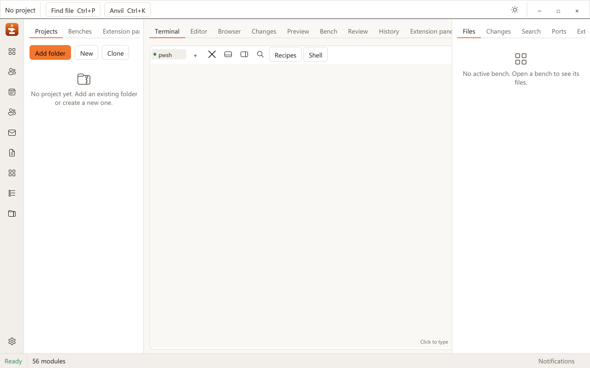

(ativa), "Editor", "Browser", "Changes", "Preview", "Bench", "Review", "History", "Extension panels" e "Helper (chat)"; barra de ferramentas do terminal com "+", quatro botões de ícone sem nome acessível, "Recipes", "Shell" e a pílula de sessão "pwsh" (sem nome acessível, (328,118)–(404,140), com indicador circular em (385,121)–(401,137)); área vazia de texto do terminal (328,150)–(1604,1036) com a sugestão "Click to type" no canto inferior direito.
- **Painel direito — Files** (aprox. (1628,42)–(1920,1048)): botão "More tabs" e as abas "Files" (ativa) e "Changes"; estado vazio com ícone de grade (rótulo "(ícone)", (1756,117)–(1784,145)) e o texto "No active bench. Open a bench to see its files.".
- **Barra de status** (aprox. (0,1048)–(1920,1080)): rótulos "Ready" e "56 modules" à esquerda e "Notifications" à direita.

## Elementos
| Elemento | Tipo | Posição (px) | Estado | O que faz |
|---|---|---|---|---|
| "Find file  Ctrl+P" | Button | (99,5)–(218,37) | normal | Abre o localizador de arquivos (atalho Ctrl+P). |
| "Anvil  Ctrl+K" | Button | (226,5)–(327,37) | normal | Abre a paleta de comandos (atalho Ctrl+K). |
| (sem nome acessível) | Unknown | (1741,5)–(1773,37) | normal | Ícone de sol: alterna o tema (claro/escuro). |
| "–" | Button | (1795,5)–(1827,37) | normal | Minimiza a janela. |
| "□" | Button | (1835,5)–(1867,37) | normal | Maximiza/restaura a janela. |
| "×" | Button | (1875,5)–(1909,37) | normal | Fecha a janela. |
| "No project" | Label | (11,12)–(77,31) | clicável | Mostra o projeto atual (nenhum). |
| (sem nome acessível) | Unknown | (304,42)–(320,1048) | foco | Divisor arrastável entre o painel esquerdo e a área central. |
| (sem nome acessível) | Unknown | (1612,42)–(1628,1048) | foco | Divisor arrastável entre a área central e o painel direito. |
| (sem nome acessível) | Image | (12,50)–(40,78) | clicável | Logotipo da Forja (bigorna laranja) no topo do trilho. |
| "More tabs" | Button | (64,50)–(151,85) | normal | Menu de abas ocultas da faixa do painel esquerdo. |
| "More tabs" | Button | (324,50)–(411,85) | normal | Menu de abas ocultas da faixa da área central. |
| "More tabs" | Button | (1632,50)–(1719,85) | normal | Menu de abas ocultas da faixa do painel direito. |
| "Projects" | Button | (159,52)–(231,84) | marcado=True | Aba ativa do painel esquerdo; lista projetos. |
| "Terminal" | Button | (419,52)–(496,84) | marcado=True | Aba ativa da área central; mostra o terminal. |
| "Editor" | Button | (496,52)–(556,84) | marcado=False | Aba do editor de arquivos. |
| "Browser" | Button | (556,52)–(629,84) | marcado=False | Aba do navegador integrado. |
| "Changes" | Button | (629,52)–(706,84) | marcado=False | Aba de comparação de diffs (área central). |
| "Preview" | Button | (706,52)–(777,84) | marcado=False | Aba de pré-visualização. |
| "Bench" | Button | (777,52)–(838,84) | marcado=False | Aba de informações da bancada. |
| "Review" | Button | (838,52)–(905,84) | marcado=False | Aba de revisão. |
| "History" | Button | (905,52)–(973,84) | marcado=False | Aba de histórico. |
| "Extension panels" | Button | (973,52)–(1099,84) | marcado=False | Aba de painéis de extensões (área central). |
| "Helper (chat)" | Button | (1099,52)–(1202,84) | marcado=False | Aba do chat do ajudante. |
| "Files" | Button | (1727,52)–(1778,84) | marcado=True | Aba ativa do painel direito; lista arquivos da bancada. |
| "Changes" | Button | (1778,52)–(1855,84) | marcado=False | Aba de mudanças pendentes (painel direito). |
| "Board" | Button | (8,94)–(44,130) | marcado=False | Ícone do quadro geral (projetos/bancadas). |
| "Add folder" | Button | (64,101)–(154,133) | normal (destaque laranja) | Adiciona uma pasta de projeto existente. |
| "New" | Button | (162,101)–(213,133) | normal | Cria um projeto novo. |
| "Clone" | Button | (221,101)–(280,133) | normal | Clona um repositório/projeto. |
| "+" | Button | (407,113)–(441,145) | normal | Abre nova aba/sessão de terminal. |
| (sem nome acessível) | Unknown | (444,113)–(476,145) | clicável | Ícone de fechar (X): encerra o terminal. |
| (sem nome acessível) | Unknown | (479,113)–(511,145) | clicável | Ícone de monitor: alterna a exibição do terminal. |
| (sem nome acessível) | Unknown | (514,113)–(546,145) | clicável | Ícone de retângulo: alterna o terminal em painel dedicado. |
| (sem nome acessível) | Unknown | (549,113)–(581,145) | clicável | Ícone de lupa: busca no terminal. |
| "Recipes" | Button | (584,113)–(655,145) | normal | Abre a lista de receitas de terminal. |
| "Shell" | Button | (658,113)–(711,145) | normal | Seletor do shell da sessão (pwsh). |
| (ícone) | Label | (1756,117)–(1784,145) | clicável | Ícone de grade do estado vazio do painel Files. |
| (sem nome acessível) | Unknown | (328,118)–(404,140) | clicável | Pílula da sessão ativa "pwsh" com indicador. |
| (sem nome acessível) | Unknown | (385,121)–(401,137) | clicável | Indicador circular da pílula (ponto de status). |
| "Helpers" | Button | (8,138)–(44,174) | marcado=False | Ícone do painel de ajudantes (agentes de IA). |
| (sem nome acessível) | Unknown | (328,150)–(1604,1036) | clicável | Área de texto do terminal (vazia); clique foca o terminal. |
| "No active bench. Open a bench to see its files." | Label | (1644,153)–(1896,191) | clicável | Estado vazio do painel Files. |
| "Routines" | Button | (8,182)–(44,218) | marcado=False | Ícone do painel de rotinas. |
| (ícone) | Label | (168,161)–(196,189) | clicável | Ícone de pasta do estado vazio do painel Projects. |
| "No project yet. Add an existing folder or create a new one." | Label | (67,197)–(297,235) | clicável | Estado vazio do painel Projects. |
| "Muster" | Button | (8,226)–(44,262) | marcado=False | Ícone do painel de mutirão (tarefas em lote). |
| "Requests" | Button | (8,270)–(44,306) | marcado=False | Ícone do painel de pedidos. |
| "Skills" | Button | (8,314)–(44,350) | marcado=False | Ícone do painel de skills. |
| "Usage" | Button | (8,358)–(44,394) | marcado=False | Ícone do painel de uso. |
| "Extensions" | Button | (8,402)–(44,438) | marcado=False | Ícone do painel de extensões. |
| "Archive" | Button | (8,446)–(44,482) | marcado=False | Ícone do painel de acervo. |
| "Settings" | Button | (8,1004)–(44,1040) | marcado=False | Ícone de ajustes, no rodapé do trilho. |
| "Ready" | Label | (10,1055)–(48,1074) | clicável | Estado geral do app na barra de status. |
| "56 modules" | Label | (70,1055)–(142,1074) | clicável | Contagem de módulos carregados. |
| "Notifications" | Label | (1808,1055)–(1886,1074) | clicável | Acesso a notificações na barra de status. |

## Aparência
Tema claro: fundo cinza muito claro de tom quente (aproximadamente #f5f4f2) na janela, com faixas de abas, painel esquerdo, área central e barra de status em branco (#ffffff) separados por bordas finas cinza. Acento laranja ("Brasa"): o botão "Add folder" tem fundo laranja sólido com texto claro, a aba ativa de cada faixa ("Projects", "Terminal", "Files") recebe sublinhado e texto em laranja, e o logotipo do trilho é laranja. Ponto verde pequeno na pílula "pwsh" indica sessão ativa, e o rótulo "Ready" aparece em verde. Tipografia sans-serif compacta em cinza-escuro (aprox. #3a3a3a), com rótulos de estado vazio em cinza médio, centralizados. Em relação à referência escura, as cores são invertidas e os textos ficam em inglês; as posições relativas são as mesmas, em escala maior (janela 1920×1080). Alinhamentos: faixas de abas em y≈50–85, linha de ferramentas do terminal em y≈101–145, trilho com ícones quadrados de 36 px espaçados de 44 px, "Settings" ancorado ao rodapé; os divisores entre painéis são linhas verticais discretas.

## Problemas encontrados
- Botões sem nome acessível (acessibilidade): o alternador de tema (1741,5)–(1773,37) e os quatro ícones da barra do terminal (444,113)–(581,145) não expõem nome e dependem de reconhecimento visual, sem rótulo ou tooltip acessível na árvore.
- A pílula de sessão "pwsh" (328,118)–(404,140) e seu ponto de status (385,121)–(401,137), os dois divisores de painel (304,42)–(320,1048) e (1612,42)–(1628,1048) e a área do terminal (328,150)–(1604,1036) também não expõem nome acessível.
- O texto "Click to type" no canto inferior direito da área do terminal (~ (1537,1017)–(1597,1029)) não corresponde a nenhum elemento da árvore de acessibilidade e tem contraste baixo (cinza claro sobre fundo claro).
- Três botões "More tabs" são exibidos mesmo com todas as abas visíveis em suas faixas — o painel esquerdo tem uma única aba ("Projects") — o que aparenta redundância visual/funcional.
- Estados com pixels idênticos a esta captura incluem os modais bench.dialogs, counter.poller, mcp.approval, notify.toasts, onboarding.wizard, project.dialogs e voice.overlay, além de bench-tab.terminal.tab e right-tab.explorer.panel: nessas capturas nenhum diálogo, aviso, sobreposição ou painel de explorer diferente aparece renderizado.
