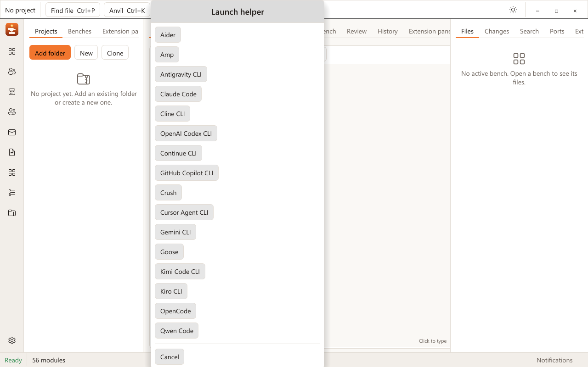

# Launch helper (modal helper.profile_picker)

Modal central que lista os ajudantes de código (agentes de IA) disponíveis para iniciar uma sessão na bancada atual. Variante em inglês e tema claro da página de referência (pt-BR, tema escuro); a estrutura é a mesma e mudam os textos, as cores e a janela maior (1920×1080), que faz com que nenhum elemento fique cortado nesta captura.

## Como chegar
Na janela principal, acione a ação de iniciar ajudante (o painel de "Helpers" fica no trilho à esquerda; o modal abre sobreposto ao app). Captura: `forja-app --locale en --theme light --modal helper.profile_picker`.

## Regiões
- **Modal "Launch helper"** — (328,58)–(706,862). Coluna central clara sobreposta ao app, com sombra e cantos arredondados; barra de título com o texto "Launch helper" (~(361,59)–(673,107)) e corpo com a lista vertical de chips de ajudantes, terminando no botão "Cancel".
- **Barra superior do app** — (0,0)–(1920,42). À esquerda o rótulo "No project" e os botões "Find file  Ctrl+P" e "Anvil  Ctrl+K"; à direita um botão de tema sem nome acessível (1741,5)–(1773,37) (ícone de sol) e os botões de janela "–", "□", "×".
- **Trilho à esquerda** — (0,42)–(52,1048). Coluna de ícones: "Board", "Helpers", "Routines", "Muster", "Requests", "Skills", "Usage", "Extensions" e "Archive", todos não marcados; embaixo, "Settings" (8,1004)–(44,1040); no topo, um ícone de módulo ativo em laranja (12,50)–(40,78).
- **Painel lateral esquerdo (Projects)** — (52,42)–(304,1048). Abas "Projects" (marcada) e um botão "More tabs"; ações "Add folder" (destaque laranja), "New" e "Clone"; estado vazio com ícone de pasta (168,161)–(196,189) e o rótulo "No project yet. Add an existing folder or create a new one.".
- **Área central** — (320,42)–(1612,1048). Botão "More tabs" (coberto pelo modal), abas "Terminal" (marcada), "Editor", "Browser" e "Changes" (todas cobertas pelo modal) e "Preview", "Bench", "Review", "History", "Extension panels" e "Helper (chat)" visíveis; abaixo, uma barra com "+", quatro controles sem nome, "Recipes" e "Shell" (cobertos pelo modal); região de conteúdo (328,150)–(1604,1036) correspondente ao terminal, com a dica "Click to type" no canto inferior direito.
- **Painel direito (Files)** — (1628,42)–(1920,1048). Botão "More tabs", abas "Files" (marcada) e "Changes"; estado vazio com ícone de grade (1756,117)–(1784,145) e o rótulo "No active bench. Open a bench to see its files.".
- **Barra de status** — (0,1048)–(1920,1080). "Ready" à esquerda (em verde), "56 modules" ao lado e "Notifications" à direita.

## Elementos
| Elemento | Tipo | Posição (px) | Estado | O que faz |
|---|---|---|---|---|
| "Find file  Ctrl+P" | Botão | (99,5)–(218,37) | clique, foco | Abre a busca rápida de arquivos (atalho Ctrl+P) |
| "Anvil  Ctrl+K" | Botão | (226,5)–(327,37) | clique, foco | Abre a paleta de comandos (atalho Ctrl+K) |
| (sem nome acessível) | Desconhecido | (1741,5)–(1773,37) | clique, foco | Botão de alternância de tema (ícone de sol) |
| "–" | Botão | (1795,5)–(1827,37) | clique, foco | Minimiza a janela |
| "□" | Botão | (1835,5)–(1867,37) | clique, foco | Maximiza/restaura a janela |
| "×" | Botão | (1875,5)–(1909,37) | clique, foco | Fecha a janela |
| "No project" | Rótulo | (11,12)–(77,31) | clique, foco | Indica ausência de projeto selecionado |
| (sem nome acessível) | Desconhecido | (304,42)–(320,1048) | foco | Divisor vertical entre painel esquerdo e área central |
| (sem nome acessível) | Desconhecido | (1612,42)–(1628,1048) | foco | Divisor vertical entre área central e painel direito |
| (sem nome acessível) | Imagem | (12,50)–(40,78) | clique, foco | Ícone do módulo ativo no topo do trilho (laranja) |
| "More tabs" | Botão | (64,50)–(151,85) | clique, foco | Abas em excesso do painel esquerdo |
| "More tabs" | Botão | (324,50)–(411,85) | clique, foco | Abas em excesso da área central; coberto pelo modal |
| "More tabs" | Botão | (1632,50)–(1719,85) | clique, foco | Abas em excesso do painel direito |
| "Projects" | Botão (aba) | (159,52)–(231,84) | clique, foco; marcado=True | Mostra o painel de projetos |
| "Terminal" | Botão (aba) | (419,52)–(496,84) | clique, foco; marcado=True | Aba central ativa; coberta pelo modal |
| "Editor" | Botão (aba) | (496,52)–(556,84) | clique, foco; marcado=False | Aba do editor; coberta pelo modal |
| "Browser" | Botão (aba) | (556,52)–(629,84) | clique, foco; marcado=False | Aba do navegador; coberta pelo modal |
| "Changes" | Botão (aba) | (629,52)–(706,84) | clique, foco; marcado=False | Aba de mudanças da área central; coberta pelo modal |
| "Preview" | Botão (aba) | (706,52)–(777,84) | clique, foco; marcado=False | Aba de pré-visualização; encosta na borda direita do modal |
| "Bench" | Botão (aba) | (777,52)–(838,84) | clique, foco; marcado=False | Aba de bancada |
| "Review" | Botão (aba) | (838,52)–(905,84) | clique, foco; marcado=False | Aba de revisão |
| "History" | Botão (aba) | (905,52)–(973,84) | clique, foco; marcado=False | Aba de histórico |
| "Extension panels" | Botão (aba) | (973,52)–(1099,84) | clique, foco; marcado=False | Aba de painéis de extensões |
| "Helper (chat)" | Botão (aba) | (1099,52)–(1202,84) | clique, foco; marcado=False | Aba do chat do ajudante |
| "Files" | Botão (aba) | (1727,52)–(1778,84) | clique, foco; marcado=True | Mostra a lista de arquivos da bancada |
| "Changes" | Botão (aba) | (1778,52)–(1855,84) | clique, foco; marcado=False | Aba de mudanças do painel direito |
| "Launch helper" | Janela (modal) | (328,58)–(706,862) | foco | Modal de escolha do ajudante; recebe o foco ao abrir |
| (sem nome acessível) | Desconhecido | (361,59)–(673,107) | clique, foco | Barra de título do modal, sobre a qual se lê "Launch helper" |
| "Board" | Botão (ícone) | (8,94)–(44,130) | clique, foco; marcado=False | Abre o quadro no trilho |
| "Add folder" | Botão | (64,101)–(154,133) | clique, foco | Destaque laranja; abre seletor de pasta para criar projeto |
| "New" | Botão | (162,101)–(213,133) | clique, foco | Cria um projeto novo |
| "Clone" | Botão | (221,101)–(280,133) | clique, foco | Clona um repositório como projeto |
| "+" | Botão | (407,113)–(441,145) | clique, foco | Ação adicional da área central; coberto pelo modal |
| (sem nome acessível) | Desconhecido | (444,113)–(476,145) | clique, foco | Controle da barra central, oculto pelo modal |
| (sem nome acessível) | Desconhecido | (479,113)–(511,145) | clique, foco | Controle da barra central, oculto pelo modal |
| (sem nome acessível) | Desconhecido | (514,113)–(546,145) | clique, foco | Controle da barra central, oculto pelo modal |
| (sem nome acessível) | Desconhecido | (549,113)–(581,145) | clique, foco | Controle da barra central, oculto pelo modal |
| "Recipes" | Botão | (584,113)–(655,145) | clique, foco | Abre receitas; oculto pelo modal |
| "Shell" | Botão | (658,113)–(711,145) | clique, foco | Abre o shell; oculto pelo modal |
| "Aider" | Botão (chip) | (337,116)–(394,151) | clique, foco | Seleciona o ajudante Aider |
| (ícone) | Rótulo | (1756,117)–(1784,145) | clique | Ícone de grade do estado vazio do painel direito |
| (sem nome acessível) | Desconhecido | (328,118)–(404,140) | clique, foco | Elemento do modal sobre a região dos chips |
| (sem nome acessível) | Desconhecido | (385,121)–(401,137) | clique, foco | Elemento interno do modal |
| "Helpers" | Botão (ícone) | (8,138)–(44,174) | clique, foco; marcado=False | Abre o painel de ajudantes |
| (sem nome acessível) | Desconhecido | (328,150)–(1604,1036) | clique, foco | Região de conteúdo da área central (terminal); a dica "Click to type" aparece no canto inferior direito e a porção esquerda fica sob o modal |
| "No active bench. Open a bench to see its files." | Rótulo | (1644,153)–(1896,191) | clique | Mensagem de estado vazio do painel de arquivos |
| "Amp" | Botão (chip) | (337,159)–(390,194) | clique, foco | Seleciona o ajudante Amp |
| (ícone) | Rótulo | (168,161)–(196,189) | clique | Ícone de pasta do estado vazio de projetos |
| "Routines" | Botão (ícone) | (8,182)–(44,218) | clique, foco; marcado=False | Abre o painel de rotinas |
| "No project yet. Add an existing folder or create a new one." | Rótulo | (67,197)–(297,235) | clique | Mensagem de estado vazio de projetos |
| "Antigravity CLI" | Botão (chip) | (337,202)–(451,237) | clique, foco | Seleciona o ajudante Antigravity CLI |
| "Muster" | Botão (ícone) | (8,226)–(44,262) | clique, foco; marcado=False | Abre o painel de mutirão |
| "Claude Code" | Botão (chip) | (337,245)–(439,280) | clique, foco | Seleciona o ajudante Claude Code |
| "Requests" | Botão (ícone) | (8,270)–(44,306) | clique, foco; marcado=False | Abre o painel de pedidos |
| "Cline CLI" | Botão (chip) | (337,288)–(414,323) | clique, foco | Seleciona o ajudante Cline CLI |
| "Skills" | Botão (ícone) | (8,314)–(44,350) | clique, foco; marcado=False | Abre o painel de skills |
| "OpenAI Codex CLI" | Botão (chip) | (337,331)–(473,366) | clique, foco | Seleciona o ajudante OpenAI Codex CLI |
| "Usage" | Botão (ícone) | (8,358)–(44,394) | clique, foco; marcado=False | Abre o painel de uso |
| "Continue CLI" | Botão (chip) | (337,374)–(440,409) | clique, foco | Seleciona o ajudante Continue CLI |
| "Extensions" | Botão (ícone) | (8,402)–(44,438) | clique, foco; marcado=False | Abre o painel de extensões |
| "GitHub Copilot CLI" | Botão (chip) | (337,417)–(476,452) | clique, foco | Seleciona o ajudante GitHub Copilot CLI |
| "Archive" | Botão (ícone) | (8,446)–(44,482) | clique, foco; marcado=False | Abre o painel de acervo |
| "Crush" | Botão (chip) | (337,460)–(396,495) | clique, foco | Seleciona o ajudante Crush |
| "Cursor Agent CLI" | Botão (chip) | (337,503)–(465,538) | clique, foco | Seleciona o ajudante Cursor Agent CLI |
| (sem nome acessível) | Desconhecido | (960,540)–(960,540) | clique, foco | Elemento de dimensão nula (retrôo da árvore) |
| "Gemini CLI" | Botão (chip) | (337,546)–(427,581) | clique, foco | Seleciona o ajudante Gemini CLI |
| "Goose" | Botão (chip) | (337,589)–(400,624) | clique, foco | Seleciona o ajudante Goose |
| "Kimi Code CLI" | Botão (chip) | (337,632)–(447,667) | clique, foco | Seleciona o ajudante Kimi Code CLI |
| "Kiro CLI" | Botão (chip) | (337,675)–(408,710) | clique, foco | Seleciona o ajudante Kiro CLI |
| "OpenCode" | Botão (chip) | (337,718)–(427,753) | clique, foco | Seleciona o ajudante OpenCode |
| "Qwen Code" | Botão (chip) | (337,761)–(432,796) | clique, foco | Seleciona o ajudante Qwen Code; último chip |
| "Cancel" | Botão | (337,818)–(401,853) | clique, foco | Fecha o modal sem escolher |
| "Settings" | Botão (ícone) | (8,1004)–(44,1040) | clique, foco; marcado=False | Abre o painel de ajustes, no pé do trilho |
| "Ready" | Rótulo | (10,1055)–(48,1074) | clique | Status geral, em verde na barra de status |
| "56 modules" | Rótulo | (70,1055)–(142,1074) | clique | Contagem de módulos carregados |
| "Notifications" | Rótulo | (1808,1055)–(1886,1074) | clique, foco | Atalho para notificações, à direita da barra de status |

## Aparência
Tema claro: fundo branco/off-white no app e no modal, com o painel do modal em cinza-claro levemente mais escuro que o fundo, cantos arredondados e sombra projetada. Acento laranja ("Brasa") no botão "Add folder", no ícone do módulo ativo do trilho e no sublinhado das abas marcadas ("Projects" e "Files"; "Terminal" também está marcada, mas fica sob o modal). Os chips de ajudantes são retângulos arredondados cinza-claro com borda sutil e texto escuro, empilhados em coluna única alinhada à esquerda a partir de x≈337, com espaçamento vertical regular de ~43 px. Texto em fonte sem serifa de ~13–15 px, cinza-escuro sobre fundo claro, com contraste bom nos rótulos e mais baixo nas mensagens de estado vazio. "Ready" aparece em verde na barra de status. Em relação à referência (tema escuro), as cores são invertidas e o restante da composição é igual; como a janela é 1920×1080 (contra 1024×768), nesta variante não há elementos cortados pelas bordas da imagem.

## Problemas encontrados
- O modal sobrepõe a área central: o botão "More tabs" (324,50)–(411,85), as abas "Terminal", "Editor", "Browser" e "Changes" e os botões "+", "Recipes" e "Shell" continuam na árvore de acessibilidade, mas estão invisíveis ao usuário.
- Botão de tema na barra superior (1741,5)–(1773,37), divisores verticais, os quatro controles da barra central, a barra de título do modal, dois elementos internos do modal e a grande região de conteúdo central sem nome acessível.
- Rótulos de ícone expostos como "(ícone)" (grade e pasta dos estados vazios), sem nome acessível descritivo.
- Elemento de dimensão nula na árvore em (960,540)–(960,540).
- Nomes acessíveis ambíguos por duplicação: "Changes" nomeia duas abas distintas (área central e painel direito) e "More tabs" se repete três vezes, o que dificulta a identificação por leitores de tela.
- Mensagens de estado vazio ("No project yet..." e "No active bench...") em cinza claro sobre fundo branco, com contraste inferior ao do restante dos textos.
