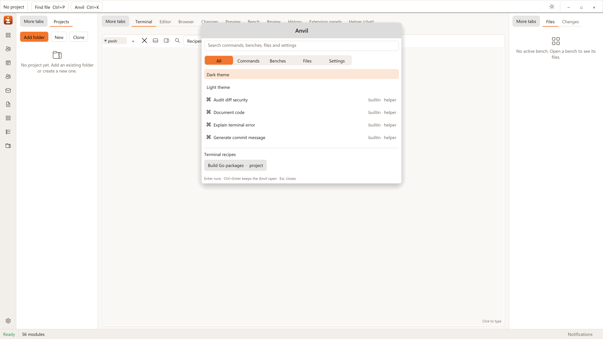

# Bigorna sobre a tela inicial (sem projeto) — tema claro

Tela inicial da Forja sem projeto aberto, com a sobreposição da Bigorna (paleta de comandos e receitas de terminal) aberta no centro. Variante em inglês e tema claro da página de referência (pt-BR.dark.open.anvil): mudam os textos (exibidos em inglês), as cores (fundo claro em vez de escuro), a resolução da captura (1920×1080 px contra 1280×800 px da referência) e a geometria da janela da Bigorna, que aqui termina em y=585 e deixa a área central visível abaixo dela.

## Como chegar
Na barra superior, clique no botão "Anvil  Ctrl+K" (ou pressione Ctrl+K); o app abre direto nessa tela com `forja-app --locale en --theme light --open anvil` (captura em `captures/en.light.open.anvil.png`, 1920×1080 px).

## Regiões
- **Barra superior** (0,0)–(1920,42): rótulo do projeto ("No project"), botões "Find file  Ctrl+P" e "Anvil  Ctrl+K", botão de tema (ícone de sol, sem nome), botões de janela "–", "□", "×".
- **Trilho de ícones à esquerda** (0,42)–(48,1048): logo da Forja (imagem em (12,50)–(40,78)) e ícones de navegação "Board", "Helpers", "Routines", "Muster", "Requests", "Skills", "Usage", "Extensions", "Archive" e, no fim, "Settings".
- **Painel lateral esquerdo (Projetos)** (48,42)–(304,1048): botão "More tabs", aba "Projects" (ativa), botões "Add folder", "New" e "Clone", e estado vazio com ícone de pasta e o texto "No project yet. Add an existing folder or create a new one.".
- **Divisor central** (304,42)–(320,1048): separador arrastável entre o painel esquerdo e a área central.
- **Barra de abas central** (320,42)–(1612,82): "More tabs", "Terminal" (ativa), "Editor", "Browser", "Changes", "Preview", "Bench", "Review", "History", "Extension panels" e "Helper (chat)" — as duas últimas esmaecidas sob a borda da Bigorna.
- **Área central** (320,82)–(1612,1048): superfície do terminal (fundo creme) com a dica "Click to type" no canto inferior direito; coberta no topo pela janela da Bigorna (641,72)–(1279,585), que esconde parcialmente "Recipes" e totalmente "Shell".
- **Divisor direito** (1612,42)–(1628,1048): separador arrastável.
- **Painel lateral direito (Files)** (1628,42)–(1920,1048): botão "More tabs", abas "Files" (ativa) e "Changes", ícone de grade vazia e o texto "No active bench. Open a bench to see its files.".
- **Barra de status** (0,1048)–(1920,1080): "Ready" (em verde), "56 modules" e "Notifications".

## Elementos
| Elemento | Tipo | Posição (px) | Estado | O que faz |
|---|---|---|---|---|
| "Find file  Ctrl+P" | Button | (99,5)–(218,37) | — | Abre a busca de arquivos (atalho Ctrl+P). |
| "Anvil  Ctrl+K" | Button | (226,5)–(327,37) | — | Abre/fecha a Bigorna (já aberta nesta captura). |
| (sem nome acessível) | Unknown | (1741,5)–(1773,37) | — | Ícone de sol: alterna tema claro/escuro. |
| "–" | Button | (1795,5)–(1827,37) | — | Minimiza a janela. |
| "□" | Button | (1835,5)–(1867,37) | — | Maximiza/restaura a janela. |
| "×" | Button | (1875,5)–(1909,37) | — | Fecha o app. |
| "No project" | Label | (11,12)–(77,31) | — | Indica que não há projeto aberto. |
| (sem nome acessível) | Unknown | (304,42)–(320,1048) | — | Divisor arrastável entre o painel esquerdo e a área central. |
| (sem nome acessível) | Unknown | (1612,42)–(1628,1048) | — | Divisor arrastável entre a área central e o painel direito. |
| (sem nome acessível) | Image | (12,50)–(40,78) | — | Logo da Forja no topo do trilho. |
| "More tabs" | Button | (64,50)–(151,85) | — | Menu de abas ocultas do painel esquerdo. |
| "More tabs" | Button | (324,50)–(411,85) | — | Menu de abas ocultas da área central. |
| "More tabs" | Button | (1632,50)–(1719,85) | — | Menu de abas ocultas do painel direito. |
| "Projects" | Button | (159,52)–(231,84) | marcado=True | Aba ativa do painel esquerdo. |
| "Terminal" | Button | (419,52)–(496,84) | marcado=True | Aba ativa da área central. |
| "Editor" | Button | (496,52)–(556,84) | marcado=False | Mostra o editor. |
| "Browser" | Button | (556,52)–(629,84) | marcado=False | Mostra o navegador de arquivos. |
| "Changes" | Button | (629,52)–(706,84) | marcado=False | Mostra as mudanças da bancada. |
| "Preview" | Button | (706,52)–(777,84) | marcado=False | Mostra o visualizador. |
| "Bench" | Button | (777,52)–(838,84) | marcado=False | Mostra a bancada. |
| "Review" | Button | (838,52)–(905,84) | marcado=False | Mostra a revisão. |
| "History" | Button | (905,52)–(973,84) | marcado=False | Mostra o histórico. |
| "Extension panels" | Button | (973,52)–(1099,84) | marcado=False | Aba de painéis de extensões; aparece esmaecida sob a borda da Bigorna. |
| "Helper (chat)" | Button | (1099,52)–(1202,84) | marcado=False | Abre o chat do ajudante; também sob a borda da Bigorna. |
| "Files" | Button | (1727,52)–(1778,84) | marcado=True | Aba ativa do painel direito. |
| "Changes" | Button | (1778,52)–(1855,84) | marcado=False | Mostra as mudanças no painel direito. |
| "Anvil" | Window | (641,72)–(1279,585) | — | Janela de sobreposição da paleta de comandos. |
| (sem nome acessível) | Unknown | (674,73)–(1246,121) | — | Faixa de título da Bigorna, com o título centralizado. |
| "Board" | Button | (8,94)–(44,130) | marcado=False | Ícone do quadro no trilho. |
| "Add folder" | Button | (64,101)–(154,133) | — | Botão primário laranja: adiciona uma pasta de projeto. |
| "New" | Button | (162,101)–(213,133) | — | Cria um projeto novo. |
| "Clone" | Button | (221,101)–(280,133) | — | Clona um repositório como projeto. |
| "+" | Button | (407,113)–(441,145) | — | Nova aba de terminal na área central. |
| (sem nome acessível) | Unknown | (444,113)–(476,145) | — | Ícone de fechar a aba de terminal, sem nome acessível. |
| (sem nome acessível) | Unknown | (479,113)–(511,145) | — | Ícone de dividir painel do terminal. |
| (sem nome acessível) | Unknown | (514,113)–(546,145) | — | Ícone de maximizar painel do terminal. |
| (sem nome acessível) | Unknown | (549,113)–(581,145) | — | Ícone de busca do terminal. |
| "Recipes" | Button | (584,113)–(655,145) | — | Visão de receitas; cortada pela borda esquerda da Bigorna. |
| "Shell" | Button | (658,113)–(711,145) | — | Visão de shell; totalmente oculta atrás da Bigorna. |
| (ícone) | Label | (1756,117)–(1784,145) | — | Ícone de grade do estado vazio do painel direito. |
| (sem nome acessível) | Unknown | (328,118)–(404,140) | — | Aba "pwsh" do terminal (chip com ponto verde), sem nome acessível. |
| (sem nome acessível) | Unknown | (385,121)–(401,137) | — | Elemento interno da aba "pwsh" (indicador de status). |
| (sem nome acessível) | TextInput | (650,130)–(1270,162) | foco | Campo de busca da Bigorna, com borda laranja e o texto "Search commands, benches, files and settings". |
| "Helpers" | Button | (8,138)–(44,174) | marcado=False | Ícone de ajudantes no trilho. |
| (sem nome acessível) | Unknown | (328,150)–(1604,1036) | — | Superfície da área central (fundo do terminal), com a dica "Click to type" no canto inferior direito. |
| "No active bench. Open a bench to see its files." | Label | (1644,153)–(1896,191) | — | Estado vazio do painel direito. |
| (ícone) | Label | (168,161)–(196,189) | — | Ícone de pasta do estado vazio do painel esquerdo. |
| "All" | Button | (650,176)–(744,208) | marcado=True | Filtro ativo da Bigorna (fundo laranja): lista tudo. |
| "Commands" | Button | (744,176)–(838,208) | marcado=False | Filtro de comandos. |
| "Benches" | Button | (838,176)–(932,208) | marcado=False | Filtro de bancadas. |
| "Files" | Button | (932,176)–(1026,208) | marcado=False | Filtro de arquivos. |
| "Settings" | Button | (1026,176)–(1120,208) | marcado=False | Filtro de ajustes. |
| "Routines" | Button | (8,182)–(44,218) | marcado=False | Ícone de rotinas no trilho. |
| "No project yet. Add an existing folder or create a new one." | Label | (67,197)–(297,235) | — | Estado vazio do painel esquerdo. |
| "Dark theme" | Button | (650,220)–(1270,252) | — | Primeira linha de resultado, com fundo destacado (pêssego): alterna para o tema escuro. |
| (sem nome acessível) | Unknown | (650,220)–(1270,460) | — | Lista de resultados da busca (linhas de 32 px a cada 40 px). |
| (sem nome acessível) | Unknown | (1268,220)–(1270,460) | — | Barra de rolagem da lista, com 2 px de largura. |
| "Muster" | Button | (8,226)–(44,262) | marcado=False | Ícone do mutirão no trilho. |
| "Light theme" | Button | (650,260)–(1270,292) | — | Linha de resultado: alterna para o tema claro (já ativo). |
| "Requests" | Button | (8,270)–(44,306) | marcado=False | Ícone de pedidos no trilho. |
| "Audit diff security" | Button | (650,300)–(1270,332) | — | Linha de resultado com a tag "builtin · helper". |
| "Skills" | Button | (8,314)–(44,350) | marcado=False | Ícone de skills no trilho. |
| "Document code" | Button | (650,340)–(1270,372) | — | Helper de documentação de código ("builtin · helper"). |
| "Usage" | Button | (8,358)–(44,394) | marcado=False | Ícone de uso no trilho. |
| "Explain terminal error" | Button | (650,380)–(1270,412) | — | Helper que explica erros do terminal ("builtin · helper"). |
| "Extensions" | Button | (8,402)–(44,438) | marcado=False | Ícone de extensões no trilho. |
| "Generate commit message" | Button | (650,420)–(1270,452) | — | Helper que gera mensagem de commit ("builtin · helper"). |
| "Archive" | Button | (8,446)–(44,482) | marcado=False | Ícone do acervo no trilho. |
| "Optimize performance" | Button | (650,460)–(1270,492) | — | Última linha de resultado dentro da área visível da lista ("builtin · helper"). |
| "Terminal recipes" | Label | (650,482)–(750,501) | — | Título da seção de receitas da Bigorna. |
| (sem nome acessível) | Unknown | (650,482)–(892,546) | — | Área da seção de receitas. |
| (sem nome acessível) | Unknown | (890,482)–(892,546) | — | Barra de rolagem da seção de receitas, com 2 px. |
| "Prepare PR description" | Button | (650,500)–(1270,532) | — | Linha de resultado cujo retângulo sobrepõe a seção "Terminal recipes"; não aparece renderizada. |
| "Build Go packages  ·  project" | Button | (650,509)–(849,544) | — | Chip de receita visível: compila os pacotes Go do projeto. |
| (sem nome acessível) | Unknown | (650,509)–(892,573) | — | Fundo da linha de receitas. |
| (sem nome acessível) | Unknown | (890,509)–(892,573) | — | Barra de rolagem da linha de receitas, com 2 px. |
| "Refactor for clarity" | Button | (650,540)–(1270,572) | — | Linha de resultado sobreposta ao chip "Build Go packages  ·  project"; não aparece renderizada. |
| "Enter runs · Ctrl+Enter keeps the Anvil open · Esc closes" | Label | (650,560)–(942,576) | — | Dica de teclado no rodapé da Bigorna. |
| "Review bench changes" | Button | (650,580)–(1270,612) | — | Comando da Bigorna; retângulo abaixo da borda da janela (y>585), não renderizado. |
| "Format code with gofmt  ·  project" | Button | (650,595)–(885,630) | — | Chip de formatação gofmt; não renderizado (abaixo da janela). |
| "Summarize bench changes" | Button | (650,620)–(1270,652) | — | Comando que resume as mudanças da bancada; não renderizado. |
| "Run golangci-lint  ·  project" | Button | (650,638)–(842,673) | — | Chip do linter Go; não renderizado. |
| "Write tests for file" | Button | (650,660)–(1270,692) | — | Comando de escrever testes para o arquivo; não renderizado. |
| "Run Go tests  ·  project" | Button | (650,681)–(814,716) | — | Chip de testes Go; não renderizado. |
| "Abort rebase or merge" | Button | (650,700)–(1270,732) | — | Comando de abortar rebase ou merge; não renderizado. |
| "Build Node project  ·  project" | Button | (650,724)–(852,759) | — | Chip de build Node; não renderizado. |
| "Accent color" | Button | (650,740)–(1270,772) | — | Ajuste de cor de destaque; não renderizado. |
| "Check Prettier formatting  ·  project" | Button | (650,767)–(891,802) | — | Chip de verificação Prettier; não renderizado. |
| "Accept agent hooks" | Button | (650,780)–(1270,812) | — | Ajuste de permissão de hooks do agente; não renderizado. |
| "Format code with Prettier  ·  project" | Button | (650,810)–(892,845) | — | Chip de formatação Prettier; não renderizado. |
| "Activate bench" | Button | (650,820)–(1270,852) | — | Comando de ativar uma bancada; não renderizado. |
| "Run Node linter  ·  project" | Button | (650,853)–(833,888) | — | Chip do linter Node; não renderizado. |
| "Add an account" | Button | (650,860)–(1270,892) | — | Ajuste de contas; não renderizado. |
| "Run Node tests  ·  project" | Button | (650,896)–(830,931) | — | Chip de testes Node; não renderizado. |
| "Add folder" | Button | (650,900)–(1270,932) | — | Comando de adicionar pasta; não renderizado. |
| "Build Python package  ·  project" | Button | (650,939)–(869,974) | — | Chip de build Python; não renderizado. |
| "Add task" | Button | (650,940)–(1270,972) | — | Comando de adicionar tarefa; não renderizado. |
| "Address bar" | Button | (650,980)–(1270,1012) | — | Ajuste de barra de endereço; não renderizado. |
| "Check Ruff formatting  ·  project" | Button | (650,982)–(871,1017) | — | Chip de verificação Ruff; não renderizado. |
| "Settings" | Button | (8,1004)–(44,1040) | marcado=False | Ícone de ajustes no fim do trilho. |
| "Allow network requests" | Button | (650,1020)–(1270,1052) | — | Ajuste de permissão de rede; não renderizado. |
| "Run Ruff linter  ·  project" | Button | (650,1068)–(824,1103) | — | Chip do linter Ruff; abaixo da janela e cortado pela borda da imagem. |
| "Ready" | Label | (10,1055)–(48,1074) | — | Status atual na barra inferior, em verde. |
| "56 modules" | Label | (70,1055)–(142,1074) | — | Quantidade de módulos carregados. |
| "Notifications" | Label | (1808,1055)–(1886,1074) | — | Atalho de notificações na barra inferior. |
| "Allow outside-project requests" | Button | (650,1060)–(1270,1092) | — | Ajuste de permissão; fora do corte da imagem. |
| "Run tests with pytest  ·  project" | Button | (650,1111)–(864,1146) | — | Chip de testes pytest; fora do corte da imagem. |
| "Anvil command mode" | Button | (650,1140)–(1270,1172) | — | Ajuste do modo de comando da Bigorna; fora do corte. |
| "Build Rust workspace  ·  project" | Button | (650,1154)–(866,1189) | — | Chip de build Rust; fora do corte. |
| "Apply chat changes" | Button | (650,1180)–(1270,1212) | — | Comando de aplicar mudanças do chat; fora do corte. |
| "Check Rust formatting  ·  project" | Button | (650,1197)–(873,1232) | — | Chip de verificação Rust; fora do corte. |
| "Apply quick fix" | Button | (650,1220)–(1270,1252) | — | Comando de aplicação de correção rápida; fora do corte. |
| "Format Rust code  ·  project" | Button | (650,1240)–(844,1275) | — | Chip de formatação Rust; fora do corte. |
| "Apply suggestion" | Button | (650,1260)–(1270,1292) | — | Comando de aplicar sugestão; fora do corte. |
| "Run Clippy linter  ·  project" | Button | (650,1283)–(838,1318) | — | Chip do Clippy; fora do corte. |
| "Approval timeout (s)" | Button | (650,1300)–(1270,1332) | — | Ajuste de tempo limite de aprovação; fora do corte. |
| "Run Rust tests  ·  project" | Button | (650,1326)–(823,1361) | — | Chip de testes Rust; fora do corte. |
| "Approve extension" | Button | (650,1340)–(1270,1372) | — | Ajuste de aprovação de extensão; fora do corte. |
| "Approve forja.toml scripts" | Button | (650,1380)–(1270,1412) | — | Ajuste de aprovação de scripts do forja.toml; fora do corte. |
| "Approve plan" | Button | (650,1420)–(1270,1452) | — | Comando de aprovar plano; fora do corte. |
| "Approve the plan" | Button | (650,1460)–(1270,1492) | — | Variante de aprovação de plano; fora do corte. |
| "Archive on ready" | Button | (650,1500)–(1270,1532) | — | Ajuste de arquivamento; fora do corte. |
| "Archive size limit (GB)" | Button | (650,1540)–(1270,1572) | — | Ajuste de limite do acervo; fora do corte. |
| "Ask again when a risky item changes" | Button | (650,1580)–(1270,1612) | — | Ajuste de reaprovação; fora do corte. |
| "Ask where to save" | Button | (650,1620)–(1270,1652) | — | Ajuste de destino de salvamento; fora do corte. |
| "Assign to me" | Button | (650,1660)–(1270,1692) | — | Comando de atribuição de tarefa; fora do corte. |
| "Attachment size limit (MB)" | Button | (650,1700)–(1270,1732) | — | Ajuste de limite de anexos; fora do corte. |
| "Author email" | Button | (650,1740)–(1270,1772) | — | Ajuste de e-mail do autor; fora do corte. |
| "Author name" | Button | (650,1780)–(1270,1812) | — | Ajuste de nome do autor; fora do corte. |

## Aparência
Tema claro: barra superior, trilho e painéis em off-white (#f7f4ef aproximado) e a área central em um creme mais quente; a Bigorna é um painel branco com sombra suave sobre a tela. Acento laranja (Brasa) na aba ativa de cada painel ("Projects", "Terminal", "Files"), no botão primário "Add folder", no filtro "All" e na borda do campo de busca focado; a linha "Dark theme" usa um destaque pêssego claro. Texto em cinza-escuro (#3a3a3a) para itens ativos e cinza médio (#8a8a8a) para abas inativas, tags "builtin · helper" e estados vazios. Chips de receitas em cinza claro arredondado com borda sutil. Tipografia sans-serif de um único tamanho, título "Anvil" em negrito centralizado; o status "Ready" aparece em verde. Abas com altura fixa de 32 px e sublinhado laranja sob a ativa, ícones do trilho em quadrados de 36 px espaçados de 44 px, botões do topo com 32 px de altura e a barra de status em texto pequeno.

## Problemas encontrados
- Vários elementos têm retângulos além dos limites da captura (1920×1080): as linhas e chips da lista da Bigorna se estendem até y=1812 (ex.: "Author name" (650,1780)–(1270,1812)) — do "Review bench changes" (y=580) em diante nada é renderizado, primeiro porque fica abaixo da borda da janela da Bigorna (que termina em y=585) e depois porque fica fora da imagem.
- Sobreposição de retângulos dentro da Bigorna: "Prepare PR description" (650,500)–(1270,532) e "Refactor for clarity" (650,540)–(1270,572) sobrepõem a seção "Terminal recipes" e o chip "Build Go packages  ·  project" sem aparecerem na tela (retângulos de lista dessincronizados).
- A aba "Recipes" (584,113)–(655,145) é cortada pela borda esquerda da janela da Bigorna e "Shell" (658,113)–(711,145) fica totalmente oculta atrás dela; as abas "Extension panels" e "Helper (chat)" (y 52–84) têm sua borda inferior coberta pela janela (que começa em y=72) e aparecem esmaecidas.
- Botões de abas com nomes ambíguos para leitores de tela: três botões "More tabs" e dois botões "Changes" com o mesmo nome.
- Elementos interativos sem nome acessível: o botão de alternar tema (ícone de sol, (1741,5)–(1773,37)), o campo de busca da Bigorna, as linhas de resultado da busca, os quatro ícones da barra de ferramentas do terminal ((444,113)–(581,145)), a aba "pwsh" e seus elementos internos, e os dois divisores laterais.
- Os rótulos de ícone dos estados vazios aparecem apenas como "(ícone)", sem nome descritivo.
- As barras de rolagem das listas têm apenas 2 px de largura ((1268,220)–(1270,460), (890,482)–(892,546) e (890,509)–(892,573)), muito finas e de baixo contraste.
- O rótulo "No project" (11,12)–(77,31) tem 66 px de largura, menos do que o texto visível ocupa na imagem, indicando retângulo acessível menor que o renderizado.
