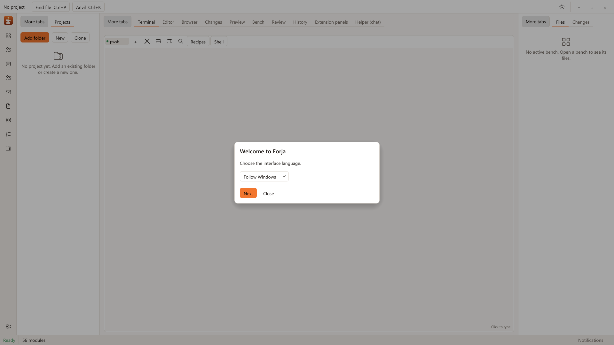

# Onboarding — Boas-vindas e escolha de idioma

Tela de primeiro uso exibida sobre a janela principal, em que a pessoa escolhe o idioma da interface e avança pela configuração inicial da Forja.

Variante da página de referência (pt-BR.dark.open.onboarding): mesma estrutura, com textos em inglês (locale "en"), tema claro e captura em 1920×1080. As faixas de abas expõem aqui um botão "More tabs" (menu de estouro com as abas que não couberam), o painel direito mostra só as abas visíveis "Files" e "Changes", e o cartão tem um botão "Close" além de "Next".

## Como chegar
Abertura direta pela linha de comando: `forja-app --locale en --theme light --open onboarding`. No app normal, a tela aparece na primeira execução (quando ainda não há projeto) e pode ser retomada pelos ajustes (botão "Settings" no rodapé do trilho à esquerda, retângulo (8,1004)–(44,1040)).

## Regiões
- **Barra superior** — (0,0)–(1920,42): à esquerda o rótulo "No project" e os botões "Find file  Ctrl+P" e "Anvil  Ctrl+K"; à direita o botão sem nome acessível com ícone de sol (alternar tema), seguido dos botões de janela "–", "□" e "×".
- **Trilho à esquerda** — (0,42)–(56,1048): o logotipo (imagem sem nome acessível em (12,50)–(40,78)) e uma coluna de botões de ícone: "Board", "Helpers", "Routines", "Muster", "Requests", "Skills", "Usage", "Extensions" e "Archive", com "Settings" fixado no rodapé.
- **Painel lateral esquerdo (Projects)** — (56,42)–(304,1048): faixa de abas com "More tabs" e a aba "Projects" (marcada); abaixo, os botões "Add folder", "New" e "Clone"; mais abaixo, um ícone de pasta e a mensagem "No project yet. Add an existing folder or create a new one."
- **Área central (Terminal + cartão de onboarding)** — (320,42)–(1612,1048): faixa de abas com "More tabs" e as abas "Terminal" (marcada), "Editor", "Browser", "Changes", "Preview", "Bench", "Review", "History", "Extension panels" e "Helper (chat)"; barra do terminal com o separador "+", quatro botões de ícone sem nome acessível e os botões "Recipes" e "Shell"; aba de sessão "pwsh" (sem nome acessível) e a área do terminal em (328,150)–(1604,1036), vazia, com a dica "Click to type" no canto inferior direito. Sobre o terminal, o cartão de onboarding (aprox. (735,445)–(1185,635)) com o título "Welcome to Forja", o texto "Choose the interface language.", a caixa de seleção de idioma mostrando "Follow Windows" e os botões "Next" e "Close".
- **Painel lateral direito (Files)** — (1628,42)–(1920,1048): faixa de abas com "More tabs", "Files" (marcada) e "Changes"; as demais abas da referência ("Helper (chat)", "Busca", "Portas" e "Painéis de extensões") ficam no menu "More tabs"; abaixo, um ícone de grade (rótulo "(ícone)" em (1756,117)–(1784,145)) e a mensagem "No active bench. Open a bench to see its files."
- **Barra de status** — (0,1048)–(1920,1080): "Ready" à esquerda em verde, "56 modules" ao lado e "Notifications" à direita.

## Elementos
| Elemento | Tipo | Posição (px) | Estado | O que faz |
|---|---|---|---|---|
| "Find file  Ctrl+P" | Button | (99,5)–(218,37) | — | Busca rápida de arquivo pelo comando Ctrl+P |
| "Anvil  Ctrl+K" | Button | (226,5)–(327,37) | — | Paleta de comandos (Ctrl+K) |
| (sem nome acessível) | Unknown | (1741,5)–(1773,37) | — | Ícone de sol: alterna tema claro/escuro |
| "–" | Button | (1795,5)–(1827,37) | — | Minimiza a janela |
| "□" | Button | (1835,5)–(1867,37) | — | Maximiza/restaura a janela |
| "×" | Button | (1875,5)–(1909,37) | — | Fecha a janela |
| "No project" | Label | (11,12)–(77,31) | — | Mostra que nenhum projeto está aberto; clicável |
| (sem nome acessível) | Unknown | (304,42)–(320,1048) | foco | Separador vertical entre o painel esquerdo e a área central |
| (sem nome acessível) | Unknown | (1612,42)–(1628,1048) | foco | Separador vertical entre a área central e o painel direito |
| (sem nome acessível) | Image | (12,50)–(40,78) | — | Logotipo da Forja no topo do trilho |
| "More tabs" | Button | (64,50)–(151,85) | — | Estouro da faixa de abas do painel esquerdo: abre o menu com as abas que não couberam |
| "More tabs" | Button | (324,50)–(411,85) | — | Estouro da faixa de abas da área central |
| "More tabs" | Button | (1632,50)–(1719,85) | — | Estouro da faixa de abas do painel direito: guarda as abas que não couberam |
| "Projects" | Button | (159,52)–(231,84) | marcado=True | Aba ativa do painel esquerdo: lista de projetos |
| "Terminal" | Button | (419,52)–(496,84) | marcado=True | Aba ativa da área central: terminal |
| "Editor" | Button | (496,52)–(556,84) | marcado=False | Alterna a área central para o editor |
| "Browser" | Button | (556,52)–(629,84) | marcado=False | Alterna para a vista de navegador |
| "Changes" | Button | (629,52)–(706,84) | marcado=False | Alterna para a vista de diferenças |
| "Preview" | Button | (706,52)–(777,84) | marcado=False | Alterna para o visualizador de arquivos |
| "Bench" | Button | (777,52)–(838,84) | marcado=False | Alterna para a vista de bancada |
| "Review" | Button | (838,52)–(905,84) | marcado=False | Alterna para a vista de revisão |
| "History" | Button | (905,52)–(973,84) | marcado=False | Alterna para o histórico |
| "Extension panels" | Button | (973,52)–(1099,84) | marcado=False | Aba de painéis de extensões da área central |
| "Helper (chat)" | Button | (1099,52)–(1202,84) | marcado=False | Aba do chat com o ajudante da área central |
| "Files" | Button | (1727,52)–(1778,84) | marcado=True | Aba ativa do painel direito: arquivos da bancada |
| "Changes" | Button | (1778,52)–(1855,84) | marcado=False | Aba de mudanças (diffs) do painel direito |
| "Board" | Button | (8,94)–(44,130) | marcado=False | Ícone do trilho: abre o quadro |
| "Add folder" | Button | (64,101)–(154,133) | — | Destaque laranja: adiciona uma pasta como projeto |
| "New" | Button | (162,101)–(213,133) | — | Cria um projeto novo |
| "Clone" | Button | (221,101)–(280,133) | — | Clona um repositório como projeto |
| "+" | Button | (407,113)–(441,145) | — | Nova aba/sessão de terminal |
| (sem nome acessível) | Unknown | (444,113)–(476,145) | — | Ícone de encerrar sessão (X) |
| (sem nome acessível) | Unknown | (479,113)–(511,145) | — | Ícone de limpar terminal |
| (sem nome acessível) | Unknown | (514,113)–(546,145) | — | Ícone de dividir terminal |
| (sem nome acessível) | Unknown | (549,113)–(581,145) | — | Ícone de busca no terminal (lupa) |
| "Recipes" | Button | (584,113)–(655,145) | — | Alterna o painel de receitas do terminal |
| "Shell" | Button | (658,113)–(711,145) | — | Alterna o painel de shell |
| (ícone) | Label | (1756,117)–(1784,145) | — | Ícone de grade do painel Files vazio |
| (sem nome acessível) | Unknown | (328,118)–(404,140) | — | Aba da sessão "pwsh" com ponto verde de sessão ativa |
| (sem nome acessível) | Unknown | (385,121)–(401,137) | — | X de fechar da aba "pwsh" |
| "Helpers" | Button | (8,138)–(44,174) | marcado=False | Ícone do trilho: abre os ajudantes |
| (sem nome acessível) | Unknown | (328,150)–(1604,1036) | — | Área do terminal (vazia, com a dica "Click to type" no canto inferior direito) |
| "No active bench. Open a bench to see its files." | Label | (1644,153)–(1896,191) | — | Mensagem de estado vazio do painel Files |
| (ícone) | Label | (168,161)–(196,189) | — | Ícone de pasta do painel Projects vazio |
| "Routines" | Button | (8,182)–(44,218) | marcado=False | Ícone do trilho: abre as rotinas |
| "No project yet. Add an existing folder or create a new one." | Label | (67,197)–(297,235) | — | Mensagem de estado vazio do painel Projects |
| "Muster" | Button | (8,226)–(44,262) | marcado=False | Ícone do trilho: abre o mutirão |
| "Requests" | Button | (8,270)–(44,306) | marcado=False | Ícone do trilho: abre os pedidos |
| "Skills" | Button | (8,314)–(44,350) | marcado=False | Ícone do trilho: abre as skills |
| "Usage" | Button | (8,358)–(44,394) | marcado=False | Ícone do trilho: abre o uso |
| "Extensions" | Button | (8,402)–(44,438) | marcado=False | Ícone do trilho: abre as extensões |
| "Archive" | Button | (8,446)–(44,482) | marcado=False | Ícone do trilho: abre o acervo |
| "Welcome to Forja" | Label | (750,461)–(893,485) | — | Título do cartão de onboarding |
| "Choose the interface language." | Label | (750,501)–(941,520) | — | Instrução do passo de idioma |
| "Follow Windows" | ComboBox | (750,536)–(903,568) | — | Caixa de seleção de idioma; "Follow Windows" segue o idioma do sistema |
| (sem nome acessível) | Unknown | (960,540)–(960,540) | — | Elemento de tamanho zero associado à seleção de idioma |
| "Next" | Button | (750,588)–(803,620) | — | Botão laranja de destaque: segue para o próximo passo do onboarding |
| "Close" | Button | (811,588)–(868,620) | — | Fecha o onboarding sem avançar |
| "Settings" | Button | (8,1004)–(44,1040) | marcado=False | Ícone do rodapé do trilho: abre os ajustes |
| "Ready" | Label | (10,1055)–(48,1074) | — | Estado geral, em verde, na barra de status |
| "56 modules" | Label | (70,1055)–(142,1074) | — | Contagem de módulos carregados |
| "Notifications" | Label | (1808,1055)–(1886,1074) | — | Atalho de notificações na barra de status |

## Aparência
Tema claro: janela, barras e painéis em branco e cinza-claro; a área do terminal em branco; o cartão de onboarding em branco com cantos arredondados e sombra suave sobre o terminal. A cor de destaque é o laranja (paleta "Brasa"), aplicada aos botões "Next" e "Add folder" (texto branco sobre laranja), ao texto e à sublinha das abas marcadas ("Projects", "Terminal", "Files") e, em verde, ao estado "Ready" da barra de status e ao ponto de sessão da aba "pwsh". Tipografia sem serifa em dois níveis: títulos e botões em quase-preto, mensagens secundárias e estados vazios em cinza médio. Os textos de estado vazio ("No project yet...", "No active bench...") são centralizados verticalmente no painel, acompanhados do ícone correspondente. O trilho à esquerda tem botões de ícone de 36 px com espaçamento uniforme; a barra de status usa fonte menor. Em relação à referência escura, inverte-se a paleta (fundo claro com texto escuro); hierarquia e destaque laranja se mantêm.

## Problemas encontrados
- O botão de alternar tema (ícone de sol, (1741,5)–(1773,37)) está sem nome acessível.
- Os quatro botões de ícone da barra do terminal — encerrar (X), limpar, dividir e buscar — ((444,113)–(476,145), (479,113)–(511,145), (514,113)–(546,145), (549,113)–(581,145)) estão sem nome acessível.
- A aba de sessão "pwsh" ((328,118)–(404,140)) e seu X de fechar ((385,121)–(401,137)) estão sem nome acessível.
- O elemento associado à seleção de idioma está sem nome acessível e tem tamanho zero ((960,540)–(960,540)).
- Três botões compartilham o mesmo nome acessível "More tabs" ((64,50)–(151,85), (324,50)–(411,85) e (1632,50)–(1719,85)), sem indicar a qual faixa de abas pertencem.
- A dica "Click to type", no canto inferior direito do terminal, é pequena e está em cinza-claro sobre fundo branco — baixo contraste.
