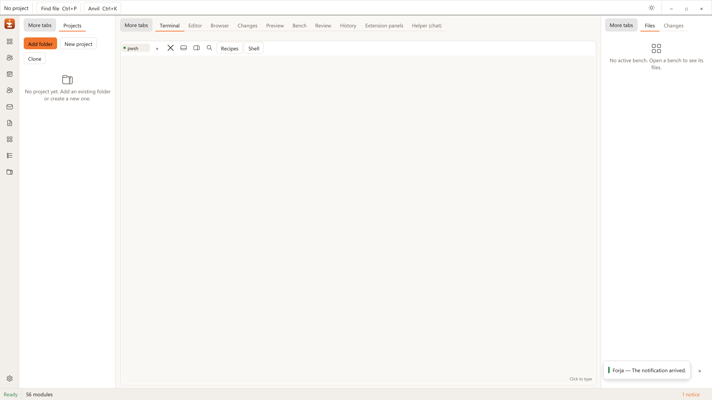

# Notificação (toast)

Captura da janela principal com uma notificação (toast) aberta no canto inferior direito; o restante da tela mostra o estado inicial sem projeto, com o painel Terminal ativo ao centro.

Variante em inglês ("en") e tema claro da página de referência (pt-BR.dark.open.toast): a estrutura e a disposição são as mesmas; mudam os textos (agora em inglês), a paleta (fundos creme claros com texto escuro, em vez de marrom-escuro) e o tamanho da janela capturada (1920×1080 px; na referência, 1280×800). Com os nomes curtos em inglês, todas as abas cabem em suas barras — não ocorrem os cortes e sobreposições registrados na referência.

## Como chegar
Na janela principal, dispare uma notificação (o alvo desta captura é o toast aberto sobre o painel direito). Comando de captura: `forja-app --locale en --theme light --open toast`.

## Regiões
- **Barra superior** — (0,0)–(1920,42): rótulo "No project" à esquerda, botões "Find file  Ctrl+P" e "Anvil  Ctrl+K", alternador de tema (ícone de sol, sem nome acessível) e os botões de janela "–", "□" e "×" à direita.
- **Trilho à esquerda** — (0,42)–(52,1048): logotipo da Forja (12,50)–(40,78) e, de cima para baixo, "Board", "Helpers", "Routines", "Muster", "Requests", "Skills", "Usage", "Extensions", "Archive" e, no fim, "Settings".
- **Painel esquerdo (Projetos)** — (52,42)–(304,1048): botão "More tabs" e aba "Projects" (marcada); botões "Add folder" (destaque laranja), "New" e "Clone"; estado vazio com ícone de pasta (168,161)–(196,189) e o texto "No project yet. Add an existing folder or create a new one.".
- **Área central (Terminal)** — (320,42)–(1612,1048): botão "More tabs" e abas "Terminal" (marcada), "Editor", "Browser", "Changes", "Preview", "Bench", "Review", "History", "Extension panels" e "Helper (chat)"; barra do terminal com a aba da sessão "pwsh" (com ponto verde), botão "+", quatro botões de ícone sem nome acessível e os filtros "Recipes" e "Shell"; área vazia do terminal (328,150)–(1604,1036) com a dica "Click to type" no canto inferior direito.
- **Painel direito (Arquivos)** — (1628,42)–(1920,1048): botão "More tabs" e abas "Files" (marcada) e "Changes"; estado vazio com ícone de grade (1756,117)–(1784,145) e o texto "No active bench. Open a bench to see its files."; sobre a base do painel, o toast (1627,974)–(1904,1040) com "Forja — The notification arrived." e botão de fechar "×".
- **Barra de status** — (0,1048)–(1920,1080): "Ready" à esquerda, "56 modules" ao lado e "1 notice" em laranja à direita.

## Elementos
| Elemento | Tipo | Posição (px) | Estado | O que faz |
|---|---|---|---|---|
| "No project" | Label | (11,12)–(77,31) | — | Indica que não há projeto aberto. |
| "Find file  Ctrl+P" | Button | (99,5)–(218,37) | — | Abre a busca rápida de arquivos (Ctrl+P). |
| "Anvil  Ctrl+K" | Button | (226,5)–(327,37) | — | Abre a paleta de comandos (Ctrl+K). |
| (sem nome acessível) | Unknown | (1741,5)–(1773,37) | — | Botão de alternância de tema (ícone de sol); alterna para o tema escuro. |
| "–" | Button | (1795,5)–(1827,37) | — | Minimiza a janela. |
| "□" | Button | (1835,5)–(1867,37) | — | Maximiza/restaura a janela. |
| "×" | Button | (1875,5)–(1909,37) | — | Fecha a janela. |
| (sem nome acessível) | Unknown | (304,42)–(320,1048) | — | Divisor arrastável entre o painel esquerdo e a área central. |
| (sem nome acessível) | Unknown | (1612,42)–(1628,1048) | — | Divisor arrastável entre a área central e o painel direito. |
| (sem nome acessível) | Image | (12,50)–(40,78) | — | Logotipo da Forja no topo do trilho. |
| "More tabs" | Button | (64,50)–(151,85) | — | Menu de abas em excesso do painel esquerdo. |
| "More tabs" | Button | (324,50)–(411,85) | — | Menu de abas em excesso da área central. |
| "More tabs" | Button | (1632,50)–(1719,85) | — | Menu de abas em excesso do painel direito. |
| "Projects" | Button | (159,52)–(231,84) | marcado=True | Aba ativa do painel esquerdo; mostra a lista de projetos. |
| "Terminal" | Button | (419,52)–(496,84) | marcado=True | Aba ativa da área central; mostra o terminal. |
| "Editor" | Button | (496,52)–(556,84) | marcado=False | Mostra o editor na área central. |
| "Browser" | Button | (556,52)–(629,84) | marcado=False | Mostra o navegador de conteúdo na área central. |
| "Changes" | Button | (629,52)–(706,84) | marcado=False | Mostra a visão de diferenças na área central. |
| "Preview" | Button | (706,52)–(777,84) | marcado=False | Mostra o visualizador de arquivos. |
| "Bench" | Button | (777,52)–(838,84) | marcado=False | Mostra a visão da bancada. |
| "Review" | Button | (838,52)–(905,84) | marcado=False | Mostra a visão de revisão. |
| "History" | Button | (905,52)–(973,84) | marcado=False | Mostra o histórico. |
| "Extension panels" | Button | (973,52)–(1099,84) | marcado=False | Mostra os painéis de extensões na área central. |
| "Helper (chat)" | Button | (1099,52)–(1202,84) | marcado=False | Mostra o chat do ajudante na área central. |
| "Files" | Button | (1727,52)–(1778,84) | marcado=True | Aba ativa do painel direito; lista de arquivos da bancada. |
| "Changes" | Button | (1778,52)–(1855,84) | marcado=False | Mostra as mudanças da bancada no painel direito. |
| "Board" | Button | (8,94)–(44,130) | marcado=False | Ícone do trilho: abre o quadro. |
| "Add folder" | Button | (64,101)–(154,133) | — | Abre o seletor para adicionar uma pasta de projeto. |
| "New" | Button | (162,101)–(213,133) | — | Cria um novo projeto. |
| "Clone" | Button | (221,101)–(280,133) | — | Clona um repositório como novo projeto. |
| "+" | Button | (407,113)–(441,145) | — | Abre nova aba/instância de terminal. |
| (sem nome acessível) | Unknown | (444,113)–(476,145) | — | Botão de ícone da barra do terminal (encerra a sessão ativa). |
| (sem nome acessível) | Unknown | (479,113)–(511,145) | — | Botão de ícone da barra do terminal (maximiza o painel do terminal). |
| (sem nome acessível) | Unknown | (514,113)–(546,145) | — | Botão de ícone da barra do terminal (divide o terminal). |
| (sem nome acessível) | Unknown | (549,113)–(581,145) | — | Botão de ícone da barra do terminal (busca no terminal). |
| "Recipes" | Button | (584,113)–(655,145) | — | Alterna o filtro de receitas do terminal. |
| "Shell" | Button | (658,113)–(711,145) | — | Alterna o filtro de shells do terminal. |
| (sem nome acessível) | Unknown | (328,118)–(404,140) | — | Aba da sessão de terminal "pwsh", com indicador de status. |
| (sem nome acessível) | Unknown | (385,121)–(401,137) | — | Ponto verde de status dentro da aba "pwsh". |
| "Helpers" | Button | (8,138)–(44,174) | marcado=False | Ícone do trilho: abre os ajudantes de código. |
| (sem nome acessível) | Unknown | (328,150)–(1604,1036) | — | Área do terminal (vazia); clique concentra o teclado; mostra a dica "Click to type" no canto inferior direito. |
| "No active bench. Open a bench to see its files." | Label | (1644,153)–(1896,191) | — | Estado vazio do painel de arquivos. |
| (ícone) | Label | (168,161)–(196,189) | — | Ícone de pasta do estado vazio do painel de projetos. |
| "Routines" | Button | (8,182)–(44,218) | marcado=False | Ícone do trilho: abre as rotinas. |
| "No project yet. Add an existing folder or create a new one." | Label | (67,197)–(297,235) | — | Estado vazio do painel de projetos. |
| "Muster" | Button | (8,226)–(44,262) | marcado=False | Ícone do trilho: abre o mutirão. |
| "Requests" | Button | (8,270)–(44,306) | marcado=False | Ícone do trilho: abre os pedidos. |
| "Skills" | Button | (8,314)–(44,350) | marcado=False | Ícone do trilho: abre as skills. |
| "Usage" | Button | (8,358)–(44,394) | marcado=False | Ícone do trilho: abre o uso. |
| "Extensions" | Button | (8,402)–(44,438) | marcado=False | Ícone do trilho: abre as extensões. |
| "Archive" | Button | (8,446)–(44,482) | marcado=False | Ícone do trilho: abre o acervo. |
| (sem nome acessível) | Unknown | (960,540)–(960,540) | — | Elemento de dimensão zero no centro da janela; sem efeito visível. |
| (sem nome acessível) | Unknown | (1627,974)–(1904,1040) | — | Contêiner do toast no canto inferior direito. |
| "×" | Button | (1870,983)–(1904,1015) | — | Fecha o toast. |
| "Forja — The notification arrived." | Label | (1652,990)–(1849,1009) | — | Texto da notificação, com barra vertical laranja à esquerda. |
| "Settings" | Button | (8,1004)–(44,1040) | marcado=False | Ícone do trilho: abre os ajustes. |
| "Ready" | Label | (10,1055)–(48,1074) | — | Estado geral na barra de status. |
| "56 modules" | Label | (70,1055)–(142,1074) | — | Quantidade de módulos carregados. |
| "1 notice" | Label | (1840,1055)–(1886,1074) | — | Contador de avisos, em laranja. |

## Aparência
Tema claro com fundos creme/off-white (tons próximos de #f7f2ea) na barra superior, no trilho e nos painéis; a área do terminal é um branco levemente mais claro, contornada por borda fina bege, e divisórias finas bege-acinzentadas separam as regiões. O texto é escuro (marrom-acinzentado), com bom contraste sobre os fundos claros. A cor de destaque é o laranja (Brasa): fundo do botão "Add folder" (texto branco), sublinhado e texto das abas marcadas ("Projects", "Terminal", "Files"), barra vertical do toast e o contador "1 notice" na barra de status. Tipografia sem serifa em dois tamanhos: rótulos de interface (~15 px) e textos de apoio em cinza médio; os atalhos ("Ctrl+P", "Ctrl+K") aparecem em cinza mais apagado dentro dos botões da barra superior. Ícones do trilho são monocromáticos em cinza-escuro, alinhados em coluna única de 36 px. O estado vazio é centrado (ícone acima do texto) nos painéis de projetos e arquivos; o terminal exibe a dica "Click to type" em cinza claro alinhada ao canto inferior direito. O toast tem fundo claro do tom de painel, barra vertical laranja à esquerda do texto e leve sombra sobre o painel. Em relação à referência (pt-BR, tema escuro), invertem-se fundos e texto (claro ↔ escuro) mantendo o mesmo laranja de destaque; o ponto de status "pwsh" segue verde nas duas variantes.

## Problemas encontrados
- O botão de alternância de tema (1741,5)–(1773,37) e os quatro botões de ícone da barra do terminal ((444,113) a (581,145)) não têm nome acessível.
- Os dois divisores arrastáveis ((304,42)–(320,1048) e (1612,42)–(1628,1048)) recebem foco por teclado, mas não têm nome acessível.
- Há dois botões nomeados apenas "×" (fechar janela em (1875,5) e fechar toast em (1870,983)), o que os torna ambíguos para leitores de tela.
- Três botões compartilham o nome "More tabs" ((64,50), (324,50) e (1632,50)) sem indicar a qual painel pertencem.
- O texto "Click to type", visível no canto inferior direito da área do terminal, não aparece na árvore de acessibilidade.
- Elemento de dimensão zero (960,540)–(960,540) sem nome na área central.
